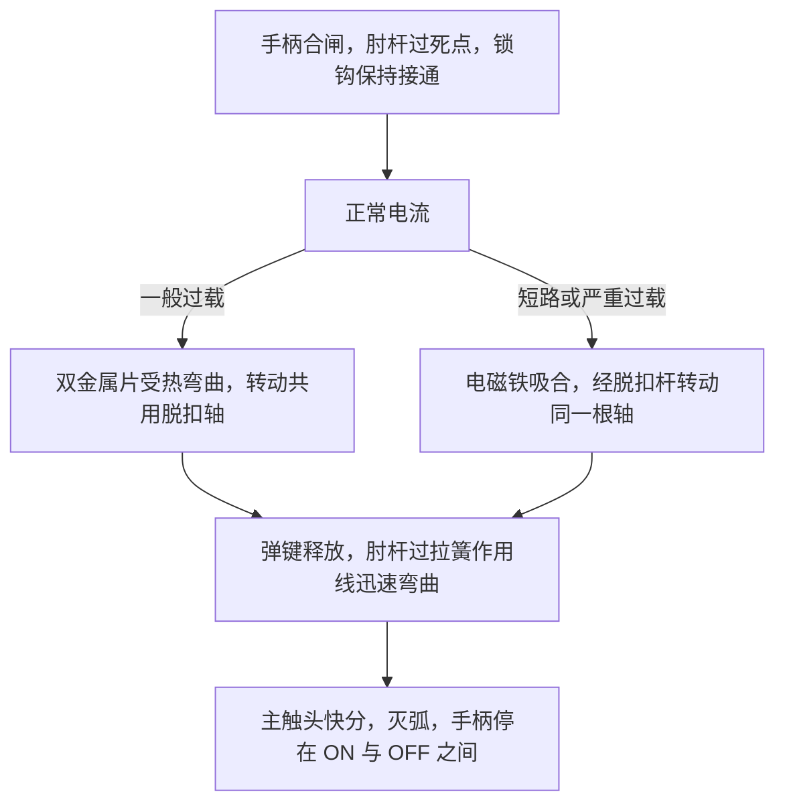

# 热磁脱扣断路器：双金属片过载延时、电磁铁短路瞬时，经自由脱扣机构分断触头

> [!summary] 一句话概述
> 热磁式断路器在合闸后靠锁钩把主触头保持在接通位置：一般过载时，电流还不足以让电磁脱扣动作，但热元件让双金属片弯曲，推动杠杆使搭钩脱开，主触头在反力弹簧作用下分断；短路或严重过载时，电流超过瞬时整定值，电磁铁吸合撞击杠杆，同样让锁扣脱开，迅速切断电路。三菱资料还说明开关机构用肘杆和拉簧实现快速闭合、快速分断和自由脱扣，脱扣后手柄停在 ON 与 OFF 之间，且各极的双金属片和电磁铁都作用到同一根共用脱扣轴，任何一极过流都会让所有极同时分断。它不是只能熔断一次的保险丝，也不是电子采样的剩余电流保护器。

## 配图

![[附件/breaker-mitsu-p20.png]]
*图源：三菱电机《塑壳断路器 技术资料》结构和动作章，塑壳断路器结构范例（灭弧装置、开关机构、手柄、过流脱扣装置、触点和端子）*

![[附件/breaker-mitsu-p30.png]]
*图源：同上，开关机构与过流脱扣说明页：拉簧作用线、脱扣时手柄位于 ON 与 OFF 之间，以及热动电磁式双金属片和电磁铁*

![[附件/breaker-dgjs-01.jpg]]
*图源：[电工天下，《空气开关的工作原理与原理图》，2019-08-29](https://www.dgjs123.com/kg/d4973.htm) 原理示意图，仅作中文教学图对照；内部尺寸以三菱结构图为准*

> 图片版权归原作者所有，仅作个人学习收藏；出处见文末「来源与核实记录」。

## 结构原理

> 本节所有数字只写来源里给出的；来源没有就写「来源未给出」。

### 堆叠方案

方向：**从操作手柄到主触头与脱扣检测件**

| 层级 | 零件 | 材料 | 厚度/尺寸 | 固定方式 | 依据 |
| --- | --- | --- | --- | --- | --- |
| L1 | 手柄 | 来源未给出 | 来源未给出 | 扳到 ON / OFF；脱扣后停在中间 | 三菱 2.1.2 |
| L2 | 开关机构（肘杆、拉簧、承载器、托架） | 来源未给出 | 来源未给出 | 预储弹簧力，实现快合、快分和自由脱扣 | 三菱 2.1.1、2.1.2 |
| L3 | 锁钩 / 弹键与共用脱扣轴 | 来源未给出 | 来源未给出 | 合闸后把触头锁在接通位置；脱扣轴转动后释放 | 电工天下；三菱 2.1.3 |
| L4a | 双金属片（各极） | 双金属，牌号来源未给出 | 来源未给出 | 过载受热沿规定方向弯曲，转动脱扣轴 | 电工天下；三菱 |
| L4b | 电磁铁（各极） | 静铁芯包裹导体、动铁芯、拉簧 | 来源未给出 | 电流超过限度时吸合动铁芯，经脱扣杆转轴 | 三菱；电工天下 |
| L5 | 主触头与共用横杆 | 触头材料来源未给出；横杆为绝缘体 | 来源未给出 | 各极触头固定在一根共用横杆上同时通断 | 三菱 |
| L6 | 灭弧装置与塑壳 | 来源未给出 | 来源未给出 | 分断电弧；塑壳把上述零件合成一体 | 三菱 2.1.1；电工天下提到灭弧罩和磁吹，未给出结构尺寸 |

剖面示意：

电工天下把脱扣方式分为热动、电磁和复式三种；日常所说「空开」多为热、磁都有的复式脱扣。文中还提到欠压脱扣：电压正常时电磁吸力吸住衔铁，电压严重下降或断电时释放，撞击杠杆分断。三菱本页讨论的是一般无熔丝断路器的热动电磁型过流脱扣，并把液压电磁型单列，本文不把液压型写进主结构。

三菱强调的机构特点：

1. **快速闭合、快速分断**：手柄过死点后由拉簧驱动，与操作速度无关，有利于防止触头熔敷、保证各极同时接通。
2. **脱扣显示**：手柄停在 ON 与 OFF 之间；复位需先向 OFF 方向拉过，使托架与承载器重新接合。
3. **自由脱扣（trip free）**：即使把手柄按在 ON，也不妨碍脱扣。
4. **共用拉簧与共用横杆**：多极电气隔离，但机械上同时通断，避免缺相。
5. **断路（绝缘）功能**：触点未断开时，手柄不能显示 OFF；不能靠强行把手柄扳到 OFF 来假装已经隔离。

电工天下有一段把过热保护说成「空气膨胀把开关推成断路」，与同一篇文章前面的双金属片叙述矛盾，属于错误通俗解释，本文不采用。

### 零件清单

| 零件 | 数量 | 功能 | 材料 | 依据 |
| --- | --- | --- | --- | --- |
| 塑壳与上盖 | 1 套 | 绝缘外壳并固定内部零件 | 来源未给出牌号 | 三菱图 2-1 |
| 手柄与开关机构 | 1 套 | 合闸、分闸、自由脱扣和脱扣显示 | 来源未给出 | 三菱 |
| 双金属片 | 每极 1 | 过载延时脱扣 | 双金属 | 电工天下；三菱 |
| 电磁铁 | 每极 1 | 短路瞬时脱扣 | 铁芯 + 拉簧 | 三菱 |
| 共用脱扣轴、弹键、承载器、托架 | 1 套 | 任一极动作则整机脱扣 | 来源未给出 | 三菱 |
| 主触头与共用横杆 | 每极触头 + 1 根横杆 | 同时通断电路 | 横杆为绝缘体 | 三菱 |
| 灭弧装置 | 每极 | 分断电弧 | 来源未给出 | 三菱；电工天下 |
| 端子 | 进出线各一组 | 接线 | 来源未给出 | 三菱 |

### 装配顺序

来源没有给出工厂装配步骤。操作与复位（三菱）：

1. 将手柄扳到 ON 或 OFF，由拉簧过死点完成快合或快分。
2. 脱扣后手柄在中间，必须先扳向 OFF 完成复位，才能再次合闸。
3. 不要在未确认触头已分断时，把中间位置的手柄当成已经隔离。
4. 电工天下提醒：断路器与隔离开关的重要区别是自动脱扣和灭弧能力；反接可能影响灭弧，接线应按规定方向。

### 受力与运动分析

- **受力路径（过载）**：过载电流在热元件上发热 → 双金属片弯曲 → 推动杠杆或共用脱扣轴 → 搭钩与锁扣脱开 → 反力弹簧 / 肘杆拉簧分断触头。弯曲需要时间，所以过载是延时的。
- **受力路径（短路）**：大电流在电磁铁中产生吸力，克服动铁芯拉簧，撞击脱扣杆，瞬时释放同一套锁扣。
- **运动关系**：检测件只负责「解开锁」，分断速度由预储的弹簧和肘杆决定，与当时是否还按着手柄无关（自由脱扣）。
- **失效风险**：把电子漏电保护器和热磁脱扣混成同一机构；忽视自由脱扣，以为按住手柄就能强迫送电；触头熔焊或灭弧失效；用错误的过热「空气膨胀」模型去做热计算。已打开资料未给出具体安培和分断千安数，本文不编造。

## 设计要点与参数

| 要点 | 内容 | 依据 |
| --- | --- | --- |
| 过载保护 | 双金属片热弯曲，延时脱扣 | 电工天下；三菱 |
| 短路保护 | 电磁铁瞬时吸合脱扣 | 电工天下；三菱 |
| 锁扣 | 合闸后由锁钩保持；脱扣后由弹簧分断 | 电工天下 |
| 自由脱扣 | 手柄限制在 ON 也不妨碍脱扣 | 三菱 |
| 脱扣显示 | 手柄位于 ON 与 OFF 之间 | 三菱 |
| 多极同步 | 各极检测件作用到共用脱扣轴，触头装在共用横杆上 | 三菱 |
| 适用标准（三菱资料） | IEC 60947-2（该手册声明） | 三菱 |
| 额定电流、分断能力、脱扣曲线 | 已打开的这两份资料未给出可直接引用的完整表，来源未给出 | — |

## 优缺点

**优点**
- 过载用热延时、短路用电磁瞬时，一套锁扣完成分断，脱扣后还可以再合闸
- 自由脱扣和中间位置显示，避免「按着手柄继续送电」或误判已经隔离
- 各极机械联动，降低缺相风险

**缺点 / 代价**
- 热元件受周围温度影响，已打开资料没有给出补偿细节
- 分断能力和曲线要按具体型号选，不能只凭「有热有磁」代替短路计算
- 与漏电保护、电子脱扣不是同一条检测路径，不能互相替代

## 可借鉴点

- 把「检测」和「分断」分开设计：检测件只负责解锁，分断能量预存在弹簧里。
- 多极产品用共用脱扣轴和共用横杆，保证同时分断。
- 脱扣要有明确的中间位置，并规定复位路径，避免操作者误判。
- 解释过载保护时只用双金属片，不要用空气膨胀那种错误模型。

## 与库中相似案例对比

| 对比项 | 本案例（热磁脱扣断路器） | [[KSD301 突跳式温控器：蝶形双金属片到位后瞬间切换触点]] | [[PCB功率继电器：线圈吸合衔铁带动触点，线圈与触点高压隔离（以 Omron G2R 为例）]] | [[工业限位开关：在微动开关外面加防护壳和滚轮杠杆等致动器]] |
| --- | --- | --- | --- | --- |
| 触发量 | 过载发热或短路电流 | 被保护表面的温度 | 控制线圈电压 | 外部机械位移 |
| 分断机构 | 锁扣 + 预储弹簧 + 灭弧 | 碟片翻转直接改触点 | 衔铁带动触点，无灭弧罩级分断能力 | 微动快动，不承担配电分断 |
| 何时用这篇 | 要理解配电断路器为什么能延时又瞬时 | 要做温度开关，不是配电保护 | 要用弱电切强电，但不是过流保护 | 只要位置信号 |

## 相关案例

- [[KSD301 突跳式温控器：蝶形双金属片到位后瞬间切换触点]]
- [[PCB功率继电器：线圈吸合衔铁带动触点，线圈与触点高压隔离（以 Omron G2R 为例）]]
- 分类索引：[[04-机构与运动 索引]]

## 来源与核实记录

- 主来源：[电工天下，老电工，《空气开关的工作原理与原理图》，2019-08-29](https://www.dgjs123.com/kg/d4973.htm)（2026-11-27 打开。双金属过载、电磁瞬时、锁扣和反力弹簧来自该文。同文后半段空气膨胀说不采用。）
- 交叉来源：三菱电机塑壳断路器技术资料（2026-11-27 下载并提取「2. 结构和动作」。结构范例、肘杆机构、自由脱扣、共用脱扣轴和热动电磁式分解来自该 PDF。已保存文件为 mitsubishi-mccb.pdf。）
- 核实：2026-11-27 打开上述来源。未编造额定电流、分断能力和脱扣曲线。
