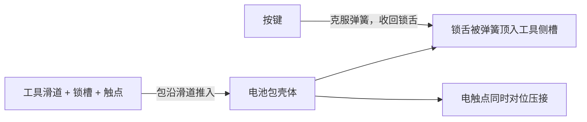

# 电动工具电池包：滑轨插入与按压锁舌（得伟拆解）

> [!summary] 一句话概述
> 手持电动工具的可换电池包，典型动作是：包体沿工具上的滑道推到位，锁舌被弹簧顶进工具侧的槽里，电触点同时对上；要取下时按按钮，按钮带动锁舌缩回，再沿滑道抽出。充电头网拆得伟 DCB184（铭牌 18V / 20V Max、6.0Ah、90Wh），前端是黑色按压开关，顶部是内凹插座和卡扣，外壳 4 颗螺丝；iFixit 拆 DCF840 所配电池时，同样先拧 4 颗螺丝，并明确标出「把电池锁在工具上的那根锁舌弹簧」。两只包不是同一型号，锁的细节不能混用，但机械逻辑一致。

## 配图

![[附件/dewalt-dcf840-tool-battery.jpg]]
*图源：[iFixit: Dewalt Impact driver DCF840 Teardown](https://www.ifixit.com/Teardown/Dewalt+Impact+driver+DCF840+Teardown/157490) Step 1；冲击起子与所配电池包外观，电池已滑在工具底部*

![[附件/dewalt-battery-latch-spring.jpg]]
*图源：同上 Step 9；打开电池壳后，橙圈标出锁舌弹簧，橙箭头标出壳上的按压部位（黄色按键）。文案：Remove four screws to open battery；Spring for latch to lock battery into tool*

![[附件/dewalt-battery-contacts.jpg]]
*图源：同上 Step 10；5 节电芯串联，插座侧一排夹片触点随机械对位与工具接触。标注电压为拆解者对这只包的说明，不能套到 DCB184 上*

> 图片版权归原作者所有，仅作个人学习收藏；出处见文末「来源与核实记录」。充电头网 DCB184 拆解里另有「内部按钮锁定结构特写」等原图，本批从该站及图片 CDN 下载失败，原文仍见主来源页，不以未成功保存的图作为配图。

## 结构原理

> 本节所有数字只写来源里给出的；来源没有就写「来源未给出」。

### 堆叠方案

方向：**从工具握把底部到电池包内部（按压锁舌类，不以某一只包的电芯数当通用）**

| 层级 | 零件 | 材料 | 厚度/尺寸 | 固定方式 | 依据 |
| --- | --- | --- | --- | --- | --- |
| L1（工具侧） | 工具底部的滑道与锁槽、电触点 | 来源未给出 | 来源未给出 | 与工具壳体一体或固定在壳内 | 充电头网：按压后可与取电工具分离；专利补充：滑入到既定位置后锁住 |
| L2 | 电池包外壳上的滑配面、前端按键、顶部插座 | DCB184：高温阻燃 PC | 充电头网实测这只包：长 117.77 mm、宽 75.71 mm、厚 58.40 mm | 顶盖与底座 4 颗螺丝 | 充电头网；iFixit 那只包同样 4 颗螺丝 |
| L3 | 锁舌 + 复位弹簧 + 按键 | 弹簧材料来源未给出 | 来源未给出几何尺寸 | 按键外露，弹簧在壳内把锁舌推向锁合位置 | iFixit Step 9；充电头网「内部按钮锁定结构」 |
| L4 | 夹片式插座 / 触点 | 来源未给出 | DCB184：内凹插座，孔旁有标识；iFixit 那只包标出多路触点 | 对位后与工具触点压接 | 两篇拆解 |
| L5 | 电芯组与保护板 | 见零件清单，两只包不同 | 见下 | 支架隔离、螺丝/焊线/点焊 | 两篇拆解 |

剖面示意：

专利 US7858219（Max Co.，不是得伟）在背景里概括过这类已有结构：把电池包沿既定位置滑入推紧，锁定装置卡进工具的接收部；按后面的钩或按两侧操作部，解除锁定后再抽出来。只用来对照「滑入 + 锁舌 + 按压解锁」这条逻辑，不把它写成得伟的量产零件图。

### 零件清单

| 零件 | 数量 | 功能 | 材料 | 依据 |
| --- | --- | --- | --- | --- |
| 外壳（顶盖 + 底座） | 1 套 | 滑配、承力、绝缘 | DCB184：高温阻燃 PC | 充电头网 |
| 外壳螺丝 | 4 | 固定壳体 | 来源未给出 | 两篇拆解 |
| 按键 / 锁舌 | 来源未给出具体件数 | 锁在工具上；按下解锁 | 来源未给出 | 充电头网；iFixit |
| 锁舌弹簧 | 至少 1（iFixit 照片中可见 1 根螺旋弹簧） | 使锁舌保持锁合 | 来源未给出 | iFixit Step 9 |
| 电触点 / 内凹插座 | 1 组 | 导电，并靠机械对位 | 来源未给出 | 两篇拆解。DCB184 强调内凹防短路 |
| 电芯（DCB184） | 10 节，5 串 2 并 | 储能 | 三星 SDI INR18650-25R，标称 2500 mAh / 3.6 V | 充电头网 |
| 电芯（iFixit 所拆那只） | 5 节串联 | 储能 | 来源未给出牌号；拆解者写标称约 3.7 V / 节 | iFixit Step 10 |
| 保护器件（DCB184） | BQ7718 等 | 过压监视等 | TI BQ7718 | 充电头网 |

### 装配顺序

装到工具上（综合两篇拆解的使用描述，不是厂方工艺卡）：

1. 把电池包沿工具底部滑道对准。
2. 向前推到尽头。锁舌在弹簧作用下进入工具侧槽，包被锁住；插座夹片与工具触点同时对上。
3. 取下时按下外露按键，锁舌缩回，再沿滑道抽出。

打开电池包（两例都是拆解顺序）：拧掉 4 颗螺丝，分开顶盖与底座，即可看到按键/锁舌和弹簧。充电头网在 DCB184 上还依次拆保护板、支架和电芯组（极耳镍片点焊，连接处打胶）。

> 装到工具上的步骤是按结构反推；打开壳体的步骤来自拆解。

### 受力与运动分析

- **受力路径**：工具自重和作业时的拉、扭、振动，经滑道限制横向和旋转，沿插入方向则由锁舌扛住「往外抽」的力。导电不靠锁舌，而靠对位后的夹片触点。
- **运动关系**：插入是沿滑道的平动；锁舌是受弹簧约束的弹入/缩回。按键行程要足以让锁舌完全退出工具侧槽，否则会一边按一边别着抽（推断，来源未给出行程数字）。
- **失效风险**：弹簧失效或锁舌磨损会导致包在振动中脱出（推断）。触点如果在锁舌尚未到位时就提前碰上，可能打火或偏磨；DCB184 用内凹插座降低被金属短路的风险。两只包电芯数不同，不能把 iFixit 的触点电压标注抄到 DCB184 上。

## 设计要点与参数

| 要点 | 内容 | 依据 |
| --- | --- | --- |
| DCB184 铭牌 | 18V（20V Max）、6.0Ah、90Wh；型号 DCB184 | 充电头网引用的底部参数。注意：标题写「5000mAh」，侧面照片说明写过「20V 2AH」，文末又写「标称容量 5000mAh，工作电压 20V」——与铭牌不完全一致，本表以铭牌为准，冲突留在核实记录里 |
| DCB184 外形与重量 | 长 117.77 mm，宽 75.71 mm，厚 58.40 mm；重量 628.4 g | 充电头网实测 |
| 电芯（DCB184） | 10 节 5S2P，INR18650-25R，标称 2500 mAh、3.6 V，最大放电 20 A（8C） | 充电头网（电芯数据来自其引用的规格，不是本仓库实测） |
| 外壳螺丝 | 两例都是 4 颗 | 充电头网；iFixit |
| iFixit 那只包的电气 | 满电约 20V，标称约 18.5 V；5 节标称约 3.7 V 串联；另标 0 V、12 V（作者猜测给灯环）、3.7 V（未接到工具）、两路 18.5 V | iFixit Step 8–10，只适用于那只包 |
| 锁的动作 | 弹簧把锁舌顶向锁合；按键解锁 | iFixit 原文；充电头网「下压按钮可以松开卡扣」 |
| 触点 | 随滑入机械对位；DCB184 插座内凹 | 两篇拆解 |

## 优缺点

**优点**
- 单手可以推入，到位后锁舌自动进槽，不必另拧一颗手钉
- 电触点跟机械对位走同一条滑道，插到位才导通
- 外壳螺丝打开就能看到锁和弹簧，锁结构本身并不依赖胶

**缺点 / 代价**
- 锁舌是整包留在工具上的关键，弹簧和钩的磨损会直接变成掉包
- 平台化之后，外壳滑道和锁槽要在整个工具系列里保持一致，改一处会影响整族配件
- 不同容量、不同串并联的包可能共用同一套滑道和锁，设计时不能把某一只包的电芯布局当成锁的几何依据

## 可借鉴点

- **先保证「滑到位」再让触点可靠接触**：用滑道管引导，用锁舌管防抽脱，不要让触点自己当定位销。
- **锁舌用弹簧保持常锁，按钮只做解锁**；按钮失效时默认应仍是锁住，而不是松开（从 iFixit 照片中的弹簧布置可以这样读，来源未用「失效安全」一词，标为推断）。
- **插座做成内凹**，降低钥匙串、金属屑把正负极短路的机会（充电头网对 DCB184 的说明）。
- **同一平台写清楚「机械接口相同、电气配置不同」**：拆解时不要把 5 串包和 5 串 2 并包的触点定义混成一张表。
- 外壳用少量螺丝而不是胶，锁和弹簧才修得了。

## 与库中相似案例对比

| 对比项 | 本案例 | [[Framework Laptop 16 Expansion Bay 滑出式显卡模块]] | [[任天堂 Switch Joy-Con 滑轨连接]] |
| --- | --- | --- | --- |
| 引导 | 电池包沿工具滑道推入 | 机身尾部贯通滑道，模块平推 | 手柄沿机身滑轨插入 |
| 锁紧 | 弹簧锁舌进槽，按键收回 | 几颗防丢螺丝 / Interposer | 弹簧锁扣（一代滑轨） |
| 电连接 | 夹片触点随机械对位 | 模块连接器 | 滑轨上的触点 |
| 取出 | 按键解锁后抽出 | 松开螺丝后推出 | 按键解锁后抽出 |

## 相关案例

- [[Framework Laptop 16 Expansion Bay 滑出式显卡模块]]
- [[任天堂 Switch Joy-Con 滑轨连接]]
- [[任天堂 Switch 2 Joy-Con 2 磁吸连接]]
- [[Mac Pro 2019 旋转把手外壳锁与免工具模块锁]]
- 分类索引：[[04-机构与运动 索引]]

## 来源与核实记录

- 主来源：[拆解报告：得伟5000mAh电动工具电池包（充电头网）](https://www.chongdiantou.com/archives/372241.html)（lingaoming，2024-09-09；DCB184 外观、按键与卡扣、4 颗螺丝、外形实测、电芯与保护板。铭牌 6.0Ah / 90Wh 与标题、文末「5000mAh」及文中「侧面 20V 2AH」表述冲突，引用时以铭牌照片说明为准）
- 补充来源 1：[iFixit: Dewalt Impact driver DCF840 Teardown](https://www.ifixit.com/Teardown/Dewalt+Impact+driver+DCF840+Teardown/157490)（Wieli 等，2023-01-29；Step 8–10 电池、4 颗螺丝、锁舌弹簧、5 串电芯与触点标注。与 DCB184 不是同一只包）
- 补充来源 2：[US7858219B2 Locking mechanism of battery pack](https://patents.google.com/patent/US7858219B2/en)（Max Co., Ltd.，授权 2010-12-28；背景中的滑入锁定与按压/按钩解锁，只作原理对照，不是得伟量产证明）
- 核实：2026-11-17 打开充电头网与 iFixit 页面及专利页。充电头网配图本批未能下载到附件库。未把同站 SKIL 拆解算作第二个独立机构。
