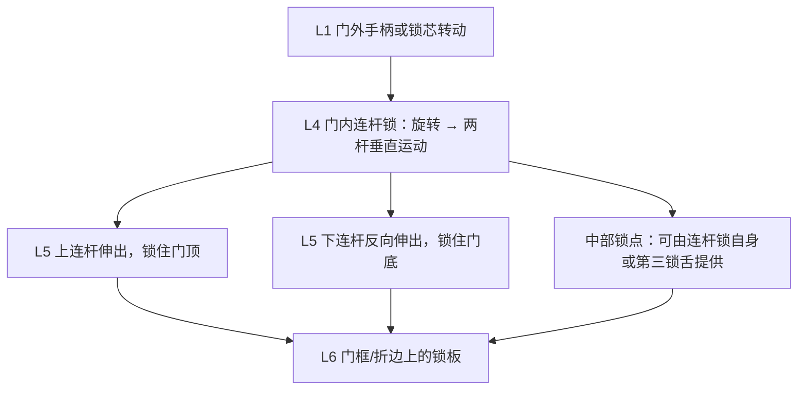

# 电柜三点连杆锁：一点把手驱动上下连杆把柜门多点锁在框上

> [!summary] 一句话概述
> 三点连杆锁用一个把手或锁芯，在门内侧通过连杆锁（杆控制器）把旋转变成上下两根杆的直线运动，让柜门在顶部、中部和底部同时扣住门框。EMKA 把它写成「杆控制器将轴向旋转运动转化为两根杆的垂直运动」；海坦则写成锁柄内凸轮带动上下传动杆反向伸出或缩回。单点转舌锁在高门板上压不均密封条，这是它要解决的问题。旋转把手（swinghandle）通常只是这套系统的操作端，不是另一种机构。

## 配图

![[附件/emka-heavy-rod-lock-exploded.jpg]]
*图源：[EMKA 2025 中文总目录](https://www.emka.com/fileadmin/catalog/catalog_downloads/pdf/zh/___________________CN_06-_2025_Web.pdf) 页码 2A-100「重型连杆锁・螺钉固定安装」；分解出 L/T 型手柄、锁面与锁芯、垫板、连杆锁、上下连杆、导向件，以及门和框架/折边*

![[附件/emka-rod-lock-13-18mm-travel.jpg]]
*图源：同上，螺钉固定系列后续页；连杆锁行程可选 13 mm 或 18 mm，并给出左右装零件号示例（如 1049-U1 / 1049-U2）以及垫板 A20 / A26*

> 图片版权归原作者所有，仅作个人学习收藏；出处见文末「来源与核实记录」。

## 结构原理

> 本节所有数字只写来源里给出的；来源没有就写「来源未给出」。

### 堆叠方案

方向：**从柜门外侧的手柄，穿过门板，到门内侧的连杆锁，再沿门高走到上下锁点**

| 层级 | 零件 | 材料 | 厚度/尺寸 | 固定方式 | 依据 |
| --- | --- | --- | --- | --- | --- |
| L1（最外） | L 型或 T 型手柄，或锁面+锁芯 | 海坦示例为锌合金压铸，亚光镀铬或黑色喷涂；恒捷多数为锌合金锁体，粉末或镀铬 | 来源未给出本分解图的外形尺寸 | 从门外侧操作，穿过门板上的锁面 | EMKA 2A-100 零件 1–4；海坦「主锁体」；恒捷材料表 |
| L2 | 门板 | 应用自定 | 海坦写可适配钣金、塑料、不锈钢门，但未给出开孔尺寸 | 手柄/锁面从正面穿过 | EMKA 零件 9；海坦 |
| L3 | 垫板 | EMKA：镀锌钢垫板，分 A20 / A26 等 | 来源未给出板厚数值 | 在门内侧与连杆锁之间，螺钉固定系列用焊接螺柱等固定 | EMKA 2A-100 零件 5，后续页「例如：M6×8 焊接螺柱带螺母与齿形垫圈」 |
| L4 | 连杆锁（杆控制器） | EMKA 该系列为镀锌钢连杆锁，也可配异型半圆柱锁芯 | 螺钉固定系列行程 13 mm 或 18 mm。目录别处把三点锁舌行程 Z 举例为 18 mm（页码 3YC-120 上 1107）或 1000 系列 26 mm | 固定在门内侧，把旋转变成两杆的垂直运动 | EMKA 行业页；2A 后续页；目录关于 Z 的说明 |
| L5 | 上、下连杆（圆杆或扁杆） | EMKA 图为圆杆；海坦：钢或不锈钢圆杆；恒捷另有扁传动杆，用于门板与内框间隙较小的门 | 杆长按门高现场截取（恒捷：杆长、锁点位置按项目确定；来源未给出通用杆长表） | 由导向件约束，只沿门高移动 | EMKA 零件 7、8；海坦；恒捷「Round Rod vs Flat Transmission Bar」 |
| L6 | 锁舌/锁靴与门框锁板 | 恒捷写钢制锁舌；EMKA 另有三点锁舌等配件 | 锁入门框；具体扣合尺寸来源未在 2A-100 页给出 | 杆端带动，扣住框架/折边 | EMKA 零件 10「框架 / 折边」；海坦「锁舌插入门框固定孔」 |

剖面示意：

独立机构对同一动作的表述：

- EMKA 行业页：从外部操作旋转手柄时，旋转运动经门叶传到内侧的杆式控制器；杆控制器把轴向旋转变成两根杆的垂直运动，杆把门锁在外壳的两个或多个锁定点上。全球模块化产品里，欧洲常用扁杆，美洲和亚洲控制柜更常见圆杆。全塑料多点系统适用于 800 至 2200 mm 高的门，可在密封条内外使用。
- 海坦：旋转锁柄时，主锁体内凸轮带动上下传动杆作轴向运动，同时锁定门板顶部与底部，形成上、中、下三点同步闭合；再通过锁芯或挂锁加强限制进入。
- 恒捷：一次钥匙或手柄动作，用圆杆或扁杆把高门在两点（上、下）或三点（上、中、下）锁到门框，使整扇门贴住密封条；单点凸轮锁做不到这一点。

平面摆手锁（swinghandle）在这套系统里是 L1 的操作件。EMKA 分解图里的 L 型/T 型手柄、海坦的锁柄、恒捷的 Handle-Operated Rod Lock，都是在驱动同一类杆机构，所以本篇不把摆手锁再写成另一种结构。

### 零件清单

| 零件 | 数量 | 功能 | 材料 | 依据 |
| --- | --- | --- | --- | --- |
| L 型或 T 型手柄（或旋转把手） | 1 | 门外操作，提供力矩 | 锌合金等，按品牌 | EMKA 2A-100：1 为 L 型 2A-140，2 为 T 型 2A-140 |
| 锁面、锁芯 | 各 1（按配置） | 穿过门板，限制谁能转动 | 按系列；可配异型半圆柱锁芯 | EMKA 零件 3、4，页码 2A-120 |
| 垫板 | 1 | 把连杆锁贴在门内侧 | 镀锌钢 | EMKA 零件 5 |
| 连杆锁 | 1 | 把旋转变成两杆的伸缩 | 镀锌钢（该系列） | EMKA 零件 6 |
| 连杆 | 上、下各 1 | 把运动送到门顶和门底 | 钢或不锈钢圆杆，或扁杆 | EMKA 零件 7；恒捷 |
| 导向件 | 若干 | 约束杆的运动，防卡滞 | EMKA 图为塑料块状导向 | EMKA 零件 8；海坦 |
| 锁舌 / 锁靴、门框锁板 | 按锁点数 | 扣住框架 | 钢等 | 海坦；恒捷 |

### 装配顺序

按 EMKA 2A 螺钉固定系列的安装逻辑，并对照海坦、恒捷的选型项（不是某一现场工艺卡）：

1. 按门高和是否有密封条决定两点还是三点。恒捷写：门越高、越需要贴紧密封条，就越应增加锁点；户外有密封条的门要更早升级到三点。EMKA 塑料多点系统给出的门高范围是 800–2200 mm。
2. 按门板与内框之间的深度选择圆杆或扁杆（恒捷：圆杆便于按长度截取，扁杆更贴门板，适合内部深度小的门）。同时决定左装或右装（EMKA 给出左右零件号）。
3. 在门上开锁面孔，门外装手柄或锁芯，门内依次装垫板和连杆锁。EMKA 举例可用 M6×8 焊接螺柱加螺母与齿形垫圈。装好锁芯后的拆卸约束，以对应页注为准。
4. 按锁点位置截取并装上、下连杆，穿过导向件，杆端装锁舌或锁靴，门框上装对应锁板。
5. 开关手柄，确认各点同时进入或退出，并检查密封条是否被均匀压紧。需要限制进入时再配锁芯、异型半圆柱或挂锁。

### 受力与运动分析

- **受力路径**：手或钥匙的力矩在连杆锁里变成两根杆的轴向力，杆端锁舌把门压向门框。多点的目的是让高门整扇贴住密封条，而不是只在锁心附近夹紧。海坦把这写成提高抗震、防撬和密封；恒捷写单点凸轮锁做不到让整扇高门贴平。
- **运动关系**：门外手柄的转动是一个自由度；连杆锁把它分配成上杆、下杆的反向直线移动。三点时，中部锁点可由连杆锁本体或额外锁舌提供。EMKA 该螺钉固定系列把杆控制器行程写成 13 mm 或 18 mm，这是杆控制器输出行程，不等于整柜密封条压缩量。
- **失效风险**：只装中部一点、或上下杆长度/导向偏了，高门会在远端翘起，密封失效。圆杆与扁杆不能按「看起来都能装」互换，内部深度不够时圆杆会碰内框（恒捷）。把门上的摆手锁当成已经完成多点锁闭，却没有装杆和锁板，实际上仍是单点。行程选 13 mm 还是 18 mm，以及三点锁舌的 Z 值，必须按目录对应页，不能混用 18 mm 与 26 mm 的例子。

## 设计要点与参数

| 要点 | 内容 | 依据 |
| --- | --- | --- |
| 传动 | 门外旋转 → 门内杆控制器 → 上、下杆垂直运动，锁住两个或多个点 | EMKA 行业页 |
| 行程（EMKA 螺钉固定系列） | 连杆锁 13 mm 或 18 mm；举例 1049-U1（右、13 mm）、1049-U19（右、18 mm） | EMKA 2A 后续页 |
| 三点锁舌行程举例 | 目录说明 Z 为三点锁舌行程，例如 3YC-120 上 1107 为 18 mm，1000 系列为 26 mm | EMKA 总目录该说明页 |
| 门高范围（塑料多点系统） | 800 至 2200 mm，可在密封条内外使用 | EMKA 行业页 |
| 杆型 | 扁杆多用于欧洲，圆杆多用于美洲和亚洲控制柜；内部深度小时改用扁杆 | EMKA 行业页；恒捷 |
| 材料 | 海坦示例：锌合金锁体 + 钢/不锈钢杆。恒捷：锌合金锁体、钢杆、黄铜钥匙；部分塑料/PA 外壳 | 海坦；恒捷 |
| 手柄 | EMKA 分解图提供 L 型、T 型（2A-140），锁面与锁芯见 2A-120 | EMKA 2A-100 |

## 优缺点

**优点**
- 一次操作锁住高门的多个点，密封条受力比单点转舌锁均匀
- 圆杆/扁杆、两点/三点、螺钉或焊接固定可以按门结构选
- 手柄、锁芯、挂锁只是限制进入的接口，锁闭功能在杆系统上，便于模块化

**缺点 / 代价**
- 零件多，导向、杆长和锁点位置都要按门高设计，现场截杆和调平行度的工作量大于单点锁
- 行程有 13 / 18 / 26 mm 等不同口径，抄错系列会顶死或锁不进
- 摆手锁本体不能代替连杆；只换一个好看的把手，门仍然是单点
- 户外防护等级取决于整柜密封和锁面密封，不能只根据锁体宣传填写 IP 值

## 可借鉴点

- **高门先问锁点数，再问把手样式**。密封条会把门往外推，锁点之间的跨度越大，越要补点。
- **把旋转把手当成驱动件，把杆控制器当成运动转换件**，两者不要在物料清单里合成一个「锁」。
- **先量门板到内框的深度，再决定圆杆还是扁杆**。
- **行程要用对应系列的毫米数**，13 mm 与 18 mm 不是可以互相替换的「大概能锁上」。
- 单点凸轮转舌锁适合小门或轻载门；要压均匀密封条时再升级到本结构。

## 与库中相似案例对比

| 对比项 | 本案例 | [[电柜压缩式门锁（Southco E3 与 EMKA 1022）：先转舌再轴向压缩密封条]] | [[柜用凸轮转舌锁：钥匙带动锁舌转过门框挡边（不是板式偏心轮）]] |
| --- | --- | --- | --- |
| 锁点数 | 两点或三点，沿门高分布 | 通常单点，但有可量化压缩行程 | 单点，锁舌转到框后 |
| 运动 | 旋转 → 连杆直线伸缩 | 半圈内先转舌再轴向压缩 | 锁芯带动一片凸轮旋转 |
| 适合 | 高门、要整扇贴紧密封条 | 中小型门，重点是压密封条 | 小型柜门、抽屉、箱盖 |
| 驱动件 | 常为摆手锁或 L/T 手柄 | 工具、把手或钥匙头 | 钥匙、方舌或旋钮 |

## 相关案例

- [[电柜压缩式门锁（Southco E3 与 EMKA 1022）：先转舌再轴向压缩密封条]]
- [[柜用凸轮转舌锁：钥匙带动锁舌转过门框挡边（不是板式偏心轮）]]
- 分类索引：[[04-机构与运动 索引]]

## 来源与核实记录

- 主来源：[EMKA：开关柜和控制柜的锁定系统](https://www.emka.com/zh/sectors/switch-and-control-cabinets/)（杆控制器把旋转变成两杆垂直运动；扁杆/圆杆地域差异；塑料多点系统门高 800–2200 mm）
- 补充来源 1：[EMKA 2025 中文总目录，重型连杆锁 2A-100 及螺钉固定系列](https://www.emka.com/fileadmin/catalog/catalog_downloads/pdf/zh/___________________CN_06-_2025_Web.pdf)（同属 EMKA：分解零件、13 / 18 mm 行程、左右装零件号、三点锁舌行程 Z 的举例）
- 补充来源 2：[海坦：天地连杆锁——工业设备中的高强度多点锁定解决方案](https://www.haitangs.com/?list_17%2F7750.html=)（2025-11-07；独立机构：锌合金锁柄内凸轮驱动上下杆反向伸缩，三点同步锁定）
- 补充来源 3：[Hengchieh: Rod Control Locks](https://hjprecisions.com/products/rod-locks/)（2026-10 更新；独立机构：2 点/3 点、圆杆与扁杆、材料与应用分工）
- 核实：2026-11-22 打开上述页面并抽取目录 2A 章配图。弗兰洛科 A-1201-3P 产品页已打开，但 FAQ 中出现与「多点拉杆」不符的「单点塑料把手」表述，该页不作为参数来源。
