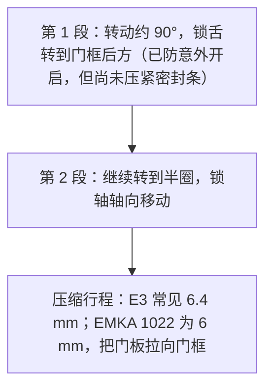

# 电柜压缩式门锁（Southco E3 与 EMKA 1022）：先转舌再轴向压缩密封条

> [!summary] 一句话概述
> 压缩式电柜锁把一次连续旋转分成两段：先让锁舌转到门框后方，再继续转动使锁轴带着锁舌做轴向移动，把门板拉向门框、压紧密封条。Southco E3 VISE ACTION 在 19.1 mm 规格上给出可量化的 6.4 mm 压缩行程；EMKA 1022 压紧锁则写成「再转 90°，锁舌沿轴向移动 6 mm」。它和四分之一转快锁都有「先转进去」的动作，但本篇多出一段可测量的轴向压缩，用来对付密封条，而不是只靠 90° 凸轮钉把面板拉住。

## 配图

![[附件/southco-e3-vise-action-section.jpg]]
*图源：[Southco E3 VISE ACTION 压缩式门锁中文目录](https://media.southco.com/media/static/Literature/e3.zh.pdf) 第 91 页；剖视标注了锁头高度、锁套长度、间距、固定孔、锁舌长度和压缩距离。下方三步：转动 90° 后锁舌转到门框后方 → 门板已处于锁紧以防意外开启 → 转动半圈后轴和锁舌产生压缩，把门板锁紧到门框上*

![[附件/emka-1022-compression-6mm.jpg]]
*图源：[EMKA 中文总目录（2025）](https://www.emka.com/fileadmin/catalog/catalog_downloads/pdf/zh/___________________CN_06-_2025_Web.pdf) 页码 1A-220，1022 系列压紧锁；左侧同样是两段 90°：先转舌，再轴向移动 6 mm，最大扭矩 2.5 Nm，并给出 IP65 与 EN 61373 标识*

![[附件/southco-e3-overview-header.jpg]]
*图源：同上 E3 中文目录第 90 页概述；说明连续旋转半圈即可把锁舌转到门框后方并拉紧，用于环境密封、抗震降噪和限制进入*

> 图片版权归原作者所有，仅作个人学习收藏；出处见文末「来源与核实记录」。

## 结构原理

> 本节所有数字只写来源里给出的；来源没有就写「来源未给出」。

### 堆叠方案

方向：**从柜门外侧的锁头，穿过门板，到门框内侧的锁舌**

| 层级 | 零件 | 材料 | 厚度/尺寸 | 固定方式 | 依据 |
| --- | --- | --- | --- | --- | --- |
| L1（最外） | 锁头（工具、手动把手、钥匙或挂锁等） | E3：锌、不锈钢或铝，多种表面处理 | 两种固定孔规格：小尺寸 13.5 mm、大尺寸 19.1 mm。锁头高度按型号而异 | 用手或工具连续旋转半圈（可顺时针或逆时针上锁） | E3 目录第 91 页「可用选件」 |
| L2 | 门板 + 可选边缘密封垫 | 应用自定；密封垫 E3 举例 E5-17 | 19.1 mm 锌锁套页：门板加边缘密封垫最大 18 mm（该页） | 被锁头压住，密封垫在门与框之间 | E3「锌锁套・19.1mm」页 |
| L3 | 锁套与固定螺母 | 该页：锌合金粉末喷涂或镀铬，配镀锌钢件 | 锁套长度按门厚和间距（固定或可调）选择 | 穿门孔后用固定螺母锁紧。该页推荐固定螺母拧紧力矩 20 N·m | 同上，安装说明 |
| L4 | 锁轴 | EMKA 1022：镀锌钢轴 | 先随锁头转 90°，再做轴向压缩。E3 常见压缩 6.4 mm；13.5 mm 规格目录写 4.3 mm | 在锁套内转动并轴向移动 | E3 第 91 页三步图；13.5 mm 规格页；EMKA 1A-220 |
| L5 | 锁舌 | E3 可选件；EMKA 1022 配镀锌钢直锁舌或折弯锁舌，舌厚图注 t = 2 mm，基准 GH = 19.5 mm | 锁舌长度按门框位置选。EMKA 举例：直锁舌 H = 25.5–32.5 mm（1022-49）；6 mm 折弯锁舌 19.5–26.5 或 31.5–38.5 mm（1022-50） | 用螺钉固定在锁轴上。E3 一页写固定间距的锁舌螺钉力矩 10 N·m | E3 安装说明；EMKA 1A-240 |
| L6 | 门框 | 应用自定 | 锁舌先转到框后，再被轴向拉紧 | 承受压缩后的夹紧 | E3 三步图 |

剖面示意：

独立机构对同一动作的表述：

- Southco E3：操作「十分顺畅，将锁舌旋转至门框后方，然后再连续旋转半圈将其拉紧」。产品页补充：偏心闭锁（上偏心）可防止因冲击或振动意外打开；压缩运动「相应将之向上拉动 6.4 mm（.25"）」。
- EMKA 1022 压紧锁：开启状态转动锁芯 90°，锁舌随之转动；锁闭状态再转 90°，「锁舌沿轴向方向移动 6 mm」到达压紧状态。开启顺序与锁闭相反。目录还标明最大扭矩 2.5 Nm，并写「这款压紧锁本身就具备抗振设计」，同时要求按安装位置和运行条件定期检查或采取必要紧固措施。

两家都是「先转进去、再轴向压缩」，但行程、载荷、扭矩和开孔必须按各自型号读取，不能拼成一张通用表。

### 零件清单

| 零件 | 数量 | 功能 | 材料 | 依据 |
| --- | --- | --- | --- | --- |
| 锁头 | 每锁 1 | 操作与可选的钥匙/工具限制 | 锌、不锈钢、铝等 | E3 概述 |
| 锁套 + 固定螺母 | 每锁 1 套 | 固定在门板上，并约束锁轴 | E3 该页锌合金+钢镀锌；EMKA 锌合金锁体+镀锌钢螺母 | E3；EMKA 1A-220 |
| 锁轴 | 每锁 1 | 先旋转后轴向移动 | EMKA：镀锌钢轴 | EMKA |
| 锁舌 | 每锁 1 | 转到框后并传递夹紧力 | EMKA：镀锌钢，直舌或折弯舌 | EMKA 1A-240 |
| 边缘密封垫 / 密封圈 | 可选或随机 | 形成门缝密封。E3 用选装 E5-17 实现 NEMA4 和 IP65；EMKA 写带密封圈 | E3：橡胶类法兰垫圈（产品列表中 E5-17 为氯丁橡胶黑，19.1 mm） | E3 目录与产品页；EMKA |
| 弹簧 | EMKA 写「带弹簧」 | 抗振/保持，具体弹簧力来源未给出 | 来源未给出 | EMKA 1A-220 |

### 装配顺序

按 E3 中文目录的安装说明（埋入式固定间距的一页写得最完整，其他头型以对应页为准）：

1. 按门厚、开孔（13.5 mm 或 19.1 mm）和所需间距（固定或可调）选锁套，并选顺时针或逆时针上锁。
2. 从门板后方插入门锁，装上安装垫圈和固定螺母。调整螺母，使锁头与门板外侧齐平；垫圈和螺母上的孔必须对齐，门锁须对准锁定位置。该页建议至少使用三颗安装螺钉（不提供 M4 或 8 号）。
3. 把锁舌装到锁轴上。固定间距：锁舌螺钉力矩 10 N·m。可调间距：先确定锁舌位置，以便用手轻松锁定。一页还给出固定螺母推荐拧紧力矩 20 N·m。
4. 合上门，连续旋转半圈：先让锁舌转到门框后，再进入压缩段，压紧密封条。E3 一页提示关闭时应与指示线排列整齐。
5. 打开则反向旋转半圈：先松开压缩，再把锁舌转离门框。EMKA 写开启顺序与锁闭相反。

### 受力与运动分析

- **受力路径**：旋转力矩经锁轴传到锁舌。第一段只改变锁舌角度，把它送到门框后方；第二段把旋转变成沿轴的拉力，门板、密封条和门框被夹在锁头与锁舌之间。E3 在 19.1 mm 锌锁套页给出最大静载荷：可调间距 450 N，固定间距 300 N（同系列其他页也出现过固定间距 450 N 或 300 N，必须看所选页，不能混用）。
- **运动关系**：一次连续半圈里有两段运动。E3 的量化压缩行程在常见 19.1 mm 规格为 6.4 mm，13.5 mm 规格目录写 4.3 mm；EMKA 1022 为轴向 6 mm。这是本篇和普通转舌锁、以及四分之一转快锁的关键差别：后者通常没有这样一段被写进目录的轴向压缩量。
- **失效风险**：只转到「锁舌已在框后」就停下，密封条没有被压缩，防护等级达不到目录里带密封垫才能声称的 NEMA4 / IP65。锁舌长度或 GH 与门框不配，会转不到框后或压过头。拧紧力矩过大或不足：E3 给出了螺母和锁舌螺钉的推荐值，EMKA 给出最大扭矩 2.5 Nm，都不是可以忽略的装饰数字。EMKA 虽称抗振设计，仍要求定期检查紧固。

## 设计要点与参数

| 要点 | 内容 | 依据 |
| --- | --- | --- |
| E3 动作 | 锁舌先转到门框后，再连续半圈拉紧；产品页称上偏心，防冲击或振动意外打开 | E3 目录第 90–91 页；E3 中文产品页 |
| E3 压缩行程 | 常见 19.1 mm 规格：6.4 mm（产品页同时写 .25"）。13.5 mm 规格目录写 4.3 mm | 目录性能详述；产品页 |
| E3 开孔 | 小 13.5 mm，大 19.1 mm | 第 91 页 |
| E3 静载荷示例 | 19.1 mm 锌锁套页：可调 450 N，固定 300 N。埋入式 22.0 mm 固定间距页：最大静载荷 300 N，压紧力 6.4 mm | 对应产品页，不可跨页混用 |
| E3 密封与规范 | 选装边缘密封垫 E5-17 可实现 NEMA4 和 IP65。概述还列出 IP65/69K、UL、EN 45545-3、DIN EN 1672-2、DIN EN 61373 等，需按具体型号认证查询 | 第 90–91 页；产品页「标准和认证」 |
| E3 安装力矩 | 一页：固定螺母 20 N·m；固定间距锁舌螺钉 10 N·m。埋入式页：棘爪安装螺钉推荐 10 N·m | 安装说明 |
| EMKA 1022 | 先转 90°，再转 90° 轴向移动 6 mm；最大扭矩 2.5 Nm；IP65、EN 61373；锌合金锁体和锁芯，镀锌钢轴和螺母，带弹簧和密封圈 | 1A-220 |
| EMKA 锁舌 | 适用于 GH = 19.5 mm；直锁舌 1022-49，6 mm 折弯 1022-50，12 mm 折弯 1022-51；折弯锁舌可正反使用 | 1A-240 |

## 优缺点

**优点**
- 一段旋转里同时完成「进框」和「压紧密封条」，不必再另加压紧件
- 压缩行程被写进目录（6.4 mm 或 6 mm），选型时可以对着密封条压缩量来谈
- 锁舌先到位再压缩，Southco 写可减少锁舌刮擦门框
- 头型、材料、固定/可调间距和开锁限制都可以按应用选

**缺点 / 代价**
- 比普通转舌锁多一段轴向机构，零件和选型都更长
- 防护等级往往要配规定的密封垫，并且依赖整柜装配，不能只看锁体广告
- 行程和载荷按系列、开孔和固定/可调而变，抄错页就压不紧或装不上
- 必须转满半圈；停在中途等于没有使用压缩功能

## 可借鉴点

- **需要压密封条时，把「旋转」和「轴向压缩」分成两段设计**：先让锁舌安全地进到框后，再量化地拉紧，避免边转边刮框。
- **压缩行程要写进规格，而不是只说「可以压紧」**。6.4 mm 还是 6 mm，必须对着密封条允许压缩量来选，并在整柜上验证。
- **开孔、门厚、锁舌 GH 和力矩是一套链**：固定螺母、锁舌螺钉和最大操作扭矩都要按对应目录页执行。
- 普通凸轮转舌锁没有这段轴向压缩，不能因为都是「转 90°」就当成压缩锁。
- 对照 [[Southco、DZUS 四分之一转快锁：90° 凸轮与按总材料厚度选钉长]]：那一篇的关键是按 TMT 选钉长，本篇的关键是可量化的压缩行程。

## 与库中相似案例对比

| 对比项 | 本案例 | [[Southco、DZUS 四分之一转快锁：90° 凸轮与按总材料厚度选钉长]] | [[过中心拉伸搭扣（Southco 97）：杠杆过死点自锁，把箱盖拉向箱体]] |
| --- | --- | --- | --- |
| 动作 | 连续半圈：先转舌进框，再轴向压缩 | 约 90° 凸轮锁 | 杠杆过死点拉紧 |
| 可向量 | E3 6.4 mm（或 4.3 mm）；EMKA 6 mm | TMT → 钉长 | 钳力 135 / 310 / 670 N |
| 密封 | 专门用来压门缝密封条 | 主要是把面板拉向框架，不是压缩锁 | 可压缝，但靠拉杆过死点 |
| 防松 | E3 称上偏心；EMKA 自称抗振并要求定期检查 | 凸轮峰 + 凹坑 + 弹簧 | 过死点后张力压向止挡 |

## 相关案例

- [[Southco、DZUS 四分之一转快锁：90° 凸轮与按总材料厚度选钉长]]
- [[过中心拉伸搭扣（Southco 97）：杠杆过死点自锁，把箱盖拉向箱体]]
- [[柜用凸轮转舌锁：钥匙带动锁舌转过门框挡边（不是板式偏心轮）]]
- 分类索引：[[04-机构与运动 索引]]

## 来源与核实记录

- 主来源：[Southco E3 VISE ACTION 压缩式门锁中文目录](https://media.southco.com/media/static/Literature/e3.zh.pdf)（2022 年版权页，文件修订见 PDF 元数据；概述、三步动作、6.4 / 4.3 mm 行程、开孔、载荷与安装力矩）
- 补充来源 1：[Southco E3 中文产品页](https://southco.com/zh_cn_int/latches/compression-latches/emvise-actionemreg-latchesp/e3-vise-action-compression-latches)（同属 Southco：6.4 mm、上偏心、认证列表）
- 补充来源 2：[EMKA 中文总目录 2025，1022 压紧锁 1A-220 / 锁舌 1A-240](https://www.emka.com/fileadmin/catalog/catalog_downloads/pdf/zh/___________________CN_06-_2025_Web.pdf)（独立机构：90°+90°、轴向 6 mm、2.5 Nm、材料与 GH = 19.5 mm 锁舌表）
- 核实：2026-11-22 下载 E3 中文 PDF 与 EMKA 2025 中文总目录，并打开 Southco 中文产品页。EMKA 2007 年英文压缩锁分册也已下载，内容更旧，本篇参数以 2025 中文总目录为准。
