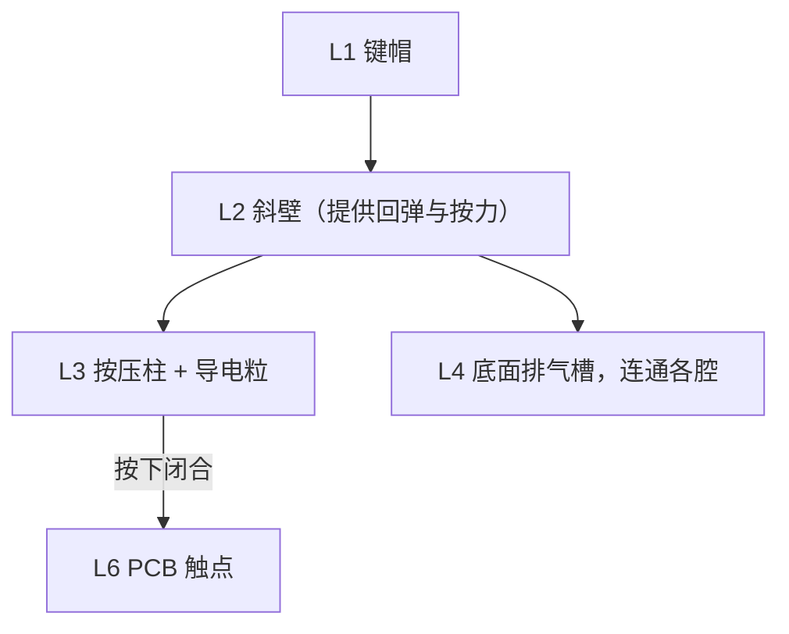

# 硅胶导电按键：斜壁荷重、碳粒与排气槽

> [!summary] 一句话概述
> 硅胶导电按键用鼓包斜壁提供回弹和按压力，按压柱底面的碳粒（或镍粒、金粒）直接去闭合 PCB 上的触点；底面必须开排气槽，否则腔内空气会变成气垫，松手还可能倒吸回不来。它不是键盘里的剪刀脚或蝶式支架，也不是单独一颗金属锅仔片——硅胶鼓包本身就是弹性件和（多数时候的）开关。

## 配图

![[附件/silicone-keypad-structure-force-curve.png]]
*图源：[深圳市昌迈科技《Rubber Key: Design & Confirmation Reference》](https://file.globalso.com/file_manage/1620/20240814/silicone-button-design-and-process-brief-description.pdf) 第 1 页；上图为按键剖面：键帽、斜壁（Wall）、导电粒（Conductive Part）与排气通道（Air Path）；下图为按力—行程曲线及 FP/FC/Fmin 等定义*

![[附件/silicone-keypad-web-geometry.png]]
*图源：同上第 3 页；阵列键的定位孔、斜壁间距与圆角要求，并给出一页图纸上的示例规格：按力 130±35 g、行程 1.0（或 1.5）mm、碳粒厚 1.0 mm 等*

![[附件/silicone-keypad-shell-fit.png]]
*图源：同上第 4 页；硅胶键与塑胶壳孔的配合：键孔与键帽间隙、露出高度与行程的关系、按压柱直径等*

> 图片版权归原作者所有，仅作个人学习收藏；出处见文末「来源与核实记录」。

## 结构原理

> 本节数字只写打开的来源；博皓、昌迈、Epec 三家的「常规区间」并不完全相同，表格里分别标注。

### 堆叠方案

方向：**从手指接触面到 PCB 触点**

| 层级 | 零件 | 材料 | 厚度/尺寸 | 固定方式 | 依据 |
| --- | --- | --- | --- | --- | --- |
| L1 | 键帽（可加塑胶帽、镭雕、滴胶、涂层，或双色插帽） | 硅胶；可选硬帽 | 露出壳面高度 H；昌迈建议 H − S ≥ 0.5 mm（S 为行程） | 与斜壁一体硫化，或加硬帽 | 昌迈第 1、4 页 |
| L2 | 斜壁（web / wall） | 硅胶，硬度见下表 | 行程与倾角配套，见设计要点；与顶帽、基板交界倒圆角 | 一体成型 | 博皓「行程与按压力」；昌迈圆角 R0.2–0.5 mm |
| L3 | 按压柱 + 导电媒介 | 碳粒 / 镍粒 / 镀金粒，或丝印碳浆、银浆 | 博皓：导电粒常见 Ø1.5 / 2.0 / 3.0 / 4.0 mm，厚 0.4–0.8 mm；昌迈示例碳粒厚 1.0 mm。丝印膜厚博皓写 10–15 µm | 模内 170 ℃ 共硫化，或底面丝印 | 博皓 01 导电方式；昌迈示例 |
| L4 | 排气槽 / 背槽通风 | 开在硅胶底面，连通各腔 | 博皓要求必须开设并连通腔室，本页未给槽深；昌迈剖面标注 Air Path，未给槽深 | 成型时做出 | 博皓「空气导流槽」；昌迈第 1 页 |
| L5 | 与外壳的配合间隙 | — | 博皓：单边 0.20–0.30 mm，小于 0.15 mm 易卡死。昌迈：A−a ≥ 0.3 mm，B−b > 0.2 mm | 装配 | 博皓四间隙；昌迈第 4 页 |
| L6 | PCB 触点 | 碳油或金盘（博皓） | 未按时，按压柱底面与触点之间博皓要求留 0.10–0.15 mm 浮动间隙，避免外壳公差造成常通 | 焊接在板上 | 博皓「防空键与微动行程」 |

若选用「硅胶只传力、下面再放锅仔片或薄膜开关」，L3 的导电粒可以取消，导通改由下层开关完成（博皓第三种方式）。那种叠法的主角在本库的锅仔片、薄膜开关篇。

剖面示意：

### 零件清单

| 零件 | 数量 | 功能 | 材料 | 依据 |
| --- | --- | --- | --- | --- |
| 硅胶键体（帽+斜壁+柱+底板） | 1 件可含多键 | 手感、回弹、密封、定位 | 固体硅胶等，见材料表 | 三家来源 |
| 导电粒或导电油墨 | 每键 1 | 闭合电路 | 碳 / 镍包石墨 / 镀金；或碳浆、银浆 | 博皓 |
| 排气槽 | 按腔室 | 排走按压时的空气，避免气垫和倒吸 | 与键体一体 | 博皓 |
| 塑胶外壳键孔 | 1 | 导向与外观 | 塑胶 | 昌迈第 4 页；博皓防卡键间隙 |
| PCB 触点 | 每键 1 组 | 被导电粒短接 | 碳油或金盘 | 博皓 |

### 装配顺序

来源以设计准则为主，装配是使用侧顺序：

1. 按图纸确认硬度、斜壁、行程、导电粒和排气槽，开模前定死（博皓：差 0.1 mm 就能把清脆变成卡滞）。
2. 模压硫化；若用导电粒，博皓写与硅胶在 170 ℃ 共硫化。
3. 需要字符或背光时再做丝印、喷油、镭雕；昌迈给出图形中心公差 ±0.3 mm。
4. 将硅胶垫装入塑胶壳，保证键缘间隙和按压柱与 PCB 的空程；壳孔倒角按昌迈建议配合。
5. 与 PCB 对位组装。出货检测项目见博皓：硬度、寿命、耐磨、接触电阻、压缩永久变形。

### 受力与运动分析

- **受力路径**：手指力经键帽传到斜壁，斜壁拉伸/弯曲储能，柱底导电粒压上 PCB 触点。按力主要由斜壁倾角、斜壁厚度和胶料硬度决定（博皓）。
- **运动关系**：键帽近似竖直下沉，斜壁是柔性铰。行程短的键倾角更陡；长行程还要加防倾导向柱（博皓）。没有剪刀脚那样的交叉支架，对位靠键孔间隙和底部定位柱。
- **失效风险**：排气不通 → 按下有气垫、松开倒吸不回弹（博皓）。间隙过小 → 热胀或偏按卡死。空程不够 → 常通。斜壁根部尖角 → 疲劳断裂（博皓要求 R0.2–0.5 mm 过渡，此值写在圆角节）。丝印导电层百万次后可能网状龟裂、电阻上漂（博皓）。硬度低于 40° Shore A 易粘键，高于 70° 则生硬（博皓）。

## 设计要点与参数

| 要点 | 内容 | 依据 |
| --- | --- | --- |
| 博皓常规区间 | 硬度 30°–80° Shore A（公差 ±2.5°；检测文另写判定 ±3°）；按力 80–500 g（公差 ±15–±30 g）；行程 0.3–2.0 mm；寿命 50 万–500 万次；工作温度 −40 ℃ ~ +220 ℃，可短期 250 ℃ | 博皓常规规格参考 |
| 行程与斜壁倾角（博皓） | 超短 0.3–0.8 mm 配 55°–65°（常再配锅仔）；中行程 1.0–1.5 mm 约 45°；长行程 1.8–2.5 mm 须做导向防倾柱 | 博皓行程分档表 |
| 硬度与按力（博皓） | 斜壁厚度与倾角不变时，硬度每提高 5° Shore A，峰值按力约增 15%–25%；优先改斜壁，不要只改硬度 | 博皓 |
| 手感率 Click Ratio（博皓） | (F1−F2)/F1×100%；消费遥控建议 40%–55%，要明确敲击感的可取 50%–65% | 博皓 |
| 推荐硬度（博皓） | 常规遥控与仪器 50°–60° Shore A；<40° 易迟滞粘键，>70° 回弹冲击大 | 博皓 |
| 导电方式与电阻（博皓） | 碳粒 50–200 Ω（判定 ≤200 Ω）；丝印油墨 100–200 Ω；镍粒 ≤5 Ω；镀金粒 ≤0.5 Ω。要求百万次后电阻上升率 ≤20%（文中另有出货波动率 ≤15% 的检测口径） | 博皓选型表与检测段 |
| 四个间隙（博皓） | 柱底空程 0.10–0.15 mm；键缘单边 0.20–0.30 mm（<0.15 mm 易卡）；必须开排气槽连通各腔；斜壁根部圆角 | 博皓结构间隙 |
| 昌迈示例图纸值 | 按力 130±35 g；要触感；寿命至少 1×10⁵ 次；硬度 50–60；接触电阻 <200 Ω；行程 1.0（或 1.5）mm；碳粒厚 1.0 mm；弹跳 <12 ms | 昌迈第 3 页 |
| 昌迈与壳配合 | A−a ≥ 0.3 mm，B−b > 0.2 mm；壳孔圆角 1–1.25 mm、键圆角 0.75–1 mm 较好；H−S ≥ 0.5 mm；柱与键的相关尺寸 D−d 优先 1.5–2.0 mm；柱径优先 1.0 mm | 昌迈第 4 页 |
| 昌迈 Flat Cone 区间 | 按力 0–350 g，行程 0.5–3.0 mm，寿命 500–2,000×10³ 次 | 昌迈第 1–2 页 |
| Epec 常规规格 | 行程 0.8–1.5 mm；按力 60–300 g；寿命 1,000,000 次；工作 −40 ℃ ~ +150 ℃；储存 −50 ℃ ~ +170 ℃；接触电阻 <200 Ω；弹跳 <5 ms；介电 >1 min @ 500 VRMS；绝缘体硬度 30–80±5 Shore A | Epec General Specifications |
| Epec 按力公差举例 | 如 100 g 档公差 ±25–±35，150 g 档 ±30–±40（表中还列出 50–200 g 各档） | Epec Actuation Force 表 |
| 收缩率 | 博皓：固体硅胶 2.5%–3.5%，硬度越低收缩越大，模具尺寸 = 目标×(1+S)。Epec：绝缘体线收缩 3–4.5%，导电碳 3–5% | 分别标注，不折中成一个数 |
| 寿命检测（博皓） | 3–5 次/秒垂直击打；遥控类 ≥50 万次，车规与工控 ≥100 万–300 万次；压缩永久变形 ≤20%（100 ℃×22 h） | 博皓交付检测 |

## 优缺点

**优点**
- 键体一体，可同时做防水密封和多键阵列，零件数少
- 斜壁参数可调行程和按力，开模前能把档位定在图纸上
- 导电粒方案寿命长、电阻档位清楚；需要更清脆的手感时，可以把硅胶改成只传力，下面再加锅仔

**缺点 / 代价**
- 纯硅胶的力曲线是缓坡，不容易做出金属锅仔那种「塌陷咔嗒」（要把锅仔当主角时看另一篇）
- 对排气、空程、壳孔间隙敏感，装配公差会直接变成常通或卡键
- 模具定型后再改斜壁成本高
- 丝印导电层不适合超高次数

## 可借鉴点

- **先定行程档，再配斜壁倾角**：0.3–0.8 mm 用 55°–65°，1.0–1.5 mm 大约 45°，更长就要加防倾柱（博皓）
- **底面必须通气**：各腔用背槽连通，否则气垫和倒吸会假手感、不回弹
- **空程和壳孔间隙写进结构评审**：柱底 0.10–0.15 mm、键缘单边约 0.20–0.30 mm，不要用外壳把键压到常通
- **调力优先改斜壁，不轻易改硬度**；用 Click Ratio 验收，不要只看峰值力
- **按信号选导电粒**：逻辑电平用碳粒即可，大电流或毫伏采样再用镍粒、金粒
- 和剪刀脚、蝶式键盘不是同一条路：这里没有交叉支架，键程和寿命都写在硅胶鼓包上

## 与库中相似案例对比

| 对比项 | 本案例（硅胶导电按键） | [[16 英寸 MacBook Pro 剪刀脚键盘：1 mm 键程与交叉支架（对照蝶式）]] | [[苹果蝶式键盘（反面案例）：变薄 40% 的代价与硅胶防尘膜补救]] |
| --- | --- | --- | --- |
| 导向与回弹 | 硅胶斜壁自己既导向又回弹 | 两片交叉塑料支架导向，橡胶穹顶储能 | 一体 V 形蝶式支架，间隙极小 |
| 导通 | 碳粒/金属粒直接压 PCB，或只传力给下层开关 | 键盘底层开关（该篇重点在支架与键程） | 同为笔记本键盘，该篇重点在变薄失败 |
| 行程 | 博皓常规 0.3–2.0 mm，分三档配倾角 | 苹果新闻稿：1 mm | 来源中有 0.5 / 0.7 mm 等不同表述 |
| 防尘/防水 | 硅胶垫本身可做密封（本篇来源未给 IP 数值） | 无防尘膜，靠更大间隙 | 第三代加硅胶防尘膜，仍可能从膜角进沙 |

## 相关案例

- [[金属锅仔片阵列：直径、力值、行程与寿命互换]]
- [[薄膜开关叠层：面板、间隔层、电路层与开窗排气]]
- [[16 英寸 MacBook Pro 剪刀脚键盘：1 mm 键程与交叉支架（对照蝶式）]]
- [[苹果蝶式键盘（反面案例）：变薄 40% 的代价与硅胶防尘膜补救]]
- 分类索引：[[04-机构与运动 索引]]

## 来源与核实记录

- 主来源（中文）：[硅胶按键技术参数与设计指南](https://cn.fromrubber.com/oid1753628/pages.htm)（博皓电子 / fromrubber）——导电方式、四间隙、行程—倾角表、Click Ratio、常规规格与检测
- 独立第二来源：[Rubber Key: Design & Confirmation Reference](https://file.globalso.com/file_manage/1620/20240814/silicone-button-design-and-process-brief-description.pdf)（深圳市昌迈科技有限公司，11 页 PDF）——剖面与力曲线定义、与壳配合尺寸、示例图纸值
- 独立第三来源：[Rubber Keypad Design Guide](https://www.epectec.com/keypads/design/)（Epec Engineered Technologies）——英文规格表与按力公差
- 核实：2026-11-17 打开全部三处并下载昌迈 PDF。赫兹 1069 本篇不作为独立来源，以免与锅仔片篇抢用来源。http://www.hengchangguijiao.com/37967.html 按简报此前 500，未依赖。
