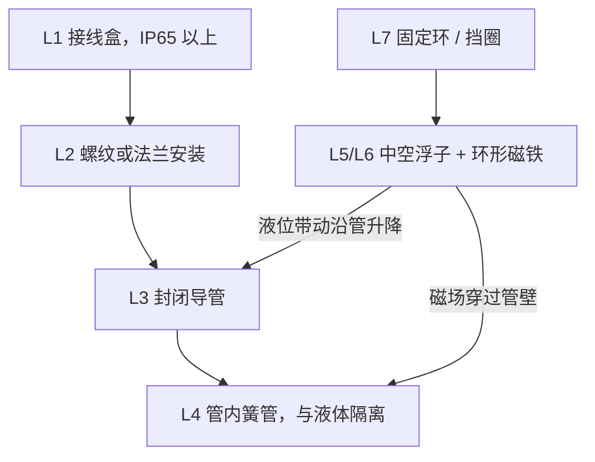

# 磁浮子液位开关：浮子内磁铁与管内簧管磁耦合

> [!summary] 一句话概述
> 连杆浮球液位开关把磁簧管封在一根封闭导管里，再把内装环形磁铁的中空浮子套在导管上：液位升降带动浮子沿导管移动，环磁隔着管壁吸动簧管接点，从而给出开或关。电气部分完全不接触液体，簧管动作也不需要给传感器供电。它是磁耦合传讯，不是把浮子「吸」在某个位置上当机械锁。

## 配图

![[附件/microsensor-md-principle.png]]
*图源：[麦克传感器，《MD 型连杆浮球液位开关》选型资料 V3.0，2021-04](https://www.microsensor.cn/uploads/files/MD%E5%9E%8B%E8%BF%9E%E6%9D%86%E6%B5%AE%E7%90%83%E6%B6%B2%E4%BD%8D%E5%BC%80%E5%85%B3%E9%80%89%E5%9E%8B%E8%B5%84%E6%96%99.pdf) 第 1 页；左侧为带多浮球的实物，右侧剖面标出浮球、磁簧开关和环状磁铁。上图常闭（N.C.）：液位上升时簧管不导通；下图常开（N.O.）：液位上升时簧管接通。同一机械，靠浮子安装方向得到两种逻辑*

![[附件/wika-rls-design.png]]
*图源：[WIKA Operating instructions, Float switch models RLS-1000, RLS-2000, RLS-3000](https://www.wika.com/media/Operating-instructions/Operating-instructions/Level/Float-switches/oi_rls_en_de_fr_es.pdf) 第 5 页 2.1 Functional description；标注 ① 接线盒 ② 电缆接头 ③ 安装螺纹 ④ 导管（内含簧管）⑤ 浮子挡圈 ⑥ 浮子。正文：导管内簧管被浮子中永磁体的磁场在设定点驱动。图中还标出安装倾斜不超过 30°*

![[附件/microsensor-md-electrical.png]]
*图源：麦克 MD 选型资料第 2 页附近电气与材质页（本轮从同一 PDF 抽出）；用于核对照接点保护要求和材质选项，具体电气额定以该页表格为准，不从图上估读未看清的格值。UL 认证系列在正文中写为 240 Vac / 200 Vdc，50 W，0.5 A*

> 图片版权归原作者所有，仅作个人学习收藏；出处见文末「来源与核实记录」。

## 结构原理

> 本节所有数字只写来源里给出的；来源没有就写「来源未给出」。

### 堆叠方案

方向：**沿导管轴线，从罐外接线盒向下到最下面的浮子（侧装或顶装连杆式）**

| 层级 | 零件 | 材料 | 厚度/尺寸 | 固定方式 | 依据 |
| --- | --- | --- | --- | --- | --- |
| L1（罐外） | 接线盒 | 麦克写防护等级皆在 IP65 以上；有普通型和防爆型 | 来源未给出盒体外形的统一尺寸 | 与导管上端连成一体，导线从同一接线盒引出 | 麦克特点与后续型谱页 |
| L2 | 过程连接（螺纹或法兰） | 随材质系列 | 来源未在原理页给出单一螺纹规格 | 安装在罐顶或罐壁接口上 | 麦克安装说明页；WIKA ③ Mounting thread |
| L3 | 封闭导管（导杆） | 金属或塑料：麦克列举 PVDF、PP、PVC 及 SUS304、SUS316 | 管内预设一点或多点磁簧开关；簧管与导线完全和液体隔离 | 穿过浮子内孔，上端固定在过程连接上 | 麦克「动作原理」 |
| L4 | 磁簧开关（簧管） | 来源未给出玻璃管尺寸 | 可多点，位置按订货设置；麦克写接点寿命可达 200 万次，使用时不需要给簧管供电 | 固定在导管内的设定高度 | 麦克；WIKA：reed contact integrated in the guide tube |
| L5 | 浮子 | 中空；内部装环型磁铁（麦克） | 来源未给出统一外径。WIKA：浮子数量和布置取决于开关点数、接点和点距 | 套在导管上，可沿管升降 | 麦克；WIKA ⑥ Float |
| L6 | 环形永磁体 | 来源未给出牌号 | 装在浮子内 | 随浮子移动，隔着管壁耦合簧管 | 麦克；WIKA：permanent magnet is located within a float |
| L7 | 固定环 / 浮子挡圈 | 来源未给出 | 限制浮子行程，使浮子只在与簧管相关的区间内运动 | 卡在导管上 | 麦克「利用固定环，控制浮球与磁簧开关在相关位置上」；WIKA ⑤ Float stop |

剖面示意：

常开、常闭不是靠改电路，而是靠浮子相对簧管的安装方向：麦克图注写，常闭是液位上升时簧管不导通，常开是液位上升时簧管接通。

### 零件清单

| 零件 | 数量 | 功能 | 材料 | 依据 |
| --- | --- | --- | --- | --- |
| 导管 + 内置簧管 | 1 根导管，簧管可多点 | 提供滑道并把电接点与液体隔开 | 金属或塑料系列 | 麦克；WIKA |
| 浮子 + 环磁 | 一点或多点各 1 | 把液位变成磁铁位置 | 浮子材质随介质选用 | 麦克；WIKA |
| 固定环 / 挡圈 | 每只浮子通常上下限位 | 限定行程，保证磁铁能扫过簧管 | 来源未给出 | 麦克；WIKA |
| 接线盒 | 1 | 多点开关共用一个出线口 | IP65 以上 | 麦克 |
| 过程连接 | 1 | 把整支开关装到罐上 | 螺纹或法兰，可订制 | 麦克；WIKA |

麦克还提供动作点可调型：松开接头上的六角螺丝，即可上下移动连杆以改变控制高度，适用桶内压力 5 kg/cm² 以下。另有测试杆，可在罐顶做动作点测试。

### 装配顺序

1. 按介质选择导管和浮子材质（麦克列举了塑料和不锈钢系列，并给化学适应性表，具体以该表为准）。
2. 按需要的常开或常闭方向安装浮子，并用固定环把行程限制在簧管对应区间（麦克原理图）。
3. 从罐的接口把导管伸入，螺纹或法兰紧固；注意密封。WIKA 要求遵守操作条件，且不要在铁磁物体或强电磁场紧邻处使用（最小间距 1 m）。
4. 把接线盒内接点接到控制器或继电器。麦克明确：不要把簧管直接接到电磁阀、电机或电磁开关；感性负载要加 RC、压敏电阻或二极管等保护，容性负载要加浪涌吸收或限流电阻，否则接点寿命会大幅缩短。
5. 用测试杆或实际液位确认动作点。可调型在压力不超过 5 kg/cm² 时，可松开六角螺丝改变连杆插入深度。

> WIKA 说明书把浮子开关的用途限定为监测液体液位，并要求核对材质是否耐该介质。逐步扭矩以各型号说明书为准。

### 受力与运动分析

- **受力路径**：浮力作用在中空浮子上，沿导管轴线产生升降。环磁与簧管内弹簧片之间是非接触的磁力，管壁承受这点径向磁力和介质压力，不把浮子「锁」在某一点。液位稳定时，浮子停在挡圈或液面平衡位置；只有磁铁经过簧管的那个行程才会改变接点状态。
- **运动关系**：浮子相对导管通常只有沿轴的滑动（外加由安装倾斜带来的轻微侧向）。WIKA 图注安装倾斜 ≤ 30°。多浮子时各点沿同一根导管排列，点距由订货决定。
- **失效风险**：导管弯曲、结垢或浮子卡死会使磁铁走不到簧管位置。铁磁附件或邻近电机磁场可能误触发或拒动（WIKA 最小间距 1 m）。把簧管直接带感性或容性负载，会在开断瞬间损坏接点（麦克保护电路页）。介质密度不够或浮子泄漏会导致浮子沉底。可调型超过 5 kg/cm² 的使用限制后，密封和调节结构可能不适用（麦克）。

## 设计要点与参数

| 要点 | 内容 | 依据 |
| --- | --- | --- |
| 磁耦合方式 | 浮子内环磁隔着导管吸引管内簧管接点 | 麦克动作原理；WIKA 2.1 |
| 电气隔离 | 簧管与导线完全和液体隔离，高温高压设备上也可使用（麦克表述） | 麦克特点 |
| 是否需要给传感器供电 | 簧管本身不需要供电 | 麦克特点 |
| 接点寿命 | 可达 200 万次 | 麦克特点 |
| UL 系列电气额定 | 240 Vac / 200 Vdc，50 W，0.5 A | 麦克电气规格注 |
| 防护 | 接线盒 IP65 以上 | 麦克 |
| 常开/常闭 | 由浮子安装方向决定 | 麦克原理图 |
| 安装倾斜 | WIKA 图示 ≤ 30° | WIKA 第 5 页 |
| 可调型压力限制 | 桶内压力 5 kg/cm² 以下 | 麦克动作点可调型 |
| 磁场环境 | 不要在铁磁物或会受磁场影响的设备紧邻处使用，最小间距 1 m | WIKA |
| 环磁牌号、簧管安匝、精确动作行程 | 来源未给出 | — |

## 优缺点

**优点**
- 电接点完全不接触液体，密封和防爆可以做在导管和接线盒上，而不是做在浮子里的电极上。
- 结构简单，多点液位只需一根导管加多只浮子，所有出线进同一个接线盒。
- 簧管本身被动工作，控制回路可以做得很简单。
- 常开/常闭用机械方向实现，现场不易接错逻辑时仍要核对立式方向。

**缺点 / 代价**
- 只适合有足够密度差、允许浮子升降的液体，不适合高粘度易结垢而不加维护的场合。
- 簧管带载能力有限，不能直接驱动阀和电机。
- 邻近铁磁结构和强磁场会干扰动作点。
- 动作点精度取决于浮子行程和挡圈位置，不是连续液位计。

## 可借鉴点

- 需要「罐内运动、罐外电气」时，优先用磁耦合穿过一层薄壁，而不是把导线或电极引进介质。
- 把开关逻辑做成可翻转的机械安装方向，比改电路更适合现场。
- 说明书必须同时给负载保护电路：簧管怕浪涌，比怕液体更常见。
- 用挡圈限定浮子行程，保证磁铁一定扫过簧管，避免「浮子一直漂在无关高度」。
- 安装时把周围铁磁件和电机的距离写进条件，否则动作点会漂。

## 与库中相似案例对比

| 对比项 | 本案例（磁浮子 + 簧管） | [[KTR MINEX-S 磁力联轴器：隔离套两侧磁转子无接触传扭]] | [[电磁门锁（磁力锁）：通电线圈吸合衔铁，断电释放]] | [[带拉环弹簧分度销：弹簧保持插入，拉出后转 90° 停在槽上]] |
| --- | --- | --- | --- | --- |
| 磁耦合做什么 | 把浮子位置传给电接点 | 把扭矩传到隔离套另一侧 | 吸住衔铁锁门 | 无磁耦合，是弹簧销 |
| 是否承力传动 | 否，只传讯 | 是，传扭 | 是，保持门 | 机械定位 |
| 运动件 | 浮子沿导管升降 | 内外转子同步旋转 | 门扇开合 | 销的插入与旋转 |
| 何时用这篇 | 储罐液位开关，要隔液传讯 | 磁力泵无泄漏传动 | 门禁电控锁 | 要机械分度定位 |

本篇主选曾考虑 IMAO QCMA「磁铁型锁紧器」（磁铁把夹紧销吸住，夹紧力 7 N、剪切 900 N），因缺少非经销商的第二独立机构，按任务书改为本候补，不把普通弹簧销贴一块磁铁凑篇。

## 相关案例

- [[KTR MINEX-S 磁力联轴器：隔离套两侧磁转子无接触传扭]]
- [[电磁门锁（磁力锁）：通电线圈吸合衔铁，断电释放]]
- [[带拉环弹簧分度销：弹簧保持插入，拉出后转 90° 停在槽上]]
- [[单动式球头快卸销：按按钮收钢珠，松手后钢珠弹出锁紧]]
- [[橱柜磁吸门吸：只有磁力保持、没有机械锁死（对照 FIDLOCK）]]
- 分类索引：[[04-机构与运动 索引]]

## 来源与核实记录

- 主来源：[麦克传感器股份有限公司，《MD 型连杆浮球液位开关》选型资料 V3.0，2021-04](https://www.microsensor.cn/uploads/files/MD%E5%9E%8B%E8%BF%9E%E6%9D%86%E6%B5%AE%E7%90%83%E6%B6%B2%E4%BD%8D%E5%BC%80%E5%85%B3%E9%80%89%E5%9E%8B%E8%B5%84%E6%96%99.pdf)（2026-11-26 重新下载 PDF，并打开产品页 https://www.microsensor.cn/products-230。动作原理、环磁与簧管、常开常闭、IP65、200 万次、负载保护、材质系列和可调型 5 kg/cm² 限制，均来自该资料）
- 交叉来源：[WIKA Operating instructions, Float switch models RLS-1000, RLS-2000, RLS-3000](https://www.wika.com/media/Operating-instructions/Operating-instructions/Level/Float-switches/oi_rls_en_de_fr_es.pdf)（2026-11-26 重新下载，产品页 https://www.wika.com/en-en/rls_1000.WIKA 同步打开。独立第二机构。磁传动浮子原理、导管内簧管、浮子内永磁、挡圈、安装倾斜与磁场环境限制，均来自该说明书第 4–5 页一带）
- 核实：未把本结构写成又一个门吸或磁力联轴器。IMAO QCMA 因第二机构不足放弃，理由见上。
