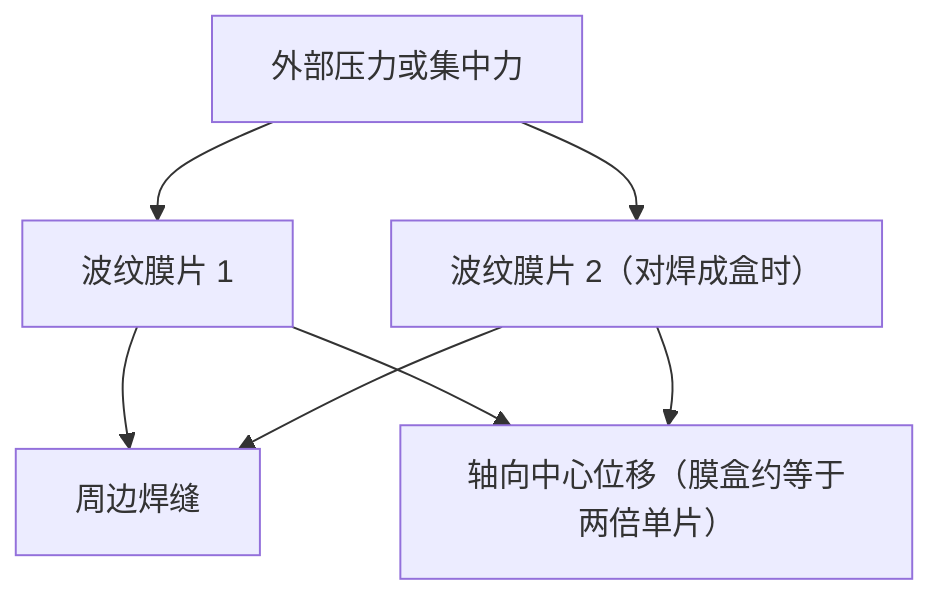

# 膜盒与焊接膜片波纹管：波纹膜片成对对焊，形成可轴向伸缩的密封弹性盒

> [!summary] 一句话概述
> 膜盒（以及由多对膜片环焊成的膜片波纹管）把两片带波纹的金属膜片沿周边对焊成密封盒：压力或外力使膜片轴向鼓起或压扁，两片叠加后的中心位移大约是单片的两倍。它和管道用 U 形膨胀节都靠金属弹性壁吸收轴向位移，但是封闭盒、行程与有效面积的定义都不同，不能当成把膨胀节截短的同一零件。

## 配图

![[附件/witzenmann-diaphragm-bellows.jpg]]
*图源：[Witzenmann Metal Bellows Manual（2019 年 5 月）第 15–16 页](https://media.witzenmann.com/mediapool/documents/metal-bellows-manual.pdf) HYDRA® Diaphragm Bellows；左为焊接膜片波纹管实物，右上为膜片环的三种截面（带槽波纹、带平底的槽形、平膜片），右下为波形示意图和金相剖面（图 2.3.2）。正文：膜片环成对焊接，比膨胀补偿可达制造长度的 80%，弹簧刚度很低，耐压通常只有几个 bar，适合低压或真空*

![[附件/jlcfa-capsule-characteristic.jpg]]
*图源：[嘉立创 FA 机械设计手册「波纹膜片计算示例」](https://www.jlcfa.com/mcbook/11194.htm) 例 1 附图；锯齿形膜片尺寸 R = 36.7 mm，r0 = 7 mm，H = 1.02 mm，h = 0.125 mm，材料 QBe2。图为中心位移 w0 与压力 p 的特性曲线。同页文字写：膜盒由两个相同的锯齿形膜片组成，膜盒的位移比一个膜片的大一倍*

![[附件/jlcfa-diaphragm-coeff-ab.jpg]]
*图源：同上页图 1「系数 a 及 b 变化图」；横轴为 H/h，纵轴为系数 a、b，并画出锯齿波的波高 H、壁厚 h、波长 l 与倾角 θ0。例 1 写按该图取 a = 69、b = 0.073 后代入弹性特性方程*

> 图片版权归原作者所有，仅作个人学习收藏；出处见文末「来源与核实记录」。

## 结构原理

> 本节所有数字只写来源里给出的；来源没有就写「来源未给出」。

### 堆叠方案

方向：**沿膜盒轴线，从一片膜片到相对的另一片（封闭内腔）**

| 层级 | 零件 | 材料 | 厚度/尺寸 | 固定方式 | 依据 |
| --- | --- | --- | --- | --- | --- |
| L1 | 波纹膜片（或膜片环） | 例 1、例 2：QBe2；Witzenmann 该节未写死牌号 | 例 1：R=36.7 mm，r0=7 mm，H=1.02 mm，h=0.125 mm。Witzenmann 提供 0.1～0.3 mm 五种壁厚 | 周边与另一片对焊 | 嘉立创例 1；Witzenmann 第 16 页 |
| L2 | 密封内腔（两片围成的盒，或一对环焊成的一波） | 可抽真空或充介质；是否充油来源在这两页未写 | 有效面积在例 2 中作为计算项 Fe | 焊缝封闭 | 嘉立创例 1「膜盒由两个相同的……组成」；Witzenmann「welded together in pairs」 |
| L3（多波时） | 下一对膜片环继续对焊，叠成膜片波纹管 | 同 L1 | Witzenmann 分标准波与窄波（narrow profile）两系列 | 对焊 | Witzenmann 第 15 页 |
| L4 | 硬心、接头或滑动环密封座（按应用） | 来源未给出本篇通用件 | 例 1 有 r0 = 7 mm 的内缘尺寸，可视为硬心区半径，是否另镶硬心来源未写明 | 焊接或一体成型 | 嘉立创例 1 尺寸；Witzenmann 应用列举 |

与管道膨胀节的差别：膨胀节是两端开口、焊在管道上的成型波纹管，用来吃热位移和承受管内压力；膜盒是封闭或近似封闭的弹性盒，行程用中心挠度、有效面积来定义，耐压通常只有几个 bar（Witzenmann），补偿量相对自身长度可以很大（达制造长度的 80%）。

### 零件清单

| 零件 | 数量 | 功能 | 材料 | 依据 |
| --- | --- | --- | --- | --- |
| 波纹膜片 / 膜片环 | 膜盒 2 片；膜片波纹管为多对 | 受压弯曲，提供位移和有效面积 | QBe2（计算例）；其他牌号来源未在这两页指定 | 嘉立创；Witzenmann |
| 周边焊缝 | 每对 1 圈 | 密封并连接成盒或成波 | 与膜片同材焊接 | Witzenmann：成对焊接，焊缝处缺口应力高 |
| 接头 / 硬心（可选） | 按设计 | 把位移传给机构或仪表 | 来源未给出 | 应用描述 |

### 装配顺序

1. 先成形单片波纹膜片或膜片环（槽形、带平底的槽形或平膜片，Witzenmann 图 2.3.3）。
2. 两片（或两环）沿周边对焊，形成一盒或一波；需要更大行程时再把多对焊成串。
3. 接到仪表、真空腔或容积补偿器上。Witzenmann 建议：为降低焊缝拉伸应力、保证寿命，轴向运动应尽量分成 80% 压缩（波纹管收缩）和 20% 拉伸（伸长）；若实际载荷分配不是这样，安装时应预紧。
4. 来源没有给出具体焊接电流或夹具步骤，现场工艺不编造。

### 受力与运动分析

- **受力路径**：均布压力作用在膜片有效面积上，变成轴向力和弯曲；集中力则经硬心或中心区传入。嘉立创例 2 在 p = 0.16 MPa、R = 25 mm、H = 1 mm、h = 0.2 mm、α = 1.2、材料 QBe2 的条件下，把中心位移 w0、最大应力、有效面积 Fe、安全系数和特性曲线非线性度作为计算项（该页公式栏在网页提取中没有把算得的 w0、Fe 数字完整印出，本文不补算）。
- **运动关系**：单片膜片中心相对边缘做轴向挠曲；两片对焊成膜盒后，总位移约为单片的两倍（嘉立创例 1 原文：「考虑到膜盒的位移比一个膜片的大一倍」）。多对膜片环焊成的膜片波纹管则把多组「盒」串起来，Witzenmann 写其比膨胀补偿高、刚度很低。
- **失效风险**：焊缝处于高缺口应力区，拉伸比压缩更危险，所以有 80%/20% 的运动分配建议（Witzenmann）。压力超过「通常只有几个 bar」的范围会受到限制。特性曲线有非线性：例 2 指出可按图 4 估计非线性度 γ，并给出该条件下约 −2% 的读图结果。

## 设计要点与参数

| 要点 | 内容 | 依据 |
| --- | --- | --- |
| 膜盒组成 | 由两个相同的锯齿形膜片组成；膜盒位移比单片大一倍 | 嘉立创例 1 |
| 例 1 尺寸与材料 | R=36.7 mm，r0=7 mm，H=1.02 mm，h=0.125 mm；QBe2，E=1.35×10⁵ N/mm²；n=3 | 嘉立创例 1 |
| 例 1 系数 | 按图 1 取 a=69，b=0.073，代入弹性特性方程 | 嘉立创例 1 |
| 例 2 条件 | QBe2，E 同上，σs=960 MPa，p=0.16 MPa；R=25 mm，H=1 mm，h=0.2 mm，α=1.2 | 嘉立创例 2 |
| 例 2 非线性度 | 按图 4 读得 γ≈−2% | 嘉立创例 2 |
| 焊接膜片波纹管特征 | 成对焊接；补偿可达制造长度的 80%；刚度很低；耐压通常仅几个 bar；适于低压或真空 | Witzenmann 第 15 页 |
| 两个系列 | 标准波与窄波；窄波更紧凑、刚度相对较高，适合滑动环密封 | 同上 |
| 膜片环壁厚规格 | 0.1、0.15、0.2、0.25、0.3 mm | 第 16 页 |
| 安装预紧 | 轴向运动宜 80% 压缩、20% 拉伸；偏离时安装预紧 | 第 15 页 |
| 单片中心位移、有效面积的完整算得值 | 例 2 网页未完整给出算得的 w0 与 Fe 数字，来源未给出则不补算 | — |

## 优缺点

**优点**
- 用很薄的波纹膜片就能在低压下得到可用的轴向位移，适合仪表、真空和容积补偿。
- 膜盒把两片对焊，位移近似加倍，又保持封闭。
- 波纹形状（锯齿、正弦、槽形、平底、平膜）和壁厚分档清楚，可以按行程、刚度和非线性选型。

**缺点 / 代价**
- 耐压低，不能拿去当高压管道膨胀节用。
- 焊缝缺口应力高，拉伸方向尤其危险，安装方向和预紧必须按 80%/20% 一类规则来，而不是对称拉压。
- 特性带非线性，精密测量要用到有效面积和非线性度，而不是只按线性弹簧常数。

## 可借鉴点

- 先问功能是「封闭盒测压/补容积」还是「开口波纹管补管道热位移」：前者走膜盒或膜片波纹管，后者走 U 形膨胀节，不要共用同一组波高波数公式而不改有效面积定义。
- 膜盒位移按「约两倍单片」来估行程，再按有效面积把压力换成力。
- 焊缝是薄弱点：能让工作行程以压缩为主就不要以拉伸为主，必要时预压安装。
- 计算时把 H、h、R、硬心半径和波型系数（a、b 或 α）写全，并用手册曲线校核非线性，不要只用一个弹性模量硬折算刚度。

## 与库中相似案例对比

| 对比项 | 本案例（膜盒 / 焊接膜片波纹管） | 本批金属波纹管轴向补偿器 | 本批膜片式联轴器 | 本批平行梁称重弹性体 |
| --- | --- | --- | --- | --- |
| 结构 | 波纹膜片成对对焊成封闭或串联的弹性盒 | 开口成型 U 形波纹管+端管，用于管道 | 平面膜片夹在轴毂间，用来传扭 | 双孔梁，用来测力 |
| 行程定义 | 中心挠度；膜盒约两倍单片；可达制造长度的 80% | 单波轴向位移×波数 | 轴偏差补偿，不是行程缸 | 微应变，不是大位移 |
| 压力 | 通常只有几个 bar | 按管道工作压力设计，并处理压力推力 | 不承管内压 | 不承压 |
| 是否同一零件截短 | 否，封闭盒与开口膨胀节定义不同 | 对照篇 | 膜片在这里不围成盒 | 无关 |

## 相关案例

- [[应变式指点杆：十字薄片根部弯曲，将侧向按力变成二维输入]]
- [[GORE 防水透气膜：压力平衡与粘贴式透气阀的安装参数]]
- [[气弹簧内部结构：活塞阻尼孔与氮气预压]]
- 分类索引：[[04-机构与运动 索引]]

## 来源与核实记录

- 主来源：[嘉立创 FA 机械设计手册：波纹膜片计算示例](https://www.jlcfa.com/mcbook/11194.htm)（打开日期 2026-11-22。中文手册页：膜盒由两片相同锯齿形膜片组成、例 1 与例 2 尺寸与材料、位移加倍说明、系数图与特性曲线。页面未另印原手册出版年）
- 补充来源：[Witzenmann GmbH, Metal Bellows Manual](https://media.witzenmann.com/mediapool/documents/metal-bellows-manual.pdf)（May 2019，第 15–16 页 HYDRA diaphragm bellows。独立第二机构。同手册第 43 页膨胀节内容只在对照中使用，不把管道膨胀节的参数写入本篇）
- 核实：2026-11-22 打开嘉立创手册页并下载其附图，下载 Witzenmann 手册对应页。沈阳仪表等其他中文论文本次未能打开，不写入。未把本篇写成管道膨胀节的重复。
