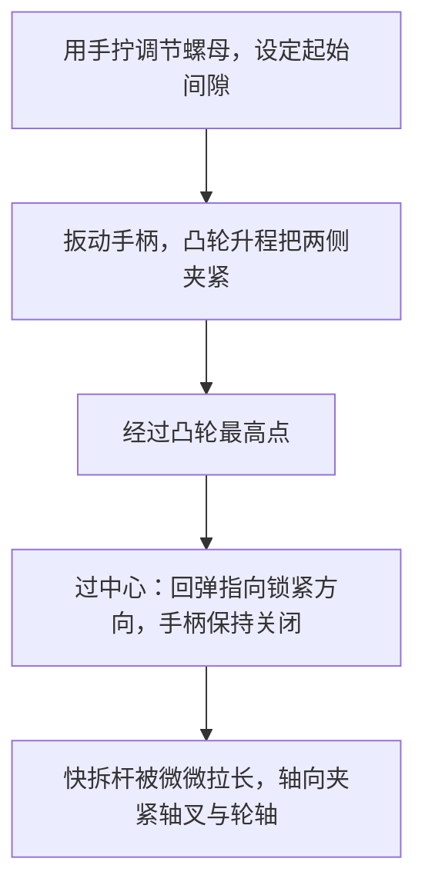

# 自行车花鼓快拆杆：空心轴、调节螺母与偏心凸轮过中心夹紧

> [!summary] 一句话概述
> 花鼓快拆用一根穿过空心轮轴的杆，一端是调节螺母，另一端是带偏心凸轮的手柄。先用手拧螺母设定起始间隙，再把手柄扳过凸轮最高点，杆被微微拉长，把前叉或车架轴叉夹紧在轮轴两端；过中心之后回弹力指向锁紧方向，手柄不会自己弹开。它是沿轮轴的轴向夹紧，不是 GoPro 那种弹性两爪，也不是 Arca 燕尾。手柄绝不能当扳手去拧螺母。Campagnolo 手册还限制前叉开口厚度最大 7,5 mm、后叉 9 mm，并保留止退边作为二次防护。

## 配图

![[附件/campagnolo-qr-dropout-thickness.jpg]]
*图源：[Campagnolo Quick Release 用户手册（2012）](https://www.campagnolo.com/on/demandware.static/-/Library-Sites-campagnoloLibrary/default/dwed056513/pdf/035_128_User_manual_quick%20release_system_Campagnolo_08_12.pdf) 图 1、图 2：前叉开口厚度 W、后叉开口厚度 J；图 11：若有止退边，打开后还需把螺母拧到间距 X 大于两边止退边间距 Y，车轮才能取出*

![[附件/campagnolo-qr-lever-open-closed.jpg]]
*图源：同上手册图 6–9、图 14–16。图 6 区分打开（APERTO / OPEN）与关闭（CHIUSO / CLOSED），并标出螺母 C 与尺寸 X；图 7–8 手柄上可见 OPEN / CLOSED 字样；图 14 是把手柄从位置 2 压到全关位置 3；图 16 明确禁止把手柄当螺母来回拧（NO! / NEIN!）*

![[附件/campagnolo-qr-manual-figures.jpg]]
*图源：同上手册图示总览。左为 Campagnolo Quick Release 标识，中右为安装、检查与手柄朝向的整套插图*

> 图片版权归原作者所有，仅作个人学习收藏；出处见文末「来源与核实记录」。

## 结构原理

> 本节所有数字只写来源里给出的；来源没有就写「来源未给出」。

### 堆叠方案

方向：**沿轮轴轴线，从凸轮手柄一侧到调节螺母一侧**

| 层级 | 零件 | 材料 | 厚度/尺寸 | 固定方式 | 依据 |
| --- | --- | --- | --- | --- | --- |
| L1（手柄侧最外） | 快拆手柄（带凸轮） | 来源未给出牌号 | 美骑：手柄转轴穿过杆头上的孔，根部外形形成凸轮；另有一种凸轮包在座里，原理相同 | 绕杆头销轴摆动 | 美骑「什么是快拆」；Ebykr 由 1951 目录推导：手柄头是凸轮，在帽 60 里绕销 64 转（文中标明为 derived，原图未画出内部） |
| L2 | 手柄座 / 凸轮帽 | 美骑：有的摩擦面是工程塑料 | 来源未给出厚度 | 贴在轴叉外侧，被凸轮顶出 | 美骑；Ebykr 零件名 cap 60 |
| L3 | 轴叉（前叉或车架） | 应用自定；Campagnolo 手册允许与高品质厂家的碳纤维轴叉配合，禁止用于低品质碳纤维轴叉 | Campagnolo：前叉最大 7,5 mm（W，Fig. 1），后叉最大 9 mm（J，Fig. 2） | 被夹在手柄座与螺母之间 | Campagnolo 技术规格与警告 |
| L4 | 花鼓空心轴与轴头 | 来源未给出 | 快拆杆从空心轴中穿过 | 轴头落入轴叉开口 | 美骑；Campagnolo：轴必须完全插入缺口（Fig. 4） |
| L5 | 快拆杆 | 美骑：四五毫米粗的金属杆，一头有螺纹 | 来源未给出精确直径公差 | 穿过空心轴；两端露出 | 美骑 |
| L6 | 两端小弹簧（车轴快拆） | 来源未给出 | 来源未给出簧丝直径 | 套在杆上，打开后使两端与轴头基本等距，便于对入轴叉；座管夹快拆通常不需要 | 美骑；Ebykr 1951 目录有圆锥弹簧 18 |
| L7（螺母侧最外） | 调节螺母（翼形或锁紧螺母） | 来源未给出 | 来源未给出螺距 | 只许用手拧，用来设定夹紧起始位置，不是主要锁紧件 | 美骑；Campagnolo：nut（C，Fig. 6），只许用手调关闭力 |

剖面示意：

独立来源对同一动作的表述：

- 美骑：把手柄从打开扳向关闭时，凸轮推动手柄座，手柄座与另一端螺母的距离减小，从而上紧。上紧过程中应感到杆被拉长产生的「弹力」。若从与杆成一直线起再搬过 90° 后阻力有所减小，说明刚经过凸轮最高点，此时状态稳定、不容易松开。
- Campagnolo 手册不写「凸轮」二字，但操作定义很清楚：锁紧是把手柄从打开压到关闭，绝不能把手柄当螺母来拧（Fig. 16）；关闭力用手拧螺母来增减。
- wiblog：用基圆、升程最高点和过中心解释「先松后紧再略回」的手感，与美骑的过峰描述一致。文中未标明出处的夹紧力公斤数，本文不采用。

对照：这是沿轮轴的轴向夹紧，不是 [[GoPro 快拆卡扣与指旋螺母：两爪弹性卡入和螺钉夹紧是两套锁]] 的弹性两爪，也不是 [[Arca-Swiss 38 mm 燕尾快装板：事实标准与跨品牌混用风险]] 的燕尾斜面夹紧。

### 零件清单

| 零件 | 数量 | 功能 | 材料 | 依据 |
| --- | --- | --- | --- | --- |
| 快拆杆 | 每轮 1 | 传拉力、一端螺纹 | 金属，美骑写四五毫米粗 | 美骑；Ebykr：rod 19 |
| 手柄（含凸轮） | 每杆 1 | 把旋转变成轴向夹紧，并过中心自锁 | 来源未给出 | 美骑；Ebykr：handle 61 |
| 手柄座 / 帽 | 每杆 1 | 凸轮的接触面，压在轴叉上 | 有的为工程塑料 | 美骑；Ebykr：cap 60、pin 64 |
| 调节螺母 | 每杆 1 | 设定凸轮起始位置 | 来源未给出 | 美骑；Campagnolo nut C；Ebykr wing nut 57 |
| 小弹簧 | 车轴快拆两端各 1；座管夹通常无 | 打开后保持两端间隙大致相等 | 来源未给出 | 美骑；Ebykr conical spring 18 |
| 空心轮轴 / 轴叉 | 应用自定 | 被夹紧的对象 | 来源未给出；厚度上限见上表 | Campagnolo；美骑 |

### 装配顺序

综合美骑使用方法和 Campagnolo「Using / Adjusting the Quick Release」（手册要求全部开合、调节、维护只用手，禁止用工具）：

1. 把轮轴完全放入轴叉缺口，并确认车轮相对车架/前叉居中（Campagnolo Fig. 4、Fig. 5）。
2. 手柄放到打开位置。Campagnolo：打开时应能看见「OPEN」（Fig. 7）。
3. 只用手拧调节螺母，设定关闭力：拧紧则关闭力增大，拧松则减小（Campagnolo）。美骑的手感判据：手柄转到与杆成一直线时开始明显受阻，继续关闭要用较大力气；应该用手掌才扳得动，并感到杆被拉长的弹力。太松可能是凸轮磨损或轴叉与轴头有间隙，太紧则先退螺母。
4. 把手柄从打开压到完全关闭（Campagnolo Fig. 14 的位置 2→3）。关闭后应能看见「CLOSED」（Fig. 8），并且手柄要扳到位（Fig. 9）。
5. 手柄朝向：Campagnolo 要求关闭后手柄主体基本平行于前叉腿或后车架，尖端几乎碰到叉腿或车架，以减少被异物挂开的机会（Fig. 15）。美骑：前轮一般向后或与前叉平行，后轮向后或与后上叉平行；碟刹一侧不要放手柄，以免碰到碟片。
6. 检查：Campagnolo 要求提起车把使前轮离地，向车轮顶部猛击，车轮应保持不动；后轮则沿轴叉开口方向击打。美骑也写提起车辆、用拳头下砸车轮检查。
7. 拆轮：先把手柄从 CLOSED 扳到 OPEN。若轴叉有止退边（Campagnolo Fig. 3 的 retainer edge A；美骑称为开口处或周围的突起），还要把螺母拧到间距 X 大于两边止退边间距 Y，才能把车轮抽出（Fig. 11）。禁止改动或破坏止退边。止退边只是夹紧失效时的二次防护，不能代替正确锁紧。
8. 维护：Campagnolo 用肥皂和水轻轻擦洗。美骑：凸轮处加足够润滑脂以减少磨损，螺纹上薄薄一层润滑脂防锈、防咬死；工程塑料摩擦面不必润滑凸轮与座，但最好给凸轮轴上油。

> 美骑还强调：绝对不能拿手柄当摇把去旋转快拆杆。这样既得不到足够夹紧力，还可能损伤螺纹、在车架或前叉上留下划痕。Campagnolo 用 Fig. 16 的「NO!」表达同一禁令。

### 受力与运动分析

- **受力路径**：手柄旋转经偏心凸轮变成沿杆轴的拉力，杆被微微拉长，把两侧轴叉夹在轮轴端部与螺母/手柄座之间。美骑写明：紧固力量主要来自这套凸轮，而不是靠螺母在螺纹上拧紧。行驶中的振动和制动载荷由这条夹紧力承担。
- **运动关系**：手柄绕杆头销轴摆动。凸轮从低点转到最高点是夹紧行程，越过最高点后进入过中心自锁。Campagnolo 把工作行程定义为从 OPEN 到完全 CLOSED。调节螺母只改变起始间隙，不代替这道摆动。
- **失效风险**：把手柄当扳手拧，关闭力不够或螺纹损伤。轴叉厚度超过 Campagnolo 给出的 7,5 mm / 9 mm，手册警告可能锁不紧，导致事故、伤害或死亡。止退边被锉掉或改装，二次防护消失。手柄朝前或朝外，容易被异物挂开。公共场所停车后快拆可能被人拨过（美骑注意事项）。只拧螺母、手柄没过中心，螺纹在振动中可能退扣——前轮一旦脱出，转向会立刻失去（美骑、wiblog 均强调前轮危险；Campagnolo 把轮子脱出列为严重后果）。

## 设计要点与参数

| 要点 | 内容 | 依据 |
| --- | --- | --- |
| 杆径 | 美骑写「四五毫米粗的金属杆」 | 美骑「什么是快拆」 |
| 轴叉厚度上限（Campagnolo 本手册） | 前 7,5 mm max（W，Fig. 1）；后 9 mm max（J，Fig. 2） | Campagnolo 技术规格与警告 |
| 操作方式 | 全部开合、调节、维护只用手，禁止用工具；禁止把手柄当螺母拧 | Campagnolo 1. TOOLS 与 Fig. 16 警告 |
| 关闭力调节 | 用手拧螺母：拧紧增大关闭力，拧松减小 | Campagnolo Using the Quick Release |
| 过中心判据 | 美骑：从与杆成一直线再搬过至少 90°，若过后阻力减小，说明经过凸轮最高点，状态较稳定 | 美骑「使用方法」 |
| 手柄关闭位置 | 主体基本平行于前叉腿或后车架，尖端几乎碰到叉腿或车架 | Campagnolo Fig. 15 |
| 止退边 | 夹紧失效时防止车轮脱出，但不是正确使用的替代 | Campagnolo；美骑 |
| 兼容性 | 该手册写：Campagnolo 快拆只与 Campagnolo 轮组和花鼓作为同一系统使用 | Campagnolo 警告 |
| 使用者体重提示 | 手册开头：体重超过 82 kg / 180 lbs 须更频繁检查裂纹、变形、疲劳或磨损 | Campagnolo 安全说明 |
| 发明 | 美骑：Tullio Campagnolo 在 1930 年发明快拆，起因是 1927 年冬赛中冻住的轴螺母拧不动 | 美骑「快拆小史」 |
| 相关专利（该 2012 手册产品） | 手册标明受 EP 1602570、US 7351000 等保护 | Campagnolo 手册图注 |
| 历史零件名（约 1951 目录，不是 2012 手册爆炸图） | 手柄 61、帽 60、销 64、圆锥弹簧 18、杆 19、翼形螺母 57 | Ebykr，来自其档案中的 Campagnolo 目录 |

## 优缺点

**优点**
- 不用工具就能拆装车轮，适合补胎和运输
- 过中心后有自锁手感，比只靠螺纹防松更适合振动环境
- 两端弹簧让打开后的杆不会挡轴叉开口，装轮对位方便
- 止退边提供二次防护

**缺点 / 代价**
- 必须先调螺母再压杆，步骤比「拧紧一颗螺母」容易用错；用错的后果是车轮脱落
- 夹紧力依赖凸轮、杆的弹性与轴叉厚度匹配，超厚或有楔形间隙时不能硬压
- 手柄外露，可能被异物挂开或被人拨动
- 相对后来的桶轴，抗剪截面更小，美骑未给对比数；不要把未给出的刚度差写成定量结论

## 可借鉴点

- **旋转变轴向夹紧时，要做出过中心，而不是停在最高点**：过了峰值，回弹帮你保持关闭；停在斜面上，振动会把手柄推开。
- **调节螺母只设定起始点，锁紧动作必须是那一下压杆**。产品上如果同时出现「螺母」和「小扳手」，要在说明书和图示里明确禁止把扳手当螺丝用。
- **二次防护不要当成主锁**：律师唇/止退边只能在夹紧失效时挡一下轮子，设计检查仍要验证过中心夹紧本身。
- **给可拆件写清厚度窗口**：Campagnolo 直接写出 7,5 mm / 9 mm，超厚就锁不真，这比只写「按手感」更可执行。
- 手柄停放位置也是安全设计：平行贴住叉腿，减少被挂开的概率；有旋转零件在旁边时（如碟片）要避开。

## 与库中相似案例对比

| 对比项 | 本案例 | [[GoPro 快拆卡扣与指旋螺母：两爪弹性卡入和螺钉夹紧是两套锁]] | [[Arca-Swiss 38 mm 燕尾快装板：事实标准与跨品牌混用风险]] | [[Southco、DZUS 四分之一转快锁：90° 凸轮与按总材料厚度选钉长]] |
| --- | --- | --- | --- | --- |
| 动作 | 偏心凸轮过中心，沿轮轴轴向夹紧 | 弹性两爪卡入 + 另用螺母夹紧 | 燕尾斜面夹紧快装板 | 约 90° 凸轮爬搭扣斜面，拉紧面板 |
| 预紧来源 | 快拆杆被拉长 | 指旋螺母 | 夹钳螺钉/凸轮（视具体夹具） | 凸轮升程 + 弹簧 |
| 防松 | 过中心；止退边是二次防护 | 螺母预紧，两爪不负责主夹紧 | 夹紧力与燕尾配合 | 凸轮峰 + 凹坑 + 弹簧 |
| 容易用错的点 | 把手柄当扳手拧螺母 | 只卡住两爪却忘了拧螺母 | 跨品牌燕尾尺寸不完全相同 | TMT 算错导致钉长不配 |

## 相关案例

- [[GoPro 快拆卡扣与指旋螺母：两爪弹性卡入和螺钉夹紧是两套锁]]
- [[Arca-Swiss 38 mm 燕尾快装板：事实标准与跨品牌混用风险]]
- [[Southco、DZUS 四分之一转快锁：90° 凸轮与按总材料厚度选钉长]]
- 分类索引：[[04-机构与运动 索引]]

## 来源与核实记录

- 主来源：[美骑网：自行车快拆要点及维护（图文）](http://www.biketo.com/knowledge/9739.html)（2012-07-07，作者 BIKETO（小荣）。空心轴+杆+螺母+凸轮手柄、两端弹簧、过中心手感、禁止当扳手用、1930 年 Campagnolo 发明、润滑与注意事项。中文主来源）
- 补充来源 1：[Campagnolo Quick Release 用户手册 PDF（文件名 035_128，2012-08-30 生成）](https://www.campagnolo.com/on/demandware.static/-/Library-Sites-campagnoloLibrary/default/dwed056513/pdf/035_128_User_manual_quick%20release_system_Campagnolo_08_12.pdf)（Campagnolo S.r.l.。前 7,5 mm / 后 9 mm、只用手调节、OPEN/CLOSED、止退边、打击检查、Fig. 16 禁令、82 kg 检查提示。独立官方手册）
- 补充来源 2：[Ebykr: The Campagnolo quick-release hub](https://ebykr.com/mechanism-workshop/campagnolo-quick-release/)（根据其档案中约 1960 说明书与约 1951 目录整理零件名；凸轮在帽内绕销转动一项，作者标明为 derived，原件未画内部）
- 补充来源 3：[wiblog：自行车快拆杆为什么先松后紧？凸轮与过中心锁紧原理](https://wiblog.cn/articles/life/2026/09/bike-quick-release-lever-cam/)（2026-09-29，wiblog 编辑部。过中心原理解释与美骑一致，属独立中文写作；文中未给出出处的「几十到上百公斤」等估计未写入本文参数）
- 核实：2026-11-22 用 curl 下载 Campagnolo PDF 并 pdftotext / pdftoppm 抽图，WebFetch 打开美骑、Ebykr 与 wiblog。
