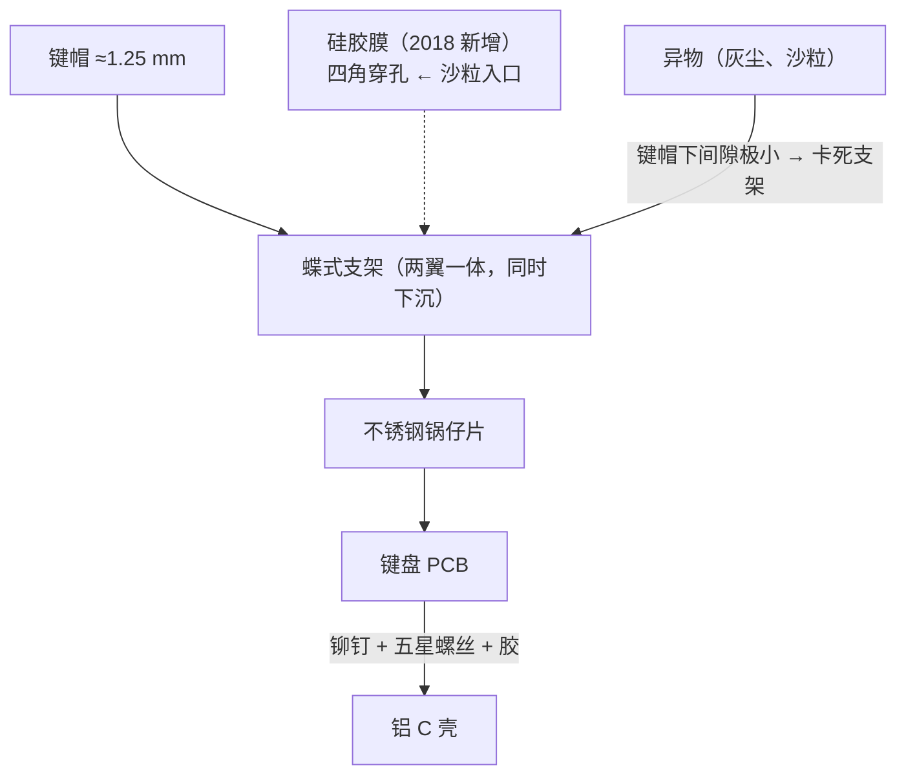

# 苹果蝶式键盘（反面案例）：变薄 40% 的代价与硅胶防尘膜补救

> [!summary] 一句话概述
> 2015 年苹果为了把 12 英寸 MacBook 做到 13.1 mm，用「蝶式」结构替代剪刀脚：苹果称它比传统剪刀脚**薄 40%、稳 4 倍**，整个键盘薄 34%。代价是键程很短，键帽下的间隙也小，一粒灰就能卡住。2018 年第三代在支架上盖了一层冲切硅胶膜，iFixit 用荧光粉测试证明它能把大部分粉尘引到键帽边缘，但用沙子打一分钟字，**沙粒仍会从膜角上的孔钻进去卡死按键**；整块键盘还被铆钉、五星螺丝和胶固定在 C 壳上，几乎没法单独更换。2019 年 16 英寸 MacBook Pro 改回剪刀脚，键程 1 mm。

## 配图

![[附件/butterfly-kb-2018-silicone-membrane.jpg]]
*图源：[iFixit MacBook Pro 13" Touch Bar 2018 Keyboard Teardown](https://www.ifixit.com/Teardown/MacBook+Pro+13-Inch+Touch+Bar+2018+Keyboard+Teardown/111509) 第 1 步；取下键帽后可见覆盖在蝶式支架上的硅胶膜*

![[附件/butterfly-kb-2018-powder-test.jpg]]
*图源：同上 第 2 步；荧光粉测试：第三代键盘把大部分粉尘挡在键边，不进入中间的锅仔片区*

![[附件/butterfly-kb-2018-pcb-membrane.jpg]]
*图源：同上 第 6 步；拆掉铆钉和胶后，键盘 PCB 从机身剥离，露出整张冲切硅胶膜*

> 图片版权归原作者所有，仅作个人学习收藏；出处见文末「来源与核实记录」。

## 结构原理

> 本节数字只写来源里给出的；来源没有就写「来源未给出」。

### 堆叠方案

方向：**从键帽到 C 壳（第三代蝶式键盘）**

| 层级 | 零件/区域 | 材料 | 厚度/尺寸 | 固定方式 | 依据 |
| --- | --- | --- | --- | --- | --- |
| L1 | 键帽 | 塑料（来源未给出牌号） | 约 1.25 mm（2017 款约 1.50 mm）；面积比上一代大 17%（2015 款） | 卡在蝶式支架上 | iFixit；AppleInsider |
| L2 | 硅胶防尘膜（2018 新增） | 冲切硅胶单片 | 来源未给出；四角有穿孔 | 夹在键帽支架与 PCB 之间 | iFixit |
| L3 | 蝶式支架 | 「更硬的材料」，一体式两翼 | 比剪刀脚薄 40% | 来源未给出 | 苹果 2015；AppleInsider |
| L4 | 锅仔片 | 不锈钢 | 来源未给出 | 在 PCB 上 | 苹果 2015 |
| L5 | 键盘 PCB + 底部屏蔽片 | — | — | 十几个一次性铆柱 + P2 五星螺丝 + 胶；屏蔽片重胶粘接 | iFixit |
| L6 | C 壳（顶壳） | 铝 | — | — | iFixit |

剖面示意：

### 零件清单

| 零件 | 数量 | 功能 | 材料 | 依据 |
| --- | --- | --- | --- | --- |
| 键帽 | 每键 1 | 按压面 | 塑料 | iFixit |
| 蝶式支架 | 每键 1 | 让键帽水平下沉 | 来源未给出 | 苹果 2015 |
| 不锈钢锅仔片 | 每键 1 | 触发 + 手感反馈 | 不锈钢 | 苹果 2015 |
| 硅胶膜 | 1 整张 | 防尘 | 硅胶 | iFixit |
| 铆柱 | 十几个 | 把键盘固定到 C 壳（一次性） | — | iFixit |
| P2 五星螺丝 | 若干 | 固定 | 钢 | iFixit |
| 屏蔽片 | 1 | 底部屏蔽，重胶粘接 | — | iFixit |

### 装配顺序

> 按 iFixit 拆卸步骤倒推（拆卸顺序 = 维修难度）：

1. 揭下底部重胶粘接的屏蔽片。
2. 回到正面，取下**所有**键帽，才能接触到硅胶膜。
3. 拆五星螺丝；削掉十几个一次性铆柱。
4. 用 iOpener 加热软化剩余的胶，把键盘 PCB 从机身上剥下来，露出夹在中间的硅胶膜。
5. iFixit 结论：拆卸量大，加上铆钉和胶，单独更换故障键盘「非常不现实」。

### 受力与运动分析

- **剪刀脚的问题**：两个独立且较高的铰链，按下时常常先从一角下沉（AppleInsider）。
- **蝶式的做法**：两翼是一个整体，用更硬的材料制成，按在键帽任何位置都同时下沉，位移浅；苹果称比剪刀脚稳 4 倍（苹果 2015；AppleInsider）。
- **失效机理**：键程和间隙都很小，异物卡在支架里就会让按键不动或连击（iFixit 沙粒测试中多个按键卡住）。硅胶膜把大部分粉尘挡在外面，但四角的穿孔仍是入口；加大粉量后荧光粉仍能越过膜到达锅仔片（iFixit）。
- **为什么维修代价大**：键盘与 C 壳通过铆钉和胶永久固定，一个键的机构损坏也可能需要更换整个顶壳组件（推断：iFixit 只写了「替换故障键盘极不现实」）。

## 设计要点与参数

| 要点 | 内容 | 依据 |
| --- | --- | --- |
| 机构厚度 | 蝶式机构比传统剪刀脚薄 40%，稳定性 4 倍；键盘整体薄 34% | 苹果 2015 新闻稿 |
| 整机 | 12 英寸 MacBook 最厚处 13.1 mm，比 11 英寸 MacBook Air 薄 24% | 苹果 2015 新闻稿 |
| 键帽 | 面积大 17%（2015）；厚度 2018 款约 1.25 mm，2017 款约 1.50 mm | AppleInsider；iFixit |
| 蝶式键程 | 来源未给出具体数值（AppleInsider 只说「键程很短」） | AppleInsider |
| 改回方案 | 2019 年 16 英寸 MacBook Pro：改良剪刀脚，键程 1 mm；苹果设计的橡胶碗储存更多势能 | 苹果 2019 新闻稿 |
| 防尘膜效果 | 荧光粉：「温和成功」；沙子：数个按键卡死 | iFixit |

## 优缺点

**优点**
- 机构更薄，键帽更大，按在边角也不会歪
- 2018 款键帽变薄，取下时更不容易损坏（iFixit）

**缺点 / 代价**（反面教训）
- 键帽下几乎没有容纳异物的空间，日常灰尘就能导致故障
- 防尘膜是后补的措施，有穿孔就不是完全密封
- 键盘铆接和胶粘在 C 壳上，维修只能换大总成
- 最终产品线放弃该结构，改回 1 mm 键程的剪刀脚

## 可借鉴点

- **薄化要给异物留余量**：运动间隙小于常见粉尘、沙粒尺寸时，必须做全封闭或可清理设计
- **防尘膜的孔位是薄弱点**：膜上的工艺孔要避开运动机构正上方（推断）
- **不要用一次性铆柱固定高故障率部件**，否则一个小故障就要换大总成
- **用户测试优先于参数**：苹果 2019 年新闻稿强调改回方案基于大量人因研究和用户研究
- 同为「为了更薄牺牲可维修」的反面案例，可对照 [[苹果 AirPods Pro 全胶粘封装（反面案例）]] 与 [[微软 Surface Laptop 超声波点焊与 Alcantara 覆面（反面案例）]]

## 与库中相似案例对比

| 对比项 | 本案例 | [[按动圆珠笔：旋转凸轮的按压伸缩机构]] | [[苹果 AirPods Pro 全胶粘封装（反面案例）]] |
| --- | --- | --- | --- |
| 机构类型 | 平行下沉的按键支架 | 按压 + 旋转凸轮 | 无机构，全胶粘 |
| 失败原因 | 间隙太小，对异物敏感；不可维修 | — | 不可拆 |
| 教训 | 薄化与可靠性、可维修性要一起评估 | — | 胶粘的维修代价 |

## 相关案例

- [[按动圆珠笔：旋转凸轮的按压伸缩机构]]
- [[苹果 AirPods Pro 全胶粘封装（反面案例）]]
- [[微软 Surface Laptop 超声波点焊与 Alcantara 覆面（反面案例）]]
- [[苹果 iPhone 14 双面可开：中框承力与前后两道密封]]
- 分类索引：[[04-机构与运动 索引]]

## 来源与核实记录

- 主来源：[MacBook Pro 13" Touch Bar 2018 Keyboard Teardown](https://www.ifixit.com/Teardown/MacBook+Pro+13-Inch+Touch+Bar+2018+Keyboard+Teardown/111509)（iFixit，Arthur Shi，2018-07-20）
- 补充来源 1：[Apple Unveils All-New MacBook](https://www.apple.com/newsroom/2015/03/09Apple-Unveils-All-New-MacBook/)（苹果新闻稿，2015-03-09）
- 补充来源 2：[Apple's new MacBook employs unorthodox keyboard design to achieve maximum thinness](https://appleinsider.com/articles/15/03/28/apples-new-macbook-employs-unorthodox-keyboard-design-to-achieve-maximum-thinness)（AppleInsider，2015-03-28）
- 补充来源 3：[Apple introduces 16-inch MacBook Pro](https://www.apple.com/newsroom/2019/11/apple-introduces-16-inch-macbook-pro-the-worlds-best-pro-notebook/)（苹果新闻稿，2019-11）
- 核实：2026-11-13 打开全部来源核对。苹果键盘维修计划页面已重定向到「服务计划状态」页，未引用。
