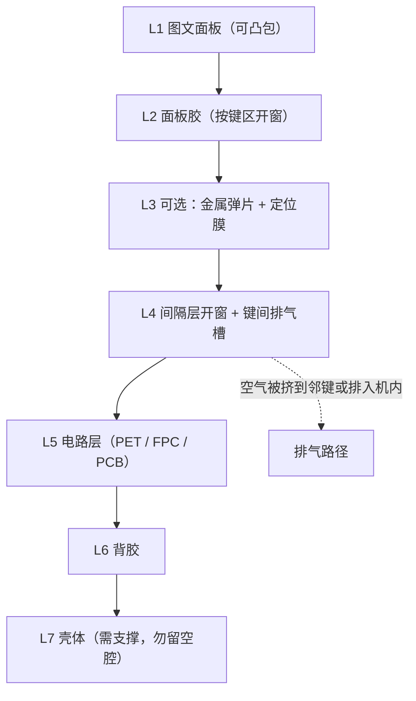

# 薄膜开关叠层：面板、间隔层、电路层与开窗排气

> [!summary] 一句话概述
> 薄膜开关的主角是一层层 PET（或 PC、FPC、PCB）贴合出来的整张面板：最外是图文面板，中间是开了窗的间隔层，下面是电路层；按下时窗里的空气被挤走，触点闭合，松开后再分开。触感可以靠不锈钢弹片或面板凸包来加，但弹片只是叠层里的一层，不是本篇的唯一零件。排气开窗要在间隔层里设计好，否则手感发闷，密封场合还要决定用内排气还是排到产品内部。

## 配图

![[附件/nfi-membrane-switch-stack.jpg]]
*图源：[NFI Membrane Switch Design Guide](https://cdn2.hubspot.net/hubfs/2126200/Membrane_Switch_Design_Guide.pdf) 第 2 页；上为无触感型层叠示意（面板、上电路、间隔层开窗、下电路、背胶），下为带弹片/凸包的触感结构分解*

![[附件/nfi-membrane-switch-specs.jpg]]
*图源：同上技术规格页；无触感与触感型的按力、行程、寿命、电性能对照，以及出线与安装剖面*

> 图片版权归原作者所有，仅作个人学习收藏；出处见文末「来源与核实记录」。

## 结构原理

> 茗智与 metal-domes 把层结构讲清楚，具体力值、行程、寿命采用 NFI 规格表，并注明是该厂商的典型规格，不是所有薄膜开关的统一标准。

### 堆叠方案

方向：**从操作面到壳体安装面（metal-domes 的七组功能层，可合并）**

| 层级 | 零件 | 材料 | 厚度/尺寸 | 固定方式 | 依据 |
| --- | --- | --- | --- | --- | --- |
| L1 | 图文面板（Graphic overlay） | PET 或 PC；可做纹理、窗口、凸包 | 面板厚度影响弹片手感（茗智、metal-domes 均强调，未给「必须用某厚度」的单一值）。NFI：凸包高度建议不超过面板厚度的 2.5 倍（从基底量） | 与下层胶贴合；面板通常比电路层略大，用来挡边 | metal-domes 层表；NFI Overlay / Embossing；茗智「面板材料」 |
| L2 | 面板胶 | 压敏胶，开窗避开按键区 | 来源未给出通用胶厚 | 贴合 | metal-domes；NFI |
| L3 | 弹片及定位层（触感型，可选） | 不锈钢 snap dome；PET 定位膜 | 茗智：须确认弹片直径与定位，避免移动或翻转。NFI：触感型有效区一般不超过 Ø 0.50"；成型聚酯凸包（polydome）工作温度较金属弹片窄，最高 55 ℃ / 131 ℉ | 定位层固定 | 茗智；NFI Types；metal-domes |
| L4 | 间隔层（Spacer）与排气通道 | PET 等，模切开窗 | 窗孔提供触点间距和弹片空间；键间做排气槽。NFI 未在本手册给出间隔层厚度系列 | 胶贴合 | 茗智「间隔层控制接点间距、弹片空间与排气路径」；NFI Venting；metal-domes |
| L5 | 电路层 | PET 银浆、FPC 或 PCB | 无触感型常为上、下两层电路被间隔层隔开；用金属弹片时，NFI 写可省去柔性上层电路 | 层压；尾排出线 | 茗智；NFI；metal-domes |
| L6 | 背胶 | 按壳体材质、表面能、平整度选择 | 窄边框要检查可贴宽度；孔、窗、螺柱需避空 | 贴到壳体 | 茗智；NFI 安装面要求平整 |
| L7 | 壳体/背衬 | 须给按键区足够刚性支撑 | 茗智：按键下方避免无支撑空腔；NFI：安装面应平整，若为凹槽则四周放大 0.010" | 整机结构 | 茗智；NFI |

无触感型可以没有 L3。NFI 写无触感最可靠、也最便宜，但没有直接的按压反馈，可用蜂鸣、LED 或显示变化弥补；无触感有效区最大约 8 in²，最小约 Ø 0.25"。

剖面示意：

### 零件清单

| 零件 | 数量 | 功能 | 材料 | 依据 |
| --- | --- | --- | --- | --- |
| 图文面板 | 1 | 外观、密封、定位手感（凸包时） | PET / PC；NFI 也提到 PVC 用于全纹理、无显示窗的低成本场合 | NFI 材料节；茗智 |
| 金属弹片 + 定位层 | 按键数，可选 | 提供可辨识回弹，并作可动导体 | 不锈钢；PET 载体 | 三家来源 |
| 间隔层 | 1 | 保持触点断开、提供弹片空间、开排气窗 | PET 等 | 茗智；NFI Venting |
| 电路与尾排 | 1 组 | 矩阵走线、出线 | 银浆 PET / FPC / PCB | 茗智；NFI |
| 背胶 | 1 | 装到壳体 | 压敏胶 | 茗智 |

### 装配顺序

据茗智「制造与检查流程」与 NFI 的层压描述：

1. 评审图稿、线路、壳体支撑、按键、窗口、出线和通环境，统一按键中心基准。
2. 面板反面印刷图文；电路层做导电线和绝缘。
3. 需要时在面板上压凸包（NFI：阳模/阴模加温加压；内圆角至少 0.040"；凸包高不超过料厚 2.5 倍）。
4. 用定位层放弹片，保证中心与方向。
5. 把面板、间隔层（含键间排气窗）、电路、背胶层压，再模切外形、孔和尾排。
6. 检查导通、开短路、手感、外观、出线插接和整机贴合。茗智强调：手感要在真实壳体支撑下验收，不要用单颗弹片的力值代替装机结果。

### 受力与运动分析

- **受力路径**：手指按面板（或凸包）→ 力传到弹片或上层电路 → 间隔层窗口里的活动侧闭合到下触点。无触感型是两层印刷触点被按到贴合；触感型是弹片塌陷后中心接通。
- **运动关系**：位移很小。NFI 规格表：无触感行程 0.007–0.011 in，触感 0.010–0.018 in。间隔层窗口和排气槽决定空气往哪走——NFI 写触点之间有一包空气，按下必须被排走；通常在间隔层里做键间排气槽，整张开关对外仍可保持封闭，适合正常气压。若会长期处于异常气压，建议把气排到产品内部，必要时再保护电路。
- **失效风险**：壳体下方空腔会让手感发软、偏按不导通（茗智、metal-domes）。排气不通手感闷。出线弯折半径不够或插接处无补强易断（NFI：尾排平滑走线，最小弯曲半径 0.10"）。银浆外露受潮迁移，NFI 要求外露银用碳覆盖。面板胶或背胶太厚会吃掉本就只有零点几毫米的行程——本篇规格以 NFI 行程为准，不把其它文章的胶厚差当作 NFI 数据。

## 设计要点与参数

| 要点 | 内容 | 依据 |
| --- | --- | --- |
| NFI 无触感规格 | 按力 6–12 ounces；行程 0.007–0.011 in；寿命至少 1,000,000 次；绝缘 10 MΩ min；触点额定 30 VDC、100 mA、1 W；弹跳 15 ms max；接触电阻 100 Ω max；电容 20 pF max | NFI Technical Specifications |
| NFI 触感规格 | 按力 10–16 ounces；行程 0.010–0.018 in；寿命至少 1,000,000 次（旁注：图文不做凸包时可到至少 5,000,000 次，且随具体应用变化） | NFI 同页 |
| NFI 温度 | 储存 −40 ℃ ~ +80 ℃；工作 −30 ℃ ~ +65 ℃ @ 95% RH | NFI |
| 有效区尺寸（NFI） | 无触感：最大约 8 in²，最小约 Ø 0.25"；触感：有效区一般最大 Ø 0.50"。相邻有效区至少留 0.10"；键帽图文可比有效区大 0.20" | NFI Types / 布局 |
| 凸包（NFI） | 高不超过面板厚度的 2.5 倍；内圆角 ≥ 0.040" | NFI Embossing |
| 安装让位（NFI） | 开孔（无边框遮挡时）比机壳孔大 0.030"；开孔与有效区或窗口至少 0.062"；支撑板每边比面板图文小 0.010"；凹槽每边大 0.010" | NFI Cut-outs |
| 出线（NFI） | 最常见节距 0.10"；ZIF 可做到 1 mm 或 1.5 mm；也可 0.05" 母连。弯曲半径 ≥ 0.10" | NFI Connector Tail |
| 排气（NFI） | 默认键间内排气、对外封闭；异常气压时改排到产品内部 | NFI Venting |
| 茗智设计立场 | 弹片力值可以在可选范围内评估，但实际手感还受面板厚度、凸包、间隔层、按键尺寸和壳体支撑影响，以装机样件为准；间隔层要避免弹片边缘与胶层干涉，并预留排气 | 茗智 |
| metal-domes 层职责 | 把 overlay、弹片定位、间隔排气、电路、背胶、壳体支撑当作一套叠层来画，不要分层各自选型后再「凑」起来 | metal-domes 2026-07-28 |

## 优缺点

**优点**
- 整面可印刷、好清洁、可做密封边，适合仪器和医疗面板
- 无触感型形状自由、成本低、寿命在 NFI 表中也达到百万次量级
- 需要段落感时，把金属弹片嵌进同一叠层即可，不必再做一副硅胶模具

**缺点 / 代价**
- 行程很短，壳体空腔、胶厚、凸包和支撑会明显改变手感
- 无弹片时手感「像按一张纸」（这是常见使用评价；NFI 也承认无触感缺少直接反馈）
- 尾排出线是薄弱点，走线和补强要从主板位置反推
- 防水是整机问题：连续密封边只能降低风险，还取决于壳体和出线（茗智、metal-domes）

## 可借鉴点

- **先画叠层和开窗，再选弹片**：间隔层窗口、排气槽和壳体支撑没有定，谈力值没有意义
- **默认做键间内排气**，面板对外仍封闭；只有会遇到气压变化时才把气引进机箱
- **凸包高度按面板厚度限制**（NFI：不超过 2.5 倍），不要为了「摸得着」把 PET 拉得太高
- **按键下面不能是空的**：壳体加支撑或背衬，避免偏按不导通
- **尾排当柔性电路走**：预留弯曲半径和补强，外露银盖碳
- 本篇不要和「只讨论单颗锅仔」或「只讨论硅胶鼓包」混成同一套参数表

## 与库中相似案例对比

| 对比项 | 本案例（薄膜开关叠层） | [[金属锅仔片阵列：直径、力值、行程与寿命互换]] | [[硅胶导电按键：斜壁荷重、碳粒与排气槽]] |
| --- | --- | --- | --- |
| 主角 | 多层 PET/电路贴合与开窗排气 | 双稳态金属圆片本身 | 硅胶斜壁 + 导电粒 |
| 弹片角色 | 可选的一层，用来加触感 | 主角 | 仅在「硅胶只传力」时作为下层 |
| 行程 | NFI：约 0.007–0.018 in | 锅仔高度减料厚 | 博皓常规 0.3–2.0 mm |
| 排气 | 间隔层键间开槽，分内排/外排 | 锅仔下方必须通气 | 硅胶底面背槽连通各腔 |

## 相关案例

- [[金属锅仔片阵列：直径、力值、行程与寿命互换]]
- [[硅胶导电按键：斜壁荷重、碳粒与排气槽]]
- 分类索引：[[04-机构与运动 索引]]

## 来源与核实记录

- 主来源（中文）：[触感薄膜开关定制](https://szjasper.com/products/membrane-switches/tactile-membrane-switches.html)（东莞茗智电子）——层结构、间隔层排气、壳体支撑与装机验收立场；该页不把通用力值写成承诺
- 独立第二来源：[Flexible Membrane Switch Design with Metal Dome Arrays](https://www.metal-domes.com/blog/2026/07/28/flexible-membrane-switch-design-metal-dome-arrays/)（EBest Circuit / metal-domes.com，Posted July 28, 2026，作者页标注 li）——七组功能层与叠层协同
- 独立第三来源：[NFI Membrane Switch Design Guide](https://cdn2.hubspot.net/hubfs/2126200/Membrane_Switch_Design_Guide.pdf)（NFI Corp，11 页）——类型、凸包规则、排气、安装让位，以及无触感/触感规格表
- 核实：2026-11-17 打开茗智与 metal-domes 页面，下载 NFI PDF 全文核对规格表。赫兹 1069 在锅仔片篇已用作独立来源，本篇不重复占用。原计划中的 Design Mark PDF 按简报此前 403，未依赖。
