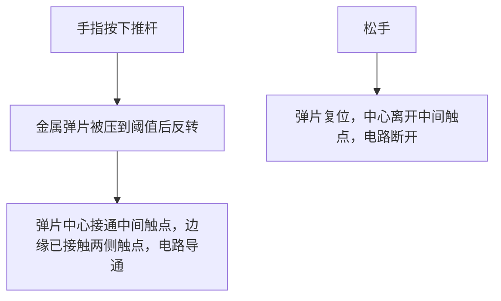

# 轻触开关壳体封装金属弹片：盖板、推杆与锅仔片反转导通（以 Omron B3F 为例）

> [!summary] 一句话概述
> 轻触开关把一枚金属弹片（锅仔片）连同推杆、盖板、基座和端子封装成一颗可焊接的元件：按下超过阈值后弹片反转，中心触点与边缘触点连通并给出咔哒手感，松手后弹片复位、电路断开。它不是直接把裸锅仔片阵列贴在薄膜或 PCB 上，也不是硅胶鼓用碳粒导通。以 Omron B3F 为例，6×6 mm 型机械/电气寿命为 100 万次，12×12 mm 型为 1000 万次；6×6 mm 标准型操作力分 0.98 N、1.47 N、2.55 N、4.9 N 四档，预行程 0.25 +0.2/−0.1 mm，额定 1–50 mA、3–24 VDC。

## 配图

![[附件/tact-shinmei-inside.jpg]]
*图源：[神明电机《什么是轻触开关》](https://www.shinmei-e.co.jp/zh/products/tactile/features_tactile_zh.html)；典型内部结构分解：盖板、推杆/按键、金属弹片/反转弹簧、基座、固定触点与端子*

![[附件/tact-shinmei-dome.jpg]]
*图源：同上；金属弹片（反转弹簧）在操作负荷达到阈值时反转，同时完成电气导通、点击感和点击声*

![[附件/tact-shinmei-fs-curve.jpg]]
*图源：同上；F-S 曲线（操作负荷–行程）与点击率定义：点击率＝(峰值负荷−底端负荷)÷峰值负荷×100*

![[附件/tact-omron-b3f-models.png]]
*图源：[Omron B3F 数据表](https://omronfs.omron.com/en_US/ecb/products/pdf/en-b3f.pdf) 第 1 页；6×6 mm 型号表，列出推杆高度、操作力与有无接地端子的订货号*

![[附件/tact-omron-b3f-char.png]]
*图源：同上，动作特性与外形尺寸页；给出 OF、RF、PT 及安装尺寸*

> 图片版权归原作者所有，仅作个人学习收藏；出处见文末「来源与核实记录」。

## 结构原理

> 本节所有数字只写来源里给出的；来源没有就写「来源未给出」。

### 堆叠方案

方向：**从操作面向 PCB（顶按型）**

| 层级 | 零件 | 材料 | 厚度/尺寸 | 固定方式 | 依据 |
| --- | --- | --- | --- | --- | --- |
| L1（最外） | 盖板 | 来源未给出；颖鑫拆解对象为金属盖板 | 来源未给出 | 颖鑫：盖板由 4 个塑胶固定柱铆住，割掉固定柱后可撬开 | 神明「盖板」；颖鑫拆解步骤 |
| L2 | 推杆 / 塑胶按钮 | 来源未给出牌号。B3F 用推杆颜色区分操作力（如 4.3 mm 平头：象牙色 0.98 N、黄色 1.47 N、橙色 2.55 N、红色 4.9 N） | B3F-1000 系列平头高度有 4.3 / 5.0 / 7.0 / 9.5 mm 等分档 | 可上下移动，受盖板导向 | 神明；Omron 型号表 |
| L3 | 金属弹片（锅仔片 / 反转弹簧） | 金属；材质、板厚、直径和曲率决定手感（神明）。具体牌号来源未给出 | 来源未给出直径 | 边缘坐在基座外围触点上，中心对准中间触点，平常不接触中间触点 | 神明；颖鑫 |
| L4 | 固定触点 | B3F 标准型镀银，高可靠型镀金 | 颖鑫拆解对象共 3 个触点：上下 2 个对弹片边缘，中间 1 个对弹片中心 | 与端子一体或埋入基座 | 颖鑫；Omron 触点材料栏 |
| L5 | 基座与端子 | 基座：来源未给出树脂牌号。端子：直插（through-hole），部分型号带接地端子 | 6×6 mm 或 12×12 mm 两种封装（B3F）；另有侧按系列 | 焊接到 PCB。B3F 还有编带径向包装型 | Omron；神明（SMD 与直插两类，B3F 本表是直插） |

剖面示意：

神明把这种开关定义为瞬动开关（Momentary）：仅在按压期间触点改变，停止操作后自动恢复。防水类轻触开关会在弹片上加一层聚酰亚胺薄膜（颖鑫）。颖鑫还观察到塑胶按钮圆孔里有缺口，作者推断可能是气道，本文按推断标注，不把它写成已测量的排气结构。

### 零件清单

| 零件 | 数量 | 功能 | 材料 | 依据 |
| --- | --- | --- | --- | --- |
| 盖板 | 1 | 保持内部零件、提供按压导向 | 颖鑫拆解对象为金属盖板 | 神明；颖鑫 |
| 推杆 / 按钮 | 1 | 把按压力传到弹片中心 | 塑胶（颖鑫）；B3F 用颜色区分力档 | 神明；Omron；颖鑫 |
| 金属弹片 | 1 | 反转导通并给出点击感 | 金属，牌号来源未给出 | 神明；颖鑫 |
| 固定触点 | 颖鑫拆解对象为 3 个（两边+中间） | 边缘常接弹片，中间按压后接通 | 镀银或镀金（B3F） | 颖鑫；Omron |
| 端子 | B3F 有无接地端子两种 | 焊到 PCB；颖鑫对象：两边触点连左侧 2 引脚，中间触点连右侧引脚 | 来源未给出牌号 | 颖鑫；Omron |
| 防水膜（可选） | 0 或 1 | 盖在弹片上密封 | 聚酰亚胺薄膜 | 颖鑫 |

### 装配顺序

按颖鑫拆解顺序反推（该文对象，不是 B3F 工厂装配规范）：

1. 端子与触点埋入或装入塑胶基座，使两边触点与中间触点分别接到对应引脚。
2. 放入金属弹片，边缘对准两边触点，中心对准中间触点。
3. 放入带导向的塑胶按钮（若有缺口，朝向需与气道设计一致；颖鑫仅作推测）。
4. 盖上金属盖板，用基座上的塑胶固定柱铆住。防水型在弹片上先加聚酰亚胺膜。
5. 焊接到 PCB。B3F 数据表还提供带接地端子的型号，用于加强接地，不是第四路信号。

### 受力与运动分析

- **受力路径**：手指力 → 推杆 → 弹片中心。负荷达到阈值后弹片失稳反转，中心下沉接通中间触点；同时产生点击感和点击声（神明）。松手后弹片弹回。
- **运动关系**：弹片是双稳态反转，不是随行程逐渐闭合的滑动触点。神明用点击率量化手感脆度。B3F 6×6 mm 的预行程 PT 为 0.25 +0.2/−0.1 mm；复位力 RF 随力档不同，例如 0.98 N 档至少 0.2 N，4.9 N 档至少 0.7 N。
- **失效风险**：弹片疲劳或触点污染会导致无手感、连击或不通。B3F 额定只有 1–50 mA、3–24 VDC（镀金型下限可到 100 μA），不能当电源开关。数据表给出弹跳时间最大 5 ms，高速扫描时要防误读。颖鑫所拆对象用塑胶柱铆盖板，维修时割掉固定柱即破坏封装，推断只能更换整颗（推断）。

## 设计要点与参数

以下为 Omron B3F 数据表数值，仅适用于已打开的该份英文数据表。6×6 mm（B3F-1000/3000/6000）与 12×12 mm（B3F-4000/5000/5001）分列。

| 要点 | 内容 | 依据 |
| --- | --- | --- |
| 6×6 mm 操作力 OF | 0.98±0.29 N、1.47±0.49 N、2.55±0.69 N、4.9±1.47 N；镀金型 1.76±0.49 N | 数据表 Characteristics |
| 6×6 mm 复位力 RF | 对应至少 0.2 / 0.49 / 0.49 / 0.7 / 0.49 N | 数据表 |
| 6×6 mm 预行程 PT | 0.25 +0.2/−0.1 mm | 数据表 |
| 12×12 mm 操作力 OF | 1.27±0.49 N 或 2.55±0.69 N | 数据表 |
| 12×12 mm 预行程 PT | 0.3 +0.2/−0.1 mm | 数据表 |
| 12×12 mm 复位力 RF | 至少 0.29 N（1.27 N 档）或 0.49 N（2.55 N 档） | 数据表 |
| 额定（阻性） | 1–50 mA，3–24 VDC；镀金型 100 μA–50 mA，3–24 VDC。最小适用负载参考值 10 μA / 1 VDC | 数据表 Ratings |
| 寿命 | 6×6 mm：100 万次；12×12 mm：1000 万次（机械/电气，数据表首页） | 数据表 |
| 弹跳时间 | 最大 5 ms | 数据表 |
| 绝缘 / 耐压 | 绝缘至少 100 MΩ（250 VDC）；耐压 500 VAC、50/60 Hz、1 min | 数据表 |
| 环境 | 工作 −25 °C 到 +70 °C，湿度最大 60%RH（无结冰、无凝露） | 数据表 |
| 点击率定义 | (峰值负荷−底端负荷)÷峰值负荷×100。B3F 数据表未给出各型号点击率数值 | 神明电机 |

> 神明页给出选型要看操作负荷、行程、点击率、接触电阻、额定、寿命、温度、防水和安装方式，但没有把某一型号的具体牛顿数写在该页上，故参数一律用 B3F 数据表。

## 优缺点

**优点**
- 封装成标准焊装元件，比在薄膜或 PCB 上直接贴裸锅仔片更容易维修和更换
- 弹片反转手感明确，神明用 F-S 曲线和点击率把「脆不脆」写成可沟通的指标
- B3F 力档和高度分档清楚，可用推杆颜色在产线上辨认

**缺点 / 代价**
- 额定电流只有数十毫安，不能切电源或电机
- 行程很短（0.25–0.3 mm 量级），外壳按键的空程和过行程要单独设计，否则会没手感或把开关顶死
- 非防水型进液、助焊剂或灰尘会失效；防水型要另加膜，不能把普通 B3F 当成密封件

## 可借鉴点

- 先决定是「裸锅仔片阵列」「硅胶碳粒」还是「封装轻触开关」：要单颗可换、要标准焊盘，用封装轻触；要大面积薄膜键盘，回到锅仔片或硅胶专篇。
- 按键外壳的行程必须覆盖预行程并留出超行程，但不要把开关按到壳体干涉。B3F 6×6 mm 的 PT 只有约 0.25 mm，按键间隙稍大就会发虚。
- 按力档选型：太轻易误触，太重易疲劳。需要在腐蚀或低电流场合，改镀金触点，不要只换一颗外观相同的镀银件。
- 防水需求要看有没有弹片上的膜或整体密封等级，不能用「有盖板」代替 IP 测试。
- 扫描按键矩阵时考虑最大 5 ms 弹跳，不要把一次按下读成多次。

## 与库中相似案例对比

| 对比项 | 本案例（封装轻触开关 / B3F） | [[金属锅仔片阵列：直径、力值、行程与寿命互换]] | [[硅胶导电按键：斜壁荷重、碳粒与排气槽]] | [[鼠标微动开关（Omron D2FC）：杠杆、簧片翻转与触点]] |
| --- | --- | --- | --- | --- |
| 核心弹性件 | 一枚被盖板和推杆约束的金属弹片 | 直接贴在电路层上的裸金属圆片阵列 | 硅胶鼓斜壁，不是金属反转片 | 簧片过缺口死点翻转，不是圆形锅仔 |
| 封装 | 独立可焊接元件，坏了换一颗 | 整张阵列，坏一片往往要换整层 | 整张硅胶垫或单颗硅胶键 | 独立微动，但内部是杠杆簧片 |
| 行程与电流 | 约 0.25–0.3 mm，毫安级信号 | 由锅仔片直径和料厚决定，同样是信号级 | 行程通常更长，靠碳粒导通 | D2FC 预行程 0.3 mm 量级，额定也是 1 mA 级 |
| 何时用这篇 | 要在 PCB 上放标准轻触、并按力档和高度选型 | 要设计薄膜或 PCB 上的裸锅仔片阵列 | 要设计遥控器或家电的硅胶键垫 | 要设计鼠标点击的超小型微动，不要和轻触开关混用 |

## 相关案例

- [[金属锅仔片阵列：直径、力值、行程与寿命互换]]
- [[硅胶导电按键：斜壁荷重、碳粒与排气槽]]
- [[薄膜开关叠层：面板、间隔层、电路层与开窗排气]]
- [[鼠标微动开关（Omron D2FC）：杠杆、簧片翻转与触点]]
- [[ALPS EC11 旋转编码器：11 mm 金属轴增量脉冲与可选按压开关]]
- 分类索引：[[04-机构与运动 索引]]

## 来源与核实记录

- 主来源：[神明电机株式会社，《什么是轻触开关》](https://www.shinmei-e.co.jp/zh/products/tactile/features_tactile_zh.html)（2026-11-27 打开中文页并下载结构分解图、金属弹片图与 F-S 曲线图。瞬动定义、六件套结构、点击率公式和选型清单来自该页。该页未给出某一型号的牛顿数或寿命次数。）
- 交叉来源：[Omron B3F Tactile Switch 数据表](https://omronfs.omron.com/en_US/ecb/products/pdf/en-b3f.pdf)（2026-11-27 从 omronfs.omron.com 下载。6×6 / 12×12 mm 分档、OF/RF/PT、额定、寿命、弹跳、温度与端子形式均来自该份已打开 PDF。）
- 交叉来源：[颖鑫电子，《轻触开关（tact switch）按键开关详细拆解》，2018-12-06](https://www.qingchukaiguan.com/gsxw/615.html)（2026-11-27 打开。独立第三机构。拆解顺序、三触点与引脚对应、防水聚酰亚胺膜和按钮缺口「可能是气道」的观察来自该文。文中「自锁按键开关」与正文「撤销压力即断开」矛盾，不采用该称呼。该页配图走了失效的图床代理，本篇配图改用神明与 Omron 已成功下载的原图。）
- 核实：2026-11-27 打开上述三处。未把本篇写成裸锅仔片阵列或硅胶碳粒按键，也未把 B3F 的电流额定套到电源开关上。
