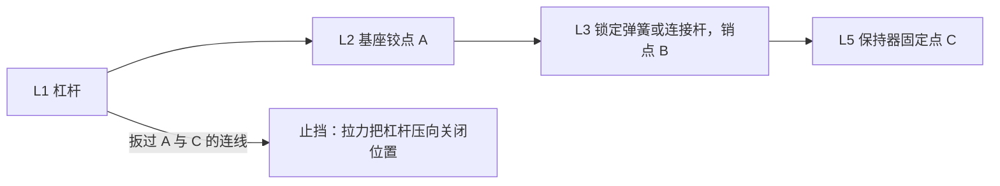

# 过中心拉伸搭扣（Southco 97）：杠杆过死点自锁，把箱盖拉向箱体

> [!summary] 一句话概述
> 过中心拉伸搭扣（draw latch / over-center latch）用杠杆拉动钩在箱盖保持器上的拉紧件，当杠杆销越过「底座铰点与保持器」的连线后，拉力会把杠杆压向关闭止挡，箱盖被拉向箱体并自锁；要打开必须把杠杆再扳回死点另一侧。Southco 97 小型目录给出钳力 135 N，较大规格分轻载 310 N 与重载 670 N。它和四分之一转快锁不是同一结构：本篇是杠杆过死点拉紧，不是 90° 凸轮钉。

## 配图

![[附件/southco-97-overcenter-latch.jpg]]
*图源：[Southco 97 拉动式门锁（上偏心）中文目录](https://media.southco.com/media/static/Literature/97.zh.pdf) 第 330 页；左上为实物，右侧标注了杠杆、基座、锁定弹簧，以及门/门框接合部与「未受压（未锁定）」状态的尺寸*

![[附件/southco-97-keepers-s-dimension.jpg]]
*图源：同上；五种保持器（隐藏式双孔、隐藏式单孔单突缘、单孔挂钩式、外露式单孔、外露式单孔单突缘）以及按保持器类型给出的尺寸 S。门锁和保持器需另行订购*

> 图片版权归原作者所有，仅作个人学习收藏；出处见文末「来源与核实记录」。

## 结构原理

> 本节所有数字只写来源里给出的；来源没有就写「来源未给出」。

### 堆叠方案

方向：**从箱体上的杠杆外侧，到箱盖上的保持器**

| 层级 | 零件 | 材料 | 厚度/尺寸 | 固定方式 | 依据 |
| --- | --- | --- | --- | --- | --- |
| L1（最外，操作侧） | 杠杆 | 与门锁相同：不锈钢或钢，镀锌（小型 97） | 小型目录给出杠杆/基座外形，例如基座长 27.4 mm、杠杆侧高 12.6 mm 等，以该页毫米为准 | 铰接在基座上，用手扳动 | 97 中文目录第 330 页标注「杠杆」「基座」 |
| L2 | 基座 | 同上 | 用 M3 圆头螺钉或 3 mm 铆钉安装（不提供） | 固定在箱体（或一门）上 | 同上「安装说明」 |
| L3 | 锁定弹簧（小型 97）或连接杆（较大 97） | 小型为锁定弹簧；较大规格按轻载/重载选短、中、长连接，L = 29.4 / 42.1 / 54.8 mm | 未锁定时处于「未受压」位置（小型图注 22.6 mm） | 一端连杠杆，另一端钩住保持器 | 中文目录第 330–331 页 |
| L4 | 门/门框接合缝 | 应用自定 | 小型图上标出接合部间隙 0.9 mm（该图状态）；保持器表格用尺寸 S 对位，S 随保持器为 14.7、14.7、21.8、33 或 27.4 mm | 被拉紧件拉近 | 同上，保持器表「尺寸 S」 |
| L5 | 保持器（箱盖或另一门） | 钢或不锈钢，与所选零件号对应 | 见保持器外形图（例如单孔挂钩式销径 Ø 5.2 mm 等，以该页为准） | M3 螺钉或铆钉；挂钩式保持器改用 M3 平头螺钉或铆钉 | 安装说明与保持器图 |

剖面示意：

独立机构对同一动作的表述：

- Jönköping University《Applied Mechanics》12.5 节把工具箱拉伸搭扣、大力钳和快速夹具归为过中心机构：三个铰点中两段距离由刚性件固定，第三段随运动变化；装置停在三个铰点共线位置（死点）稍稍越过的一侧。越过之后，张力产生的力矩变号，把杠杆压向止挡；外力越拉，关闭位置越被压紧。精确停在死点本身并不是可靠锁止。该章还提到，若止挡装在尚未过死点的一侧，松手会弹开。
- Protex 把同一类箱扣做成刚性爪（rigid claw）或弹簧爪（spring claw）。刚性爪建议在扣与扣板之间加橡胶类密封以提供弹性；否则建议改用弹簧钢弯丝或螺旋弹簧的弹簧爪。拉伸弹簧爪超过最大工作载荷会永久变形，压缩弹簧爪超过后会并圈变刚性。可调型用螺杆或带螺纹的眼形螺栓，目录写明至少 10 mm 调节量。

这些是同一类「杠杆拉紧、过死点自锁」的运动。具体钳力、连接长度和保持器 S 值，要以 Southco 97 对应规格为准，不要把 Protex 的极限拉力（UTS）当成 97 的钳力。

### 零件清单

| 零件 | 数量 | 功能 | 材料 | 依据 |
| --- | --- | --- | --- | --- |
| 杠杆 | 每锁 1 | 提供力臂，把拉紧件带过死点 | 见上表 | 97 中文目录 |
| 基座 | 每锁 1 | 提供固定铰点与关闭止挡 | 见上表 | 同上 |
| 锁定弹簧或连接杆 | 每锁 1 | 钩住保持器并产生拉力 | 小型为锁定弹簧；较大规格分轻载/重载连接 | 第 330–331 页 |
| 保持器 | 每锁 1 | 在箱盖侧提供钩挂点 | 钢 97-37-xxx-11 或不锈钢 97-37-xxx-24（小型表） | 零件号表 |
| 辅助锁扣（可选） | 可选 | 「抵御剧烈震动和防止意外开启」 | 钢 97-58-101-11 或不锈钢 97-58-101-25；英文页注 17-7PH 或不锈钢/1075 钢 | 第 331 页 |

### 装配顺序

按目录的选型/安装逻辑（不是某一现场的工艺卡）：

1. 按箱盖与箱体的接合位置选择保持器形式，并采用该保持器对应的尺寸 S 布置孔位。小型 97 的 S 为 14.7 mm（两种隐藏式）、21.8 mm（单孔挂钩式）、33 mm（外露式单孔）或 27.4 mm（外露式单孔单突缘）。
2. 用 M3 圆头螺钉或 3 mm 铆钉把门锁基座装到箱体上（紧固件不随锁提供）。若用挂钩式保持器，改用 M3 平头螺钉或铆钉。较大 97 改用 M4 圆头螺钉或 4 mm 铆钉，挂钩式仍用平头。
3. 把保持器装到箱盖（或另一侧）上。门锁和保持器需分开订购。
4. 合上箱盖，让拉紧件钩住保持器，扳下杠杆，使其越过死点并贴到关闭位置。较大规格若选挂锁型（拉环向上，零件号中 S = 3），还可加挂锁。
5. 打开时反向扳起杠杆，使拉紧件回到死点另一侧后再脱钩。需要抗剧烈震动时，目录提供弹簧加载辅助锁扣。

### 受力与运动分析

- **受力路径**：手力作用在杠杆上，经基座铰点变成对拉紧件的拉力，把箱盖保持器拉向箱体。Jönköping 教材指出，过死点后张力的力矩把杠杆压向止挡；试图拉开箱盖只会加大这个压紧趋势，直到零件本身破坏。Southco 给出的是钳力（小型 135 N，较大规格轻载 310 N、重载 670 N），不是破坏载荷。
- **运动关系**：工作动作是杠杆在平面内摆动，带动拉紧件的活动销越过「基座铰点—保持器」连线。教材把这一位置称为死点；目录中文名是「上偏心」。拉紧件在通过死点时长度（或弹簧变形）达到极值，必须依靠锁定弹簧、密封条或结构弹性才能越过去。
- **失效风险**：没有越过死点就松手，杠杆会被拉力扳回打开（教材中的「止挡装错侧」）。保持器类型或尺寸 S 与门缝不匹配，会钩不牢或无法过死点。把 Protex 一类目录里的 UTS（按 30 mm/min 拉伸、不含安全系数，并建议把约一半当作安全工作载荷）直接当成 Southco 钳力使用，会选错规格。刚性拉杆若完全没有弹性，理论上也过不去死点——这是推断，来源用弹簧爪或密封来解决。

## 设计要点与参数

| 要点 | 内容 | 依据 |
| --- | --- | --- |
| 动作 | 杠杆过死点（上偏心）后自锁，把箱盖拉向箱体 | 97 中文目录标题「上偏心」；Jönköping 12.5 节 |
| 小型 97 钳力 | 135 N（英文目录同时写 30 lbf） | 中文第 330 页；英文 97.en.pdf |
| 较大 97 钳力与连接长 | 轻载 310 N，重载 670 N；短/中/长连接 L = 29.4 / 42.1 / 54.8 mm | 中文第 331 页 |
| 安装 | 小型：M3 圆头螺钉或 3 mm 铆钉；挂钩式保持器用平头。较大：M4 或 4 mm 铆钉 | 同上 |
| 保持器 S | 14.7 / 14.7 / 21.8 / 33 / 27.4 mm，随保持器类型 | 第 330 页表格 |
| 材料 | 小型：不锈钢或钢，镀锌。较大：不锈钢，钢镀锌或钢黑色粉末涂层 | 第 330–331 页 |
| 辅助锁扣 | 可选，用于剧烈震动和防意外开启 | 第 331 页 |
| 独立品牌对照（不是 97 的数） | Protex 目录用极限拉力 UTS（千克，拉伸速度最大 30 mm/min，不含安全系数），并建议安全工作载荷约取一半；举例 01-589 镀锌件 UTS 为 50 kg。刚性爪建议加密封弹性，弹簧爪提供回弹，可调型至少 10 mm 调节量 | Protex Full Catalog「General Fastener Guide」与 10/01-589 表 |

## 优缺点

**优点**
- 一次扳动即可拉紧箱盖，适合需要压缝或压紧密封条的箱体
- 过死点后，向外拉开的力会把杠杆更紧地压向止挡，不靠摩擦维持关闭
- 保持器形式多，可按是否外露、能否用挂钩来选
- 较大规格可用连接长度和轻载/重载分档，还可加挂锁或辅助锁扣

**缺点 / 代价**
- 杠杆关闭后会高出安装面，不像嵌入式蝴蝶锁那样齐平，堆叠和防刮挂不如沉盘锁
- 必须真正越过死点；差一点点看起来「关上了」，载荷下一拉就开
- 钳力、UTS、安全工作载荷不是同一个量，跨品牌不能混抄
- 门缝和保持器 S 要配对，装偏了会钩不上或拉过劲

## 可借鉴点

- **过中心锁必须有「死点之后的止挡」**：停在正死点并不稳；止挡还在死点之前，松手就会弹开。
- **要能过死点，就得有一点弹性**：锁定弹簧、弹簧爪、密封条或结构弹性，用来越过拉紧件最长（或变形最大）的位置。
- **先定接合位置再选保持器和 S 值**，不要只按「看起来能钩上」打孔。
- **写清你用的是钳力还是破坏拉力**，并保留安全系数；Protex 自己建议把 UTS 的约一半当作安全工作载荷。
- 本结构是杠杆拉紧，不要和 [[Southco、DZUS 四分之一转快锁：90° 凸轮与按总材料厚度选钉长]] 的 90° 凸轮钉混成同一选型表。

## 与库中相似案例对比

| 对比项 | 本案例 | [[Southco、DZUS 四分之一转快锁：90° 凸轮与按总材料厚度选钉长]] | [[Mac Pro 2019 旋转把手外壳锁与免工具模块锁]] |
| --- | --- | --- | --- |
| 动作 | 杠杆过死点，拉杆把盖拉向箱体 | 约 90° 旋转，凸轮/横销爬上搭扣斜面 | 旋转把手后上拔外罩 |
| 锁紧原理 | 过死点后张力把杠杆压向止挡 | 凸轮峰 + 凹坑 + 弹簧预紧 | 整机互锁，不是过中心拉扣 |
| 选型关键 | 钳力档、连接长、保持器 S | 先算 TMT 再选钉长；外/内螺旋取舍 | 机箱模块锁，未按拉扣表 |
| 外廓 | 杠杆关闭后凸出安装面 | 钉头在面板外，较扁 | 把手是整机外观的一部分 |

## 相关案例

- [[Southco、DZUS 四分之一转快锁：90° 凸轮与按总材料厚度选钉长]]
- [[Mac Pro 2019 旋转把手外壳锁与免工具模块锁]]
- 分类索引：[[04-机构与运动 索引]]

## 来源与核实记录

- 主来源：[Southco 97 拉动式门锁（上偏心）中文目录](https://media.southco.com/media/static/Literature/97.zh.pdf)（目录页码 330–331；零件名称、钳力 135 / 310 / 670 N、保持器 S、安装螺钉、连接长度、辅助锁扣）
- 补充来源 1：[Southco 97 Draw Latch Over-center 英文目录](https://media.southco.com/media/static/Literature/97.en.pdf)（与中文目录同属 Southco，不另计机构；用于核对 135 N / 30 lbf 等）
- 补充来源 2：[Jönköping University, Applied Mechanics 12.5 Over-centre mechanisms](https://mechanics.ju.se/Mechanisms/OverCentre.html)（独立教材：三铰点、死点、力矩变号、止挡，以及止挡位置错误时会弹开）
- 补充来源 3：[Protex Fasteners Full Catalog](https://hardwaremfg.com/wp-content/uploads/2021/03/Protex-Full-Catalog-2-2.pdf)（独立品牌：刚性爪/弹簧爪/可调型，UTS 试验条件与 01-589 的 50 kg 示例）
- 核实：2026-11-22 下载并打开上述 PDF 与教材页面。thingsunpacked 一文有助于理解过中心，但插图自称为 AI 辅助，且部分转述 Southco/DESTACO，不作为本篇独立第二机构，也未采用其插图。
