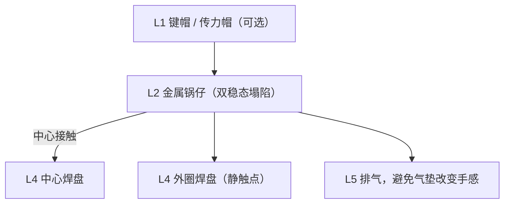

# 金属锅仔片阵列：直径、力值、行程与寿命互换

> [!summary] 一句话概述
> 金属锅仔片是一枚双稳态金属圆片：按到峰值力后中心塌陷，发出「咔嗒」并接通电路，松手弹回。直径、力值和寿命要一起选——Snaptron 手册里，同是 6 mm 的 F06180（180 g）寿命做到 500 万次，F06300（300 g）却只标 1 万次。硅胶在这里如果出现，只是上面的传力帽；PET 叠层如果出现，只是定位和电路的配角，主角仍是这枚金属圆片。

## 配图

![[附件/snaptron-force-displacement-curve.jpg]]
*图源：[Snaptron Design Guide v2.0](https://www.hannovermesse.de/apollo/hannover_messe_2022/obs/Binary/A1170559/Snaptron-Design-Guide_v2.0.pdf)「Metal Domes / Characteristics」页（手册页码 8）；左侧定义行程、寿命、厚度，右侧是 ASTM F2592 力—位移曲线：Fmax、Fmin、Fc 以及 tease 区间*

> 图片版权归原作者所有，仅作个人学习收藏；出处见文末「来源与核实记录」。

## 结构原理

> 本节数字只写来源给出的型号或定义；赫兹文中的「舒适区 180–220 gf」是该文经验，不是 Snaptron 某型号规格，分开标注。

### 堆叠方案

方向：**从手指/键帽到电路焊盘（单颗或阵列）**

| 层级 | 零件 | 材料 | 厚度/尺寸 | 固定方式 | 依据 |
| --- | --- | --- | --- | --- | --- |
| L1 | 执行器：键帽、橡胶帽或面板凸包（可选） | 来源未规定必须有 | 来源未给出通用厚度 | 把力传到锅仔中心 | Snaptron Switch Design 节；赫兹也提到 cover 层越厚手感越糊 |
| L2 | 锅仔片（可带中心凸点、背光孔、力集中特征） | 不锈钢，或镀镍等；未注字母即为未镀不锈钢 | 直径手册写 4–50 mm（标准款常见 4–37 mm）；厚度 0.002"–0.009" | 腿或外缘坐在外圈焊盘上 | Snaptron Introduction / Characteristics |
| L3 | 定位方式：单颗放置，或 Peel-N-Place 胶膜阵列 | PET 等载体 + 胶 | 来源未给出载体通用厚度 | 胶膜定位；也可叠两片加大力值 | Snaptron Dome Arrays；Characteristics「Dome Stacking」 |
| L4 | 电路焊盘：外圈通路 + 中心焊盘 | PCB、FPC 或其它导电面；镀层另选 | 手册按直径给出焊盘尺寸示例（如 4/5/6 mm 的 P1/P2 等，单位为手册图中英寸或毫米，见该页表） | 焊接/蚀刻在电路上 | Contact Pad Patterns |
| L5 | 排气路径 | 空气在锅仔下方进出 | 来源未给槽宽通用值 | 内排气（膜内或键间）或外排气 | Venting 节 |

剖面示意：

### 零件清单

| 零件 | 数量 | 功能 | 材料 | 依据 |
| --- | --- | --- | --- | --- |
| 金属锅仔片 | 每键 1，或叠两片 | 提供咔嗒手感并作为可动导体 | 不锈钢 / 镀镍等 | Snaptron |
| 定位胶膜或隔离层 | 阵列时 1 张 | 定位、防翻转 | PET + 胶 | Snaptron Arrays |
| 电路焊盘 | 每键一组 | 外圈常闭于锅仔腿，中心在塌陷时被接通 | PCB / FPC 等 | Snaptron |
| 传力帽 | 可选 | 只传力，不负责回弹 | 硅胶或硬帽 | 博皓在硅胶篇中的「外配锅仔」；本篇不把硅胶当主角 |

### 装配顺序

1. 按直径、目标力值、寿命和空间选型号（先看手册的「越大越容易在较高力值下保持寿命」这条关系，再核对具体型号）。
2. 按 Contact Pad Patterns 画中心/外圈焊盘，焊盘区内不要残留阻焊或多余膜（Snaptron：阻焊和薄膜不要出现在焊盘区内，否则污染和接触不良）。
3. 设计排气：内排气让空气在锅仔下方或键间流动，常见于薄膜开关或需要密封的场合；必须让空气能出去，否则气压会对手感和动作不利。
4. 单颗放置或贴 Peel-N-Place 阵列；需要更大按力又不想掉寿命时，手册提到可把两片同系列四腿锅仔叠起来。
5. 盖上键帽或面板。Snaptron 建议在量产前对具体应用做寿命测试，不要只抄目录寿命。

### 受力与运动分析

- **受力路径**：执行器把力传到锅仔顶部 → 力升到 Fmax（trip / 峰值力）后中心塌陷，力掉到 Fmin，中心碰到中心焊盘完成导通（Fc 为接触力）。松手后沿回弹曲线回到原弧面，电路断开。这是双稳态弹性跳跃，不是硅胶斜壁那种缓坡。
- **运动关系**：行程被定义为「锅仔高度减去材料厚度（若有凸点再减去凸点深度）」。除 M 系列外，Snaptron 写大多数锅仔会走到与腿/外缘平齐；M 系列可以过行程（中心低于外缘）。过行程可能把锅仔压成双稳态「塌住不回」，失去手感。
- **直径—力值—寿命**：手册写，一般而言直径越大，越能在较高触发力下仍保持可用寿命。反例必须用具体型号：F06180（6 mm，180 g）标到 500 万次；同直径的 F06300（6 mm，300 g）只标 1 万次。另一处对照：6 mm 的 SQ 系列可以做到 400 g、高达 1000 万次，而 6 mm F 系列在 500 万次寿命规格下只能到 180 g。
- **失效风险**：排气不良改变手感；焊盘污染或过软镀层（如 ENIG、碳墨）加速磨损；对中偏差——赫兹写偏差 0.2 mm 以上手感就会废；过行程导致不回弹；把力值选得过高，同直径寿命会掉几个数量级（见上例）。

## 设计要点与参数

| 要点 | 内容 | 依据 |
| --- | --- | --- |
| 直径与力值范围 | 直径 4–50 mm（标准常见 4–37 mm）；力值 40–6,800 g | Snaptron Introduction |
| 材料 | 多为不锈钢或镀镍；零件编号无字母表示未镀不锈钢，N 表示镀镍 | Snaptron 编号说明 |
| 厚度 | 标准厚度 0.002"–0.009"；镀层可能改变手感与电性能 | Characteristics |
| 行程定义 | 高度 − 材料厚度（− 凸点深度）；多数系列走到与外缘平齐 | Characteristics |
| 力曲线（ASTM F2592） | Fmax 峰值力，Fmin 最小回弹力，Fc 接触力；tactile ratio 与 Fmax、Fmin 的差有关，比值越高越「脆」；Fmin 与 Fc 之间的区间称为 tease | 手册曲线页 |
| 型号例：寿命互换 | F06180：6 mm、180 g，高达 500 万次；F06300：6 mm、300 g，仅 1 万次 | Snaptron |
| 型号例：系列差异 | 6 mm SQ 可达 400 g、高达 1000 万次；6 mm F 在 500 万次寿命规格下只到 180 g | Snaptron |
| 叠片 | 两片同直径、同力值的四腿锅仔可叠加以提高力值，而不按手册所述去牺牲寿命 | Characteristics「Dome Stacking」 |
| 排气 | 必须让锅仔下的空气进出；内排气用于薄膜或密封场合 | Venting |
| 赫兹经验（非 Snaptron 规格） | 消费电子峰值力常见舒适区 180–220 gf；太轻（<130 gf）易误触，太重（>300 gf）易累；侧键可 200–250 gf。行程经验 0.3–0.5 mm。对位偏差 0.2 mm 以上手感变差 | 赫兹 1069，2026-08-18。只作设计讨论，不是某型号合格线 |

## 优缺点

**优点**
- 手感段落清晰，力和寿命可以按型号表选
- 本身又是导体，薄膜开关里常常不再需要上层柔性电路
- 可以阵列化贴装，占高很小

**缺点 / 代价**
- 同直径把力值抬高，寿命可能从百万次掉到万次，必须看具体型号，不能按「都是 6 mm」类推
- 对焊盘清洁、排气和对中敏感
- 需要 PCB 或 FPC，成本高于纯硅胶或纯薄膜无弹片方案（赫兹的选型对比）
- 过行程会把锅仔压坏成「塌住」

## 可借鉴点

- **选型先问寿命再问力值**：先规定要 100 万次还是 500 万次，再看该直径、该系列还能给多大力。F06180 与 F06300 就是同一直径下的反例
- **行程按「高度−料厚」理解**，执行器不要把中心压过外缘（除非用允许过行程的系列，并做验证）
- **焊盘区保持干净**，按手册的焊盘图做中心/外圈，不要把阻焊铺进接触区
- **给空气留路**：密封面板尤其要做内排气，否则手感会被气垫改掉
- 硅胶帽只负责传力和防水时，锅仔才是手感来源；不要用加厚 cover 去「补手感」，赫兹的经验是 cover 越厚越糊

## 与库中相似案例对比

| 对比项 | 本案例（金属锅仔片） | [[硅胶导电按键：斜壁荷重、碳粒与排气槽]] | [[16 英寸 MacBook Pro 剪刀脚键盘：1 mm 键程与交叉支架（对照蝶式）]] |
| --- | --- | --- | --- |
| 主角 | 双稳态金属圆片 | 硅胶斜壁 + 导电粒 | 交叉塑料支架 + 橡胶穹顶 |
| 力曲线 | 有明显塌陷（Fmax→Fmin） | 缓坡，Click Ratio 靠斜壁调 | 该篇重点在 1 mm 键程与支架厚度 |
| 硅胶角色 | 最多做传力帽 | 主角 | 该键盘用橡胶穹顶储能，不是本篇这种导电粒硅胶垫 |
| PET 叠层 | 只作定位膜时出现 | 无 | 无 |

## 相关案例

- [[硅胶导电按键：斜壁荷重、碳粒与排气槽]]
- [[16 英寸 MacBook Pro 剪刀脚键盘：1 mm 键程与交叉支架（对照蝶式）]]
- [[苹果蝶式键盘（反面案例）：变薄 40% 的代价与硅胶防尘膜补救]]
- 分类索引：[[04-机构与运动 索引]]

## 来源与核实记录

- 主来源：[Snaptron Design Guide v2.0 — Engineering Handbook for Metal Dome Switch Design](https://www.hannovermesse.de/apollo/hannover_messe_2022/obs/Binary/A1170559/Snaptron-Design-Guide_v2.0.pdf)（Snaptron，经汉诺威工博会资料库转存，21 页）——直径与力值范围、F06180/F06300/SQ 对照、力曲线定义、排气与焊盘
- 独立第二来源（中文）：[产品按键手感设计实战——锅仔片、硅胶按键、薄膜开关](https://www.hezidesign.com/jingyan/1069.html)（赫兹工业设计，王然，页面标注 2026-08-18）——方案对比、舒适力值经验、对位与 cover 厚度的实战观察
- 核实：2026-11-17 下载 Design Guide 并打开赫兹页面。Snaptron 官网术语页与 F 系列产品页为同一公司，本篇未再当作独立来源。未把赫兹经验值写成 Snaptron 规格。
