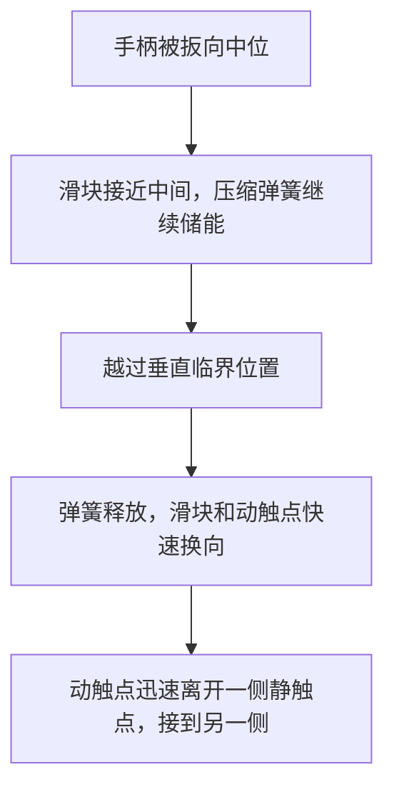

# 钮子拨杆开关：手柄过中后压缩弹簧把动触点快速切换到另一侧静触点

> [!summary] 一句话概述
> 钮子开关（拨杆开关）用外露手柄拨动内部滑块和动触点：手柄被扳到中位附近时压缩弹簧继续储能，一旦越过垂直临界位置，弹簧就把滑块连同动触点迅速推离一侧静触点、接到另一侧，形成比手拨更快的分断。它不是跷板开关那种外部翘板带着柱塞在触桥上滑过，也不是轻触开关那种短行程金属弹片。云恒与利托都强调这种快动是为了缩短触点缓慢接触产生的电弧；两文都没有给出某一具体型号的额定电流、行程或寿命数字。

## 配图

![[附件/toggle-yhzz-structure.png]]
*图源：[云恒制造《钮子开关的原理与特性》，2025-03-25](https://www.yhzz.com.cn/a/24710.html)；文章配图，用于说明钮子开关的外部拨杆形态*

![[附件/toggle-yhzz-02.png]]
*图源：同上；文章配图之二*

![[附件/toggle-yhzz-03.png]]
*图源：同上；文章配图之三*

> 图片版权归原作者所有，仅作个人学习收藏；出处见文末「来源与核实记录」。

## 结构原理

> 本节所有数字只写来源里给出的；来源没有就写「来源未给出」。

### 堆叠方案

方向：**从操作手柄到安装面/接线端**

| 层级 | 零件 | 材料 | 厚度/尺寸 | 固定方式 | 依据 |
| --- | --- | --- | --- | --- | --- |
| L1（最外） | 操作手柄（扳手 / 旋钮柄） | 金属或塑料。利托列举金属圆锥、塑料圆锥、荧光、球形、扁平杆、锁定杆、桨叶等多种外形 | 来源未给出长度 | 可绕支点拨动；锁定杆或「提起再拨」型另有弹簧约束 | 云恒；利托 |
| L2 | 联动滑块（利托称单刃滑块）与压缩弹簧 | 弹簧：来源未给出牌号 | 来源未给出 | 手柄带动滑块；过中前继续压缩弹簧 | 利托 |
| L3 | 动触点 / 可动接触片 | 云恒：多为银合金或铜镀银 | 来源未给出 | 随滑块快速从一侧静触点转移到另一侧 | 云恒；利托 |
| L4 | 静触点（稳定器脚） | 同上 | 来源未给出 | 固定在绝缘底座上，对应 2 位或 3 位档 | 利托；云恒 |
| L5 | 外壳与底座 | 尼龙、热塑性塑料等绝缘材料（云恒） | 来源未给出 | 包裹内部、提供安装与防触电 | 云恒 |

剖面示意：

云恒用双刀双掷（DPDT）举例：手柄在中间时两路都断开，向上接通第一组，向下接通第二组。利托补充：操作位置有 2 位和 3 位；3 位开关可以有某一侧位置不确定（不定位/点动，原文表述为「某一侧的位置不确定」）。锁定杆用于危险操作；「拔出锁定解除」式手柄带弹簧，螺纹口端有铣槽，必须先提起再拨到其他位置。

### 零件清单

| 零件 | 数量 | 功能 | 材料 | 依据 |
| --- | --- | --- | --- | --- |
| 手柄 | 1 | 人工拨档、提供档位姿态 | 金属或塑料 | 云恒；利托 |
| 滑块 | 1（利托所描述的单刃滑块结构） | 把手柄角位移变成触点切换，并压缩弹簧 | 来源未给出 | 利托 |
| 压缩弹簧 | 至少 1 | 过中后释放，加快触点分断与闭合 | 来源未给出 | 利托；云恒 |
| 动触点 | 随极数变化，来源未给出统一数量 | 在静触点间切换 | 银合金或铜镀银（云恒：多为） | 云恒 |
| 静触点 | 随 2 位/3 位和极数变化 | 形成稳定接通位置 | 同上 | 利托 |
| 绝缘壳与底座 | 1 套 | 绝缘、安装、保持内部几何 | 尼龙或热塑性塑料（云恒） | 云恒 |

### 装配顺序

来源没有给出工厂装配步骤，只给出使用中的动作顺序。按利托描述的动作阶段理解装配关系（不是某厂作业指导书）：

1. 静触点固定在绝缘底座上，形成 2 位或 3 位的停留位置。
2. 装入压缩弹簧与单刃滑块，使滑块在两侧位置都能被弹簧压稳。
3. 装上手柄，保证手柄中位与滑块垂直临界位置对应。
4. 如为提起解锁型，先装手柄上的弹簧和铣槽约束，使未提起时不能换档。
5. 盖上外壳并做安装固定。接线按极数和常开/常闭或切换定义进行。具体扭矩、孔径来源未给出。

### 受力与运动分析

- **受力路径**：手指力矩作用于手柄 → 滑块移动并压缩弹簧 → 过中后弹簧力驱动滑块和动触点快速换向。分断速度由弹簧压力和运动件摩擦决定，而不是手拨有多快（利托）。
- **运动关系**：动作分两段。第一段手把扳手拉到中间（垂直位置），滑块前部接近中位并进一步压缩弹簧；第二段过中后弹簧把滑块推向另一侧，动触点迅速脱离一个静触点、接上另一个。云恒把这写成「弹簧的瞬时动作实现快动，避免触点因缓慢接触产生火花」。
- **失效风险**：弹簧疲劳或摩擦增大后，快动变慢，电弧时间变长（由结构可直接推出，推断）。锁定型如果锁舌或提起弹簧失效，可能在振动中自行换档，或反过来锁死拨不动（推断）。两文都没有给出电气寿命或接触电阻的测试数据。利托提到可用于交直流电源通断，也可用于「几千赫兹或高达 1 兆赫兹」的电路，但未给出额定电压电流，选型时仍要查具体型号数据表，不能把这段能力范围写成某一颗开关的额定值。

## 设计要点与参数

| 要点 | 内容 | 依据 |
| --- | --- | --- |
| 快动机制 | 过中后靠压缩弹簧，而不是靠手拨速度来分断触点 | 利托；云恒 |
| 档位 | 2 位或 3 位；3 位可有一侧不定位 | 利托 |
| 电路形式 | 云恒举例 DPDT：中位两路皆断，上、下各通一组 | 云恒 |
| 防误操作 | 锁定杆；或提起后再拨的解锁柄（柄上有弹簧，螺纹口端有铣槽） | 利托 |
| 触点材料 | 多为银合金或铜镀银 | 云恒 |
| 适用电路 | 利托：主要用于交直流电源通断，一般也可用于几千赫兹至 1 兆赫兹。额定电流、电压、寿命：两文均未给出 | 利托 |
| 触点切换时间 | 利托写「毫秒左右」，后文数据表述不清，不采用具体测值 | 利托 |

> 来源没有给出的参数一律写「来源未给出」，不估算、不编造。

## 优缺点

**优点**
- 档位姿态看得清，适合电源和功能切换，不像轻触那样松开就回
- 过中快动由弹簧完成，有利于缩短电弧（两文共同观点）
- 手柄外形和锁定方式可按误操作风险选型

**缺点 / 代价**
- 需要面板开孔和手柄活动空间，做不进超薄消费电子按键区
- 没有数据表就无法确认电流、寿命和防护等级，不能只凭「可用于电源电路」一句话选型
- 3 位不定位或中位断开的定义必须和电路图一致，装错会变成「怎么拨都是另一路」

## 可借鉴点

- 画清临界位置：手柄垂直、弹簧最压缩、触点即将跳跃，这三点应当对齐。过中行程不够，手感会发粘，电弧也会变长。
- 电源开关或有危险的动作，优先选带锁定或「先提起再拨」的手柄，不要只用普通 2 位拨杆。
- 需要保持通断状态时用钮子；需要点一下就回的，用轻触或按钮，不要把钮子装成「假按钮」。
- 触点材料只知道「多为银合金或铜镀银」时，低电流信号或含硫环境仍要查具体镀层和最小适用负载，本文给不出这组数字。

## 与库中相似案例对比

| 对比项 | 本案例（钮子拨杆） | [[跷板开关的弹簧柱塞：滑动压点、摇动触桥与中位自定心]] | [[轻触开关壳体封装金属弹片：盖板、推杆与锅仔片反转导通（以 Omron B3F 为例）]] | [[ALPS EC11 旋转编码器：11 mm 金属轴增量脉冲与可选按压开关]] |
| --- | --- | --- | --- | --- |
| 操作件 | 外露拨杆，停在 2 或 3 个角度 | 外部跷板，按两端 | 短行程直按推杆，松开即回 | 旋转轴，不是拨杆档位 |
| 内部动作 | 滑块过中，弹簧把动触点快速换到另一静触点 | 柱塞在触桥上滑动，改变触桥姿态 | 圆形金属弹片反转 | 增量脉冲码盘或类似机构 |
| 保持 | 有机械停留档，松手保持 | 通常保持在一端或中位 | 瞬时，不保持 | 旋转位置由后面电路计数 |
| 何时用这篇 | 要做带明确拨档和快动分断的电源/功能开关 | 要做面板船型或跷板开关 | 要做短行程点击信号键 | 要做旋转参数调节 |

## 相关案例

- [[跷板开关的弹簧柱塞：滑动压点、摇动触桥与中位自定心]]
- [[轻触开关壳体封装金属弹片：盖板、推杆与锅仔片反转导通（以 Omron B3F 为例）]]
- [[灶具旋钮轴向解锁：先推或拉解除转动约束，阀芯压紧与解锁分工]]
- 分类索引：[[04-机构与运动 索引]]

## 来源与核实记录

- 主来源：[云恒制造，《钮子开关的原理与特性》，2025-03-25](https://www.yhzz.com.cn/a/24710.html)（2026-11-27 打开并下载文章配图。手柄、触点系统、弹簧快动、绝缘外壳，以及 DPDT 中位断开的例子来自该文。）
- 交叉来源：[东莞市利托电子有限公司，《工业钮子开关原理及分类》，2022-05-31](https://www.dglte.cn/news/58.html)（2026-11-27 打开。独立第二机构。两段式动作、单刃滑块与压缩弹簧、2 位/3 位、锁定柄和提起解锁柄来自该文。文中切换时间表述不完整，未写入参数表。）
- 核实：2026-11-27 打开上述两页。未把本篇写成跷板开关或轻触开关，也未编造额定电流和寿命。
