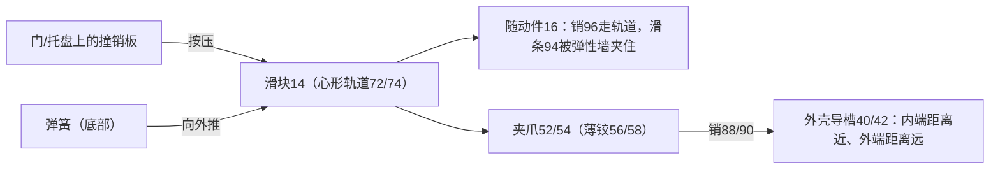

# 防变形静音 Push-Push 按压弹跳锁（ITW 专利 EP1596030）

> [!summary] 一句话概述
> 经典的按压弹跳锁用「心形槽 + 随动销」实现按一下锁、再按一下弹开；这件 ITW 专利针对夹爪长期闭合后塑料蠕变（set）张不开、刮住撞销发出噪音甚至打不开的问题，在每个夹爪上加一根销、插进外壳上的斜向导槽，让夹爪在每次动作时被**强制**完全张开/闭合。

## 配图

![[附件/push-push-latch-ep1596030.png]]
*图源：EP1596030A2 附图第 1 页（Google Patents）。Fig.1 总装；Fig.2/3 外壳 12（导槽 40/42、弹性夹持槽 30/34/38、随动件 16 出厂时与外壳连在一起）；Fig.4 滑块 14（夹爪 52/54 经薄铰 56/58 连在本体上、心形墙 72 与岛 74 组成循环轨道）*

> 专利附图为公开文献，仅作个人学习收藏。

## 结构原理

> 本节数字只写来源里给出的；来源没有就写「来源未给出」。专利描述的是设计方案，不等于某款量产产品。

### 堆叠方案

方向：**从外壳前壁向内**（Fig.1 前视方向）

| 层级 | 零件 | 材料 | 厚度/尺寸 | 固定方式 | 依据 |
| --- | --- | --- | --- | --- | --- |
| L1 | 外壳 12 前壁 18：槽 30（一侧为悬臂弹性墙 36/弹臂 38）、导槽 40/42 | 塑料 | 来源未给出 | 外壳通过颈圈 46 安装到产品上 | 说明书「Housing 12…」段 |
| L2 | 随动件 16：前面滑条 94 卡在槽 30，背面销 96 伸进心形轨道 | 塑料 | 槽 30 比滑条略窄，弹性墙被轻微撑开 | 被弹性墙夹住 | 说明书「Follower 16…」段 |
| L3 | 滑块 14 正面 60：心形墙 72 + 岛 74 组成循环轨道，口袋 76（锁住）/78（打开） | 塑料 | 来源未给出 | 在外壳内轴向滑动，背面凸起 68 走外壳背面槽 44 | 说明书「Slide 14…」段 |
| L4 | 夹爪 52/54（经薄铰 56/58 与滑块一体），爪上销 88/90 插入导槽 40/42 | 塑料 | 来源未给出 | 一体成型 | 说明书、权利要求 15 |
| L5 | 弹簧（图中未画） | 来源未给出 | 来源未给出 | 位于外壳底 26 与滑块之间，把滑块向外推 | 说明书「A spring (not shown)…」 |

剖面示意：

### 零件清单

| 零件 | 数量 | 功能 | 材料 | 依据 |
| --- | --- | --- | --- | --- |
| 外壳 12 | 1 | 导向、导槽、夹持随动件 | 塑料 | 说明书 |
| 滑块 14（含夹爪） | 1 | 心形轨道 + 抓住撞销板 | 塑料，一体成型 | 说明书 |
| 随动件 16 | 1 | 在心形轨道中切换锁/开状态 | 塑料；可与外壳一起注塑、以薄连接筋相连，装配时折断 | 说明书 |
| 弹簧 | 1 | 把滑块推出 | 来源未给出 | 说明书 |
| 撞销板（被锁物上） | 1 | 被夹爪抓住 | 来源未给出 | 说明书 |

### 装配顺序

1. 外壳与随动件一起注塑，装配时折断连接薄筋，取下随动件。
2. 弹簧放入外壳底部。
3. 滑块装入外壳，背面凸起 68 进入背面槽 44；夹爪上的销 88/90 进入前壁导槽 40/42。
4. 随动件放在滑块与外壳前壁之间：滑条 94 压进槽 30（弹性墙被撑开而夹紧），销 96 伸进心形轨道。

### 受力与运动分析

- **运动关系**（专利 Fig.6–11）：
  1. 打开状态：随动销在口袋 78。按压滑块，心形墙的斜段 100 把随动件推向一侧，直到抵住转向块 102，滑块「到底」。
  2. 松手：滑块在弹簧作用下略微外移，随动销落入岛 74 上的口袋 76 → 锁住（夹爪闭合抓住撞销板）。
  3. 再按：转向块 102 从另一侧推动随动销；松手后随动销从岛 74 另一侧绕出，回到口袋 78 → 打开（夹爪张开放开撞销板）。
- **夹爪强制定位**：导槽内端彼此距离比外端近，滑块的每个位置都对应确定的夹爪张开量，因此即使长期闭合后出现塑料蠕变，夹爪也会被销和导槽强制完全张开，不会刮住撞销板。
- **防误动**：弹性墙始终夹住随动件滑条，设备被倾斜、翻转、颠簸时随动件不会跑出口袋。
- **失效风险**（专利背景所述的旧方案问题）：柔性夹爪长期闭合产生永久变形（高温环境如车内、发热电子设备会加速），张不全会刮撞销 → 噪音、动作延迟或完全打不开。

## 设计要点与参数

| 要点 | 内容 | 依据 |
| --- | --- | --- |
| 心形轨道位置 | 做在滑块正面凹槽里，随动件独立 | 说明书 |
| 夹爪开合 | 夹爪上的销 + 外壳斜导槽 = 位置控制，而不是靠塑料自身回弹 | 权利要求 8–10 |
| 导槽方向 | 内端距离 < 外端距离 | 权利要求 10、16 |
| 随动件防窜 | 槽一侧做成悬臂弹性墙夹住滑条 | 权利要求 11–13 |
| 零件合并 | 随动件与外壳同模注塑、装配时折断 | 说明书 |
| 行程、弹簧力、轨道尺寸 | 来源未给出 | — |

## 优缺点

**优点**
- 把「塑料件回弹」换成「几何强制定位」，消除蠕变导致的卡滞和噪音
- 外壳、滑块、随动件三个塑料件 + 一根弹簧，零件少；随动件与外壳同模

**缺点 / 代价**
- 多了销—导槽配合，导槽磨损和公差会影响动作顺滑（推断）
- 专利未给出寿命、动作力数据

## 可借鉴点

- 塑料弹性件长期受载时，用凸轮/导槽强制复位，而不是依赖材料回弹
- Push-push 的随动件要考虑「设备翻转时会不会自己跑位」，加一个轻微夹持即可
- 小零件可与主体同模连筋成型，装配时折断，减少模具和物料号

## 相关案例

- [[按动圆珠笔：旋转凸轮的按压伸缩机构]]（同为「按两次切换」，但用旋转分度凸轮而非心形轨道）
- [[活动铰链（Living Hinge）：一体成型的柔性铰链]]（夹爪薄铰）
- [[卡扣三种基本形式：悬臂、环形、扭转]]
- 分类索引：[[04-机构与运动 索引]]

## 来源与核实记录

- 主来源：[EP1596030A2 - Distortion resistant silent push-push latch](https://patents.google.com/patent/EP1596030A2/en)（Illinois Tool Works Inc.；申请 2005-04-19，公开 2005-11-16，2009-06-17 授权 EP1596030B1；发明人 Joseph J. Bella 等）
- 核实：2026-11-13 打开 Google Patents 页面，阅读背景、发明内容、实施例与权利要求 1–20，核对零件编号；下载附图第 1 页。
