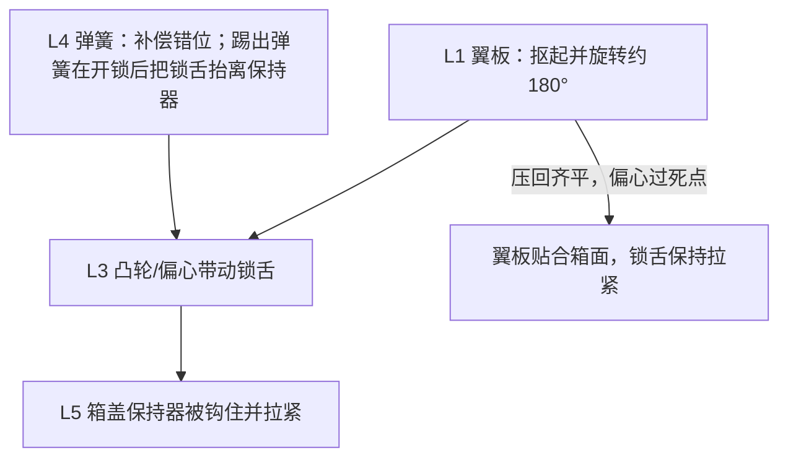

# 飞行箱嵌入式蝴蝶锁：旋转翼板 180° 钩住保持器（对照直线拉扣）

> [!summary] 一句话概述
> 飞行箱常用的蝴蝶锁（butterfly latch / twist catch）不是把一根长杠杆翻过去做直线拉紧，而是用手抠起并旋转一块翼板，内部凸轮或偏心带动锁舌钩住箱盖上的保持器，再把翼板压回与箱面齐平；TCH 把开合写成 180° 旋转。沉盘把机构藏进箱壁，便于堆叠。它与拉伸搭扣（draw latch）都可能带过中心，但运动副不同，不能当成同一结构。

## 配图

![[附件/penn-elcom-l925-recessed-butterfly.jpg]]
*图源：[Penn Elcom L925T/525/38 大号深盘嵌入式蝴蝶锁](https://www.penn-elcom.com/lc/large-recessed-latch-with-kick-out-spring-in-deep-dish-l925t-525-38)；翼板、中央凸轮、两侧弹簧和上半盘里的保持器都装在沉盘里，开槽把锁体和保持器分到箱体与箱盖两侧*

![[附件/nrh-6306-butterfly-latch.jpg]]
*图源：[纳汇蝴蝶锁产品图，见于其 FAQ 文](https://www.nrh.hk/newcenter/product-faq/20827.html) 及 [蝴蝶锁产品线](https://www.nrh.hk/product/case-latches/butterfly-latches)；表面安装的翼板、中央转轴和两侧钢丝弹簧，上方为独立保持器*

![[附件/nrh-butterfly-blade-closeup.jpg]]
*图源：[纳汇「蝴蝶锁扣是什么」](https://www.nrhwj.com/m/news/ask/3241.html)；近景可以看到翼板转轴、锁舌前端的钩形，以及钩住保持器后的贴合面*

> 图片版权归原作者所有，仅作个人学习收藏；出处见文末「来源与核实记录」。

## 结构原理

> 本节所有数字只写来源里给出的；来源没有就写「来源未给出」。

### 与直线拉扣的运动差异

这是本篇能单独成文的前提。两套机构都可能「过中心」，但手部和内部的运动不是一回事：

| 对比项 | 本篇：蝴蝶锁 / 扭转锁（twist catch） | 拉伸搭扣（draw latch，如 Southco 97） |
| --- | --- | --- |
| 手部动作 | 抠起翼板，在大致平行于箱面的平面内旋转（TCH：180° 开合），再把翼板压回齐平 | 在垂直于箱面的平面内翻下一根杠杆 |
| 内部传动 | 翼板带动凸轮/偏心，使锁舌移入并拉紧保持器（纳汇：偏心轴转动，锁舌拉入副锁钩片） | 杠杆直接拉动锁定弹簧或连接杆，把它钩在保持器上拉紧 |
| 安装外廓 | 常见嵌入沉盘，关闭后与箱面齐平，利于堆叠（Penn Elcom、TCH） | 杠杆关闭后通常凸出安装面 |
| 保持器位置 | 可与锁体分装在沉盘的上下两半（嵌入式），或单独一块扣板 | 单独的保持器/扣板，装在箱盖一侧 |

Penn Elcom 把 recessed latch 的核心写成「twist-locking mechanism」，并把 draw latch 另列为「像行李箱扣那样把两部分拉到一起产生张力」的类型。TCH 则把 twist / butterfly latch 定义为：用旋转凸轮和杠杆去咬住保持器。若来源只能写出「也是过中心」而画不出这条旋转翼板路径，本篇就不能成立。

另需避开的混淆：Pelican 一类防护箱上常见的 Double-Throw、以及部分塑料箱的双级杠杆扣，外观有时也被叫「箱扣」，但其主运动仍是翻杠杆拉紧，应归入拉伸搭扣，而不是本篇的旋转翼板。

### 堆叠方案

方向：**从箱体表面外侧，到沉盘里的锁体，再到箱盖上的保持器**

| 层级 | 零件 | 材料 | 厚度/尺寸 | 固定方式 | 依据 |
| --- | --- | --- | --- | --- | --- |
| L1（最外） | 蝴蝶形翼板（扭转片） | 钢镀锌（Penn Elcom、TCH 常规）；可选不锈钢（TCH 部分型号） | 关闭后贴合箱面或沉入盘内。Penn Elcom L925T/525/38 沉盘深 16 mm，外形 17.4 cm × 12.7 cm | 绕中央轴旋转，用手抠起、转动后再压回 | 纳汇中文文「蝴蝶形手柄（扭转片）」；Penn Elcom 产品页 |
| L2 | 沉盘（嵌入式）或底座安装壳 | L925：1.2 mm 钢 | 盘深：该型号 16 mm（同系列还有 10 mm 盘深；带偏移的型号 Offset 27 mm） | 嵌入箱壁开孔，用盘缘孔铆接。L925 为 14 个安装孔 | Penn Elcom；flightcase-brico 安装叙述 |
| L3 | 凸轮 / 偏心与锁舌 | 来源未给出单独材料 | 来源未给出锁舌行程数值。TCH：弹簧可自动补偿中型/大型最多 0.16 in（4 mm）、小型最多 0.11 in（2.7 mm）的错位 | 由翼板驱动，钩住并拉紧保持器 | 纳汇「传动与偏心机构」「锁舌与锁钩」；TCH 弹簧补偿 |
| L4 | 补偿弹簧或踢出弹簧 | L925 该型号带 kick-out spring；纳汇图可见两侧钢丝弹簧 | 踢出弹簧在打开后把锁体抬起，给保持器让位。flightcase-brico 写弹簧会把锁扣踢到大约 30° 以下的角度 | 装在锁体上 | Penn Elcom「Kick-out Spring」；TCH optional kick-out |
| L5 | 保持器（副锁钩片） | 与锁体配套的钢件 | L925 分缝到孔心：上 17.5 mm、下 19.7 mm；并写明适配 L0526 背板 | 嵌在箱盖一侧的半盘里，或单独铆在盖上 | Penn Elcom；纳汇「副锁在箱盖」 |

剖面示意：

### 零件清单

| 零件 | 数量 | 功能 | 材料 | 依据 |
| --- | --- | --- | --- | --- |
| 翼板 | 每锁 1 | 手操、把旋转传给偏心 | 见上表 | 纳汇；TCH；Penn Elcom |
| 沉盘或底座 | 每锁 1（嵌入式为上下两半盘） | 提供齐平安装面并保护机构 | L925：1.2 mm 钢 | Penn Elcom |
| 凸轮/偏心与锁舌 | 每锁 1 套 | 钩住并拉紧保持器 | 来源未给出单独牌号 | 纳汇 |
| 弹簧 | 常见 1 组 | 补偿错位，或打开后踢出锁舌 | 来源未给出线径 | TCH；Penn Elcom |
| 保持器 | 每锁 1 | 提供被钩的扣片 | 钢（来源图） | 纳汇；Penn Elcom |
| 挂锁孔、扎带孔、钥匙（可选） | 可选 | 保安。TCH：关闭后翼板还可挡住安装螺钉 | 来源未给出 | TCH |

### 装配顺序

综合 Penn Elcom 产品页和 flightcase-brico 的安装叙述（按现场习惯反推开孔与铆接，不是某一国家标准工艺卡）：

1. 按所选型号的盘深和外形开箱壁孔。L925T/525/38 为深 16 mm 的深盘，长 17.4 cm、宽 12.7 cm；分缝到孔心上 17.5 mm、下 19.7 mm，需与盖、体之间的分型对齐。
2. 把带锁体的半盘装到箱体（TCH：扭转锁通常装在固定的箱体侧），带保持器的半盘装到箱盖。flightcase-brico 建议盘面略低于盖口约半毫米，靠分型处的孔用短铆钉、其余孔用长铆钉。
3. 合上箱盖，抠起翼板并旋转，使锁舌钩住保持器，再把翼板压回齐平。纳汇写：手柄压回贴合箱体时，偏心机构越过死点，锁舌被拉紧在副钩片上。
4. 打开则反向旋转翼板。带踢出弹簧的型号会自动把锁舌抬离保持器，避免关盖时撞上。TCH 还写：部分中型/大型在翼板损坏或丢失后，仍可用工具打开；并有防锁体在脱离保持器后自行倒下的铆止（staked）。

### 受力与运动分析

- **受力路径**：手把力矩加在翼板上，经中央轴传到凸轮/偏心，再变成锁舌对保持器的钩拉，把箱盖拉向箱体。TCH 的外置螺旋弹簧用来吸收最多 4 mm（中型/大型）或 2.7 mm（小型）的错位。纳汇把关闭后的状态写成偏心过死点：振动和压力反而加固锁闭，而不是靠摩擦维持。
- **运动关系**：主自由度是翼板绕垂直于箱面的轴旋转（TCH：180° 开合），再加翼板本身的掀起/压平，以便齐平收藏。这和拉伸搭扣「一根杠杆在侧平面里翻转、拉杆做近似直线拉紧」不是同一条运动链。
- **失效风险**：翼板没有压回到齐平、偏心没有过死点，看起来关上了，运输中仍可能松开（纳汇强调要过死点）。沉盘分缝与孔心距离不配，锁舌钩不住或关不严。没有踢出弹簧、又把锁装在朝下的盖上时，打开后的锁舌会挡着合盖（flightcase-brico 为此建议朝下使用时选带弹簧的型号）。TCH 写明部分型号可在翼板损坏后用工具应急打开，说明翼板本身是薄弱的操作件。

## 设计要点与参数

| 要点 | 内容 | 依据 |
| --- | --- | --- |
| 开合动作 | TCH：180° 旋转开锁与上锁 | TCH 中、大、小型扭转锁条目 |
| 错位补偿 | 小型最多 0.11 in（2.7 mm）；中型/大型最多 0.16 in（4 mm） | TCH |
| L925T/525/38 | 盘深 16 mm，17.4 cm × 12.7 cm，1.2 mm 钢，镀锌，14 个安装孔，重 480 g；分缝到孔心上 17.5 mm、下 19.7 mm；带踢出弹簧；适配 L0526 背板 | Penn Elcom 产品页 |
| 同系列变体 | 无弹簧、可锁、黑色、Offset 27 mm、盘深 10 mm 等 | 同上表格 |
| 材料（TCH） | 常规为高品位钢镀锌；部分型号可订不锈钢 | TCH |
| 保安选件 | 挂锁环、钥匙、翼板上的扎带/封签孔；上锁后螺钉被关闭的锁挡住 | TCH |
| 与拉扣的产品线划分 | Penn Elcom 把 recessed / over / surface / draw / slam 分成不同类别；draw latch 被单独写成拉紧箱盖与箱体的「suitcase latch」 | Penn Elcom 博客 |

## 优缺点

**优点**
- 关闭后齐平，适合堆叠和运输，不易刮挂
- 单手旋转即可开合，沉盘还保护机构不被撞到
- 弹簧可补偿数毫米错位；踢出弹簧让朝下安装时也容易合盖
- 可加挂锁或封签，部分型号在翼板损坏后仍可用工具打开

**缺点 / 代价**
- 要在箱壁上开较大沉盘孔，结构改动比表面拉扣大
- 分缝到孔心、盘深、是否带偏移都必须按盖口厚度选，选错就对不齐
- 翼板和中央转轴是外露的操作件，损坏后手感会变，尽管有的型号可用工具应急
- 名称混乱：市面上有人把杠杆拉扣也叫「蝴蝶锁」，选型时必须看是旋转翼板还是翻杠杆

## 可借鉴点

- **先问运动，再问名字**：要齐平、要旋转翼板，就写 twist catch / recessed butterfly，不要只搜「蝴蝶锁」把直线拉扣买回来。
- **沉盘的分缝必须落在盖、体的分型上**，并按「分缝到孔心」校核，而不是按外形大概对中。
- **朝下或单手盲操时优先带踢出弹簧**，避免锁舌挡在合盖路径上。
- **用弹簧补偿错位，但不要把 4 mm 补偿当成可以随意错位的安装公差**；那是机构允许的最大偏差，不是开孔可以随便偏的量。
- 防护箱上的双级塑料杠杆扣（常见于 Pelican 一类）请按拉伸搭扣分析，不要和本篇混成同一零件号。

## 与库中相似案例对比

| 对比项 | 本案例 | [[过中心拉伸搭扣（Southco 97）：杠杆过死点自锁，把箱盖拉向箱体]] | [[Southco、DZUS 四分之一转快锁：90° 凸轮与按总材料厚度选钉长]] |
| --- | --- | --- | --- |
| 手部动作 | 翼板在箱面内旋转约 180°，再压回齐平 | 侧向翻杠杆，拉杆过死点 | 钉转约 90° |
| 外廓 | 沉盘齐平，利于堆叠 | 杠杆凸出 | 钉头在面板外，较扁 |
| 锁紧 | 凸轮/偏心带动锁舌钩住保持器，可过死点 | 拉杆张力把杠杆压向止挡 | 凸轮峰 + 凹坑 + 弹簧 |
| 典型对象 | 飞行箱、运输箱 | 工具箱、罩壳 | 需要频繁打开的设备面板 |

## 相关案例

- [[过中心拉伸搭扣（Southco 97）：杠杆过死点自锁，把箱盖拉向箱体]]
- [[Southco、DZUS 四分之一转快锁：90° 凸轮与按总材料厚度选钉长]]
- 分类索引：[[04-机构与运动 索引]]

## 来源与核实记录

- 主来源：[纳汇：蝴蝶锁扣是什么，为什么工业场景选它？](https://www.nrhwj.com/m/news/ask/3241.html)（2026-10-26；翼板、偏心、锁舌与副钩、压回过死点的中文结构说明，以及锁舌近景图）
- 补充来源 1：[TCH: What is a Twist Catch?](https://us.tchweb.com/blogs/access-hardware/what-is-a-twist-catch)（2023-03-07；独立机构：旋转凸轮+杠杆咬合保持器，180° 开合，2.7 / 4 mm 弹簧补偿，踢出弹簧与保安选件）
- 补充来源 2：[Penn Elcom L925T/525/38 产品页](https://www.penn-elcom.com/lc/large-recessed-latch-with-kick-out-spring-in-deep-dish-l925t-525-38)（独立品牌：沉盘尺寸、板厚、孔距、踢出弹簧）
- 补充来源 3：[Penn Elcom: Most Popular Flight Case Latches](https://www.penn-elcom.com/blog/most-popular-flight-case-latches.html)（2024-04-05；把 recessed 的扭转锁与 draw latch 分开介绍）
- 核实：2026-11-22 打开上述页面并下载产品图。flightcase-brico 的安装步骤用作装配叙述的旁证，不单独充当第二机构。未把 Pelican/Nanuk 的双掷杠杆扣写入本结构。
