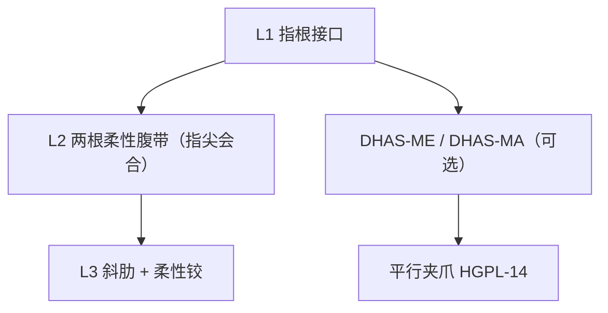

# 鳍条效应自适应夹指：Festo DHAS 斜肋梯形桁架包络抓取

> [!summary] 一句话概述
> 鳍条效应夹指用两根在指尖会合的柔性腹板，中间用间隔布置的斜肋以柔性铰连成梯形桁架：指尖或指面受力时，肋条变形使手指弯向物体并形成包络（形封闭趋势）。它不是根部一个活铰的开合爪。Festo DHAS 把这一结构做成 TPE-U 量产手指，可滑入转接件后装到平行夹爪上；林群煦等用 TPU 打印了同类鳍条软爪，并另加可变刚度外骨骼做对比实验。

## 配图

![[附件/festo-dhas-finger-mounting.jpg]]
*图源：[Festo Adaptive gripper fingers DHAS，2023/05 样本](https://ftp.festo.com/public/pneumatic/SOFTWARE_SERVICE/Documentation/2023/US/DHAS_ENUS.PDF) 第 2 页；左侧为手指与安装套件的滑入装配：1 安装套件 DHAS-ME，2 安装支架 DHAS-MA，3 自适应手指 DHAS，4 平行夹爪 HGPL-14。右侧可见两根在指尖会合的腹板和中间等间距斜肋。样本注明：适合抓圆形件；每爪行程应至少 10 mm；使用中手指可能轻微变形，但不影响功能*

![[附件/festo-dhas-envelope-steps.jpg]]
*图源：同上第 3 页；从紧密包装中取件的四步：1 把手指伸到包装上方；2 沿包装内侧下滑；3 手指包络工件形成形封闭；4 提起工件。尖头外形可以插进壁与工件之间，即使工件并未对中*

![[附件/finray-tpu-hand-photos.jpg]]
*图源：[林群煦等，一种变刚度柔性机械手的设计及其性能测试，《人工智能与机器人研究》2024, 13(3): 515–525](https://pdf.hanspub.org/airr2024133_52610468.pdf) 第 521 页图 7、图 8 与表 1。图 7 为带 TPU 鳍条软爪的样机；图 8 为垂直、水平和侧向三种抓取姿态，对象是直径 50 mm、高 50 mm 的圆柱。表 1：TPU55A 打印参数，层高 0.2 mm、壁厚 0.8 mm、填充 100%、速度 10 mm/s。该文的变刚度外骨骼是附加装置，不是 Festo DHAS 的结构*

> 图片版权归原作者所有，仅作个人学习收藏；出处见文末「来源与核实记录」。

## 结构原理

> 本节所有数字只写来源里给出的；来源没有就写「来源未给出」。

### 堆叠方案

方向：**从指根安装接口到指尖（Festo DHAS 单指）**

| 层级 | 零件 | 材料 | 厚度/尺寸 | 固定方式 | 依据 |
| --- | --- | --- | --- | --- | --- |
| L1（指根接口） | 与 DHAS-ME 滑配的根部 | TPE-U（PU） | 规格 60/80/120 的外形尺寸见下表 B1、H1、L1 | 与转接件滑入，形成形封闭兼摩擦的配合，同时仍允许手指弯曲 | 样本第 2 页；尺寸表第 11 页 |
| L2 | 两根柔性腹带 | 同上 | 在指尖会合，构成三角形/梯形的两边 | 与根部和指尖连续 | 样本「At a glance」 |
| L3 | 等间距斜肋，肋与腹带之间为柔性铰（flex hinges） | 同上 | 肋距来源未给出具体毫米；规格 60/80/120 的指长 l 为 50/80/115 mm | 与腹带一体 | 样本第 2 页；压入深度表 |
| L4（选用） | 安装套件 DHAS-ME、支架 DHAS-MA、平行夹爪 HGPL-14 | 支架等金属件材料来源未给出牌号 | 见订货数据；本篇以手指本体为主 | 螺钉固定到夹爪 | 第 2 页与订货表 |

剖面示意：

林群煦等的鳍条软爪是同一类斜肋包络结构，材料改为 TPU55A 打印；变刚度摩擦关节是额外一层，不是鳍条桁架本身。

### 零件清单

| 零件 | 数量 | 功能 | 材料 | 依据 |
| --- | --- | --- | --- | --- |
| 自适应手指 DHAS-GF | 通常成对使用（保持力曲线按两指给出） | 包络并保持工件 | TPE-U（PU） | 样本；DHAS-GF-60 数据页 |
| 安装套件 DHAS-ME | 按接口选 | 把手指接到夹爪或转接板上 | 来源未给出牌号 | 第 2 页 |
| 安装支架 DHAS-MA | 接到 HGPL-14 时需要 | 与 ME 一起把手指装到平行夹爪 | 来源未给出牌号 | 第 2 页 |
| 平行夹爪 HGPL-14 | 1（应用例） | 提供张合行程，行程每爪应至少 10 mm | 来源未给出 | 第 2 页 Note |
| TPU 鳍条软爪（林群煦等） | 样机为多指 | 包络抓取实验 | TPU55A | 表 1、图 7 |

### 装配顺序

1. 把 DHAS 手指的根部接口滑入 DHAS-ME，形成既靠形状又靠摩擦的配合，同时保留手指可弯。
2. 若装到 HGPL-14，再通过 DHAS-MA 把 DHAS-ME 接到平行夹爪上，用样本给出的螺钉规格紧固（规格 80/120 用 M4 等，见订货表，本篇不把未在正文逐项展开的螺钉长度全部抄入）。
3. 使用：先把手指伸到工件旁或包装内侧，再合拢或下插，让斜肋桁架变形、指面贴合物体，最后提起。
4. 林群煦等样机另用 42 步进电机和丝杆滑块驱动手指合拢；抓取直径 50 mm、高 50 mm 的圆柱后，可做垂直、水平、侧向三种下拉试验。变刚度装置是在包络完成后再选择是否锁紧，不是 DHAS 的步骤。

> 按产品说明书正装；本篇打开的样本没有给出拆卸专用工具。

### 受力与运动分析

- **受力路径**：夹爪的合拢力（或插入时的接触力）经指根传到两根腹带和斜肋。物体把指面顶向一侧时，斜肋和柔性铰变形，手指弯向物体并增加接触包络。Festo 把「保持力 FH」定义为：在两指夹持力和给定直径下，仍能抓住工件的最大力；「侧向力 FQ」定义为工件开始滑移前可施加的最大侧向力。曲线按 23 ℃、HGPL-14、圆柱工件给出，具体牛顿值在图上，本篇不从图上估读。
- **运动关系**：没有根部一个销轴式开合；相对运动分布在腹带与肋之间的柔性铰上。工件最好在手指中部测点 MP2 抓取。规格 60/80/120 在 MP2 的压入深度 t 分别为 12、20、30 mm。
- **失效风险**：样本写明手指在寿命期内可能轻微变形，但不影响功能；不适用于机加工、磨尘、焊渣和腐蚀性介质。林群煦等指出纯柔性鳍条的承载力有限，所以他们另加变刚度机构；未加该机构时，垂直下拉最大阻力为 7.4 N，水平 4.5 N，侧向 5.5 N（结论段）。这些力值属于该 TPU 样机，不能当成 DHAS 的额定保持力。

## 设计要点与参数

| 要点 | 内容 | 依据 |
| --- | --- | --- |
| 结构定义 | 两根在指尖会合的柔性腹带，中间用等间距肋和柔性铰连接，形成 Fin Ray Structure | Festo 样本第 2 页 |
| 材料 | 夹爪材料 TPE-U（PU）；无铜无 PTFE；RoHS；CRC 2 | 样本第 7 页；DHAS-GF-60 数据页 |
| 环境温度 | 10–50 ℃ | 样本第 7 页；数据页 |
| 规格与手指质量 | 60：6.5 g；80：13 g；120：29 g（仅手指；支架、挡块、螺钉另计） | 样本第 7 页 |
| 指长 l 与测点 | 60：l=50 mm，MP1/2/3/4=15/25/35/50 mm；80：80 mm，30/40/50/80 mm；120：115 mm，47.5/57.5/67.5/115 mm | 样本第 10 页 |
| MP2 压入深度 | 60：12 mm；80：20 mm；120：30 mm | 同上 |
| 外形主要尺寸（B1×H1×L1，单位 mm） | 60：18×61.5×26；80：21.3×94.5×37.5；120：25×11.8（B2）×134.5×50。B2 三档均为 11.8 mm | 样本第 11 页 |
| 订货号 | DHAS-GF-60-U-BU 3998967；80：3998964；120：3998959 | 第 11 页；60 号数据页 |
| 行程建议 | 每爪行程至少 10 mm；适合抓圆形件、长行程/径向/角度夹爪 | 第 2 页 Note |
| TPU55A 打印（林群煦等） | 层高 0.2 mm，壁厚 0.8 mm，填充 100%，速度 10 mm/s，挤出量 105%，关闭回抽 | 表 1 |
| 林群煦等实验对象 | 直径 50 mm、高 50 mm 的圆柱；PLA 与软爪表面摩擦系数 0.66 | 第 3.2 节 |
| 未开变刚度时的最大下拉力 | 垂直 7.4 N，水平 4.5 N，侧向 5.5 N | 结论段 |
| 开启变刚度后（仅该样机） | 垂直 37.3 N，水平 44.5 N（约 9.89 倍），侧向 38.6 N | 结论段；这是外骨骼附加效果，不是鳍条本身，也不是 DHAS 参数 |

## 优缺点

**优点**
- 同一对指可以包络不同直径和形状的工件，形成形封闭，不必为每种外形换刚性爪。
- 尖头可以伸进缝隙再包络，适合从紧密排列中取件。
- 量产件给出了明确的规格链（60/80/120）、质量和中部压入深度，便于按工件大小选型。
- 结构完全是柔顺桁架，根部不必再做活铰。

**缺点 / 代价**
- 保持力和侧向力依赖夹持力、工件直径和温度，样本用曲线给出，不能简化成一个固定牛顿数。
- 弹性手指在寿命期内可能变形；不耐切屑、磨尘和焊渣。
- 纯柔性鳍条的承载力有限（林群煦等的 TPU 样机未加外骨骼时只有数牛到约 7 N 量级），重载需要另做变刚度或增大腹板，不能指望 DHAS 去代替金属卡爪的刚性夹紧。

## 可借鉴点

- 需要「轻轻包住不规则物体」时，用斜肋梯形桁架，而不是只在根部放一个活铰再装硬指面。
- 把「指长、中部抓取点、该点允许的压入深度」写成选型三件套（Festo 的 l、MP2、t）。
- 配对的平行夹爪行程要大于手指包络所需的开合（样本要求每爪至少 10 mm）。
- 若用打印件做鳍条手，把材料、层高和填充写进工艺表；承载力要用实物下拉试验，不要直接套用 TPE-U 量产件的曲线。
- 变刚度、骨架或摩擦锁是附加层，应在图上与鳍条桁架分开，以免把两种结构的力值混在一张表里。

## 与库中相似案例对比

| 对比项 | 本案例（鳍条包络夹指） | [[活动铰链（Living Hinge）：一体成型的柔性铰链]] | [[卡扣三种基本形式：悬臂、环形、扭转]] |
| --- | --- | --- | --- |
| 夹持动作从哪来 | 斜肋桁架受力后弯向物体，形成包络 | 薄膜弯曲开合，不是包络桁架 | 弹性卡臂卡入，不是包络桁架 |
| 是不是根部一个活铰 | 不是 | 活铰是弯曲带 | 不是鳍条 |
| 本轮是否重复 | 本篇只写鳍条包络与 DHAS / TPU 软爪 | 库内已有，只对照 | 库内已有，只对照 |

## 相关案例

- [[活动铰链（Living Hinge）：一体成型的柔性铰链]]
- [[接触辅助十字簧片柔性铰（CAFP）：接触缩短簧片自由长度以改变单向刚度]]
- 分类索引：[[04-机构与运动 索引]]

## 来源与核实记录

- 主来源：[林群煦、张立炜、黄祖成、王卫军、王建、刘成沛，一种变刚度柔性机械手的设计及其性能测试，《人工智能与机器人研究》2024, 13(3): 515–525](https://pdf.hanspub.org/airr2024133_52610468.pdf)（2024-08-15；五邑大学轨道交通学院、广州先进技术研究所机器人与智能装备中心。CC BY 4.0。已下载 11 页 PDF，核对鳍条软爪、TPU55A 打印参数、三种姿态下拉力。变刚度倍率只作为该样机的附加结果，与 Festo 参数分开写）
- 补充来源 1：[Festo, Adaptive gripper fingers DHAS, 2023/05](https://ftp.festo.com/public/pneumatic/SOFTWARE_SERVICE/Documentation/2023/US/DHAS_ENUS.PDF)（已下载 14 页英文样本；三角腹板+斜肋+柔性铰、规格 60/80/120 的质量与尺寸、保持力/侧向力/压入深度、装配接口。独立第二机构。官网 catalog 链接本次 403，改用 ftp.festo.com）
- 补充来源 2：[Festo 数据页 DHAS-GF-60-U-BU，零件号 3998967](https://ftp.festo.com/Public/PNEUMATIC/SOFTWARE_SERVICE/DataSheet/EN_US/3998967.pdf)（与样本同属 Festo，不另计机构。TPE-U、10–50 ℃、产品重量 7 g；样本第 7 页写规格 60 手指 6.5 g，二者不合并）
- 核实：2026-11-22 下载并打开上述 PDF。未把根部活铰开合爪或打印间隙规则写成同一结构。
