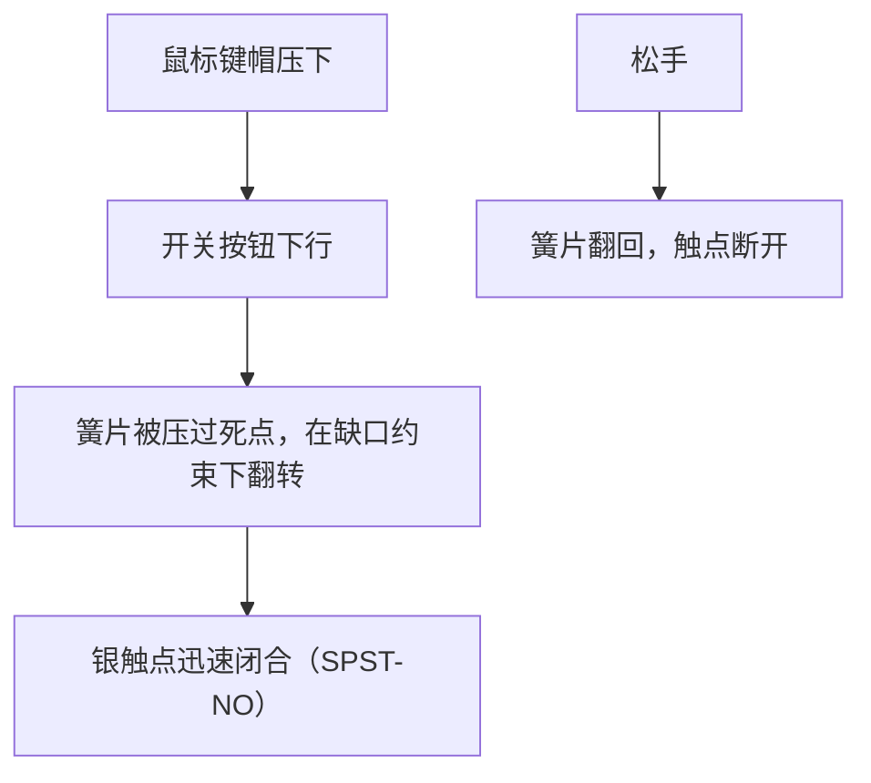

# 鼠标微动开关（Omron D2FC）：杠杆、簧片翻转与触点

> [!summary] 一句话概述
> 鼠标里常见的「咔哒」不是 MX 那种十字轴体，而是一颗超小型瞬时微动：按钮把力传给内部的弹性杠杆/簧片，簧片在缺口里翻过死点，银触点迅速闭合，松手后簧片翻回。Omron 称之为 Ultra Subminiature Basic Switch。以 D2FC-F-7N（20M）为例，数据表给出操作力 0.59 ± 0.15 N、预行程 0.3 ± 0.2 mm、超行程至少 0.2 mm、机械/电气寿命至少 2000 万次。拆解文章显示：簧片必须准确挂在壳体缺口里，位置差一点开关就不再工作。

## 配图

![[附件/omron-d2fc-working.jpg]]
*图源：[Inside the Omron D2FC-F-7N microswitch（gonnalearn）](https://www.gonnalearn.com/inside-omron-d2fc-f-7n-microswitch/)；工作状态侧视。紫箭头标出可能需要清洁的接触区，绿箭头标出簧片必须落入的缺口——作者强调缺口位置差一档，外观几乎看不出来，开关却已经失效*

![[附件/omron-d2fc-opening.jpg]]
*图源：同上；建议从这一侧打开壳体，从另一端打开很容易把簧片弄弯、弹出原位*

![[附件/omron-d2fc-datasheet-dims.png]]
*图源：[Omron D2FC 数据表（Digikey 镜像）](https://mm.digikey.com/Volume0/opasdata/d220001/medias/docus/5389/D2FC_Datasheet_EN.pdf) 尺寸与动作特性页；D2FC-F-7N（20M / 60M）与 D2FC-7 外形相同，表中给出 OF、RF、PT、OT、MD、FP、OP*

> 图片版权归原作者所有，仅作个人学习收藏；出处见文末「来源与核实记录」。

## 结构原理

> 本节所有数字只写来源里给出的；来源没有就写「来源未给出」。

### 堆叠方案

方向：**从鼠标按键帽到 PCB（以 D2FC 直插焊盘型为例）**

| 层级 | 零件 | 材料 | 厚度/尺寸 | 固定方式 | 依据 |
| --- | --- | --- | --- | --- | --- |
| L1（最上） | 鼠标键帽 / 传力件（开关本体之外） | 来源未给出 | 数据表给了推荐拨杆形状示意，尺寸见该页括号标注 | 压在开关按钮上 | 数据表「Recommended shape for proper stalk operation」 |
| L2 | 开关按钮（外露的操作点） | 20M 为白色，60M 为橙色，D2FC-7 为白色 | 动作特性以 FP / OP 等相对于安装面的高度给出，例如 FP 最大 7.35 mm，OP 6.9 ± 0.2 mm（F-7N） | 可上下移动 | 数据表 List of Models 与 Operating Characteristics |
| L3 | 内部弹性杠杆 / 簧片 | 来源未给出 | 来源未给出厚度；必须落入壳体缺口 | 一端铰在壳体里，中段和接触端挂在缺口中 | gonnalearn 照片与说明 |
| L4 | 触点（Crossbar） | 银；标准间隙 0.4 mm | 0.4 mm（标准值） | 一组随簧片翻转闭合/断开 | 数据表 Contact Specifications |
| L5 | 塑壳 | 来源未给出 | 数据表外形：例如主体相关尺寸 12.8 ± 0.15 mm、6.5 ± 0.1 mm 等，详见该页 | 扣合，可打开但易把簧片弄移位 | 数据表；gonnalearn |
| L6 | PCB 焊盘端子（直插） | 来源未给出 | 端子间距 5.08 ± 0.15 mm；另有 Dummy 端子，数据表写明不要接入电路 | 焊接。波峰焊建议 260 °C 以内 5 秒 | 数据表 Dimensions / Precautions |

剖面示意：

数据表把这颗开关定义为 SPST-NO（常开，按下才通）。型号规则：F 表示操作力 0.59 ± 0.15 N，无 F 的 D2FC-7 为 1.0 ± 0.23 N；后缀 7 / 7N(20M) / 7N(60M) 对应寿命档。

### 零件清单

| 零件 | 数量 | 功能 | 材料 | 依据 |
| --- | --- | --- | --- | --- |
| 塑壳（可打开的两半或扣盖） | 1 套 | 约束簧片、提供缺口和按钮导向 | 来源未给出 | gonnalearn；数据表外形 |
| 按钮 | 1 | 把外部行程传到簧片 | 颜色见上表 | 数据表 |
| 簧片 / 杠杆 | 1 | 储能、过死点翻转、带动触点 | 来源未给出 | gonnalearn |
| 触点 | 1 对（Crossbar） | 通断电路 | 银 | 数据表 |
| 端子 | COM、NO，另有 Dummy | 焊接到 PCB | 来源未给出 | 数据表：Dummy 端子不要接电路 |
| 整颗质量 | 约 0.5 g | — | — | 数据表 |

### 装配顺序

装到鼠标里（数据表 Precautions + 常规焊接注意，不是某只鼠标的厂规）：

1. 按推荐焊盘和拨杆形状设计键帽传力，避免偏载（数据表画了推荐 stalk 形状）。
2. 焊接：多层板要先试焊，以免焊盘热量把开关烫变形；自动焊槽建议 260 °C、5 秒以内，焊锡和助焊剂液面不要超过板面。
3. 数据表明确：开关不密封，不能清洗；洗板液带着助焊剂或灰尘进去会失效。
4. 不要在有害气体、硅、过多粉尘、过热过湿、骤冷骤热、溅水或溅油的环境使用。

若要打开已装开关（gonnalearn，维修观察，不是官方步骤）：

1. 先认准外壳上的标签方向，从文章推荐的那一侧打开，避免簧片飞出。
2. 簧片要重新挂进正确缺口：作者建议先固定铰链一侧，再把接触侧横推进槽，最后用小工具把中段弹片挑进正确缺口（这条来自文后评论区的复装经验，不是数据表）。
3. 作者自己的结论是：用了多年、簧片已经变形时，更稳妥是整颗更换，而不是反复扳内部簧片。原文还写 10M 字样表示 1000 万次，并提到另有 20M 版本——与数据表的 20M / 60M 分档对应，但具体一颗要以壳上标记和订货型号为准。

### 受力与运动分析

- **受力路径**：键帽力 → 按钮 → 簧片储能 → 越过死点后迅速释放，触点闭合。数据表用 OF（操作力）、RF（复位力）、PT（到动作位置的行程）、OT（超行程）、MD（动作与复位的行程差）描述这条曲线。F-7N：OF 0.59 ± 0.15 N，RF 至少 0.24 N，PT 0.3 ± 0.2 mm，OT 至少 0.2 mm，MD 最大 0.12 mm。
- **运动关系**：这是瞬时翻转（snap-action），不是 MX 轴那种随行程逐渐压下的滑动触点。行程很短，手感里的「咔哒」来自簧片过死点（gonnalearn 评论也提到小簧片能发出点击声，属使用观察）。
- **失效风险**：簧片从缺口里滑出或挂错一档，开关就不工作（gonnalearn 的核心观察，有「看起来没问题其实已错位」的照片）。触点脏污会造成连点或断触，作者指出可清洁，但多年变形的簧片建议更换。数据表额定只有 6 VDC / 1 mA，超电会缩短寿命或发热烧毁，尤其要小心开关瞬间的电流电压。不密封，不能洗。

## 设计要点与参数

以下为数据表数值。D2FC-F-7N（20M）与（60M）的动作力/行程相同，差别主要在寿命和按钮颜色。

| 要点 | 内容 | 依据 |
| --- | --- | --- |
| 操作力 OF | F 型：0.59 ± 0.15 N；D2FC-7：1.0 ± 0.23 N | 数据表 |
| 复位力 RF | F 型：至少 0.24 N；D2FC-7：至少 0.2 N | 数据表 |
| 预行程 PT | 0.3 ± 0.2 mm（两档力值相同） | 数据表 |
| 超行程 OT | 至少 0.2 mm | 数据表 |
| 动作差 MD | F 型最大 0.12 mm；D2FC-7 最大 0.15 mm | 数据表 |
| 自由高度 FP / 动作高度 OP | FP 最大 7.35 mm；F 型 OP 6.9 ± 0.2 mm，D2FC-7 的 OP 为 6.9 ± 0.3 mm | 数据表 |
| 寿命 | D2FC-7：至少 500 万次；F-7N(20M)：至少 2000 万次；F-7N(60M)：至少 6000 万次（机械/电气，300 次/分试验条件） | 数据表 |
| 额定 | 6 VDC，1 mA 阻性负载 | 数据表 |
| 触点 | 银，Crossbar，间隙标准值 0.4 mm；最小适用负载参考值 5 VDC 1 mA | 数据表 |
| 接触电阻 / 绝缘 | 初值最大 100 mΩ；绝缘至少 100 MΩ（500 VDC） | 数据表 |
| 防护 / 环境 | 相当于 IEC IP40；工作 –25 到 +65 °C（湿度条件见数据表） | 数据表 |
| 质量 | 约 0.5 g | 数据表 |
| 端子 | 间距 5.08 mm；Dummy 端子不接电路 | 数据表 |

> gonnalearn 没有给出自己的测力或测行程数据，因而没有「实测值 vs 官方值」对照表。维修照片只用来说明内部几何和失效形态。

## 优缺点

**优点**
- 行程短、有明确翻转点，适合鼠标这种高频、小行程点击
- 数据表把 OF、PT、OT、寿命和焊接限制写全，便于在键帽行程里预留超行程
- 体积小、约 0.5 g，可以藏在鼠标按键下面

**缺点 / 代价**
- 额定电流极小（1 mA 量级），不能当电源开关用
- 不密封，不能洗板
- 内部簧片对缺口位置非常敏感，开壳维修很容易修坏（拆解文多例）
- 寿命分档要靠型号后缀，外壳上的 10M / 20M 字样必须和订货号对上

## 可借鉴点

- **鼠标按键和键盘轴不要共用同一套结构语言**：这边是短行程翻转微动，那边是长行程滑杆 + 螺旋弹簧。键帽只要把力竖直、对中地传到微动按钮，并留出数据表要求的超行程。
- **在 PCB 和键帽设计阶段就用数据表的 FP / OP / OT**：只保证「能按到」不够，还要保证按到底时不会把开关压过机械极限，也要保证复位力能把键帽顶回来。
- **Dummy 端子是机械脚，不是电气脚**，不要接到网络上。
- **不要洗这颗开关**；需要清洁工艺时，得在设计上把开关排除在洗板区域之外，或改用明确声明可洗的型号。
- 维修时把簧片当定位件而不是「随便压回去的铜片」；错一个缺口就整颗失效。量产失效分析也可以先查簧片是否还在槽里。

## 与库中相似案例对比

| 对比项 | 本案例 | [[Cherry MX 机械键盘轴：轴心、螺旋弹簧与金交叉触点]] | [[16 英寸 MacBook Pro 剪刀脚键盘：1 mm 键程与交叉支架（对照蝶式）]] |
| --- | --- | --- | --- |
| 结构 | 瞬时翻转微动：按钮 + 簧片过死点 + 银触点 | 滑杆 + 螺旋弹簧 + 金交叉触点 | 剪刀支架 + 橡胶穹顶 |
| 行程 | PT 0.3 ± 0.2 mm，OT 至少 0.2 mm | MX2A RED：预行程 2 mm，总行程 4 mm | 键程 1 mm（苹果新闻稿） |
| 操作力 | F 型 0.59 ± 0.15 N | 45 cN | 来源未按这套微动方式给力值 |
| 典型用途 | 鼠标左右键 | 键盘字符键 | 笔记本键盘 |

本篇不展开硅胶按键、锅仔片或薄膜开关，那些是另一类叠层，不在本次题目范围内。

## 相关案例

- [[Cherry MX 机械键盘轴：轴心、螺旋弹簧与金交叉触点]]
- [[16 英寸 MacBook Pro 剪刀脚键盘：1 mm 键程与交叉支架（对照蝶式）]]
- 分类索引：[[04-机构与运动 索引]]

## 来源与核实记录

- 主来源：[Omron D2FC Ultra Subminiature Basic Switch 数据表（Digikey 提供的 PDF 镜像）](https://mm.digikey.com/Volume0/opasdata/d220001/medias/docus/5389/D2FC_Datasheet_EN.pdf)（型号分档、OF/RF/PT/OT/MD/FP/OP、寿命、额定、触点、端子、焊接与清洗限制。Omron 官网 PDF 直链本批 403，内容以该份已打开数据表为准）
- 补充来源：[Inside the Omron D2FC-F-7N microswitch](https://www.gonnalearn.com/inside-omron-d2fc-f-7n-microswitch/)（Stephan，2019-11-02；打开方向、簧片与缺口、触点清洁、10M/20M 标记的说明。无测力数据）
- 核实：2026-11-17 下载数据表并打开拆解页。电子产品世界论坛与欧姆龙中文访谈本批未作为依据（先前有 403 或未再核开）。LCSC 跳转首页，未引用。
