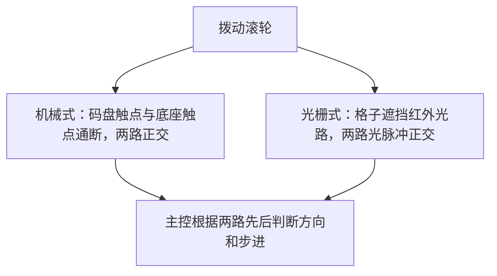

# 鼠标滚轮编码器：机械触点码盘与光栅遮光两种取信号方式

> [!summary] 一句话概述
> 鼠标滚轮要把旋转方向和步进传给主控，常见有两条路：机械式编码器由滚轮带动转盘，转盘上的触点与底座固定触点时通时断，形成两路错开的开关信号；光栅式则在滚轮上开一圈格子，两侧用红外发射和接收，格子转过时光线被反复挡住或透过，芯片根据光脉冲的先后判断方向和速度。TTC 写道，机械式因为有触点摩擦，手感和定位比较明确，寿命从早期的 10 万圈发展到其 2017 年宣称的 200 万圈；光栅式工作时几乎没有实质性接触，稳定性好，但灯源会衰减。它不是旋钮电位器，也不是已经在库中的 EC11 那种带柄编码器本体的重复堆叠。

## 配图

![[附件/wheel-strongpi-02.jpg]]
*图源：[实作派电子实验室，阿信助教，《滑鼠滾輪-編碼器-倒捲定格-維修DIY》，2021-10-07](https://www.strongpilab.com/mouse-scroll-wheel-repair/) 滚轮与编码器拆解照片*

![[附件/wheel-strongpi-03.jpg]]
*图源：同上，编码器安装位置与滚轮轴*

![[附件/wheel-strongpi-05.jpg]]
*图源：同上，机械编码器或码盘一侧的实物细节，零件名称以 TTC 和数码之家文字为准，不从照片臆造未标注尺寸*

> 图片版权归原作者所有，仅作个人学习收藏；出处见文末「来源与核实记录」。

## 结构原理

> 本节所有数字只写来源里给出的；来源没有就写「来源未给出」。

### 堆叠方案

方向：**从滚轮外缘到电路板上的编码器或光电器件**

| 层级 | 零件 | 材料 | 厚度/尺寸 | 固定方式 | 依据 |
| --- | --- | --- | --- | --- | --- |
| L1 | 滚轮 | 来源未给出 | 来源未给出直径 | 由用户拨动，经轴传到编码器或光栅盘 | 数码之家；TTC |
| L2a（机械式） | 转盘 / 码盘触点 | 来源未给出 | 来源未给出 | 随滚轮转动，与底座固定触点接触或离开 | TTC |
| L3a（机械式） | 底座固定触点 | 来源未给出 | 来源未给出 | 焊在或插在鼠标电路板上，输出两路通断 | TTC；数码之家正交信号说明 |
| L2b（光栅式） | 带格子的轮或盘 | 来源未给出 | 来源未给出槽数 | 格子随滚轮转动，反复遮光 | 数码之家；TTC |
| L3b（光栅式） | 红外发射与接收 | 来源未给出波长 | 来源未给出间距 | 分列滚轮两侧 | TTC；数码之家 |
| L4 | 中键微动（如有） | 不在本篇展开 | — | 按下滚轮时触发，与编码不是同一条力路 | 数码之家仅提到光学微动是另一话题 |

数码之家用两路信号的排列说明方向判断：主控在单位时间内收到某种顺序（文中举例 01、02、012 这类前后沿组合）就判定为顺时针，反向排列则为逆时针。本文只保留「两路错开的正交通断用来辨向」这一结论，不把论坛排版里可能错位的 0/1 序列当成正式真值表。

TTC 补充：早期光栅式对主控编程要求较高，当时只有少数厂家采用；后来机械式因手感、结构和编程都更简单，成为绝大多数鼠标的方案。机械故障常见表现包括滚轮失灵、方向乱跳、信号时有时无。原因常是零件精度不够或触点材质差、磨损后接触不良。更换时要核对安装高度、编码器类型，以及高端鼠标是否用了定制编码器；并给出 TTC 103 系列（常见）和 123 系列（部分带线）作为类型对照。

剖面示意：

### 零件清单

| 零件 | 数量 | 功能 | 材料 | 依据 |
| --- | --- | --- | --- | --- |
| 滚轮与转轴 | 1 套 | 把手指动作变成旋转 | 来源未给出 | 数码之家；实作派照片 |
| 机械编码器（或光栅组件） | 1 | 把旋转变成电信号 | 机械式为触点码盘 + 底座；光栅式为格子 + 红外对管 | TTC；数码之家 |
| 电路板焊盘 / 插座 | 1 组 | 固定编码器并引出信号 | 来源未给出 | TTC（安装高度在面板上测量） |

### 装配顺序

来源没有给出原厂装配步骤。维修更换（TTC）：

1. 拆开鼠标上盖，在面板上测量编码器安装高度，不要只按外观「差不多」去买。
2. 确认是 103 这类常见封装还是 123 这类带线或其他定制件。
3. 焊接或插装新编码器，保证滚轮轴与编码器孔同轴，避免一边磨。
4. 光栅式还要保证发光和接收对正，并避开强杂光（数码之家提到光栅滚轮怕光干扰，少见带跑马灯的光栅滚轮）。

### 受力与运动分析

- **受力路径（机械式）**：滚轮扭矩传到转盘，触点与固定触点摩擦通断。数码之家指出金属与塑料摩擦是寿命短的主要原因；市售标注寿命低的约 5 万圈，高的号称 200 万圈，价格从几毛到几块，并认为内部镶嵌金属结构缺少维修价值，坏了就换整只编码器。
- **受力路径（光栅式）**：滚轮只带动格子做遮光，编码光路基本不接触，数码之家认为寿命天生更长，但结构更复杂、普遍偏重，手感也更少依赖金属摩擦。
- **失效风险**：触点磨损导致倒捲、定格或方向反了（与实作派维修主题一致）；光栅灯源衰减（TTC）；安装高度不对导致啮合不良；把 EC11 或电位器的寿命数据套过来。

## 设计要点与参数

| 要点 | 内容 | 依据 |
| --- | --- | --- |
| 机械式原理 | 转盘触点与底座固定触点通断 | TTC |
| 光栅式原理 | 红外收发 + 格子遮光，工作时无实质性接触 | TTC；数码之家 |
| 辨向 | 两路错开的信号顺序表示顺/逆时针 | 数码之家 |
| 机械式寿命（数码之家） | 标注低的约 5 万圈，高的号称 200 万圈 | 数码之家 |
| 机械式寿命（TTC） | 由最初 10 万圈发展到 2017 年 CES 发布的 200 万圈宣称值 | TTC |
| 光栅式寿命 | 两文都说更长或可与机械式相当，但灯源会衰减；未给出统一圈数 | TTC；数码之家 |
| 更换注意 | 安装高度、类型、是否定制 | TTC |
| 电参数（电压、电流） | 已打开资料未给出，来源未给出 | — |

## 优缺点

**优点**
- 机械式结构简单、有刻度手感，主控好做，适合大多数鼠标
- 光栅式非接触取信号，手感较少随触点磨损变化
- 两种方案都用正交信号辨向，电路模型清楚

**缺点 / 代价**
- 机械式寿命受触点材质和精度限制，是滚轮故障的常见来源
- 光栅式怕杂光、更重、对安装和主控要求更高
- 宣称的 200 万圈是厂家发布值，已打开资料不是第三方寿命试验报告

## 可借鉴点

- 先决定要不要「刻度手感」：要手感就走机械触点，要少磨损就走光栅，不要混用两套寿命数据。
- 维修和设计都把编码器安装高度写成尺寸，而不是「装得上就行」。
- 用两路正交信号辨向，不要只用单路脉冲，否则无法区分方向。
- 本篇只讨论滚轮取信号，不把中键微动或库中已有的 EC11 再堆一遍。

## 与库中相似案例对比

| 对比项 | 本案例（鼠标滚轮编码器） | [[ALPS EC11 旋转编码器：11 mm 金属轴增量脉冲与可选按压开关]] | [[旋转BCD编码开关：编码转子把档位编成4位代码（对照 Nidec SC 与 Omron A6A）]] | [[鼠标分体主键预压：独立键板、金属枢轴与弹簧张紧]] |
| --- | --- | --- | --- | --- |
| 信号 | 连续旋转的两路正交脉冲或通断 | 带柄增量编码器，库中已有，不再重复其本体 | 离散档位的 4 位代码 | 主键微动，不是滚轮 |
| 取信号 | 机械码盘或红外光栅 | 通常为接触式脉冲（见原案例） | 编码转子 / 旋转电路板 | 按压触点 |
| 何时用这篇 | 要写鼠标滚轮为什么会倒捲、以及光栅和机械的差别 | 要选带柄的面板编码器 | 要拨 BCD 地址 | 要写主键力路 |

## 相关案例

- [[旋转BCD编码开关：编码转子把档位编成4位代码（对照 Nidec SC 与 Omron A6A）]]
- 分类索引：[[04-机构与运动 索引]]

## 来源与核实记录

- 主来源：数码之家拆机乐园，《当你滚动鼠标滚轮的时候，发生了什么？来看看编码器工作原理吧》（2026-11-27 打开正文。正交辨向、5 万至号称 200 万圈、光栅格子与两侧光路来自该帖。配图下载为脚本，不采用。完整帖址以已保存 html 为准。）
- 交叉来源：TTC，《今天终于弄明白了鼠标滚轮编码器》，2017-07-23（2026-11-27 打开。独立第二机构。机械触点原理、红外光栅、10 万至宣称 200 万圈、103/123 系列和更换要点来自该文。电话、邮箱和地址不写入正文。）
- 交叉来源：[实作派电子实验室，《滑鼠滾輪-編碼器-倒捲定格-維修DIY》，2021-10-07](https://www.strongpilab.com/mouse-scroll-wheel-repair/)（2026-11-27 打开并保存真实照片。第三机构，正文以图为主。）
- 核实：2026-11-27 打开上述来源。不把 EC11 案例拆成一篇新的同质机构。未编造槽数、电压和实测寿命。
