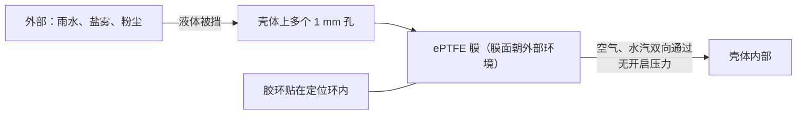

# GORE 防水透气膜：压力平衡与粘贴式透气阀的安装参数

> [!summary] 一句话概述
> 密封外壳在升温、降温、海拔变化或突然淋雨时，内外会产生压差，长期把密封圈「憋坏」；在壳上开几个 1 mm 小孔，从内侧贴一片 ePTFE 透气膜，就能让空气和水汽双向通过、液态水和粉尘进不来，而且不像蘑菇阀那样需要开启压力。Gore 数据表给出了透气量、厚度、定位环尺寸和压贴参数（约 2 bar、> 5 s、固化 24 h）。

## 配图

![[附件/gore-adhesive-vent-mounting.png]]
*图源：[Gore Adhesive Series 数据表](https://kr.gore.com/sites/default/files/2017-08/GORE_PTV_AdhesiveVents_EN_WEB.pdf) Figure 6/7；内装（VE8，必须内装）与内/外装（VE7、VE9）示意：壳体开多个 1 mm 孔，ePTFE 膜始终朝向外部环境*

![[附件/gore-adhesive-vent-target-ring.png]]
*图源：同上 Figure 4；用凸起、下沉或平齐的「定位环」标出贴装位置*

> 图片版权归原作者所有，仅作个人学习收藏；出处见文末「来源与核实记录」。

## 结构原理

> 本节数字只写来源里给出的；来源没有就写「来源未给出」。

### 堆叠方案

方向：**从外部环境到壳体内部（内装方式）**

| 层级 | 零件 | 材料 | 厚度/尺寸 | 固定方式 | 依据 |
| --- | --- | --- | --- | --- | --- |
| L1（最外） | 壳体透气孔（多个） | 壳体材料 | 建议每孔至少 1 mm，大直径透气阀用多个 1 mm 孔 | 开孔 | 数据表 Installation |
| L2 | 壳体内壁贴装面 + 定位环 | 壳体材料 | 定位环墙高 ≥ 0.51 mm；内径 = 透气阀外径 + 2.54 mm | 注塑成型 | 数据表 Figure 4 下方表 |
| L3 | 压敏胶环 | 丙烯酸（VE8）/ 硅胶（VE7、VE9） | 同心度 A = 0.8 mm | 压贴 | 数据表 Product Information |
| L4 | ePTFE 膜（疏油） | ePTFE；VE8 带白色 PET 无纺布背衬 | 典型总厚：VE8 0.26 mm、VE7 0.34 mm、VE9 0.32 mm | 与胶环一体 | 同上 |
| L5（最内） | 壳体内部空气 | — | — | — | — |

剖面示意：

### 零件清单

| 零件 | 数量 | 功能 | 材料 | 依据 |
| --- | --- | --- | --- | --- |
| 粘贴式透气阀 | 按透气量计算，可多个 | 压力平衡 + 防水防尘 | ePTFE + 胶 | 数据表；FAQ |
| 透气孔 | 每阀 1 个或多个 1 mm 孔 | 通道 | — | 数据表 |
| 定位环（可选） | 每阀 1 | 定位、保护阀边缘 | 壳体一体 | 数据表 |
| 主密封（胶圈等） | — | 仍然需要 | — | FAQ：「设备总要有某种密封」 |

### 装配顺序

1. 准备：透气阀和壳体温度 > 10 °C；贴装面平整、干净、无油无颗粒、无毛边。
2. 戴无粉乳胶手套，用钝头镊子从卷带上取阀，不要碰中间透气区和胶环，不要撬。
3. 放进定位环内（阀必须完全在环内、不能骑在环壁上）。
4. 压贴：手动时用手指沿胶环至少按压两圈；半自动时用 20–40 Shore A、厚度 ≥ 5.0 mm 的软橡胶压头，约 2 bar 均匀压在胶环区（压头中间挖空，不压透气区），保压 > 5 s。
5. 固化 24 h 后再使用或测试；贴好后不能再挪位，取下即损坏。

### 受力与运动分析

- **受力路径**：温度/海拔变化 → 内外压差 → 通过膜迅速平衡，而不是作用在主密封圈和壳体上。FAQ 原话：压差平衡后可以「用更少的密封垫，或更少的螺母螺栓压紧外壳」。
- **运动关系**：无运动零件；膜的微孔让气体在任意小压差下流动，没有蘑菇阀那样的开启压力。
- **失效风险**：膜被挡住会失去透气（应装在竖直面、保持畅通）；水会积在水平面上（应装竖直面，避免积水）；胶环未压实会从边缘渗漏；激进环境下阀边缘可能被损伤（可加凸起定位环保护）。货架期最长 1 年（21 °C、50% RH 存放）。

## 设计要点与参数

| 要点 | 内容 | 依据 |
| --- | --- | --- |
| 典型透气量（ΔP = 70 mbar） | VE8 3300、VE7 290、VE9 1150 ml/min/cm² | 数据表 |
| 厚度 | VE8 0.26、VE7 0.34、VE9 0.32 mm | 数据表 |
| 安装位置 | VE8 只能内装；VE7、VE9 可内装或外装；膜面始终朝外部环境 | 数据表 Positioning |
| 透气孔 | 至少 1 mm；大阀用多个 1 mm 孔（需与 Gore 确认） | 数据表 |
| 定位环 | 墙高 ≥ 0.51 mm（0.02"）；内径 = 阀外径 + 2.54 mm（0.10"） | 数据表 |
| 压贴 | 约 2 bar，保压 > 5 s，压头 20–40 Shore A、厚 ≥ 5.0 mm；固化 24 h | 数据表 |
| 环境测试 | IP68：2 m 浸水 1 h（与外壳设计、尺寸、内外装有关）；85 °C/85% RH 1000 h；–40 °C 到 100 °C（VE8）/125 °C（VE7、VE9） | 数据表 |
| 浸水 | 许多型号达 IP67（1 m、30 min） | FAQ |
| 选型计算 | 透气量按外壳尺寸、自由内容积、温度条件、海拔变化、允许压差计算 | FAQ；术语表 |
| 膜孔径 | 来源只说「孔比空气分子大 700 倍」，具体数值来源未给出 | 数据表封底 |

## 优缺点

**优点**
- 消除压差：密封圈不再承受「呼吸」载荷，可以减少密封件或螺丝
- 水汽双向流动，减少冷凝（FAQ：任何外壳都无法完全杜绝冷凝，但透气膜能让进入的水汽再排出去）
- 体积小、可自动化贴装

**缺点 / 代价**
- 增加一个零件和一道贴装工序，贴装质量直接决定防水
- 防水能力有上限（水压过大会被压穿，WEP 指标需查具体型号）

## 可借鉴点

- **密封外壳先问一句「它怎么呼吸」**：有温度循环或海拔变化的产品（户外、车载、无人机、带电池/发热件的手持设备）都要加透气膜
- **在模具上做定位环**：墙高 ≥ 0.51 mm、内径 = 阀外径 + 2.54 mm，贴装位置和保护一次解决
- **开孔用多个 1 mm 小孔**，不要开一个大孔，膜有支撑也不易被戳破
- **装在竖直面**，避免积水和被挡
- **压贴工装**：软橡胶压头中间挖空，只压胶环，约 2 bar、保压 > 5 s
- 手机喇叭/MIC 的「防水泡棉 + 防水膜」是同一原理（见 [[三防手机整机防水结构：上下壳胶圈、电池盖、按键与开孔的参数清单]]，背胶宽 2.5 mm）

## 与库中相似案例对比

| 对比项 | 本案例 | [[三防手机整机防水结构：上下壳胶圈、电池盖、按键与开孔的参数清单]] | [[GoPro Hero4 Session 免外壳防水机身]] |
| --- | --- | --- | --- |
| 思路 | 主动「放气不放水」 | 结语明确要求高防水机加透气/泄压 | 全封闭 |
| 参数来源 | 厂商数据表（可信度高） | 工程师经验值 | 拆解观察 |

## 相关案例

- [[三防手机整机防水结构：上下壳胶圈、电池盖、按键与开孔的参数清单]]
- [[O 形圈密封槽设计：填充率、压缩率与挤出间隙的五个数]]
- [[GoPro Hero4 Session 免外壳防水机身]]
- 分类索引：[[05-密封与防护 索引]]

## 来源与核实记录

- 主来源：[GORE® Protective Vents Adhesive Series（VE8/VE7/VE9）数据表与安装指南](https://kr.gore.com/sites/default/files/2017-08/GORE_PTV_AdhesiveVents_EN_WEB.pdf)（W. L. Gore & Associates，2017 版 PDF）
- 补充来源 1：[FAQ for GORE® Protective Vents](https://www.gore.com/resources/faq-gorer-protective-vents)（Gore 官网）——无开启压力、减少密封件、冷凝、IP67、竖直安装
- 补充来源 2：[三防手机防水结构 cv14365267](https://www.bilibili.com/read/cv14365267)（B站）——手机喇叭/MIC 用防水泡棉 + 防水透气膜，高防水机需透气泄压，防止气压差导致开裂
- 核实：2026-11-13 下载数据表 PDF 全文核对全部数值，打开 FAQ 页面核对原理描述。透气阀为厂商产品，数据为厂商测试值。
