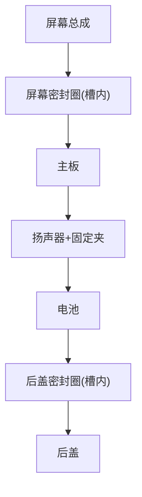

# Garmin fēnix 7X 可复用橡胶密封圈

> [!summary] 一句话概述
> fēnix 7X 的屏幕总成和后盖都用 T4 Torx 螺丝压紧橡胶密封圈来防水，而不是一次性胶粘——正确装回密封圈理论上可以保持防水，是「可维修的防水设计」范例。

## 配图

![[附件/garmin-fenix7x-gasket.jpg]]
*iFixit：把后盖密封圈按回机身底部的槽内*

![[附件/garmin-fenix7x-backplate.jpg]]
*iFixit：拆下后盖后的电池与机身*

> 图片版权归原作者所有，仅作个人学习收藏；出处见文末「来源与核实记录」。

## 结构原理

> 本节数字只写来源里给出的；来源没有就写「来源未给出」。

### 堆叠方案

方向：**从表盘正面到背面**

| 层级 | 零件 | 材料 | 厚度/尺寸 | 固定方式 | 依据 |
| --- | --- | --- | --- | --- | --- |
| L1 | 屏幕总成 | 来源未给出 | 来源未给出 | 4 颗 T4 Torx 螺丝 | Step 2 |
| G1 | 屏幕总成密封圈 | 橡胶 | 来源未给出 | 压入屏幕总成底面的槽 | Step 10 |
| L2 | 主电路板 | — | 来源未给出 | 4 颗 T4 Torx 螺丝 + 排线 | Step 4 |
| L3 | 扬声器 + 固定夹 | — | 来源未给出 | 螺丝固定的夹片 | Step 6 |
| L4 | 电池 | — | 来源未给出 | 带部分胶（后盖上有胶） | Step 7 |
| G2 | 后盖密封圈 | 橡胶 | 来源未给出 | 压入机身底部的槽，非对称需对准方向 | Step 9 |
| L5 | 后盖 | 来源未给出 | 来源未给出 | 4 颗 T4 Torx 螺丝 | Step 1 |

剖面示意：

### 零件清单

| 零件 | 数量 | 功能 | 材料 | 依据 |
| --- | --- | --- | --- | --- |
| T4 Torx 螺丝 | 后盖 4 + 屏幕 4 + 主板 4 + 扬声器夹 若干 | 紧固并压缩密封圈 | 钢（来源未写明） | Step 1/2/4/6 |
| 后盖密封圈 | 1 | 后盖与机身之间密封 | 橡胶 | Step 9 |
| 屏幕总成密封圈 | 1 | 屏幕与机身之间密封 | 橡胶 | Step 10 |
| 扬声器固定夹 | 1 | 固定扬声器 | 来源未给出 | Step 6 |

### 装配顺序

1. 把后盖密封圈按方向压入机身底部槽内（非对称，需对准）
2. 装电池、扬声器与固定夹，4 颗螺丝固定后盖
3. 装主板（4 颗螺丝）并接排线
4. 若屏幕密封圈脱落，压回屏幕总成底面槽内
5. 接屏幕排线，4 颗螺丝固定屏幕总成

> 来源给出了拆解步骤及「重新安装密封圈」的装配注意事项。

### 受力与运动分析

- **受力路径**：螺丝预紧力压缩槽内的橡胶密封圈形成密封（推断：来源只说用橡胶密封圈防水，未给压缩量）。
- **运动关系**：无相对运动（静态密封）。
- **失效风险**：密封圈可能粘在后盖上脱落或装反；作者提示无官方指导时不保证重装后仍防水。

## 设计要点与参数

| 要点 | 内容 | 依据 |
| --- | --- | --- |
| 紧固件 | 全部为 T4 Torx | 页面说明 |
| 密封形式 | 橡胶密封圈 + 槽，非胶粘 | 页面说明 |
| 防水等级/槽深/压缩率 | 来源未给出 | — |

## 优缺点

**优点**
- 可拆可装，维修后有机会恢复防水
- 装配防错：非对称密封圈+槽只能一种方向装

**缺点 / 代价**
- 后盖仍有少量胶，拆卸需用力
- 依赖装配质量，用户自行维修难以验证密封

## 可借鉴点

- 小型穿戴设备也可以用「螺丝+密封圈」替代胶粘
- 密封圈做成非对称形状实现防呆
- 密封圈放在槽内，拆装时不易移位

## 相关案例

- [[GoPro Hero4 Session 免外壳防水机身]]
- [[三星 Galaxy Z Fold3 折叠屏防水结构]]
- 分类索引：[[05-密封与防护 索引]]

## 来源与核实记录

- 主来源：[Garmin fēnix 7X Teardown](https://www.ifixit.com/Teardown/Garmin+f%C4%93nix+7X+Teardown/156672)（2023-01-04，Lawrence Lee（iFixit 社区））
- 核实：2026-11-13 通过 iFixit API 读取 10 步原文与页面说明，核对螺丝、密封圈位置与装配提示。
