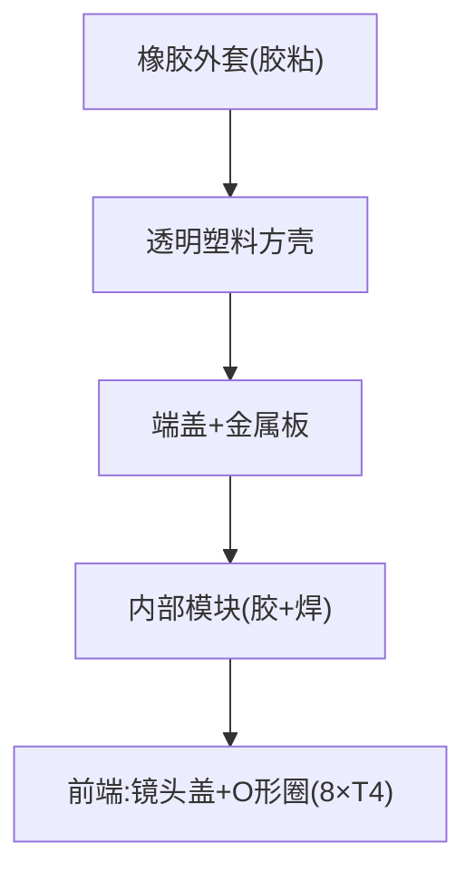

# GoPro Hero4 Session 免外壳防水机身

> [!summary] 一句话概述
> GoPro 第一款不用外壳就防水的相机：镜头盖用 8 颗 T4 螺丝压 O 形圈（可换），机身则是「透明塑料方壳 + 胶粘橡胶外套」整体密封——防水做到了，但内部只能破坏性拆开，可维修性 1/10。

## 配图

![[附件/gopro-session-oring.jpg]]
*iFixit：拆下镜头盖后露出 O 形圈*

![[附件/gopro-session-clearcase.jpg]]
*iFixit：剥掉橡胶外套后的透明塑料内壳*

> 图片版权归原作者所有，仅作个人学习收藏；出处见文末「来源与核实记录」。

## 结构原理

> 本节数字只写来源里给出的；来源没有就写「来源未给出」。

### 堆叠方案

方向：**从外到内**

| 层级 | 零件 | 材料 | 厚度/尺寸 | 固定方式 | 依据 |
| --- | --- | --- | --- | --- | --- |
| L1 | 橡胶外套（含快门按键） | 橡胶 | 来源未给出 | 胶粘在内壳上 | Step 6 |
| L2 | 透明塑料方壳 | 塑料 | 来源未给出 | 无外部螺丝或卡扣，整体封闭 | Step 7 |
| L3 | 端盖 + 金属板 | — | 来源未给出 | 粘接 | Step 8 |
| L4 | 内部模块（电池、主板、无线板、镜头） | — | 来源未给出 | 胶粘 + 焊接，电池焊在主板并粘在支架 | Step 11 |
| 前端 | 镜头玻璃盖 + O 形圈 | 玻璃 / 橡胶 | 来源未给出 | 8 颗 T4 Torx 螺丝 | Step 5、18 |

剖面示意：

### 零件清单

| 零件 | 数量 | 功能 | 材料 | 依据 |
| --- | --- | --- | --- | --- |
| 镜头玻璃盖 | 1 | 保护镜头，最易损件，可单独更换 | 玻璃 | Step 5 |
| O 形圈 | 1 | 镜头盖密封 | 橡胶 | Step 5 |
| T4 Torx 螺丝 | 8 | 压紧镜头盖 | 来源未给出 | Step 18 |
| 橡胶外套 | 1 | 外观/防护/按键 | 橡胶 | Step 6 |
| 铰接防水端口门 | 1 | 盖住 micro-USB 与 microSD | 来源未给出 | Step 2 |
| 电池 | 1 | 3.8 V / 1000 mAh / 3.8 Wh | 锂电 | Step 11 |

### 装配顺序

1. (按拆解顺序反推) 内部模块装入并胶粘固定
2. 封闭透明塑料方壳、粘端盖与金属板
3. 粘贴橡胶外套
4. 放 O 形圈，8 颗 T4 螺丝锁镜头玻璃盖

> 来源只给出（破坏性）拆解顺序，以上为反推。

### 受力与运动分析

- **受力路径**：水压由橡胶外套与封闭塑料壳承担；镜头处由螺丝压紧 O 形圈密封（推断：来源未写明压缩方式）。
- **运动关系**：无相对运动；唯一活动件是铰接的端口门（Step 2）。
- **失效风险**：内部维修需剪开/打磨外壳，无法复原；电池焊接+胶粘，基本无法更换（Step 18）。

## 设计要点与参数

| 要点 | 内容 | 依据 |
| --- | --- | --- |
| 重量 | 74 g | Step 2 |
| 体积 | 略大于 50 cm³ | Step 2 |
| 镜头盖螺丝 | 8 颗 T4 Torx | Step 18 |
| O 形圈规格/防水深度 | 来源未给出 | — |

## 优缺点

**优点**
- 免外壳防水，整机体积远小于「相机+防水壳」
- 最易损的镜头盖做成可拆换（官方出售替换套件）

**缺点 / 代价**
- 机身为一次性胶粘密封，可维修性 1/10
- 电池不可换，寿命受限

## 可借鉴点

- 把最易损、最需要维修的部件（镜头盖）单独做成螺丝+O 形圈的可拆密封
- 整机密封与可维修之间要提前权衡

## 相关案例

- [[Garmin fēnix 7X 可复用橡胶密封圈]]
- [[苹果 AirPods Pro 全胶粘封装（反面案例）]]
- 分类索引：[[05-密封与防护 索引]]

## 来源与核实记录

- 主来源：[GoPro Hero4 Session Teardown](https://www.ifixit.com/Teardown/GoPro+Hero4+Session+Teardown/44307)（2015-07-16，Evan Noronha / iFixit）
- 核实：2026-11-13 通过 iFixit API 读取 18 步原文，核对 O 形圈、螺丝数量、外壳层次与电池参数。
