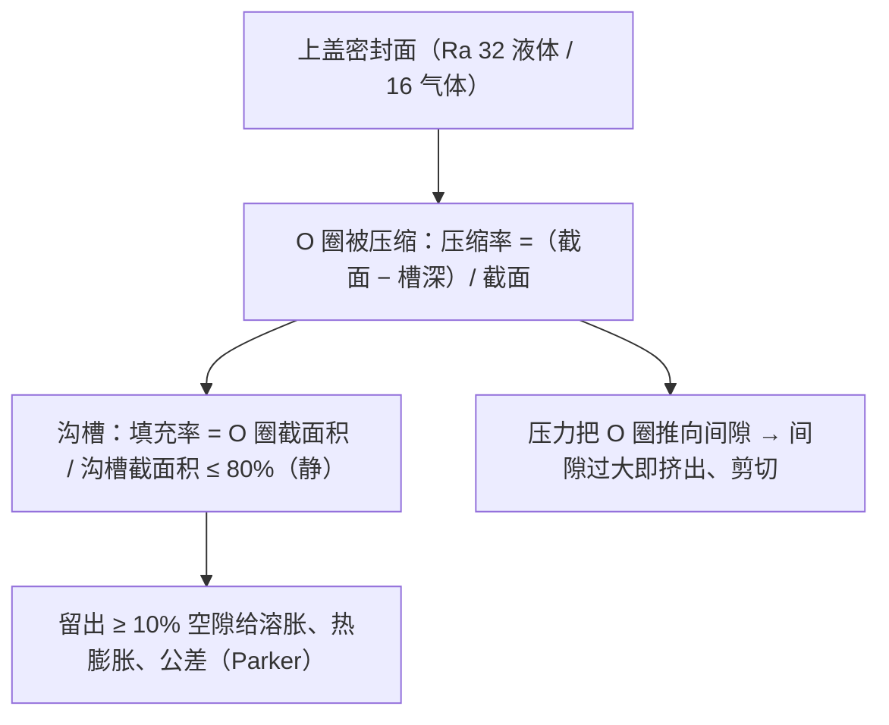

# O 形圈密封槽设计：填充率、压缩率与挤出间隙的五个数

> [!summary] 一句话概述
> O 圈漏不漏，主要不看胶料，而看沟槽的几个数：填充率（静 ≤ 80%、动 ≤ 70%）、压缩率（一般 12%–30%，要用 O 圈最小/最大截面各算一遍）、挤出间隙（按最大实际间隙算，压力越高间隙要越小）、线速度、介质 + 温度。三家来源给的区间基本一致：Parker 手册建议填充 60%–85%、最佳 75%，静密封最大压缩 30%，绝对压缩量不少于 0.007 in（约 0.2 mm）。

## 配图

![[附件/oring-gland-fill.jpg]]
*图源：[B站 cv53610609](https://www.bilibili.com/read/cv53610609)；沟槽剖面：压缩量、沟槽深度、沟槽宽度、径向间隙与沟槽填充率*

![[附件/oring-squeeze.png]]
*图源：同上；按使用方式的压缩率区间：径向静密封 15%–25%、往复动密封 12%–18%、端面密封 20%–30%、旋转轴 8%–12%（不推荐）*

![[附件/oring-extrusion-gap.png]]
*图源：同上；70 度胶的允许间隙与工作压力：≤ 5 MPa ≤ 0.40 mm，10 MPa ≤ 0.25 mm，20 MPa ≤ 0.15 mm（加 PTFE 挡圈），> 25 MPa 建议 90 度胶 + 双挡圈*

> 图片版权归原作者所有，仅作个人学习收藏；出处见文末「来源与核实记录」。

## 结构原理

> 本节数字只写来源里给出的；来源没有就写「来源未给出」。

### 堆叠方案

方向：**端面密封剖面，从上盖到槽底**（径向密封同理，只是方向转 90°）

| 层级 | 零件 | 材料 | 厚度/尺寸 | 固定方式 | 依据 |
| --- | --- | --- | --- | --- | --- |
| L1 | 上盖（密封面） | 金属/塑料 | 静态液体密封面 32 Ra、气体 16 Ra；动态 8–16 Ra | 螺栓压紧 | Marco Rubber |
| L2 | 配合间隙（挤出间隙） | — | 按最大实际间隙控制，见上图表 | — | cv53610609 第 03 节 |
| L3 | O 形圈 | NBR / HNBR / FKM / EPDM | 例：截面 φ3.53（±0.08）、φ5.33（±0.10） | 装在槽内，被压扁 | cv53610609 第 02 节 |
| L4 | 沟槽（宽 × 深） | 下壳 | 例：宽 4.8 × 深 2.75 mm → 填充率 74% | 加工/成型 | cv53610609 第 01 节 |
| L5 | 槽口导入角与圆角 | — | 导入角 15°–20°，圆角 R0.2 以上 | — | cv53610609 第 06 节 |

剖面示意：

### 零件清单

| 零件 | 数量 | 功能 | 材料 | 依据 |
| --- | --- | --- | --- | --- |
| O 形圈 | 1 | 挤压型密封 | 按介质与最高温度选 | cv53610609 第 05 节 |
| 沟槽 | 1 | 定位并限定压缩 | — | 全部来源 |
| 挡圈（必要时） | 1–2 | 防挤出 | PTFE | cv53610609 第 03 节 |
| 格莱圈/斯特封（> 40 MPa 往复） | — | 替代 O 圈 | PTFE 滑环 + O 圈 | cv53610609 第 03 节 |

### 装配顺序

1. 检查沟槽倒角（15°–20° 导入角、R0.2 以上圆角），避免装配时划伤 O 圈。
2. 选内径：O 圈装到轴上会被拉伸 1%–5%，内径要略小于轴径（cv53610609）；Parker 不建议拉伸超过 5%，超过 2%–3% 要修正槽深（Conquest 转引）。
3. 确认润滑剂与介质兼容后，涂装配油/硅脂。
4. 装入沟槽，合盖压紧；端面密封压紧后检查是否有啃边。

### 受力与运动分析

- **受力路径**：压紧力 → O 圈截面被压扁 → 在两个密封面上产生接触应力；介质压力推 O 圈贴向低压侧，接触应力随压力升高（自紧），但也把 O 圈推向间隙。
- **运动关系**：静密封无相对运动；往复密封压缩率要更低（摩擦、磨损）；旋转轴不建议用 O 圈（离心力把圈甩向槽外壁，几小时就能磨出平面），改用骨架油封。
- **失效风险**：填充率过高（例：92%）时温升或溶胀让橡胶无处可去，被剪断在间隙里；压缩 < 12% 密封压不实，> 30% 永久变形（尤其 FKM）；压缩量低于约 0.005 in 时几乎 100% 压缩永久变形（Parker，经 Conquest 转引）；批次硬度差 5 度，压缩永久变形差 10 个百分点。

## 设计要点与参数

| 要点 | 内容 | 依据 |
| --- | --- | --- |
| 填充率 | 静 ≤ 80%，往复 ≤ 70%，气体 ≤ 65%，> 85% 出事 | cv53610609 |
| 填充率（交叉核对） | 60%–85%，最佳 75%（25% 空隙）；至少留 10% 空隙 | Parker（Conquest 转引）；Marco「约 25% 空隙」 |
| 压缩率区间 | 12%–30%；端面 20%–30%，径向静 15%–25%，往复 12%–18%，旋转 8%–12% | cv53610609 |
| 压缩率（交叉核对） | 端面 20%–30%，静态内外径 18%–25%，往复 10%–20%，旋转 0%–10% | Marco Rubber |
| 压缩率上限 | 静密封最大约 30%，端面 30% 常常有利 | Parker（Conquest 转引） |
| 最小绝对压缩量 | 0.007 in（约 0.18 mm，换算） | Parker（Conquest 转引） |
| 截面公差 | φ3.53 ±0.08 mm；φ5.33 ±0.10 mm（GB/T 3452.1、AS568） | cv53610609 |
| 填充率算例 | φ3.53 截面积约 9.78 mm²；槽 4.8 × 2.75 = 13.2 mm² → 74%（静合格）；动密封加宽到约 5.3 mm → 67% | cv53610609 |
| 挤出间隙（70 度胶） | ≤ 5 MPa ≤ 0.40 mm；10 MPa ≤ 0.25；20 MPa ≤ 0.15 + PTFE 挡圈；> 25 MPa 90 度胶 + 双挡圈 | cv53610609 配图 |
| 线速度 | < 0.5 m/s NBR 70 度可跑几十万次；> 1 m/s 换配方或结构 | cv53610609 |
| 介质 | 矿物油 ≤ 100 °C 用 NBR；> 120 °C 或含硫添加剂用 HNBR；酮、酯、强酸碱、蒸汽用 FKM/FFKM；DOT3/4 制动液用 EPDM | cv53610609 |
| 表面粗糙度 | 静态液体 32 Ra，气体 16 Ra，动态 8–16 Ra | Marco Rubber |
| 安装拉伸 | 一般 0%–5%；截面减小率约为内径拉伸率的一半 | Marco Rubber |

## 优缺点

**优点**
- O 圈是标准件，便宜、易买、可换
- 只要沟槽算对，静密封非常可靠

**缺点 / 代价**
- 对沟槽尺寸、公差和表面粗糙度敏感
- 高压动密封、旋转密封不适用

## 可借鉴点

- **出图前按这张清单检查**：① 填充率（静 ≤ 80%、动 ≤ 70%、气 ≤ 65%）；② 压缩率用最小/最大截面各算一遍，都要落在区间内；③ 挤出间隙按最大实际间隙（孔轴公差叠加、偏心、受载变形）；④ 线速度；⑤ 最高温度下的介质兼容
- **公差叠加必须算**：同批 φ3.53 的 O 圈可能是 3.45 或 3.61，槽深按名义值算，压缩率可能一个 18% 一个 26%
- **塑料外壳防水**：没有高压，主要控制压缩率与填充率；塑料壳会变形，螺丝间距和壳体刚度同样要保证（见 [[三防手机整机防水结构：上下壳胶圈、电池盖、按键与开孔的参数清单]]）
- **槽口倒角**写进图纸：15°–20° 导入角 + R0.2

## 与库中相似案例对比

| 对比项 | 本案例 | [[Garmin fēnix 7X 可复用橡胶密封圈]] | [[GoPro Hero4 Session 免外壳防水机身]] |
| --- | --- | --- | --- |
| 类型 | 通用设计规则 | 产品实例（螺丝压密封圈） | 产品实例（镜头盖 O 圈） |
| 参数 | 完整 | 无沟槽参数 | 无沟槽参数 |
| 用法 | 拿来检查前两个实例的设计 | — | — |

## 相关案例

- [[三防手机整机防水结构：上下壳胶圈、电池盖、按键与开孔的参数清单]]
- [[Garmin fēnix 7X 可复用橡胶密封圈]]
- [[GoPro Hero4 Session 免外壳防水机身]]
- [[GORE 防水透气膜：压力平衡与粘贴式透气阀的安装参数]]
- 分类索引：[[05-密封与防护 索引]]

## 来源与核实记录

- 主来源：[O型密封圈选型手册：先别翻材料表，先算这五个数](https://www.bilibili.com/read/cv53610609)（B站专栏，「全国o型圈定制厂家」，2026-10-26）
- 补充来源 1：[O-Ring Gland General Design Considerations](https://www.marcorubber.com/downloads/Marco-O-Ring-Gland-General-Design-Considerations.pdf)（Marco Rubber & Plastics，PDF）
- 补充来源 2：[O-Ring Squeeze: How Much Is Enough?](https://conquestseal.com/guides/o-ring-squeeze)（Conquest Seal 参考指南，转引 Parker ORD 5700 第 3.5–3.7 节、Trelleborg、Precision Associates）
- 补充来源 3：[o型圈开槽深度和宽度设计](https://www.bilibili.com/read/cv26331074)（B站，2023-09-06）——只有定性说明，未提供数值
- 核实：2026-11-13 打开以上全部页面/PDF 核对。Parker 手册原 PDF（parker.com）返回 Access Denied，未能直接打开，Parker 数值均标注为经 Conquest Seal 转引。
