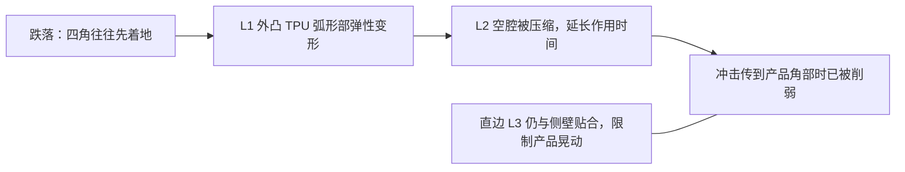

# TPU 包胶气囊角：拐角外凸空腔缓冲跌落冲击

> [!summary] 一句话概述
> 保护壳四边可以贴住电子产品侧壁，但在水平段与垂直段相接的拐角向外做出弧形凸起，使拐角内壁与产品角部之间留出空腔，形成「气囊角」；跌落时通常四角先着地，TPU 弧形部先弹性变形，空腔再参与缓冲。专利只给出结构，不给出硬度或边框厚度；若采用硬胶+TPU 包胶，还要单独验证粘接。

## 配图

![[附件/tpu-airbag-corner-cn204707366.jpg]]
*图源：[CN204707366U 说明书附图 图1](https://patents.google.com/patent/CN204707366U/zh)；矩形框架 1 由水平段 2、垂直段 3 组成，拐角外凸弧形部 4 与产品侧壁之间形成空腔 5；6、7 为贯通孔，8 为电子产品示意*

> 图片版权归原作者所有，仅作个人学习收藏；出处见文末「来源与核实记录」。本图为专利附图，不是开模量产照片。

## 结构原理

> 本节所有数字只写来源里给出的；来源没有就写「来源未给出」。专利内容不当作已量产事实。

### 堆叠方案

方向：**从保护壳外侧到电子产品侧壁（俯视拐角）**

| 层级 | 零件 | 材料 | 厚度/尺寸 | 固定方式 | 依据 |
| --- | --- | --- | --- | --- | --- |
| L1（最外） | 拐角外凸弧形部 | 优选 TPU；也可以是整个矩形框架都用 TPU | 厚度、外凸量、空腔高度：来源未给出 | 与边框一体注塑（专利未限定是否双色） | CN204707366U |
| L2 | 空腔 | 空气 | 由「弧形部内壁不与产品侧壁贴合」形成；具体容积来源未给出 | 几何让位，不是单独零件 | 同上 |
| L3 | 水平段、垂直段 | 与框架相同，专利优选 TPU | 与产品上下两端、左右侧壁贴合 | 靠框架约束电子产品侧壁 | 同上 |
| L4（最内） | 电子产品侧壁/四角 | 来源未给出 | — | 放入框架；可选底部封闭一端 | 同上 |

剖面示意：

### 零件清单

| 零件 | 数量 | 功能 | 材料 | 依据 |
| --- | --- | --- | --- | --- |
| 矩形框架 | 1 | 限制产品侧壁，直边贴合、拐角让空 | 专利优选整体 TPU；弧形部至少为 TPU | 权利要求 1、3、4 |
| 外凸弧形部 / 空腔 | 四角各 1 | 角跌缓冲 | TPU + 空气 | 说明书 |
| 按键与贯通孔 | 按产品 | 对应按键、耳机孔、数据线孔等 | 与框架同体 | 权利要求 2 |
| 底部（可选） | 0 或 1 | 封闭框架一端，形成只有一侧开口的容腔 | 来源未给出是否同料 | 权利要求 5 |

### 装配顺序

专利未写成型和装配的详细工序。按结构能直接读出的是：

1. 注塑成型矩形框架（是否与硬底壳双色/包胶，专利未规定）。
2. 若做封闭底部，则框架先有一端封闭。
3. 将电子产品从开口侧推入，使水平段、垂直段与侧壁贴合，四角对准空腔。
4. 按键与开孔对位。

若实际采用硬质底材 + TPU 包胶，装配/成型顺序要改成「先硬后软」的 2K 或嵌件包胶，并验证粘接。这不是该专利的权利要求，而是 Eastman/Lubrizol 白皮书讨论的另一类工艺。

### 受力与运动分析

- **受力路径**：专利认为质量比较均匀的电子产品自由落体时，通常四个角先落地；冲击先作用在拐角弧形部，TPU 发生弹性变形，空腔参与缓冲，从而减小传到产品的外力。直边仍贴合侧壁，主要起限位，不是主吸能区。
- **运动关系**：弧形部相对产品角部有一次压缩变形，卸荷后回弹（回弹量来源未给出）。空腔不是密封气密腔的量化设计，专利只说「不贴合而形成气囊结构」。
- **失效风险（推断，已标注）**：空腔太小或弧形部太硬，变形行程不够；空腔太大则角部包裹不足、产品可能在框架内窜动（推断）。TPU 与硬胶若采用包胶而不做机械互锁，粘接不足会在角跌时撕开（推断；白皮书讨论的正是粘接问题）。专利已于 2025-06-13 因未缴年费终止，不能当作现行有效权利或量产规范。

## 设计要点与参数

| 要点 | 内容 | 依据 |
| --- | --- | --- |
| 气囊如何形成 | 水平段、垂直段与产品侧壁贴合；二者连接处向外凸出弧形部，其内壁不与产品侧壁贴合，从而形成空腔 | CN204707366U 摘要、说明书 |
| 材料 | 弧形部采用 TPU；矩形框架也可整体采用 TPU。专利描述 TPU「高透明度、较好的弹性、容易注塑成型、易于着色」 | 说明书优选实施方式；权利要求 3、4 |
| 硬度、边框厚度、空腔尺寸 | 来源未给出 | 已打开的专利全文无这些数 |
| 开孔 | 框架上与产品对应位置设按键及贯通孔 | 权利要求 2 |
| 底部 | 可选，封闭一端 | 权利要求 5 |
| 专利性质 | 2015-06-01 申请，2015-10-14 授权，2025-06-13 因未缴年费终止。结构主张 ≠ 已验证的防护等级或量产工艺 | Google Patents 法律状态 |
| 包胶粘接（另一来源，试验条件不同） | Eastman 与 Lubrizol 2024 年白皮书：在 Tritan™ TX1501HF 底材上包 TPE/TPU。对粘接有显著影响的是模温、TPE 保压时间、TPE 料筒温度；注射速度在该 DoE 中不是显著项。优化后平均粘接强度约 294 N，非理想条件最低平均约 240 N；ESTANE ECO TPU 12T80E 与 16T85 在优化窗口内可 > 310 N。剥离：23℃、50% RH，速度 100 mm/s，每组至少 10 件 | Eastman 白皮书摘要与试验描述 |
| 机械互锁 | 白皮书指出：在硬件上做可供软胶充填的特征或凹腔，凝固后形成机械互锁，可增强粘接，尤其当材料化学不相容或不能改料时 | Eastman 白皮书 Introduction |
| 与整机跌落加固的关系 | 赫兹跌落文把「电池仓、镜头周围用 TPU 包边或垫片」作为局部缓冲手段，并强调必须预先留位。该文未给出气囊角空腔或硬度 | 赫兹 1050，仅作场景对照 |

## 优缺点

**优点**
- 不靠把整圈边框做得很厚来防摔，专利主张在不增加制造难度和产品厚度的前提下，用拐角空腔缓冲角跌
- 直边仍贴合，对日常握持限位清楚
- TPU 既可做局部弧形部，也可做整框

**缺点 / 代价**
- 已公开专利没有硬度、壁厚、空腔高度、测试高度或防护等级，不能直接当设计输入
- 空腔效果强烈依赖角部几何和材料弹性模量，必须用样机跌落验证
- 若改成硬壳+软胶包胶，还要解决粘接和互锁，工艺窗口与专利结构不是一回事
- 该专利权利已终止，不构成可依赖的权利状态

## 可借鉴点

- **角跌优先在四角做「可变形区 + 空腔」**，直边继续贴合限位，不要把整圈边框加得一样厚
- **TPU 要在开模前留位**（与跌落加固篇一致）
- **硬度、边框厚、空腔高必须自己试验或向材料商要数据**，不要把本专利没写的数补上去
- 做 2K 包胶时：模温、软胶保压、料筒温度按该 TPU 的推荐窗口去优化粘接；硬件上预留互锁凹槽或倒扣
- 专利只当结构线索，量产前做六面四角跌落，并写明地面和高度

## 与库中相似案例对比

| 对比项 | 本案例 | [[跌落测试结构加固：六面四角、外圆角与局部 TPU 缓冲]] | [[双色注塑：硬胶先射、软胶后射的结构拆件规则]] |
| --- | --- | --- | --- |
| 对象 | 保护壳拐角空腔 | 整机外壳圆角、筋、局部 TPU | 双色拆件与包胶顺序 |
| 参数来源 | 专利结构 + 包胶试验（不同产品） | 测试方向/圆角/材料韧性 | 硬胶先射、软胶后射规则 |
| 关系 | 气囊角是一种「把 TPU 用在角上」的几何 | 本篇是其中一种局部缓冲实现 | 若气囊角要包在硬壳上，按该篇拆件 |

## 相关案例

- [[跌落测试结构加固：六面四角、外圆角与局部 TPU 缓冲]]
- [[双色注塑：硬胶先射、软胶后射的结构拆件规则]]
- 分类索引：[[05-密封与防护 索引]]

## 来源与核实记录

- 主来源：[CN204707366U 一种具有气囊结构的保护壳](https://patents.google.com/patent/CN204707366U/zh)（申请人/专利权人：深圳市一鸣达精密技术有限公司，发明人王敏刚；申请日 2015-06-01，授权公告 2015-10-14）。2026-11-15 打开 Google Patents 并下载官方 PDF，核对摘要、说明书、权利要求和附图。
- 补充来源 1：[Examining how 2k injection molding conditions and choice of TPE impact adhesion of TPEs overmolded onto Eastman Tritan™ TX1501HF](https://www.eastman.com/content/dam/eastman/corporate/en/literature/misc/eastman-tpe-overmolding-whitepaper.pdf)（Eastman / Lubrizol，2024-04）——包胶工艺与粘接数据，试验底材是 Tritan，不是该保护壳
- 补充来源 2：[跌落测试不过关，多半卡在这几处](https://www.hezidesign.com/jingyan/1050.html)——整机局部 TPU 缓冲的应用语境，无气囊角尺寸
- 核实：2026-11-15 打开上述来源。硬度、边框厚度等在已打开文献中均未给出，正文一律写「来源未给出」。未把专利当量产事实。
