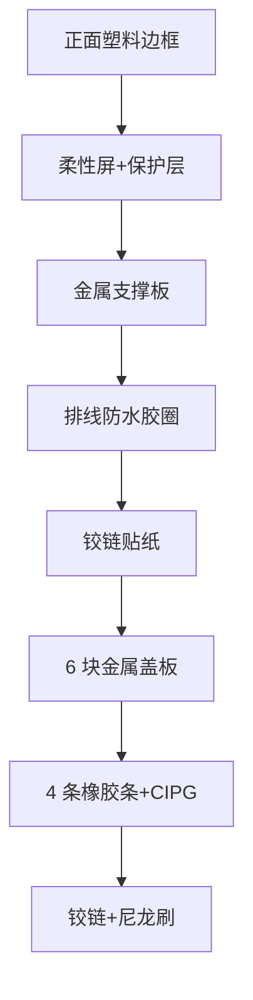

# 三星 Galaxy Z Fold3 折叠屏防水结构

> [!summary] 一句话概述
> Z Fold3 带铰链这种活动部件也拿到了 IPX8：它不追求挡住所有水，而是允许水进到屏幕下方，再用「排线周围一圈胶 + 铰链处橡胶条和现场成型密封胶(CIPG)」在关键部位把水拦下。

## 配图

![[附件/galaxy-z-fold3-teardown-ifixit.jpg]]
*iFixit 拆解视频封面：Z Flip3 与 Z Fold3 浸水测试*

> 图片版权归原作者所有，仅作个人学习收藏；出处见文末「来源与核实记录」。

## 结构原理

> 本节数字只写来源里给出的；来源没有就写「来源未给出」。

### 堆叠方案

方向：**从折叠屏正面向内（铰链区域）**

| 层级 | 零件 | 材料 | 厚度/尺寸 | 固定方式 | 依据 |
| --- | --- | --- | --- | --- | --- |
| L1 | 塑料凸起边框 (bumper bezel) | 塑料 | Fold3 的边框比前代更厚（具体数值来源未给出） | 粘接 | 「plastic bumper bezels on the series three Folds are thicker」 |
| L2 | 柔性折叠屏（表面带保护层） | 柔性 OLED + 保护层（营销称更耐刮） | 来源未给出 | 背胶粘接，胶几乎涂到中间 | 「adhesive … applied it almost all the way to the center」 |
| L3 | 屏幕背面金属支撑板 | 金属（薄板） | 来源未给出 | 与屏幕一体 | 「screens are reinforced by a thin metal plate」 |
| L4 | 排线周围的胶圈（3 根排线各一圈） | 胶粘剂 | 来源未给出 | 围绕排线连续涂胶 | 「adhesive perimeters all the way around each of the three cables」 |
| L5 | 铰链区贴纸 | 贴纸 | 来源未给出 | 粘贴 | 「stickers cover the display-side hinges」 |
| L6 | 金属盖板 ×6 | 金属 | 来源未给出 | 贴在橡胶条上 | 「six metal plates」 |
| L7 | 橡胶条 ×4 + 透明 CIPG 密封胶 | 橡胶 + 现场成型密封胶 | 来源未给出 | 点胶后在空气中固化 | 「cured-in-place gasket … dispense it, it's a liquid」 |
| L8 | 铰链 + 尼龙防尘刷 | 金属铰链 / 尼龙刷毛 | 来源未给出 | 螺丝连接三段机身 | 「More screws hold the three parts of phone together」 |

剖面示意：

### 零件清单

| 零件 | 数量 | 功能 | 材料 | 依据 |
| --- | --- | --- | --- | --- |
| 后盖玻璃 / 外屏 | 每台 2 块（原文 two phones 合计 four outer panels） | 外观与保护 | 玻璃（外屏胶为泡沫+常规背胶） | 原文 |
| 折叠屏 + 金属支撑板 | 1 | 主显示 | 柔性 OLED/金属 | 来源未给出 |
| 排线 | 3 | 连接两半机身与屏幕 | 来源未给出 | 原文 |
| 金属盖板 | 6 | 压住/保护铰链区橡胶条 | 金属 | 原文 |
| 橡胶条 + CIPG | 4 | 阻止液体进入机身其余部分 | 橡胶/固化密封胶 | 原文 |
| 尼龙防尘刷 | 来源未给出 | 挡灰 | 尼龙 | 原文 |

### 装配顺序

1. (按拆解顺序反推) 两半机身与中间铰链段用螺丝连接
2. 在铰链区点涂 CIPG，与橡胶条配合，固化成型
3. 装 6 块金属盖板与铰链贴纸
4. 沿 3 根排线四周涂一圈胶，装折叠屏（含金属支撑板）
5. 装塑料凸起边框
6. 装外屏、无线充电线圈与屏蔽罩、后盖

> 来源只给出拆解顺序，以上为按拆解顺序反推。

### 受力与运动分析

- **受力路径**：水压/液体路径：水可从屏幕边缘进入屏幕下方（iFixit 浸水后在 Z Flip3 屏下看到水），随后被排线四周的胶圈和铰链处橡胶条+CIPG 拦住，不再进入主板等区域。
- **运动关系**：铰链在两半机身之间转动；三星采访中提到给铰链涂了疏水润滑剂，iFixit 拆解中未明显看到该润滑剂，推测只在齿轮内部。
- **失效风险**：屏幕胶几乎涂到中心、边框更厚，维修时边框容易弯折断裂；一根排线与框架间隙很小，需要松开主板才能取出（原文）。

## 设计要点与参数

| 要点 | 内容 | 依据 |
| --- | --- | --- |
| 防护等级 | IPX8（三星宣称，iFixit 鱼缸浸泡后两台手机正常） | 原文开头与结论 |
| 防水策略 | 「允许水进屏下，再在关键部位拦截」 | 原文 |
| CIPG | 液体点胶，暴露在空气中固化成软胶 | 原文 |
| 几何尺寸/胶宽/压缩量 | 来源未给出 | — |

## 优缺点

**优点**
- 不必把整个活动铰链做成密封腔，降低了密封难度
- 密封点集中在排线和铰链两处，路径清晰

**缺点 / 代价**
- 大面积背胶 + 加厚边框让屏幕维修很难
- iFixit 评价两款都不是为维修而设计

## 可借鉴点

- 活动部件附近的防水可以换思路：把「进水区」和「保护区」分开，只密封保护区边界
- 排线过孔处做独立胶圈，是成本很低的局部防水
- CIPG 适合不规则、空间窄的密封路径

## 相关案例

- [[三星 Galaxy Z Flip 铰链与尼龙防尘刷]]
- [[三星 Galaxy Fold 一代铰链与屏幕支撑结构]]
- [[Garmin fēnix 7X 可复用橡胶密封圈]]
- 分类索引：[[05-密封与防护 索引]]

## 来源与核实记录

- 主来源：[Galaxy Z Flip & Fold 3: Small Changes Make a Big Difference](https://www.ifixit.com/News/52399/galaxy-z-flip-fold-3-small-changes-make-a-big-difference)（2021-09-02，Taylor Dixon / iFixit）
- 补充来源：<https://www.ifixit.com/Teardown/Samsung+Galaxy+Z+Fold3+Teardown/144857>
- 核实：2026-11-13 打开原文，逐条核对了 IPX8、屏下进水、排线胶圈、6 块金属盖板、4 条橡胶条、CIPG、尼龙刷等描述。
