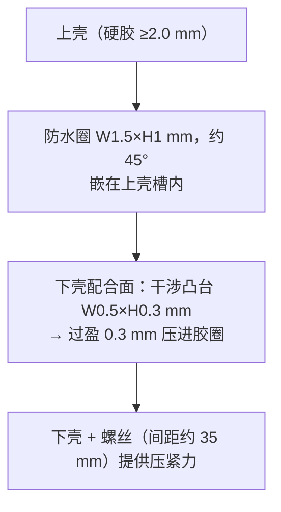

# 三防手机整机防水结构：上下壳胶圈、电池盖、按键与开孔的参数清单

> [!summary] 一句话概述
> 一篇把三防手机每个漏水口都配了「怎么封 + 封多少」的经验清单：上下壳用 W1.5×H1 mm、约 45° 的正压胶圈，配 W0.5×H0.3 mm 干涉凸台（过盈 0.3 mm）、螺丝间距约 35 mm；电池盖侧压 φ1.5 mm 圈过盈 0.2 mm；侧键单边过盈 0.15–0.3 mm；TP 贴胶宽 ≥ 2.5 mm；喇叭贴防水膜，高防水机必须留透气泄压孔。

## 配图

![[附件/rugged-phone-housing-gasket.jpg]]
*图源：[B站 菲特教育 cv14365267](https://www.bilibili.com/read/cv14365267)（图内水印「Proe和Creo教程」）；两侧空间不足时的「侧压」防水圈剖面（红色为胶圈）*

![[附件/rugged-phone-side-key-seal.jpg]]
*图源：同上；侧按键橡胶防水件，箭头处为与壳体孔过盈配合的密封裙边*

![[附件/rugged-phone-speaker-seal.jpg]]
*图源：同上；喇叭另一种做法：周圈侧面打胶密封（需留 ≥ 0.5 mm 点胶空间）*

> 图片版权归原作者所有，仅作个人学习收藏；出处见文末「来源与核实记录」。

## 结构原理

> 本节数字只写来源里给出的；全部为作者经验值。

### 堆叠方案

方向：**从外到内（正面 TP → 上壳 → 防水圈 → 下壳 → 电池盖）**，按「每个开口一道防线」列出

| 层级 / 部位 | 零件 | 材料 | 厚度/尺寸 | 固定方式 | 依据 |
| --- | --- | --- | --- | --- | --- |
| L1 正面 | TP（触摸屏）盖板 | — | 两侧贴胶面宽 ≥ 2.5 mm | 防水双面胶 0.25 mm（如 3M5220）；也有改点热胶 | cv14365267 第四节 |
| L1 摄像头 | 前/后摄镜片 | — | 单边贴胶宽 ≥ 2.0 mm | 防水双面胶 0.25 mm | 同上 |
| L1 闪光灯 | 闪光灯镜片 | 硬胶 + 双色软胶 | 硬胶上做 0.5 mm 宽防水圈 | 与软胶单边过盈 0.1 mm；无软胶则加圈或点胶 | 同上 |
| L2 | 上壳（硬胶，可双色） | 硬胶 / 软胶 | 硬胶大面 ≥ 2.0 mm（局部 0.8）；软胶 ≥ 1.2 mm（局部 0.8）；筋 0.8–1.0 mm | — | 第四节·一 |
| L3 | 上下壳间正压防水圈 | 橡胶，约 45° | W1.5 mm × H1 mm | 嵌在槽内，下壳配合面做 W0.5×H0.3 mm 干涉凸台（过盈 0.3 mm）；空间不足改侧压 | 第四节·一 |
| L4 | 下壳 + 螺丝 | 硬胶 | 螺丝间距约 35 mm | 螺丝锁紧 | 同上 |
| L4 螺丝孔 | 螺丝塞 | 70° 软胶 | 单边过盈 0.1–0.25 mm | 塞入 | 第四节·五 |
| L5 | 电池盖 | 硬胶（可双色） | 胶厚 ≥ 2.0 mm | 一端卡扣 + 一端螺丝 | 第四节·一.3 |
| L5 密封 | 电池盖侧压 O 圈 | 橡胶 | φ1.5 mm，装在电池盖侧面槽内 | 与电池仓四周骨位过盈 0.2 mm | 同上 |
| L5 SIM 盖 | SIM 卡盖正压圈 | 橡胶 | 宽 ≥ 2.0 mm（便于贴背胶）；底壳凸台 W0.5×H0.2 mm | 过盈 0.2 mm | 同上 |
| 侧面 | 侧按键防水件 | 橡胶，或橡胶 + 0.3 mm 不锈钢（3/4H） | 单边过盈 0.15–0.3 mm | 外装压入；或粘贴；或与双色软胶一体 | 第四节·二 |
| 底部 | USB / 耳机座 | 自带防水母座，或普通母座 + 外塞 | 来源未给出 | 母座直接与壳料配合并锁螺丝 | 第四节·三 |
| 内部 | 喇叭 / 听筒 / MIC | 防水泡棉 + 防水膜 | 背胶宽 2.5 mm，总厚约 0.8 mm | 贴合；或侧面周圈打胶（留 ≥ 0.5 mm） | 第四节·六 |
| 内部 | 透气泄压元件 / 贴透气膜的出气孔 | — | 来源未给出 | — | 结语第 3 条 |

剖面示意（上下壳正压圈）：

### 零件清单

| 零件 | 数量 | 功能 | 材料 | 依据 |
| --- | --- | --- | --- | --- |
| 上下壳防水圈 | 1 | 主体密封 | 橡胶约 45°（同类文章给 50–60°） | cv14365267；cv39016892 |
| 电池盖 O 圈 | 1 | 电池仓密封 | 橡胶 φ1.5 | cv14365267 |
| SIM 盖正压圈 | 1 | 卡托密封 | 橡胶 | 同上 |
| 侧键防水件 | 每键 1 | 按键密封 | 橡胶 / 橡胶 + 不锈钢片 / 双色软胶 | 同上 |
| 螺丝塞 | 每孔 1 | 封螺丝孔 | 70° 软胶 | 同上 |
| 防水双面胶 | TP、摄像头各 1 | 镜片/屏密封 | 0.25 mm | 同上 |
| 防水泡棉 + 防水膜 | 喇叭/MIC 各 1 | 声学开孔防水 | — | 同上 |
| USB 外塞 | 1（普通母座时） | 接口密封 | 软胶 | 同上 |

### 装配顺序

> 按文章给出的配合关系整理；侧键给了 3 步装配图，其余为推断（推断）。

1. 镜片、TP 用防水双面胶贴到上壳（贴胶面宽度按上表留）。
2. 侧键防水件从外侧压入按键孔（外装），内部加软胶按压支架。
3. 喇叭/MIC：泡棉 + 防水膜贴在出声孔内侧，或周圈点胶。
4. 上下壳防水圈装入槽，合壳后按约 35 mm 间距锁螺丝，螺丝孔打螺丝塞。
5. 电池盖：侧面槽装 O 圈，一端卡扣插入、另一端锁螺丝；SIM 盖同理。
6. 整机做水压、高低温、跌落后复测（作者强调测试后可能不再防水）。

### 受力与运动分析

- **受力路径**：螺丝拉紧上下壳 → 干涉凸台把胶圈压缩 0.3 mm → 胶圈反弹力形成接触应力挡水；侧压结构则靠径向过盈（0.2 mm）而不是螺丝压紧力，所以对螺丝间距和壳体变形更不敏感（推断）。
- **运动关系**：整机为静密封；侧键是唯一的动密封点，靠橡胶件弹性变形传递按压。
- **失效风险**：作者列出——经过高低温、跌落、水压测试后可能失效；高防水机若没有透气泄压，内外气压差会导致壳体开裂。另一篇同类文章（cv8868052 摘要）把「塑胶变形、防水面不在一条线」列为主要漏水原因（未打开全文，仅作线索）。

## 设计要点与参数

| 要点 | 内容 | 依据 |
| --- | --- | --- |
| 壳厚 | 硬胶大面 ≥ 2.0 mm，局部 0.8；双色软胶 ≥ 1.2 mm；筋 0.8–1.0 mm | cv14365267 |
| 主密封 | 正压圈 W1.5×H1 mm，约 45°；凸台 W0.5×H0.3 mm，过盈 0.3 mm | cv14365267 |
| 交叉核对 | 另一作者给上下壳防水圈：硅胶/橡胶，硬度 50–60°，干涉量 0.1–0.2 mm | cv39016892 |
| 螺丝间距 | 约 35 mm | cv14365267 |
| 电池盖 | 侧压 φ1.5 mm 圈，过盈 0.2 mm；一端卡扣一端螺丝 | cv14365267 |
| SIM 盖 | 正压圈宽 ≥ 2.0 mm；凸台 W0.5×H0.2，过盈 0.2 mm | cv14365267 |
| 侧键 | 单边过盈 0.15–0.3 mm，打样后微调；五金片 0.3 mm 不锈钢 3/4H 保证平整 | cv14365267 |
| 螺丝塞 | 70° 软胶，单边过盈 0.1–0.25 mm | cv14365267 |
| TP / 摄像头 | 贴胶宽 ≥ 2.5 / ≥ 2.0 mm，胶厚 0.25 mm | cv14365267 |
| 闪光灯 | 0.5 mm 宽防水圈，与软胶过盈 0.1 mm | cv14365267 |
| 喇叭 | 背胶宽 2.5 mm，膜+泡棉总厚约 0.8 mm；或留 ≥ 0.5 mm 点胶空间 | cv14365267 |
| 圈硬度 | 「密封性结构防水圈的硬度一般在 30–55 度之间」 | cv14365267 第三节 |
| 等级取舍 | 定义为 IP54 就不要用 IP68 的结构 | cv14365267 结语 |

## 优缺点

**优点**
- 每个开口都有对应的封法和数值，能直接当首版设计的起点
- 可维修：胶圈 + 螺丝方案可以拆开再装（对比全胶粘方案）

**缺点 / 代价**
- 两篇文章的硬度与过盈量不一致（45° / 0.3 mm vs 50–60° / 0.1–0.2 mm），说明参数依赖具体产品，必须打样验证
- 胶圈方案需要壳厚和螺丝，厚重，不适合轻薄手机（轻薄机多用点胶/背胶）

## 可借鉴点

- **列「开口清单」**：逐一列出所有开口（壳缝、按键、接口、声学孔、镜片、螺丝孔、电池/卡盖），每个都写明封法、过盈量和贴胶宽度，再做评审
- **主密封首版取值**：W1.5×H1 mm 胶圈 + 0.3 mm 干涉凸台 + 35 mm 螺丝间距，打样后按漏点和装配力调整
- **空间窄的边用侧压**：侧压靠径向过盈，不依赖螺丝压力
- **透气泄压不能省**：高等级防水必须有透气膜出气孔或泄压元件（见 [[GORE 防水透气膜：压力平衡与粘贴式透气阀的安装参数]]）
- **防水等级按定义取**，不要过度设计

## 与库中相似案例对比

| 对比项 | 本案例（三防手机） | [[GoPro Hero4 Session 免外壳防水机身]] | [[三星 Galaxy Z Fold3 折叠屏防水结构]] |
| --- | --- | --- | --- |
| 主密封 | 胶圈 + 螺丝（可拆） | 镜头盖 O 圈 + 机身胶粘 | 点胶/CIPG + 排线胶圈 |
| 参数 | 全套经验数值 | 少 | 少 |
| 思路 | 每个开口单独封 | 尽量减少开口 | 允许局部进水、保护关键部位 |

## 相关案例

- [[O 形圈密封槽设计：填充率、压缩率与挤出间隙的五个数]]
- [[GORE 防水透气膜：压力平衡与粘贴式透气阀的安装参数]]
- [[GoPro Hero4 Session 免外壳防水机身]]
- [[Garmin fēnix 7X 可复用橡胶密封圈]]
- [[双色注塑：硬胶先射、软胶后射的结构拆件规则]]
- 分类索引：[[05-密封与防护 索引]]

## 来源与核实记录

- 主来源：[Proe/Creo产品防水结构设计（三防手机案例）](https://www.bilibili.com/read/cv14365267)（B站专栏，菲特教育，2021-12-10）
- 补充来源 1：[CREO结构工程师必须要懂的防水结构设计](https://www.bilibili.com/read/cv39016892)（B站笔记）——上下壳防水圈：硅胶/橡胶、50–60°、干涉 0.1–0.2 mm
- 补充来源 2：[产品的防水处理都是怎么做的？](https://www.bilibili.com/read/cv14840779)（B站专栏，UG产品设计教学，2022-01-14）——电池门、按键、引出线、上下盖、螺丝柱防水的示意图集（螺丝柱套塑料套或 O 圈/软垫）
- 核实：2026-11-13 通过 B 站专栏接口读取三篇全文核对数值。主来源图片水印为「Proe和Creo教程」，与发布账号不同，可能是转载整理。
