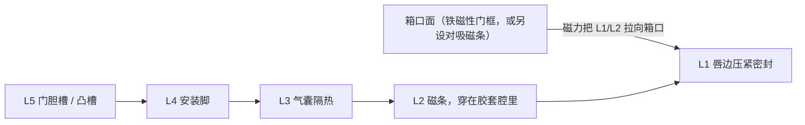

# 冰箱门磁封条：挤出胶套内嵌磁条闭环吸合，兼作闭合与密封（对照橱柜门吸）

> [!summary] 一句话概述
> 冰箱门封是沿门周闭合的挤出弹性胶套：磁条穿在面向箱口的腔里，关门后把整圈封条吸到箱口并压紧唇边和气囊，同时完成保持闭合与密封隔热；它不是橱柜上那颗只负责一点吸合力的门吸。

## 配图

![[附件/fridge-gasket-cn203771883u-figs.png]]
*图源：[CN203771883U《冰箱门密封条》说明书附图](https://patents.google.com/patent/CN203771883U/zh) 图1、图2（授权公告 2014-08-13，专利权人合肥雪祺电气有限公司）。图1为说明书所称现有结构：1 磁条、2 气囊、3 倒三角安装脚插入门胆 5 的凹槽、4 唇边。图2为本专利方案：安装脚改为 U 型包覆门胆凸槽，内壁加硬质 PVC 6 作骨架。*

![[附件/fridge-gasket-aifo-welded-frames.jpg]]
*图源：[AiFO Components，《Manufacturing of magnetic gaskets》](https://aifo.pl/en/magnetic-gaskets-manufacturing-at-aifo-components/) 文内生产质检照片。已经穿磁、45°切角并热焊成矩形闭环的门封框，质检员正在检查焊角与外形。*

![[附件/fridge-gasket-dsu-dart-profiles.png]]
*图源：[DSU Fridge Seal B.V.，《2026 ENGLISH》商用冰箱/冷柜门封目录](https://www.dsu-nl.com/attachment/791/download/DSU_Catalog_2026_EN_Commercial_Bespoke_Refrigerator_Freezer_Cold_Room_Seal_Gasket) 第10–11页 “Dart profiles with magnet”。各型号截面都画出顶部磁条腔和向下的卡脚（dart），卡脚插入门板槽，磁条腔朝向箱口。目录页脚标注 Copyright 2026 DSU BV，January 2026。*

> 图片版权归原作者/专利权人/厂商所有，仅作个人学习收藏；出处见文末「来源与核实记录」。

## 结构原理

> 本节所有数字只写来源里给出的；来源没有就写「来源未给出」，不估算、不把不同来源的单位混算成同一个值。

### 堆叠方案

方向：**沿门封截面，从箱口接触面看向门体安装侧（CN203771883U 图1 的现有典型结构）**

| 层级 | 零件 | 材料 | 厚度/尺寸 | 固定方式 | 依据 |
| --- | --- | --- | --- | --- | --- |
| L1（靠箱口） | 唇边 4，贴合箱口 | 软质 PVC | 来源未给出具体厚度 | 关门后被磁力压紧在箱口面上 | CN203771883U 图1、[0002] |
| L2 | 磁条 1，位于胶套磁条腔内 | 磁粉加助剂挤出并充磁；截面尺寸按供应商规格，例如 DSU 常用 M 型（S-N-S）M-76 为宽 8.0 mm、厚 3.0 mm | 磁条是穿入腔体，不与箱口直接接触 | 科普中国；AiFO 写插入 profile pocket；DSU 第63页表 |
| L3 | 气囊 2 | 软质 PVC 包出的空腔，内为空气 | 来源未给出统一腔高；各厂截面不同 | 与胶套一体挤出 | CN203771883U 图1；科普中国：靠气囊内空气抑制传热 |
| L4 | 安装脚 3 | 软质 PVC；图2方案在脚内壁共挤硬质 PVC 6 | 来源未给出统一脚宽 | 图1：倒三角脚插入门胆凹槽；图2：U 型脚包覆门胆凸槽 | CN203771883U [0002]、[0005]、[0016] |
| L5（门体） | 门胆 5 及门体发泡层 | 门胆为吸塑件；图2凸槽内可进入发泡液 | 来源未给出 | 安装脚与门胆槽配合，把整圈门封留在门上 | CN203771883U [0002]、[0008] |

剖面示意：

磁条并不“锁死”门，只提供沿门周分布的吸合力；气囊和唇边负责补偿门与箱口的间隙误差，并增加热阻。AiFO 写 polarity must match the counterpart in the cabinet body：若箱口也装了磁条，极性必须配对，否则不能吸合。DSU 把最常用的冰箱门封磁条写成 M 型（South-North-South），把极性相反的 C 型（North-South-North）称作 contra magnet，并明确 M 与 C 会相互吸引。家用电冰箱常见的是磁条对铁磁性箱口，打开的来源没有给出箱口钢板牌号；若箱口也有磁条，应按 DSU / AiFO 匹配极性，不能当作“随便哪一面都能吸到钢板上”。

### 零件清单

| 零件 | 数量 | 功能 | 材料 | 依据 |
| --- | --- | --- | --- | --- |
| 挤出胶套（含唇边、气囊、磁条腔、安装脚） | 四边型材焊成一圈 | 密封、隔热、把磁条和安装脚连成闭环 | 软质 PVC 为主；亦可软硬共挤或 TPE | CN203771883U；AiFO；DSU |
| 磁条 | 按边插入，拐角处按厂家工艺处理 | 提供吸合力，使门自动靠紧并保持密封 | 磁粉+助剂挤出后充磁 | 科普中国；AiFO |
| 热焊拐角 | 四个直角（矩形门） | 把斜切型材连成封闭框，避免开胶漏冷 | 与胶套同种热塑性材料热焊，AiFO 强调不用低温下易失效的胶粘 | AiFO |
| 门胆安装槽或凸槽 | 沿门内周一圈 | 固定门封，承受拉拔 | 吸塑门胆，图2凸槽可进发泡液 | CN203771883U |
| 箱口配合面 | 一圈 | 作为磁路的另一侧（钢板或对吸磁条）并接收唇边压紧 | 来源未给出材料牌号 | AiFO；DSU |

### 装配顺序

按 AiFO 的生产顺序，再装到门上（DSU 目录第5、7页是更换测量与安装注意）：

1. 用软质 PVC 挤出门封截面（磁条腔、气囊、安装脚、唇边一次成型；图2方案则软硬共挤）。
2. 按订货长度把型材切成 45° 斜角（AiFO）。
3. 自动放卷并切断磁条，由操作者把磁条穿进胶套的磁条腔（AiFO 称为 magnetization 工位；科普中国也写磁条是生产过程中穿入胶条内部）。
4. 用与该截面对形的焊模把四个角热焊成矩形框，得到可装上门的闭环门封（AiFO；质检照片即此状态）。
5. 把安装脚压入（或包覆）门胆对应的凹槽/凸槽。CN203771883U 写装配后拉拔力有一定要求，但未给出牛顿值。DSU 提醒拿到门封时要握在拐角处，以免把磁条折断；展开后先回到环境温度，运输折痕可用热风枪轻轻加热消除。
6. 关门检查整圈是否贴合。DSU 提供三种测量口径：A size（外侧到外侧，最常用）、B size（磁条到磁条，不常用）、C size（卡脚到卡脚，适用于插入式 dart 型，目录称为更精确的中心距量法）。

> 更换现场的拆装顺序与上列生产顺序相反；DSU 第5页把更换写成：先测量，再对截面，再订货，再安装。

### 受力与运动分析

- **受力路径**：手关门时，门绕铰链转到门封靠近箱口，磁条与箱口（或对吸磁条）之间的吸力把唇边和气囊压向箱口，形成连续压紧。开启时，手柄拉力必须克服这圈分布式吸力。AiFO 给出磁条吸力可选区间 31–75 g/cm²，并写明力大有利于自闭合和密封，力小则开门更轻。DSU 第63页用自己的单位 Power g/cm 列出规格，例如常用 M-76 为 31 g/cm、M-18 为 38 g/cm、M-72 为 51 g/cm；额外加强型（Extra strong）如 MS-18 为 55 g/cm，目录写其吸力比常规磁条高 25–45%，用于门或抽屉闭合时容易弹开的场合，以及车载制冷设备。两家单位写法不同（g/cm² 与 g/cm），本篇不做换算。
- **运动关系**：使用中门封相对门胆基本不滑动，只有气囊和唇边随开门、关门弹性变形。没有机械锁舌。整圈门封是一个焊成的框，随门一起转动。
- **失效风险**：软质 PVC 会因增塑剂迁移、低温变硬而失去贴合（科普中国；CN203771883U 也指出全软门封在搬运中易变形）。焊角或磁条折断会造成局部漏冷。气囊压溃或门与箱口平行度差时，只能局部贴合。油脂和食物残渣会让材料变脆、易撕裂（DSU 维护说明）。磁力不足或极性装反（有对吸磁条时）会导致关不严。来源未给出允许最大间隙的统一毫米值。

## 设计要点与参数

| 要点 | 内容 | 依据 |
| --- | --- | --- |
| 基本组成 | 磁条 + 气囊 + 安装脚 + 唇边，软质 PVC 挤出 | CN203771883U [0002] |
| 两种安装脚 | 现有：倒三角脚插入门胆凹槽；本专利：U 型脚包覆凸槽，凸槽可进发泡液，声称隔热更好、装配更紧、拉拔力更大 | CN203771883U [0002]、[0008]–[0010]、图1/图2 |
| 软硬共挤 | 安装脚内壁加硬质 PVC 当骨架，减少生产、搬运中的变形报废 | CN203771883U [0006]、[0011] |
| 气囊作用 | 用空气抑制门封内外传热；科普中国写冰箱内外常有近 20℃ 温差，并称在一定范围内气囊数量越多隔热越好 | 科普中国 |
| 结构优化方向 | 减小胶条和磁条宽度；用飞边和辅助气囊增大空气体积；加波纹管补偿安装误差；把大气囊分成较均匀的小气囊以减弱对流并加强刚度 | 科普中国（与家电科技 2019 年第6期论文摘要所述“多飞边、多气囊”方向一致；该论文全文未能下载） |
| 漏热占比 | 家电科技论文摘要写：门封漏热约占冰箱总热负荷 15% | 仅依据已打开的摘要页，未核对该文图表 |
| 制造流程 | 软质 PVC 挤出 → 45° 切断 → 磁条切断并穿入腔体 → 专用焊模热焊拐角 | AiFO |
| 磁条极性 | AiFO：标准 S-N-S，可订 N-S-N，须与箱口对侧匹配。DSU：M = S-N-S（最常用）；C = N-S-N（contra，与 M 相吸）；B = 双极，很少用于冰箱门封，使用时必须确认哪一极朝内、哪一极朝外 | AiFO FAQ；DSU 第63页 |
| 磁条吸力（AiFO） | 31–75 g/cm² | AiFO |
| 磁条规格举例（DSU） | M-76：8.0×3.0 mm，sns，31 g/cm；M-25：8.9×2.7 mm，sns，34 g/cm；M-18：10.7×2.5 mm，sns，38 g/cm；M-71：11.8×3.0 mm，sns，42 g/cm；M-72：15.3×3.3 mm，sns，51 g/cm；加强型 MS-18：10.7×2.5 mm，sns，55 g/cm。目录称使用 20 种以上磁条 | DSU 第63页 |
| 测量三法 | A：外侧到外侧（最常用）；B：磁条到磁条（不常用）；C：卡脚到卡脚（插入式更精确） | DSU 第5页 |
| 胶套截面具体壁厚、统一气囊高度、门封拉拔力牛顿值、允许最大门缝 | 来源未给出统一值（各型号截面不同，DSU 以 1:1 图纸按型号给出，本篇不把某一型号误写成行业标准） | — |

## 优缺点

**优点**
- 沿门周连续吸合，同时完成“把门关上”和“把缝封住”，不必另设门栓或点状门吸。
- 气囊和唇边可以吸收门、箱加工和安装误差，比刚性压条更能适应间隙变化。
- 卡槽或包覆式安装便于更换；闭环热焊拐角比胶粘更适合低温环境（AiFO）。
- 磁条规格和极性可以按门重、密封要求和是否对吸来选（AiFO、DSU）。

**缺点 / 代价**
- 只有磁力保持，没有机械锁死，不能当防盗锁用。
- 软质 PVC 会老化变硬、增塑剂迁移，密封和外观都会变差；TPE 更环保但成本与工艺更复杂（科普中国）。
- 吸力、极性、截面和门缝必须匹配，装反或焊角、磁条损坏会局部漏冷、结露。
- 磁条加胶套本身导热高于空气，截面设计需要在吸力、材料和气囊热阻之间折中。

## 可借鉴点

- 把“保持闭合”和“连续密封”做成同一圈弹性件：磁力只负责把唇边压到配合面上，密封主要靠弹性截面，而不是把全部压紧力集中到几个点。
- 磁条要藏在腔里，不直接暴露；先挤出再穿磁、再焊框，便于按门洞改长度。
- 需要拆换时优先用卡脚/包覆，不要只靠粘接；设计时同时规定拉拔力方向和焊角强度。
- 选磁力时同时写极性和单位：有对吸磁条就必须配对（M 对 C）；只对钢板时也不要混用不同厂家的 g/cm 与 g/cm²。
- 气囊要分成多腔并考虑对流，而不是只挖一个大空腔；用波纹或补偿腔吸收门缝公差。
- 对照橱柜门吸：门吸只解决“别自行打开”，不负责整圈密封，也没有气囊热阻。

## 与库中相似案例对比

| 对比项 | 本案例（冰箱门磁封条） | [[橱柜磁吸门吸：只有磁力保持、没有机械锁死（对照 FIDLOCK）]] | [[淋浴房对开门磁吸密封条：两扇门边磁条互吸并兼密封（对照冰箱门封）]] | [[电柜压缩式门锁（Southco E3 与 EMKA 1022）：先转舌再轴向压缩密封条]] |
| --- | --- | --- | --- | --- |
| 磁路对象 | 门上周圈磁条对箱口（钢板或对吸磁条） | 点状永磁对钢板或铁片 | 两扇门边的磁条互吸（门对门） | 一般无磁吸，靠锁舌轴向压缩密封条 |
| 是否兼密封 | 是，唇边+气囊整圈密封、隔热 | 否，只保持门扇关闭 | 是，对合面磁条兼防喷溅 | 是，但压紧力来自机械锁 |
| 几何形态 | 挤出截面焊成闭环框 | 单个或少数撞点 | 两根竖向胶条，卡在玻璃边 | 门框上的密封条+压缩锁 |
| 有无机械锁死 | 无 | 无 | 无 | 有 |
| 何时用这篇 | 要沿周缘既吸合又密封、可更换的冷柜/冰箱门 | 柜门轻保持、不要求密封圈 | 两扇玻璃门对开，没有钢板箱口 | 需要可调压紧力和上锁的电柜门 |

## 相关案例

- [[橱柜磁吸门吸：只有磁力保持、没有机械锁死（对照 FIDLOCK）]]
- [[淋浴房对开门磁吸密封条：两扇门边磁条互吸并兼密封（对照冰箱门封）]]
- [[电柜压缩式门锁（Southco E3 与 EMKA 1022）：先转舌再轴向压缩密封条]]
- [[FIDLOCK V-BUCKLE：磁吸引导到位后再由机械扣锁死]]
- 分类索引：[[05-密封与防护 索引]]

## 来源与核实记录

- 主来源：[CN203771883U《冰箱门密封条》](https://patents.google.com/patent/CN203771883U/zh)（申请 2014-03-25，授权公告 2014-08-13，发明人刘治国、顾维，专利权人合肥雪祺电气有限公司；2026-11-27 已下载 Google Patents PDF 并核对说明书第0001–0016段与附图图1、图2）
- 交叉来源：[AiFO Components，《Manufacturing of magnetic gaskets》](https://aifo.pl/en/magnetic-gaskets-manufacturing-at-aifo-components/)（2023-11-23 刊出，2024-05-15 更新；波兰厂商，与雪祺为不同机构。核对挤出、45°切断、穿磁、热焊及 31–75 g/cm²、S-N-S / N-S-N）
- 交叉来源：[DSU Fridge Seal B.V. 2026 英文目录](https://www.dsu-nl.com/attachment/791/download/DSU_Catalog_2026_EN_Commercial_Bespoke_Refrigerator_Freezer_Cold_Room_Seal_Gasket)（荷兰厂商，2026 年 1 月版，已下载 37 页 PDF。核对第5页测量方法、第10–11页带磁卡脚截面、第63页磁条极性与 Power g/cm 表）
- 补充核对：[科普中国 / 中国农业科技推广网转载《小小冰箱门封 大大科学知识》](https://www.agricoop.cn/news/show.php?itemid=13311)（2022-10-24；材料、穿磁、气囊隔热与四项结构优化。文末署河北石家庄藁城区兴安镇中学高级教师崔会欣科学性把关）
- 摘要页核对：[《家电科技》2019 年第6期第58–63页，刘国强、晏刚、汪昌勇等，《冰箱门封技术现状与研究进展》](http://www.jdkjjournal.com/CN/Y2019/V0/I6/58)（2026-11-27 打开摘要页，见到“门封漏热约占冰箱总热负荷15%”及多飞边、多气囊表述；全文 PDF 多次请求失败，不引用该文未打开的插图或表内数据）
- 未采用：xishu.com 专利转载页触发验证码，未能打开，不以该站为来源。
