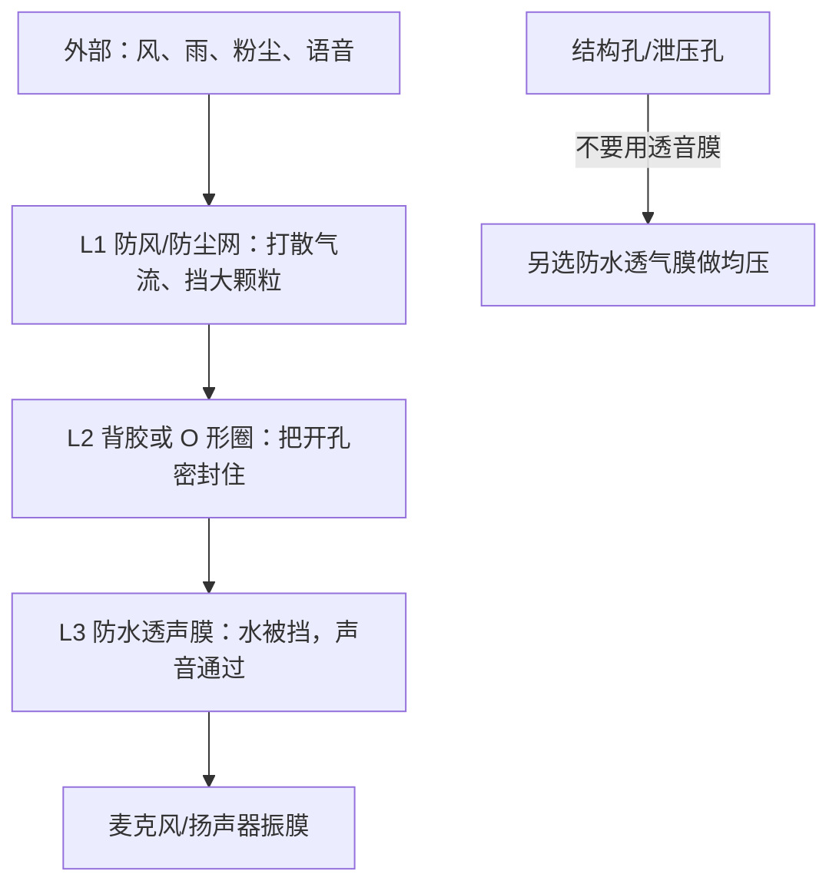

# 喇叭防尘网与防水透声膜叠层：声学孔与结构孔不要混用

> [!summary] 一句话概述
> 麦克风或扬声器开孔上的防护通常不是一层网：最外层用防尘/防风网打散气流、挡大颗粒，内侧再贴防水透声膜挡水并让声音通过。这和外壳上只做压力平衡的防水透气膜不是同一种东西——声学孔看插损和耐水压，结构孔看压差平衡；两类开孔不要共用一张膜。

## 配图

![[附件/acoustic-membrane-square-patches.jpg]]
*图源：[三德利精密《麦克风防风网怎么选》](https://www.shenzhensandeli.com/news/a-mvxki81rxuh.html) 配图；方形带背胶的透声/透气膜模切片，中心为透声区、四周为胶环*

![[附件/acoustic-membrane-oval-sheet.jpg]]
*图源：同上；蓝色离型底纸上的椭圆形黑色膜片排版，属于可模切、可卷带的贴片供货形态*

![[附件/acoustic-membrane-sandeli-3.jpg]]
*图源：同上；条状排版的椭圆形贴片，便于按开孔尺寸选取后直接贴在腔体内侧*

> 图片版权归原作者所有，仅作个人学习收藏；出处见文末「来源与核实记录」。

## 结构原理

> 本节所有数字只写来源里给出的；来源没有就写「来源未给出」。

### 堆叠方案

方向：**从外部环境到麦克风/扬声器腔体（声学孔）**

| 层级 | 零件 | 材料 | 厚度/尺寸 | 固定方式 | 依据 |
| --- | --- | --- | --- | --- | --- |
| L1（最外） | 防风网纱 / 防尘网，或穿孔扬声器罩 | 网纱或金属穿孔板 | 防尘看网目与厚度（三德利未给具体目数）。东杰：专业级穿孔罩孔径控制在 1.2–2.0 mm 时，可将声波衰减控制在 0.5 dB 以内（其实验表述） | 卡装、粘贴或作为外壳一部分 | 三德利；东杰 |
| L2 | 固定与密封 | 背胶或 O 形圈；也可以是防水防尘喇叭网整体 | 胶型、压缩量：来源未给出通用数。三德利提醒开孔毛刺、贴合面平整度、O 形圈压缩量都会影响整机 IP | 压贴或压入 | 三德利 |
| L3 | 防水透声膜 | ePTFE（可无支撑）或 TPU 透音膜 | 见表中型号：如 SDL8025W 厚 20–25 µm | 开孔内侧贴片 | 三德利 |
| L4（最内） | 声学腔与振膜 | 来源未给出 | — | 整机结构 | 三德利 |

剖面示意：

### 零件清单

| 零件 | 数量 | 功能 | 材料 | 依据 |
| --- | --- | --- | --- | --- |
| 防风网 / 防尘网 / 穿孔罩 | 每声学孔外侧 1 | 防风、防尘、护膜；单独使用不具备耐静水压能力 | 网纱或金属 | 三德利；东杰 |
| 固定密封 | 每孔 1 圈 | 决定漏水路径是否被堵住 | 背胶或 O 形圈 | 三德利 |
| ePTFE 防水透声膜 | 按孔 | 挡水并透声，同时可有一定透气 | ePTFE | 三德利 SDL8025W / SDL809YW |
| TPU 透音膜 | 按孔（可选路线） | 只过声、不过气，不能当均压膜 | TPU | 三德利 SDL8025B |
| 防水透气膜 | 仅结构孔 | 均压防水，不承担拾音 | ePTFE 等 | 三德利；对比库中 GORE 透气阀篇 |

### 装配顺序

来源以选型与贴装要点为主，完整产线节拍未给出。按文中可操作清单：

1. 先把开孔分成声学孔和结构孔，两类不要共用一种膜。
2. 确认安装形态：O 形圈、带背胶贴片，还是成型的防水防尘喇叭网。
3. 壳体开孔去毛刺，贴合面平整、干净。
4. 先装或先成型最外层防风/防尘网（或穿孔罩）。
5. 从内侧贴透声膜（或按设计先膜后网）；胶环要对准，不要遮死透声区。
6. 按约定做整机防水测试（如 1 m 水柱 30 min）和电声测试（频响、THD、SPL 等）。三德利写：常规打样 3–5 个工作日，膜材只是 IP 的其中一环。

### 受力与运动分析

- **受力路径**：风噪来自开孔边缘的湍流冲击振膜，不是「膜不够厚」那么简单，所以防风层要放在最外、先打散气流。液态水由透声膜的耐静水压和开孔密封共同承担。粉尘由最外层孔径/网目承担。
- **运动关系**：膜本身无机构运动；声音以压力波形式穿过膜和孔。多层叠合后总厚度会改变开孔的有效声学长度，声损取决于膜厚、复合结构和开孔尺寸（三德利）。
- **失效风险**：只用防尘网、不贴膜，遇雨即透水；把 TPU 透音膜用到需要均压的结构孔上；为了防水把膜选得很厚或复合很多层，语音一起被压掉；油污/汗液环境仍用防油 0 级的通用透声膜；透气量过大把湿气带进腔体。

与 [[GORE 防水透气膜：压力平衡与粘贴式透气阀的安装参数]] 的差异要写清：GORE 那篇的目标是外壳呼吸、消除压差；本篇声学孔的目标是低插损地传声同时挡水。ePTFE 透声膜可以兼有一些透气，但选型指标是插损/耐水压/开孔尺寸，不是腔体泄压计算的同一张表。

## 设计要点与参数

| 要点 | 内容 | 依据 |
| --- | --- | --- |
| 三层分工 | 防尘看孔径与网目；防水看膜材耐静水压与开孔密封；透声看膜厚、复合结构与开孔尺寸。膜越厚、复合层越多，防水余量通常越大，声损也增加 | 三德利 |
| SDL8025W（ePTFE，无支撑） | 透气量 2500–3000 @7 kPa；耐水压 50–70 kPa；厚 20–25 µm；长期 120℃、短期 260℃；IP67–IP68（1 m 水柱 30 min，须整机结构达标）；防油 0 级。适合开孔内侧贴片、保语音清晰度 | 三德利 |
| SDL809YW（ePTFE，无支撑） | 透气量 11000–12000 @7 kPa；耐水压 40–50 kPa；厚 5–10 µm；长期 120℃、短期 260℃；IP66–IP67（0.7 m 水柱 30 min）；防油 0 级。插损更低，防水余量收窄，适合小开孔、进水风险可控 | 三德利 |
| SDL8025B（TPU 透音膜） | 无透气量；耐水压 20–30 kPa；厚 20–25 µm；长期 60℃、短期 80℃；IP67–IP68（1.5 m 水柱 30 min）；防油 0 级；适用 ABS、PP 等塑胶壳体。只用于声学孔 | 三德利 |
| 防油等级 | 0 级不防油，8 级防油。上述型号均为 0 级 | 三德利 |
| IP 不是贴张膜就有 | 需在壳体结构、开孔与装配工艺达标前提下整机实测。开孔毛刺、背胶贴合面、O 形圈压缩量都会影响结果 | 三德利 FAQ |
| 穿孔罩孔径（另一来源） | 东杰称孔径 1.2–2.0 mm 时可挡尘并将声波衰减控制在 0.5 dB 以内；六边形蜂窝排列可比传统矩形阵列提高开孔率 15% 以上；举例 0.3 mm 超薄航空铝罩需阳极氧化。梯度孔径、内侧透声布等为该文描述，未给出完整试验报告 | 东杰 2025-06-24 文 |
| 询价清单 | 开孔分类、安装形态、尺寸与厚度上限、腔体容积与温变、防水测试方式、声损要求、防油、背胶与出货形式（散装或卷带） | 三德利 |

## 优缺点

**优点**
- 防风、防尘、防水、透声可以分层治理，不必用一层材料打所有指标
- 声学孔与结构孔分开选膜，避免「一张膜兼顾两个相反需求」
- 贴片/卷带适合自动化

**缺点 / 代价**
- 多一层零件和一道贴装，密封质量直接决定防水
- 防水余量与插损、透气量互相牵制
- 通用透声膜常常不防油
- 膜材供应商给出的 IP 不能代替整机认证

## 可借鉴点

- **先给开孔分类**：麦克风、喇叭、听筒走透声膜；电池仓、灯腔、按键腔走透气膜
- **防风层放最外，透声膜放内侧**，不要指望加厚膜来消风噪
- **ePTFE 与 TPU 透音膜的界限**：要不要透气。TPU 透音膜不能当泄压膜
- 贴装面做平整定位，胶环只压在胶上，参考 GORE 透气阀的定位环思路，但开孔尺寸按声学要求另算
- 油污、汗液环境单独提防油等级

## 与库中相似案例对比

| 对比项 | 本案例 | [[GORE 防水透气膜：压力平衡与粘贴式透气阀的安装参数]] | [[三防手机整机防水结构：上下壳胶圈、电池盖、按键与开孔的参数清单]] |
| --- | --- | --- | --- |
| 目标 | 传声 + 挡水 + 防尘 | 压差平衡 + 挡水挡尘 | 整机各开口密封 |
| 关键指标 | 插损、耐水压、孔径 | 透气量、压差、安装环尺寸 | 胶圈、开孔密封清单 |
| 能否互换 | 不能用透气阀代替拾音膜，也不能用 TPU 透音膜做均压 | 不承担扬声器频响 | 文中也提到喇叭/MIC 用防水膜，本篇把叠层写细 |

## 相关案例

- [[GORE 防水透气膜：压力平衡与粘贴式透气阀的安装参数]]
- [[三防手机整机防水结构：上下壳胶圈、电池盖、按键与开孔的参数清单]]
- [[苹果 iPhone 7 首代 IP67：逐个开口封堵与气压平衡阀]]
- 分类索引：[[05-密封与防护 索引]]

## 来源与核实记录

- 主来源：[麦克风防风网怎么选：防风、防尘与防水透声膜的搭配](https://www.shenzhensandeli.com/news/a-mvxki81rxuh.html)（深圳三德利精密；2026-11-15 打开，核对分层表、三款型号参数和 FAQ）
- 补充来源：[Dustproof but not soundproof: Precision aperture design of perforated speaker cover](https://www.dj-metal-mesh.com/news/dustproof-but-not-soundproof-precision-aperture-design-of-perforated-speaker-cover/)（Dongjie / 东杰，页面标注 Post time Jun-24-2025）——穿孔罩孔径与开孔率，作为最外层金属罩的独立来源
- 原计划补充来源 <https://shieldzonetechnology.com/zh-cn/acoustic-membranes/> 在 2026-11-15 返回 Cloudflare 403，未能打开，不引用。
- 核实：型号参数只采用三德利原文；东杰的 0.5 dB、15% 为其文章表述，未见到原始实验条件全文。
