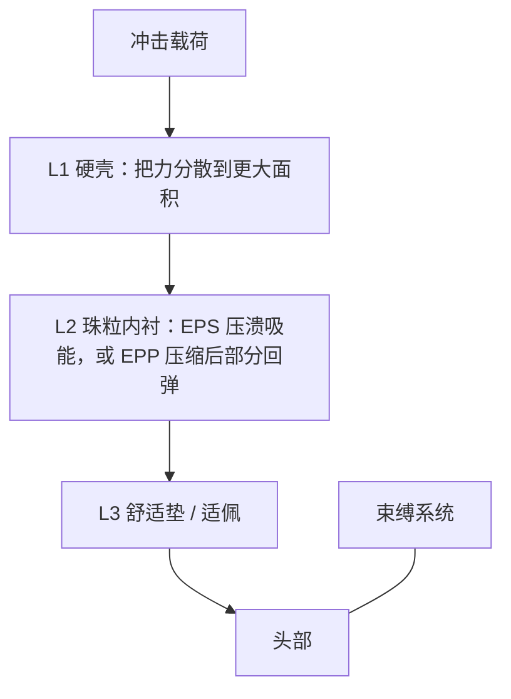

# 安全帽 EPS 与 EPP 缓冲内衬：珠粒模压与硬壳堆叠

> [!summary] 一句话概述
> 头盔的缓冲内衬多由 EPS 或 EPP 珠粒在专用模具里用蒸汽、热和压力熔接而成，再与硬壳、适佩和束缚系统堆叠成整盔。EPS 更常靠一次性压溃吸能，EPP 回弹更好、可在一定冲击后恢复；谁更安全不取决于材料名称，而取决于密度、厚度、几何和整盔认证。

## 配图

![[附件/epp-helmet-shell-liner-section.jpg]]
*图源：[Aurora Sports *EPP Helmet Liner Technology*](https://aurorahelmets.com/technology-epp-helmet-liners/) 页头图右侧：硬壳（蓝轮廓）包住缓冲内衬的剖面，以及面罩/下巴护具的铰链连接。左侧为页面标题设计，不是结构图。*

![[附件/epp-helmet-liner-bead-texture.jpg]]
*图源：同上页产品照片；可见珠粒发泡内衬的熔接表面、通风孔和分区凹槽，尚无外壳覆面。*

![[附件/eps-vs-epp-helmet-liners.jpg]]
*图源：[Helmetsure *Should a Bicycle Helmet Use EPS or EPP Foam?*](https://helmetsure.com/helmet-types/eps-epp/)；两侧头盔切开后对比内衬外观（左浅、右深），文中用来讨论 EPS 与 EPP 的观感差异，密度与厚度仍以文字来源为准。*

主来源赫兹 833 的配图是与头盔内衬无关的设备/产品效果图，未收入。BHSI 一文中冲击后的 KAV 头盔为蜂窝开孔外壳，不是典型 EPS 内衬剖面，亦未收入。层叠关系见下方剖面示意。

> 图片版权归原作者所有，仅作个人学习收藏；出处见文末「来源与核实记录」。

## 结构原理

> 本节所有数字只写来源里给出的；来源没有就写「来源未给出」。

### 堆叠方案

方向：**从撞击外侧到头部（整盔由外到内）**

| 层级 | 零件 | 材料 | 厚度/尺寸 | 固定方式 | 依据 |
| --- | --- | --- | --- | --- | --- |
| L1（最外） | 硬壳 / 外壳 | 来源未统一给出具体牌号 | 厚度来源未给出。外壳影响载荷如何传到内衬 | 与内衬贴合、粘接或其他壳体工艺，来源未给出通用值 | Aurora；Helmetsure |
| L2 | 缓冲内衬（可分层或分区密度） | EPS 或 EPP，也可混合使用 | 密度、厚度随型号而异。赫兹看到的电动车头盔 EPP 样品约 80 kg/m³；赫兹表：EPP 模压密度范围 15–200 kg/m³ | 珠粒在模具中蒸汽熔接成三维形状 | 赫兹 833；Aurora；BHSI |
| L3 | 舒适衬垫、适佩和通风道 | 来源未给出统一材料 | 来源未给出 | 装配在内衬与头型之间 | Aurora |
| L4 | 束缚/卡扣系统 | 可在 EPP 模压时植入织带等嵌件 | — | 模内嵌件或后装 | 赫兹 833；Aurora |
| L5（最内） | 头型 | — | — | 靠适佩保持位置 | Helmetsure |

剖面示意：

BHSI 还描述过「可变密度 / 双密度」做法：较软的内层在较小冲击时先压溃，较硬的外层在软层压实后再继续管理大冲击；并提到 Kali 在摩托车盔上用过同一层里分区密度，或分层密度。这是整盔设计选项，不是所有自行车盔的默认结构。

### 零件清单

| 零件 | 数量 | 功能 | 材料 | 依据 |
| --- | --- | --- | --- | --- |
| 外壳 | 1 | 分散载荷、保护泡沫、构成外形 | 来源未统一给出 | Aurora；Helmetsure |
| EPS 或 EPP 内衬 | 1，或分层多件 | 把冲击动能转化为泡沫变形 | EPS / EPP | 各来源 |
| 珠粒 | 充满模腔 | 熔接后成为内衬本体 | 赫兹：EPP 珠粒直径可以做到 0.5–4 mm | 赫兹 833 |
| 嵌件（可选） | 按设计 | 金属螺母、织带等 | 金属或织带 | 赫兹：头盔和座椅中已有应用 |
| 适佩、衬垫、卡扣 | 一套 | 保持盔体位置，认证也考束缚 | 来源未给出 | Helmetsure；Aurora |

### 装配顺序

按来源可还原的成型与整盔集成顺序：

1. 选择 EPS 或 EPP 及密度、厚度、分区（Aurora：不能脱离外壳、头模、通风、重量和目标认证单独选一块泡沫）。
2. 把预发泡珠粒放入专用模具（Aurora：用受控的蒸汽、热和压力熔接；这就是珠粒模压）。
3. 需要时在合模前放入嵌件一起成型（赫兹）。
4. 出模后与硬壳、衬垫、适佩、束缚系统组装。
5. 以**整盔**做冲击衰减、稳定性、束缚强度等认证，而不是单独给泡沫发证书（Helmetsure：美国自行车盔联邦标准针对完整头盔）。

### 受力与运动分析

- **受力路径**：撞击 → 外壳扩展与传递载荷 → 内衬在约束空间内变形吸能 → 传到头模的加速度应落在认证限值内。Helmetsure 强调：壳-衬界面、加载方向、覆盖范围和是否戴正，都会改变结果。
- **运动关系**：
  - EPS：BHSI、Helmetsure 将其描述为更偏向一次性、牺牲性压溃，变形在卸载后较多残留。
  - EPP：Aurora 和赫兹强调回弹和一定压缩后的恢复。赫兹写 EPP「回弹率超过 95%」「摔 10 次也不会有明显变形」——这是赫兹文中的表述，应理解为该文对材料特点的描述，不能代替整盔认证或具体密度下的冲击曲线。
- **失效风险**：把「EPP」或「EPS」字样当成安全保证；密度、厚度不够或通风开孔过大导致局部先裂；撞击后只看泡沫表面是否完好（Helmetsure：必须按整盔状态和厂家说明判断，不能只看泡沫）。EPP 尺寸公差比注塑大，和硬壳、注塑件配合必须留间隙（赫兹）。

## 设计要点与参数

| 要点 | 内容 | 依据 |
| --- | --- | --- |
| 珠粒模压 | EPP 是闭孔珠粒泡沫，珠粒在专用模具中用蒸汽、热和压力熔接成三维头盔几何 | Aurora |
| EPP 密度范围 | 赫兹表：EPP 模压 15–200 kg/m³；珠粒直径可以做到 0.5–4 mm。赫兹见到的电动车头盔样品约 80 kg/m³，表面有气泡坑，不能按注塑件外观要求 | 赫兹 833 |
| EPP 收缩与公差 | 赫兹：成型收缩率 1.5–3%，须在模具上预放；儿童头盔内衬案例模具放大了 2.8%。尺寸公差通常约 ±0.5%，与注塑常见 ±0.1% 不是同一量级。与注塑外壳配合一般单边留 0.5–1 mm | 赫兹 833 |
| EPP 模具压力与寿命 | 赫兹：EPP 成型压力低（只有 0.5–1 MPa），模具寿命可达 100 万次以上（为该文表述） | 赫兹 833 FAQ |
| EPS 与 EPP 怎么选 | Helmetsure：EPS 适合强调轻、一次性压溃、结构紧凑的自行车盔设计；EPP 材料恢复更好。两者都不是「天生更安全」，要看密度、厚度、结构、认证和撞击后状态 | Helmetsure |
| 双密度 / 分层 | BHSI：可用较软内层 + 较硬外层；也可用同一层分区密度。该文举 Kali 摩托车盔为例 | BHSI |
| 系统集成 | Aurora：必须同时考虑外壳、盔形、头模、适佩、舒适垫、通风、束缚、配件、目标重量和认证标准 | Aurora |
| 认证边界 | 认证针对测试过的整盔配置，不给单独的泡沫家族颁发「更安全」结论。美国联邦自行车盔标准包含冲击衰减、位置稳定性、束缚强度和周边视野等 | Helmetsure |
| 本篇不混用的数据 | 赫兹 833 里结构发泡/微发泡注塑的壁厚 4–10 mm、减重 10–30% 等，属于另一类注塑发泡，不是头盔珠粒内衬参数，不挪到本表当设计值 | 赫兹 833 其他章节 |

## 优缺点

**优点**
- 珠粒模压能做成贴合头型的复杂三维内衬，并可模内植嵌件
- EPS 压溃吸能、质量轻，适合许多一次性冲击场景
- EPP 回弹性更好，适合可能经历多次中等冲击、或强调耐久的设计（仍须整盔验证）

**缺点 / 代价**
- EPP 外观和尺寸精度不如注塑件，和硬壳配合要留较大间隙
- EPS 一次较重撞击后应视为已经耗材，不能只看表面是否完好
- 密度、开孔、分层都会改变性能，改一处就要重新做整盔试验
- 来源没有给出可直接套用的「某密度 + 某厚度 = 通过某标准」公式

## 可借鉴点

- **按整盔系统设计内衬**，不要单独买一块「头盔泡沫」来定方案
- **先选吸能机制再选材料**：要一次性压溃还是要恢复，决定偏 EPS 还是偏 EPP，再定密度和厚度
- **EPP 图纸按 1.5–3% 收缩放模，并给硬壳 0.5–1 mm 单边间隙**（赫兹经验，需用本项目试模确认）
- 织带、螺母能模内埋就模内埋，减少后装失效点
- 撞击后按厂家说明整盔报废或评估，不要只看泡沫有没有裂

## 与库中相似案例对比

| 对比项 | 本案例 | [[发泡件缩水：模温、排气与保压和实心件相反]] | [[跌落测试结构加固：六面四角、外圆角与局部 TPU 缓冲]] |
| --- | --- | --- | --- |
| 发泡方式 | 珠粒蒸汽模压 | 注塑发泡 / 微发泡 | 不是泡沫主体，是壳体+局部 TPU |
| 功能 | 头盔碰撞吸能 | 解决发泡件局部缩水 | 电子产品跌落 |
| 数据 | 勿把微发泡保压/排气数用到头盔模 | 勿把 EPP 1.5–3% 收缩套到微发泡壳体 | 测试方向逻辑可对照，结构完全不同 |

## 相关案例

- [[发泡件缩水：模温、排气与保压和实心件相反]]
- [[跌落测试结构加固：六面四角、外圆角与局部 TPU 缓冲]]
- 分类索引：[[05-密封与防护 索引]]

## 来源与核实记录

- 主来源：[发泡成型工艺：从 EPP 到结构发泡](https://www.hezidesign.com/gongyi/833.html)（赫兹工业设计，作者邓铮；2026-11-15 打开）。只采用与 EPP/头盔内衬直接相关的密度、收缩、公差、嵌件和模具压力表述；文中市场统计、特斯拉座椅、微发泡注塑参数不作为本篇设计依据。配图为无关设备效果图，未收入附件。
- 补充来源 1：[Bicycle Helmet Liners: Foam and Other Materials](https://helmets.org/bicycle-helmet-liners-foam-and-other-materials/)（BHSI）——EPS 仍是多数自行车盔选择、双密度做法
- 补充来源 2：[EPP Helmet Liner Technology](https://aurorahelmets.com/technology-epp-helmet-liners/)（Aurora Sports）——珠粒蒸汽模压和整盔集成
- 补充来源 3：[Should a Bicycle Helmet Use EPS or EPP Foam?](https://helmetsure.com/helmet-types/eps-epp/)（Helmetsure）——材料家族不能代替整盔认证
- 核实：2026-11-15 打开上述页面。未把赫兹「回弹率超过 95%」写成可直接用于安全认证的指标。
