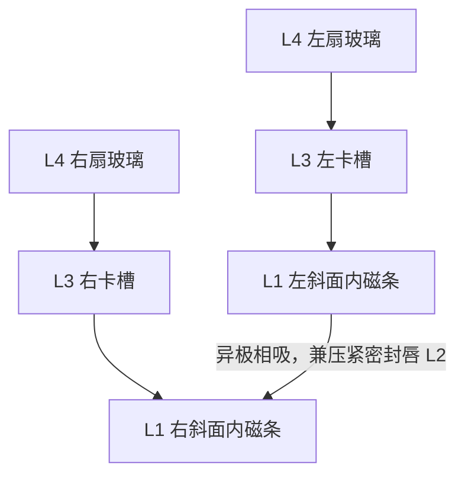

# 淋浴房对开门磁吸密封条：两扇门边磁条互吸并兼密封（对照冰箱门封）

> [!summary] 一句话概述
> 淋浴房对开门在两扇玻璃的对合边上各卡一根带磁条的密封型材，关门时两根磁条异极相吸，把对合面贴严并兼作防喷溅密封；这是门对门的互吸，不是冰箱门封那种磁条对箱口钢板。

## 配图

![[附件/shower-magnetic-seal-s008a1w-photo.jpg]]
*图源：[GoldRays S008A1W 产品页](https://goldrays.com/seal/s008a1w) 实物照片。透明型材的 U 型槽用于卡住玻璃，对合斜面内嵌深色矩形磁条；两根成对，磁条面相对。*

![[附件/shower-magnetic-seal-s008a1w-fitting.jpg]]
*图源：同上 GoldRays S008A1W 产品页的装配示意图。上一图为 90° 折角闭合：两根不对称截面让磁条在斜面上对吸，门可向外打开。下一图为 180° 一字对开：两扇玻璃共面，磁条在中间斜面处对吸。图中箭头表示开门方向。*

![[附件/shower-magnetic-seal-crl-profiles.png]]
*图源：[CRL《WATER SEALS AND SWEEPS》目录页](https://dkstatic.blob.core.windows.net/resources/496380/CRL23R-092314_264.pdf) 上半部分 “CRL Magnetic Profiles for 1/4\" to 3/8\" (6 to 10 mm) Glass”。左侧为 PMA8/PMB8/PMC8（6–8 mm）与 PMA10/PMB10/PMC10（8–10 mm）截面；中为 180°、135°、90° 玻璃对玻璃俯视；右为实物淋浴房照片；下为配对表。本图只截取磁吸型材部分，未把同页下方的铝框+胶条当作同一结构。*

> 图片版权归原厂商所有，仅作个人学习收藏；出处见文末「来源与核实记录」。

## 结构原理

> 本节所有数字只写来源里给出的；来源没有就写「来源未给出」。

### 堆叠方案

方向：**从关闭后的对合缝向外看，以 GoldRays S008A1W 的 180° 对开为例（产品页装配图）**

| 层级 | 零件 | 材料 | 厚度/尺寸 | 固定方式 | 依据 |
| --- | --- | --- | --- | --- | --- |
| L1（对合面） | 两根型材的斜向贴合面，磁条嵌在斜面腔里 | S008A1W 为聚碳酸酯；磁条牌号来源未给出 | 磁条在图上呈矩形截面，边长来源未给出毫米值 | 两根磁条面相对，异极相吸把贴合面压在一起 | GoldRays 实物图与装配图 |
| L2 | 密封唇/翼边，随型材一体挤出 | 与型材同材或共挤软边（CRL 写 Soft Magnetic Receiver；GoldRays 图中可见薄唇） | 来源未给出唇厚 | 关门后被磁力压到对侧型材上，阻挡喷溅 | GoldRays 图；CRL 目录要点 |
| L3 | U 型（或近似 U 型）卡槽 | 与型材一体 | 必须对应玻璃厚度。SOSfix：台湾常见 8 mm，平价 6 mm，无框重型 10 mm。S008A1W 列出 6/8/10/12 mm | 靠卡槽夹持力和内侧防滑齿（SOSfix）卡在玻璃边，原则上不打玻璃胶 | SOSfix；GoldRays 尺寸表 |
| L4 | 强化玻璃门扇 | 安全强化玻璃 | SOSfix：6、8 或 10 mm；CRL PMA8 系列 6–8 mm，PMA10 系列 8–10 mm；S008A1W 另列出 12 mm | 门扇由铰链或滑轮承重，密封条不承门重 | SOSfix；CRL；GoldRays |
| L5（相邻结构，不属于本磁条，但影响漏水） | 门底挡水条、门槛 | SOSfix 写 h 型 / F 型带 45° 回水斜舌 | 门底缝 SOSfix 写通常约 10–15 mm | 另卡在玻璃下缘，不能靠侧向磁条代替 | SOSfix |

剖面示意（180° 一字对开）：

磁极相对关系：这是一对磁条互吸，不是磁条吸钢板。SOSfix 写，安装前先手持两根新条对吸；若相斥弹开，把其中一根上下颠倒 180°，极性就会变为相吸，确认后再卡上玻璃。CRL 在 90°、只向外开的配对里专门写 Reverse for polarity。GoldRays 选购指南也提醒：面目相斥或弹开时，先核对型号和安装方向，不要在说明书未允许时自行把预埋磁条反过来。Shower Parts Store 进一步写：两根松放置时能相吸，不等于按安装方向装到门上之后仍相吸，必须按成对型材做干试装。

闭合角不是只有 180°。SOSfix 与 GoldRays、CRL 都按门的对合几何区分：
- 180°：两扇在同一直线上对碰（一字对开或三联动的中缝）。
- 90°：L 型转角对吸。
- 135°：钻石型或斜边对吸（CRL、SOSfix、GoldRays 008C1 均有此类）。
CRL 还按开门方向给不同配对：180° 只向一侧开用 PMA8+PMB8（或 PMA10+PMB10）；180° 双向开用 PMC8+PMC8（或 PMC10+PMC10）；135° 只向外开用 PMA8+PMC8；90° 只向外开用 PMA8+PMB8，并须反转极性。

### 零件清单

| 零件 | 数量 | 功能 | 材料 | 依据 |
| --- | --- | --- | --- | --- |
| 磁吸密封条（成对） | 对合缝两侧各 1 根 | 对中吸合、缓冲防撞、封喷溅 | S008A1W：聚碳酸酯；CRL：共挤塑料；SOSfix：PVC 或 EVA | GoldRays；CRL；SOSfix |
| 嵌在斜面内的磁条 | 每根型材 1 条 | 提供互吸磁力 | 来源未给出牌号 | GoldRays 实物图 |
| 玻璃门扇 | 2 扇（对开）或门+固定玻璃 | 提供安装边和开合运动 | 强化玻璃 | SOSfix；CRL |
| 底边挡水条（相关但不属本结构主角） | 每扇活动门下缘通常 1 根 | 导回湿区、挡门槛积水 | SOSfix 写 h / F 型胶条 | SOSfix |

GoldRays 给出的 S008A1W 外形尺寸（目录 2026/27，标注在剖面的 A、B 上，单位 mm）：

| 玻璃厚度 | A (mm) | B (mm) |
| --- | --- | --- |
| 6 mm（1/4"） | 16 | 20 |
| 8 mm（5/16"） | 17 | 22 |
| 10 mm（3/8"） | 17 | 20 |
| 12 mm（1/2"） | 19 | 22 |

CRL 库存长度写 98"（2.49 m）。磁条吸力牛顿值、磁能积、S008A1W 的 A/B 以外的壁厚，来源未给出。

### 装配顺序

按 SOSfix 的免打胶更换步骤，并加上 GoldRays / CRL 的配对核对：

1. 先量三组几何：玻璃厚度、关门对合角度（180°/90°/135°）、所需长度；CRL 还要分清只向一侧开还是双向开，再选 PMA/PMB/PMC 配对，不能只按厚度下单。
2. 从玻璃上端或下端切口把旧条向外撕离。SOSfix 强调强化玻璃最怕边角集中受力，禁止用铁锤或铁起子硬撬边角。
3. 清洗玻璃边的水垢和霉斑并擦干，保证新卡槽能咬住。
4. 先做磁极干试：两根新条对吸，相斥就把其中一根上下颠倒 180°。CRL 的 90° 配对若闭合不对，按目录反转极性。不要切短后再发现装反。
5. 冬季 PVC 偏硬时，SOSfix 建议在 45–50°C 温水中浸泡约 3 分钟再装。由一端卡入，垂直按压推入，不要纵向猛拉，以免回缩后长度不够。
6. 压到底后把多余长度切平。SOSfix 写正规条靠内侧防滑齿即可咬住玻璃，原则上不打玻璃胶，以便日后整根更换；仅在卡槽略松时，可在最顶和最底点一小滴中性防霉胶，不要全线打死。
7. 缓慢开关门，检查全高是否均匀贴合。GoldRays 与 Shower Parts Store 都写：只在一端碰上、中间有缝，多半是门扇垂直度或滑轮/铰链问题，不能靠换更强磁条来纠正几何。

### 受力与运动分析

- **受力路径**：关门将近闭合时，两根斜面上的磁条开始靠近并相吸，把对合面和密封唇拉到一起，同时给门扇一个缓冲。开启时，手推力必须克服这道竖向分布的吸力。来源未给出吸力牛顿值。门的自重仍由铰链或滑轮承担，磁条不承担吊挂。
- **运动关系**：180° 对开时，两扇绕各自铰链或沿滑轨运动，对合面在关闭位置近似共面；90°、135° 则在相应角度相遇。型材相对玻璃在正常使用中不应滑动。磁条之间在闭合时贴合，打开后分离。
- **失效风险**：胶条老化发硬、发霉发黑后失去回弹和吸力（SOSfix：常见于入住 3–5 年后）。磁极装反会相斥，门关不严或弹开。门扇下沉、缝上大下小或只一端接触时，磁条无法补正。卡槽尺寸与玻璃厚度不符会装不进或脱落。SOSfix 提醒拆装时碰到钢化玻璃边角有整片爆裂风险。底部漏水应查挡水条和门槛，不是侧向磁条的职责（Shower Parts Store）。

## 设计要点与参数

| 要点 | 内容 | 依据 |
| --- | --- | --- |
| 结构本质 | 门对门磁条互吸，兼密封；不是磁条对钢板 | GoldRays 装配图；对照冰箱门封 |
| 截面 | U 型卡槽夹玻璃 + 斜向对合面内嵌磁条 + 密封唇 | GoldRays 实物图、剖面；CRL 截面图 |
| 闭合角 | 至少覆盖 90°、135°、180°；另有移门用截面（GoldRays 008B） | SOSfix；GoldRays；CRL |
| 配对与开门方向 | 见 CRL 表：180° 单向 PMA+PMB，180° 双向 PMC+PMC，135° 向外 PMA+PMC，90° 向外 PMA+PMB 并反转极性 | CRL 目录 |
| 玻璃厚度 | SOSfix：6/8/10 mm。CRL：PMA8 系列 1/4–5/16"（6–8 mm），PMA10 系列 5/16–3/8"（8–10 mm）。S008A1W：6/8/10/12 mm | 各写各的范围，不要混成同一型号 |
| S008A1W 的 A/B | 6 mm：16/20；8 mm：17/22；10 mm：17/20；12 mm：19/22（mm） | GoldRays S008A1W 尺寸表 |
| 材料 | S008A1W 为聚碳酸酯；008B/008C/008N 等为 PVC；CRL 为共挤塑料+软质磁性接收面 | GoldRays FAQ；CRL |
| 极性处理 | 相斥则把一根上下颠倒 180°；90° 配对按 CRL 反转极性；不要在未允许时拆出预埋磁条再翻面 | SOSfix；CRL；GoldRays 指南 |
| 安装 | 免打胶卡装为主；SOSfix 温水软化 45–50°C、约 3 分钟 | SOSfix |
| CRL 库存长度 | 98"（2.49 m） | CRL 目录 |
| 磁条吸力、牌号、建议门缝毫米值 | 来源未给出（Shower Parts Store 转述过 CRL 某系列 11 mm 门缝，但本篇未能打开对应 CRL 产品页，不以该数字为已核对规格） | — |

## 优缺点

**优点**
- 对开门没有箱口钢板可用时，仍能用一对磁条把中缝吸合，并同时封喷溅。
- U 型卡槽可按玻璃厚度选，更换不必重做玻璃，也不必全线打胶。
- 同一“斜面内嵌磁条”思路，换截面就能覆盖 180°、90°、135° 和不同开门方向。
- 吸合有缓冲，减少玻璃对撞。

**缺点 / 代价**
- 只有磁力保持，门扇配重和铰链/滑轮仍要自己调平；几何不正时磁条帮不上忙。
- 胶条长期接触热水、皂垢和余氯会发黄发硬、长霉，磁力与密封一起下降。
- 极性、角度、厚度、配对型号必须同时正确，只买“通用磁吸条”容易相斥或对不上斜面。
- 侧向磁条管不了门槛漏水，必须另配底边挡水条。

## 可借鉴点

- 先画关闭后的俯视角度和开门方向，再决定左右型材是对称还是阴阳配对，而不是先买一根再凑。
- 磁极要写成“安装态的相对方向”：允许用整根颠倒 180° 来换极的，要在说明书里写清楚；不允许用户翻出磁条的，就要靠型号配对保证。
- 卡槽公差按玻璃厚度分档，内侧做防滑齿，把永久打胶留成例外，便于更换。
- 验收看全高是否均匀贴合，而不是只在中间吸一下；一端接触要先修门，再怀疑磁条。
- 对照冰箱门封：那里是闭环磁条对箱口，还有气囊隔热；这里是两根竖条互吸，服务的是防水喷溅而不是保温。

## 与库中相似案例对比

| 对比项 | 本案例（淋浴房对开门磁吸条） | [[冰箱门磁封条：挤出胶套内嵌磁条闭环吸合，兼作闭合与密封（对照橱柜门吸）]] | [[橱柜磁吸门吸：只有磁力保持、没有机械锁死（对照 FIDLOCK）]] |
| --- | --- | --- | --- |
| 磁路对象 | 门边磁条对门边磁条 | 门上周圈磁条对箱口 | 点状永磁对钢板 |
| 几何 | 两根竖向卡玻璃型材，对合面常为斜面 | 焊成矩形的闭环框 | 单个撞点 |
| 兼密封吗 | 是，防喷溅；底边另要挡水条 | 是，整圈密封+气囊隔热 | 否 |
| 极性 | 必须成对异极；装反会相斥 | 对钢板时较宽容；对吸时需 M/C 配对 | 对铁件，一般不靠一对磁极配对 |
| 何时用这篇 | 玻璃对玻璃的淋浴门中缝 | 冰箱、冷柜等有箱口的保温门 | 柜门轻保持、不密封 |

## 相关案例

- [[冰箱门磁封条：挤出胶套内嵌磁条闭环吸合，兼作闭合与密封（对照橱柜门吸）]]
- [[橱柜磁吸门吸：只有磁力保持、没有机械锁死（对照 FIDLOCK）]]
- [[电柜压缩式门锁（Southco E3 与 EMKA 1022）：先转舌再轴向压缩密封条]]
- 分类索引：[[05-密封与防护 索引]]

## 来源与核实记录

- 主来源：[SOSfix《乾濕分離淋浴拉門門縫漏水磁吸條發黑？…》](https://www.sosfix.tw/post/shower-enclosure-magnetic-seal-strip-replacement-diy)（页面更新 2026-11-09，作者署 SOSfix 即刻救援工程团队。2026-11-27 打开正文，核对玻璃厚度、180°/90°/135°、磁极颠倒、温水软化、免打胶安装及底边挡水条与侧向磁条的分工。文中出现的服务电话未写入本篇。）
- 交叉来源：[GoldRays S008A1W 产品页](https://goldrays.com/seal/s008a1w) 与 [Magnetic Shower Seals 选购指南](https://goldrays.com/your-shower-magnetic-sealing-strip-guide)（佛山 GoldRays，与 SOSfix 为不同机构。核对聚碳酸酯材质、90°/180° 装配图、A/B 尺寸表及相斥时的处理原则。）
- 交叉来源：[CRL Magnetic Profiles 目录页 PDF](https://dkstatic.blob.core.windows.net/resources/496380/CRL23R-092314_264.pdf)（C.R. Laurence，美国厂商。已下载 1 页目录并截取磁吸型材部分，核对共挤材料、6–8 mm / 8–10 mm 分档、PMA/PMB/PMC 配对和 90° 反转极性。CRL 产品网页返回 403，不以未打开的产品页为准。）
- 补充阅读：[Shower Parts Store，《How to Match a Magnetic Shower Room Door Seal》](https://www.showerpartsstore.com/blog/shower-room-door-seal-magnetic)（2026-09-23，Marco DeLuca。核对“先对截面和极性再裁切”、门扇不正不能靠更强磁铁纠正等原则。文中转述的 CRL 11 mm 门缝未能在已打开的 CRL 目录页上见到，故不写入参数表。）
- 未采用：xishu.com 上《一种淋浴房180度内外开不锈钢磁条》触发验证码未能打开；REHAU 淋浴型材 PDF 返回 403。不以这两处为来源。
