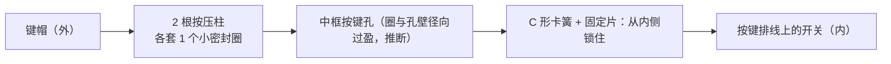

# 苹果 iPhone 7 首代 IP67：逐个开口封堵与气压平衡阀

> [!summary] 一句话概述
> iPhone 7 是 iPhone 第一代 IP67（1 m、30 min）。iFixit 拆了两台，发现苹果的做法不是某一个新技术，而是把每个开口都单独处理：屏幕周边换成更强的胶条，音量键各有两个小密封圈并用 C 形卡簧固定，SIM 卡托和顶针孔各加一圈橡胶，喇叭导管压在橡胶垫上并加细网，Lightning 接口用整圈橡胶垫，Home 键改成没有活动件的固态键、取消耳机孔——再用一个塑料「气压平衡挡板」让密封机身内外气压一致，保证气压计准确。

## 配图

![[附件/iphone7-volume-button-gaskets.jpg]]
*图源：[iFixit iPhone 7 拆解](https://www.ifixit.com/Teardown/iPhone+7+Teardown/67382) 第 19 步；音量键取下后，两个按压柱上各有一个小密封圈*

![[附件/iphone7plus-sim-tray-gasket.jpg]]
*图源：[iFixit iPhone 7 Plus 拆解](https://www.ifixit.com/Teardown/iPhone+7+Plus+Teardown/67384) 第 20 步；SIM 卡托上的橡胶密封圈*

![[附件/iphone7plus-sim-eject-plug.jpg]]
*图源：同上；SIM 顶针孔内侧的塑料推杆和橡胶密封圈*

> 图片版权归原作者所有，仅作个人学习收藏；出处见文末「来源与核实记录」。

## 结构原理

> 本节数字只写来源里给出的；来源没有就写「来源未给出」。

### 堆叠方案

方向：**按开口位置列出「外 → 内」的封堵层**（iPhone 7 机身尺寸 138.3 × 67.1 × 7.1 mm，重 138 g）

| 开口 / 层级 | 零件 | 材料 | 厚度/尺寸 | 固定方式 | 依据 |
| --- | --- | --- | --- | --- | --- |
| 屏幕周边 | 屏幕总成 → 周边胶条 → 后壳 | 黑白两色胶 | 来源未给出；胶条比 6s 明显更强 | 胶粘 | 7 Plus 第 4–5 步 |
| 音量键 | 键帽 → 两个按压柱上的小密封圈 → 壳体孔 → C 形卡簧 | 橡胶 | 来源未给出 | C 形卡簧 + 固定片（三件式） | iPhone 7 第 19 步 |
| 静音拨片 | 拨片 + 密封圈 | 橡胶 | 来源未给出 | — | 7 Plus 拆解 |
| SIM 卡托 | 卡托外沿橡胶圈 | 橡胶 | 来源未给出 | 卡托插入压紧 | iPhone 7 第 11 步；7 Plus |
| SIM 顶针孔 | 塑料推杆（带橡胶圈）→ 金属推杆 → 卡托 | 塑料 + 橡胶 + 金属 | 来源未给出 | — | iPhone 7 第 11 步 |
| 底部喇叭 | 喇叭出声导管 → 橡胶喇叭网垫 → 细网 | 橡胶、网 | 来源未给出 | 压紧 | iPhone 7 第 10 步 |
| Lightning 接口 | 接口 → 整圈橡胶垫（上代为泡棉胶） | 橡胶 | iFixit 称「能挡住 50 米水柱」 | 额外螺丝加固 | 7 Plus；iPhone 7 第 17 步 |
| Home 键 | 固态触压传感器 + Taptic Engine 震动反馈 | — | 无活动件 | 螺丝 + 轻胶 | 7 Plus「少一个按钮就少一个进水点」 |
| 内部 | 气压平衡挡板（原以为是扬声器挡板） | 塑料 | 来源未给出 | 装在原耳机孔位置 | iPhone 7 第 8 步（苹果说明） |
| 内部 | 进水指示贴（显示屏 EMI 屏蔽罩左缘） | — | — | 贴附 | 7 Plus |

剖面示意（音量键）：

### 零件清单

| 零件 | 数量 | 功能 | 材料 | 依据 |
| --- | --- | --- | --- | --- |
| 屏幕周边胶条 | 1 圈 | 主体密封 | 胶 | 7 Plus |
| 音量键密封圈 | 每键 2 个 | 按键动密封 | 橡胶 | iPhone 7 第 19 步 |
| C 形卡簧 | 1 | 固定按键 | 金属 | 同上 |
| SIM 卡托密封圈 | 1 | 卡托密封 | 橡胶 | 第 11 步 |
| SIM 顶针推杆密封圈 | 1 | 顶针孔密封 | 橡胶 | 7 Plus |
| 喇叭网垫 + 细网 | 各 1 | 声学开口防水 | 橡胶、网 | 第 10 步 |
| Lightning 橡胶垫 | 1 | 接口密封 | 橡胶 | 7 Plus |
| 气压平衡挡板 | 1 | 平衡内外气压、保证气压计精度 | 塑料 | 第 8 步 |
| 进水指示贴 | 1 | 售后判定 | — | 7 Plus |

### 装配顺序

> 按拆解顺序反推（推断）。

1. 后壳内装按键：密封圈套到按压柱上，从外侧插入，内侧装 C 形卡簧和固定片。
2. 装 Lightning 排线总成（带橡胶垫，加螺丝），喇叭导管压在橡胶网垫上。
3. 装主板、电池（三条易拉胶）、气压平衡挡板等内部件。
4. 屏幕总成沿侧边（像书一样）合上，压紧周边胶条。
5. 插入带密封圈的 SIM 卡托。

### 受力与运动分析

- **受力路径**：浸水压力 → 胶条（屏幕缝）、各橡胶圈（按键、卡托、接口）承担；所有密封都是「被动」的，没有需要用户操作的防水塞。
- **运动关系**：音量键与静音拨片是动密封（圈随按压柱移动）；Home 键取消了活动件。
- **失效风险**：iFixit 指出更换零件时必须把密封圈放好、保证压实，是一道「额外又麻烦」的步骤；屏幕维修比以前更复杂（要重新贴胶）；苹果说明防水「不是永久的，会因正常磨损而下降」。

## 设计要点与参数

| 要点 | 内容 | 依据 |
| --- | --- | --- |
| 防护等级 | IP67，IEC 60529，最深 1 m、30 min | 苹果支持页 |
| 后续机型对照 | 同一页面列出后续机型 IP68：最深 2 m、4 m、6 m，均为 30 min | 苹果支持页 |
| 减少开口 | 取消耳机孔；Home 键改固态（「少一个按钮就少一个进水点」） | iFixit 7 Plus |
| 接口密封 | 从上代泡棉胶改为整圈橡胶垫 | iFixit 7 Plus |
| 气压平衡 | 密封机身内用塑料挡板平衡气压，保证气压计（高度计）准确 | iFixit 第 8 步（苹果说明） |
| 可维修性 | 7/10 | iFixit 第 22 步 |
| 胶条宽度、密封圈尺寸、过盈量 | 来源未给出 | — |

## 优缺点

**优点**
- 全部是被动密封，用户无感（没有防水塞）
- 每个开口单独处理，便于逐项排查漏点
- 固态 Home 键同时解决了防水和机械按键寿命问题（iFixit：近 10 万人用过其 iPhone 6 Home 键维修教程）

**缺点 / 代价**
- 维修时需要更换胶条、确认每个密封圈到位
- 按键拆装更难（三件式结构）

## 可借鉴点

- **先减开口再谈封堵**：能取消的开孔（耳机孔、机械按键）就取消，用固态/电容按键 + 震动反馈替代
- **按键防水的经典组合**：按压柱套 O 圈 + 内侧 C 形卡簧固定；O 圈跟着按压柱走，属于短行程动密封
- **卡托和顶针孔都要封**：卡托外沿一圈、顶针推杆上再一圈
- **声学孔「垫 + 网」双层**：导管压在橡胶垫上做主密封，外加细网作为第二道
- **密封机身要考虑气压**：带气压计或温度变化大的产品，需要气压平衡通道（同原理见 [[GORE 防水透气膜：压力平衡与粘贴式透气阀的安装参数]]）
- 维修时「把密封圈放回原位并压实」应写进维修 SOP

## 与库中相似案例对比

| 对比项 | 本案例（iPhone 7） | [[三防手机整机防水结构：上下壳胶圈、电池盖、按键与开孔的参数清单]] | [[三星 Galaxy Z Fold3 折叠屏防水结构]] |
| --- | --- | --- | --- |
| 主体缝 | 胶条（不可拆） | 胶圈 + 螺丝（可拆） | 点胶/CIPG |
| 按键 | O 圈 + C 形卡簧 | 橡胶件过盈 0.15–0.3 mm | — |
| 接口 | 整圈橡胶垫、无塞 | 自带防水母座或外塞 | — |
| 气压 | 塑料平衡挡板 | 透气膜出气孔 | — |

## 相关案例

- [[三防手机整机防水结构：上下壳胶圈、电池盖、按键与开孔的参数清单]]
- [[GORE 防水透气膜：压力平衡与粘贴式透气阀的安装参数]]
- [[苹果 iPhone 16 电解脱粘电池胶]]
- [[三星 Galaxy Z Fold3 折叠屏防水结构]]
- 分类索引：[[05-密封与防护 索引]]

## 来源与核实记录

- 主来源：[iPhone 7 Teardown](https://www.ifixit.com/Teardown/iPhone+7+Teardown/67382)（iFixit，2016-09-16，Sam Goldheart），第 8、10、11、17、19、22 步
- 补充来源 1：[iPhone 7 Plus Teardown](https://www.ifixit.com/Teardown/iPhone+7+Plus+Teardown/67384)（iFixit，2016-09）——周边胶条、Lightning 橡胶垫、SIM 推杆密封圈、固态 Home 键、进水指示贴
- 补充来源 2：[About splash, water, and dust resistance of iPhone 7 and later](https://support.apple.com/en-us/108039)（Apple 支持）——IP67/IP68 等级与测试深度
- 核实：2026-11-13 通过 iFixit API 读取两篇拆解全文，打开苹果支持页核对等级。
