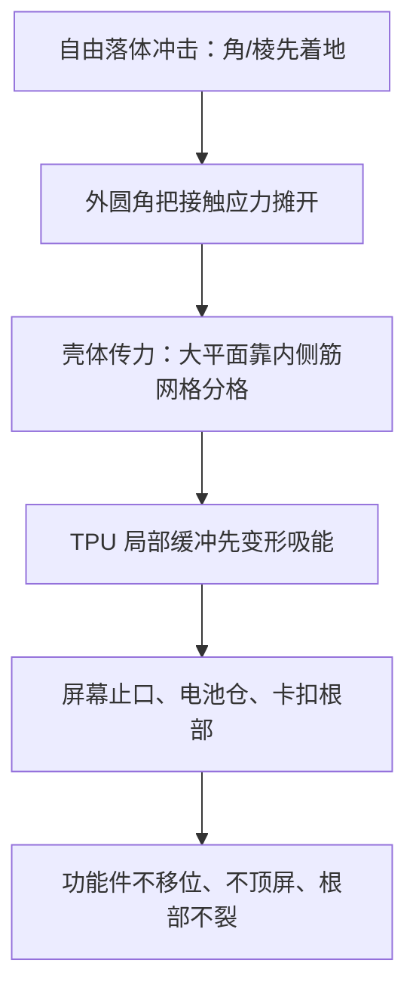

# 跌落测试结构加固：六面四角、外圆角与局部 TPU 缓冲

> [!summary] 一句话概述
> 消费电子跌落测试通常按「六面四角」十个方向做自由落体；角和棱先着地，应力沿棱传入壳体。结构上优先把外观直角改成更大外圆角、在大平面内侧加网格筋，并在电池仓、镜头等「金贵部位」预留 TPU 软胶包边或垫片吸收冲击，而不是把壁厚一律加厚。

## 配图

主来源页面的头图是与跌落结构无关的产品效果图，第二来源维亚达文无结构配图，故本篇不以装饰图充数；受力路径见下方剖面示意。原页面：<https://www.hezidesign.com/jingyan/1050.html>。

> 图片版权归原作者所有，仅作个人学习收藏；出处见文末「来源与核实记录」。

## 结构原理

> 本节所有数字只写来源里给出的；来源没有就写「来源未给出」，不估算、不换算成看似精确的值。

### 堆叠方案

方向：**从着地点向外壳内部（角跌为主）**

| 层级 | 零件 | 材料 | 厚度/尺寸 | 固定方式 | 依据 |
| --- | --- | --- | --- | --- | --- |
| L1（最外） | 外壳角、棱、大平面 | 常见 PC+ABS；也有 ABS、PC | 外圆角：赫兹举例 R1.5 与 R5 对比，运动相机案例从 R0.8 改到 R2.5 | 注塑一体 | 赫兹 1050 |
| L2 | 内侧加强筋网格 | 与壳体同料 | 赫兹经验：筋高不超过壁厚 3 倍，筋厚取壁厚 0.5–0.6 倍（已有加强筋专篇，此处只作跌落刚度手段） | 一体注塑 | 赫兹 1050 |
| L3 | 局部 TPU 包边/垫片/缓冲条 | TPU | 来源未给出硬度与截面厚度 | 结构上预留位置后装配或包胶 | 赫兹 1050 |
| L4 | 屏幕止口、电池等内部大件 | 来源未给出 | 运动相机案例：止口加深 0.6 mm，并加一圈双面胶 | 止口 + 胶 | 赫兹 1050 |
| L5（最内） | 内部零件与卡扣根部 | 与壳体同料 | 维亚达：内圆角取壁厚 0.5–1 倍，绝对值不低于 0.3–0.5 mm | 一体 | 维亚达 |

剖面示意：

### 零件清单

| 零件 | 数量 | 功能 | 材料 | 依据 |
| --- | --- | --- | --- | --- |
| 外壳（含外圆角） | 按整机 | 承受角跌、面跌接触力 | 常用 PC+ABS | 赫兹 |
| 内侧加强筋 | 来源未给出 | 提高大平面刚度，减轻鼓包、顶白、裂穿 | 与壳体同料 | 赫兹 |
| TPU 包边/垫片/缓冲条 | 局部，按保护对象 | 先变形，减少内部件撞击外壳 | TPU | 赫兹 |
| 屏幕止口与固定胶 | 按屏幕 | 防止撞地时屏幕被顶出 | 来源未给出 | 赫兹案例 |
| 卡扣 | 按拆件 | 开盖连接；根部是固定裂纹高发点 | 与壳体同料 | 赫兹；维亚达 |

### 装配顺序

来源以设计和测试流程为主，未给出完整装配工序。按文中结构反推：

1. 注塑壳体（已含外圆角、内侧筋、卡扣、止口和软胶让位）。
2. 需要局部缓冲处装 TPU 垫片/包边，或在二次成型中包胶（赫兹只写「结构里给软胶留位置」）。
3. 装电池及内部大件，再装屏幕（案例中止口加深并加双面胶）。
4. 盖好全部盖子、装好电池并充电后，再按约定姿态做跌落。

### 受力与运动分析

- **受力路径**：自由落体动能在接触瞬间集中于着地点。角着地时，应力沿两条棱传入壳体；锐角是应力集中点。维亚达补充：冲击应力还会叠加上注塑残余内应力，零件可能提前开裂。
- **运动关系**：整机相对地面是一次性碰撞，随后可能翻滚造成二次撞击。赫兹建议把电池等重物尽量贴近常见着地方向、降低重心，以减少翻跟头次数。壳体相对内部件可能发生瞬时错动（屏幕被顶出、电池撞壳再顶屏）。
- **失效风险**：角部开裂；大平面薄壁鼓包、顶白、裂穿；屏幕止口过浅导致屏幕脱出；卡扣根部壁厚不足而裂（赫兹运动相机案例第二轮失效点）；内应力型裂纹位置不固定、跟着熔接线走（维亚达）。钢板地面冲击峰值高于水泥地，测试合同必须写明地面材质。

## 设计要点与参数

| 要点 | 内容 | 依据 |
| --- | --- | --- |
| 测试方向 | 常规「六面四角」共 10 个方向；更严可做「六面八角十二棱」。手机类常每个方向摔两次，共 20 次。有些小家电只摔六面 | 赫兹 1050 正文与 FAQ |
| 测试高度 | 小家电和普通消费电子一般 1 m；中高端 1.2–1.5 m；手机类旗舰 1.8 m。运动相机案例目标 1.5 m 全方向 | 赫兹 |
| 测试状态 | 产品充好电、装好电池、盖好所有盖子；地面为钢板、大理石或水泥。判定：外壳不裂、屏幕不碎、按键能回弹、充电口不变形、内部无异响 | 赫兹 |
| 外圆角 | 把直角改成圆弧。赫兹对比 R1.5 与 R5「开裂概率差一大截」；案例把四角从 R0.8 改到 R2.5。具体「差多少」来源未给出定量概率模型 | 赫兹 |
| 内圆角（结构根部） | 内圆角半径与壁厚之比从 0.1 提到 0.5，应力集中系数大约从 2.5 以上降到 1.5。工程上内圆角取壁厚 0.5–1 倍，绝对值不低于 0.3–0.5 mm（下限还受刀具与放电最小半径限制） | 维亚达 |
| 壁厚突变 | 厚度比控制在 3:1 以内，超过则加渐变，过渡段长度取壁厚差的 3 倍以上。文中举例：壁厚从 1.5 mm 增到 3 mm，冷却时间约为原来的 4 倍 | 维亚达 |
| 大平面加强 | 不是单纯加厚；内侧加十字网格筋。赫兹经验：筋高不超过壁厚 3 倍，筋厚 0.5–0.6 倍壁厚，间距以保证走胶（该比例在库中加强筋专篇已展开，本篇只作跌落加固手段） | 赫兹 |
| 局部 TPU | 在电池仓、镜头等周围做软胶包边或垫片；须在开模前预留位置。硬度、厚度来源未给出 | 赫兹 |
| 材料 | 耐摔看韧性而非单纯硬度。ABS 偏脆，PC 韧但贵，常用 PC+ABS。维亚达给出 Izod 缺口冲击常见范围：通用 ABS 约 15–25 kJ/m²，PC/ABS 约 30–50 kJ/m²（测试方法、试样厚度、缺口半径、温度不同则不可比） | 赫兹；维亚达 |
| 熔接线 | 未增强料熔接线强度通常为本体 70%–90%，玻纤增强可能降到 50% 以下。位置由浇口决定，调机改不了位置，只能改强度或挪浇口 | 维亚达 |
| 裂纹分流 | 裂纹位置随熔接线/浇口变化且件与件不重复 → 先查内应力/工艺；裂纹固定在同一几何特征 → 改结构；两者都排除再换料 | 维亚达 |
| 能量举例 | 维亚达按高度换算：0.4 kg 整机从 1.0 m 落下，接触瞬间动能约 3.9 J；0.8 kg 从 1.2 m 落下约 9.4 J。角跌与面跌破坏模式不同 | 维亚达 |

## 优缺点

**优点**
- 外圆角几乎不增加零件，却能摊开角跌应力
- 局部 TPU 比整机改成更贵的高韧材料成本更低（赫兹：「成本不高，效果却立竿见影」）
- 先按裂纹位置分流，可避免把钱花在错误的调机或改模上

**缺点 / 代价**
- 大外圆角可能与「棱角分明」的外观冲突
- 筋过密会走胶困难、表面缩水
- TPU 必须提前留位，开模后再补往往要改模
- 厂内水泥地摔过，不能代替第三方钢板台的结果

## 可借鉴点

- **把跌落写进结构评审，而不是样机出来再补课**：合同写明高度、地面材质、方向数、循环次数和判定标准
- **外观直角先问「角跌怎么传力」**：能加外圆角就加；卡扣、止口、壁厚台阶的内圆角按壁厚 0.5–1 倍检查
- **金贵件周围预留 TPU 让位**，不要等开模才想起缓冲
- **先标裂纹再动手**：位置随机先调工艺（一次只动一个参数），位置固定再改结构，最后才换料
- 重的电池尽量靠近常见着地侧布置，减少翻滚二次撞击

## 与库中相似案例对比

| 对比项 | 本案例 | [[塑料件加强筋设计：厚度、高度与间距比例]] | [[注塑熔接痕：位置由浇口定、深浅由前锋温差定]] |
| --- | --- | --- | --- |
| 问题 | 角跌、面跌导致外壳裂、屏碎、内部撞击 | 用筋提高刚度同时控制缩痕 | 熔接线强度和外观 |
| 本篇重点 | 测试方向、外圆角、局部 TPU、裂纹分流 | 筋厚 0.5–0.6 壁厚等比例 | 浇口决定位置 |
| 交叉 | 大平面用筋分格，比例不在此重讲 | 跌落加固会用到筋网格 | 维亚达把熔接线列为跌落薄弱点之一 |

## 相关案例

- [[塑料件加强筋设计：厚度、高度与间距比例]]
- [[注塑熔接痕：位置由浇口定、深浅由前锋温差定]]
- [[塑料外壳止口与扣位：间隙参数与三个翻车案例]]
- [[注塑螺丝柱（Boss 柱）：壁厚比 0.6 分水岭与自攻底孔公式]]
- 分类索引：[[05-密封与防护 索引]]

## 来源与核实记录

- 主来源：[跌落测试不过关，多半卡在这几处——产品结构设计实战笔记](https://www.hezidesign.com/jingyan/1050.html)（赫兹工业设计，作者胡亚设；页面未给出独立发布日，2026-11-15 打开核对）
- 补充来源：[注塑件跌落不合格：材料、结构和内应力的验证流程](https://weiyadakeji.com/xwdt/gongsixinwen/1520.html)（深圳市维亚达科技有限公司，页面标注发布时间 2026-11-11）——裂纹分流、内圆角与壁厚比、冲击韧性比较、动能举例
- 核实：2026-11-15 用 curl 打开两篇原文，核对测试方向/高度、圆角与案例改模数据、材料韧性表述。赫兹头图为无关产品效果图，未收入附件。两文参数均为经验或典型推荐，不是某项国标的全文引用。
