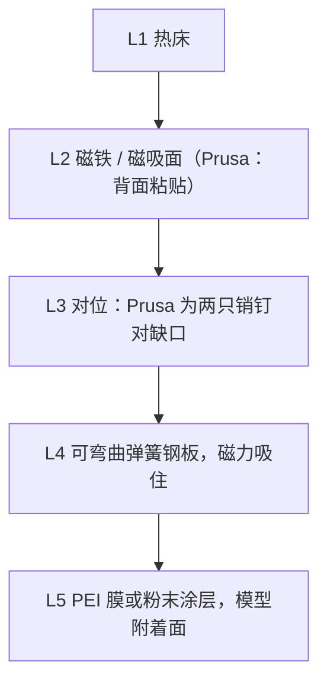

# 3D 打印磁吸弹簧钢构建板：热床磁吸固定，取下弯曲脱件（对照橱柜磁吸门吸）

> [!summary] 一句话概述
> FDM 打印机把一张柔性弹簧钢打印板用磁力吸在热床上，打印时它是模型的附着面，打印后把钢板整张取下、弯曲，让模型脱落，再吸回热床。拓竹把光面 PEI 写成 0.5 mm 弹簧钢加贴膜，并按机型给出板面尺寸；Prusa 把保持力交给热床背面粘上的多枚磁铁，把平面对位交给热床上的两只销钉和钢片缺口。它和 [[橱柜磁吸门吸：只有磁力保持、没有机械锁死（对照 FIDLOCK）]] 都靠磁力保持，但本篇还要在加热的构建面上定位和反复取件，不是把门留在关闭位置。

## 配图

![[附件/bambu-dual-pei-plate.jpg]]
*图源：[拓竹打印板介绍（Bambu Lab Wiki）](https://wiki.bambulab.com/zh/filament-acc/acc/plates) 官方配图；同一张「纹理 + 光面 PEI 打印板」的两面：左侧为纹理 PEI，右侧为光面 PEI。图中板边可见缺口，Wiki 正文未用文字说明该缺口如何与热床对位。*

![[附件/bambu-textured-pei-release.jpg]]
*图源：同一篇拓竹 Wiki；纹理 PEI 面在冷却后，模型因与 PEI 收缩率不一致而容易分离。Wiki 写：纹理面可承受反复热床加热与冷却，室温冷却后模型可自动脱落。*

![[附件/prusa-flexible-steel-sheets.jpg]]
*图源：[Prusa Knowledge Base：Flexible steel sheets (guidepost)](https://help.prusa3d.com/article/flexible-steel-sheets-guidepost_2195)；三种弹簧钢片实物，上缘都有对位缺口，板上印有 print area。Prusa 正文写明：MK 系列、MINI/+、XL、HT90 的热床表面有两只销钉，与钢片缺口对准；对面那两个孔是制造工艺孔，不是对位孔。*

> 图片版权归原作者所有，仅作个人学习收藏；出处见文末「来源与核实记录」。

## 结构原理

> 本节所有数字只写来源里给出的；来源没有就写「来源未给出」。拓竹与 Prusa 是同一类「磁吸柔性弹簧钢构建板」，参数按来源分列。

### 堆叠方案

方向：**从热床（下）到打印面（上）**。

| 层级 | 零件 | 材料 | 厚度/尺寸 | 固定方式 | 依据 |
| --- | --- | --- | --- | --- | --- |
| L1（最下） | 热床 | 来源未给出热床本体材料 | 来源未给出热床厚度。打印板平面尺寸按机型：拓竹 350×320 mm（H2D/H2S）、330×320 mm（H2C/A2L）、256×256 mm（X1/P1/A1 等）、180×180 mm（A1 mini） | 打印机结构件，本篇不展开 | 拓竹 Wiki「打印板尺寸」表 |
| L2 | 磁吸部件 | Prusa：若干磁铁，从热床背面粘贴；拓竹：Wiki 只写「磁吸的方式」，未给出磁铁数量、牌号与安装面 | 来源未给出磁铁尺寸和吸力值 | Prusa：胶粘在热床背面；拓竹：来源未给出磁片做法 | Prusa guidepost「General information」；拓竹开篇 |
| L3 | 对位特征 | Prusa：热床表面两只销钉 + 钢片缺口。拓竹配图可见板边缺口，正文未说明对位方式 | 来源未给出销钉直径和缺口尺寸 | 销钉插入缺口，限制平面内移动 | Prusa 同上。拓竹缺口仅配图可见，正文未写 |
| L4（可取下的钢板） | 柔性弹簧钢打印板 | 拓竹光面：弹簧钢 + PEI 膜 + 高耐热 3M 胶；拓竹纹理：不锈钢板、双面喷 PEI 粉；Prusa 光滑：双面 PEI 贴纸；Prusa 纹理：粉末涂层聚合物（Ultem） | 拓竹光面明确写加厚的 0.5 mm 弹簧钢板。Prusa 写不同板类型厚度略有不同，未给出毫米数 | 磁力吸附在热床上，打印后整张取下 | 拓竹「光面 PEI 打印板」段；Prusa「Smooth / textured」段与 profiles 说明 |
| L5（最外，打印面） | PEI 或粉末涂层 | 见上行 | 拓竹光面 PEI 膜厚：来源未给出；纹理为喷涂，未给膜厚 | 贴合或喷涂在钢板上，随板一起取下 | 拓竹、Prusa 各自表面说明 |

剖面示意：

### 零件清单

| 零件 | 数量 | 功能 | 材料 | 依据 |
| --- | --- | --- | --- | --- |
| 热床 | 1 | 加热并承载磁吸面 | 来源未给出 | 两家均把板吸在热床上 |
| 磁铁 | Prusa：若干（several），数量来源未给出；拓竹：来源未给出 | 把钢板吸在热床上，打印中保持 | Prusa 未给磁材牌号 | Prusa General information |
| 定位销 + 缺口 | Prusa：热床两只销，钢片一个缺口 | 平面对位。Prusa 明确：不要把缺口对面的两个孔当成对位孔 | 来源未给出销的材料 | Prusa 同上 |
| 弹簧钢打印板 | 1 张（可双面） | 可弯曲取件的构建面载体 | 拓竹光面 0.5 mm 弹簧钢；纹理为不锈钢板 | 拓竹；Prusa 称 removable double-sided flexible spring-steel sheet |
| 表面涂层 / 膜 | 单面或双面 | 提供附着，并在冷却后便于分离 | 拓竹光面 PEI 膜 + 3M 胶；纹理双面喷粉；Prusa 光滑为 PEI 贴纸，纹理为 Ultem 粉末涂层 | 两家表面说明 |

### 装配顺序

1. 确认热床表面清洁、无耗材残渣后再放钢片（Prusa 原文）。
2. Prusa：让钢片缺口对准热床上的两只销钉，再放下，由背面磁铁吸住。拓竹 Wiki 开篇只写「通过磁吸的方式固定在热床上」，未逐步写对位动作；官方配图可见板边缺口。
3. 按所用板类型和耗材设置热床温度。拓竹增稳低温板打印 PLA 时约 40℃ 即可稳定固定；该页并给出部分环境下 PETG 约 55–60℃、部分 X/P 机型仍建议约 65℃ 的说明。纹理 PEI 打印 PLA/PETG/TPU 通常不必涂胶，ABS/ASA/PA/PC 等高温耗材前要涂胶。光面 PEI 只有打印 PLA 可以不涂胶，其他材料需用粘合剂以免撕裂 PEI 膜。
4. 打印结束后取件：拓竹纹理面写室温冷却后模型可因收缩率不一致而分离，并可弯曲打印板取下模型。Prusa 要求始终等到钢片冷却到室温，再把钢片向内、向外弯曲取件；大面积或 PETG/ASA/ABS/PC Blend 可能还需要胶棒作隔离层，必要时用铲刀，但应先略弯曲再把铲刀伸进模型下方，避免在平铺钢板上硬铲。
5. 把钢片再吸回热床。没有 loadcell 的 Prusa 机型在换不同厚度的板后，需要重做第一层或改用 Steel sheet profiles，因为各板厚度略有不同（具体毫米数来源未给出）。

> 若某一步官方只给了使用注意而不是装配工步，上文已按原文功能叙述，不补充未写出的卡扣或磁极方向。

### 受力与运动分析

- **受力路径**：打印时挤出物附着在涂层上，附着力和热应力经钢板传到磁吸面和（Prusa）定位销。磁力负责把板留在热床上；Prusa 的销钉负责平面对位。取件时外力用来弯曲钢板，让涂层与模型之间的界面撕开，而不是靠把模型从热床上硬撬。两家都没有给出吸力的牛顿值或公斤值。
- **运动关系**：打印中钢板相对热床应无相对运动。取件时钢板被整张取下，再在板平面外弯曲（Prusa：inwards and outwards；拓竹：轻轻弯折）。这是弹性变形，不是铰链开合。
- **失效风险**：表面被油脂污染导致附着失败（拓竹提醒少用手指摸打印面）；模型粘得过紧撕裂光面 PEI 膜（拓竹：除 PLA 外要涂胶）；用铲刀在平板上硬铲损伤涂层（Prusa）；Prusa 还写耗材不匹配或表面制备不对时，冷却后仍可能撕坏涂层。磁吸和销钉的具体磨损寿命，来源未给出。把本结构当成「门吸」去套用 4 kg / 6 kg 吸力是错误的，那些数字属于橱柜门吸案例，本篇来源没有。

## 设计要点与参数

| 要点 | 内容 | 依据 |
| --- | --- | --- |
| 结构本质 | 热床上的磁吸把柔性弹簧钢板吸住；打印后取下钢板弯曲脱件，再吸回 | 拓竹开篇；Prusa 开篇 |
| 拓竹光面构成 | PEI 膜用高耐热 3M 胶贴在弹簧钢上；加厚的 0.5 mm 弹簧钢可降低翘曲风险 | 拓竹「光面 PEI 打印板」 |
| 拓竹纹理构成 | 不锈钢板两面喷涂 PEI 粉末 | 拓竹「纹理 PEI 打印板」 |
| 拓竹板面尺寸 | 350×320、330×320、256×256、180×180 mm，按机型选配 | 拓竹尺寸表 |
| 拓竹低温板热床温度 | 打印 PLA 约 40℃；二代通常再低约 5℃；示例中 PETG 约 55–60℃，部分 X/P 机型仍约 65℃ | 拓竹增稳低温打印板 Wiki |
| Prusa 磁铁 | 若干磁铁从热床背面粘贴，吸住可拆双面弹簧钢片 | Prusa General information |
| Prusa 对位 | 热床两只销钉对准钢片缺口；缺口对面的两孔是工艺孔，不要用来对位 | 同上 |
| Prusa 取件 | 先冷却到室温，再向内向外弯曲；必要时用铲刀，先弯板再插入模型下方 | Removing prints |
| Prusa 厚度 | 不同板类型厚度略有不同，无 loadcell 的机型换板要重校 Live Z 或用 sheet profiles；毫米数来源未给出 | Steel sheet profiles 段 |
| 吸力值 | 来源未给出 | 两家均未列 N 或 kg |
| 与门吸的关系 | 本篇磁力用于固定构建面，并配合弯曲取件；门吸只把门留在关闭位置，没有构建面定位，也不能用来取塑件 | 对照橱柜磁吸门吸案例，不把门吸力值写入本表 |

## 优缺点

**优点**
- 打印面做成可取下的钢板，取件不必在机内铲热床，热床和加热元件少受撬击。
- 弯曲钢板用弹性变形拆件，比在刚性台面上硬铲更不容易伤涂层（仍须按官方的冷却和铲刀提示操作）。
- 双面或多种涂层可以按耗材更换整张板，而不必更换热床。
- Prusa 把「吸住」和「对位」分开：磁力保持，销钉对缺口，工艺孔明确禁止当销孔用。

**缺点 / 代价**
- 磁力没有机械锁死，板是否在打印中微移，取决于磁吸和（若有）销钉；两家都没有给出抗移力。
- 光面贴膜怕被粘撕，高温或高附着耗材必须按说明涂胶。
- 不同板厚度会改变第一层高度，换板要重新校准或调用已存的板材参数。
- 涂层是耗材，Prusa 写明表面磨损一般不在保修范围内（到达即缺陷的除外）。

## 可借鉴点

- **先分清「磁力保持」和「几何对位」**：只靠磁吸，板在平面内可能还有游隙；Prusa 用两只销钉吃掉平面自由度，并写明哪个孔不能用。做同类热床时，应检查有没有专门的对位特征，而不是假设磁铁自己能对中。
- **把取件动作设计成「整板取下再弯曲」**：让弹性钢板当工具，而不是让用户在热的刚性床面上撬模型。
- **板厚有参数就要写进维护流程**：即使来源只说「略有不同」而没有毫米数，也要提醒换板后重校第一层，不要假装各板可以零补偿互换。
- **不要借用门吸的公斤档来选热床磁铁**：本篇来源没有吸力值，就写「来源未给出」，用板面积、温度和官方安装步骤做设计约束。

## 与库中相似案例对比

| 对比项 | 本案例（磁吸弹簧钢构建板） | [[橱柜磁吸门吸：只有磁力保持、没有机械锁死（对照 FIDLOCK）]] | [[任天堂 Switch 2 Joy-Con 2 磁吸连接]] | [[3D 打印件热熔铜螺母：孔径与拉拔力实测]] |
| --- | --- | --- | --- | --- |
| 磁力的角色 | 把构建钢板吸在热床上，打印中保持 | 把门留在关闭位置 | 手柄与主机的保持并带电触点 | 不用磁力 |
| 有无几何对位 | Prusa：两只销钉对缺口；拓竹正文未写，配图可见板边缺口 | 靠壳体和吸片安装位置，长圆孔可调 | 见该篇磁吸与定位，不套用到本热床 | 热熔孔位 |
| 取下之后还做什么 | 弯曲钢板让模型脱落，再吸回 | 打开就是把门拉开，没有「弯曲脱件」 | 拉开手柄 | 镶嵌后一般不作为日常取件面 |
| 力值 | 两家均未给吸力 | 海福乐 4/6 kg 等，不套用到本篇 | 该篇来源未给吸力 | 该篇为拉拔力实测，与本篇无关 |
| 分类取舍 | 放在 06：它是整机上可更换的构建模块，磁吸是固定手段 | 02，柜门保持连接件 | 02，磁吸连接 | 02，嵌件紧固 |

## 相关案例

- [[橱柜磁吸门吸：只有磁力保持、没有机械锁死（对照 FIDLOCK）]]
- [[FDM 一体打印活动件（Print-in-Place）：XY 每边 0.3 mm、Z 两整层的间隙规则]]
- [[3D 打印件热熔铜螺母：孔径与拉拔力实测]]
- [[任天堂 Switch 2 Joy-Con 2 磁吸连接]]
- 分类索引：[[06-拆解与可维修 索引]]

## 来源与核实记录

- 主来源：[拓竹打印板介绍 \| Bambu Lab Wiki](https://wiki.bambulab.com/zh/filament-acc/acc/plates)（2026-11-22 打开中文页面。核对：磁吸固定、可弯曲取件、板面尺寸表、光面 0.5 mm 弹簧钢 + 3M 胶贴 PEI 膜、纹理为不锈钢双面喷粉、冷却脱落与涂胶注意。）
- 补充来源 1：[拓竹增稳低温打印板 \| Bambu Lab Wiki](https://wiki.bambulab.com/zh/filament-acc/acc/bambu-cool-plate-supertack)（同一机构的另一种涂层。核对 PLA 约 40℃ 等温度表述，不把该温度套到纹理/光面 PEI 上。）
- 补充来源 2：[Flexible steel sheets (guidepost) \| Prusa Knowledge Base](https://help.prusa3d.com/article/flexible-steel-sheets-guidepost_2195)（独立机构。核对：背面粘贴磁铁、两只销钉对缺口、工艺孔不可对位、室温后弯曲取件、不同板厚度需重校。未给出板厚毫米数和吸力值。）
- 核实：2026-11-22 打开上述页面并下载官方配图。未把橱柜门吸的 4/6 kg 写入本篇，也未把拓竹配图上的缺口写成已由正文证实的销钉对位。
