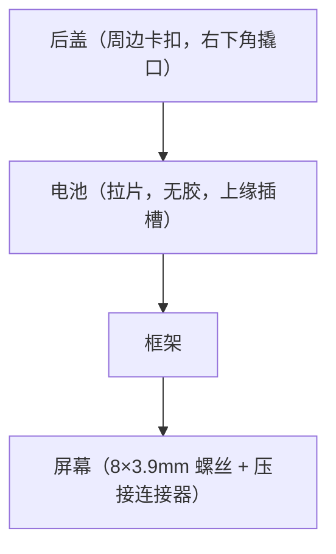

# Fairphone 5 卡扣后盖与免胶可换电池

> [!summary] 一句话概述
> Fairphone 5 的后盖只靠一圈卡扣扣在机身上，用指甲从右下角缺口撬开即可取下；电池不粘胶，抠起底边拉片就能拿出；屏幕用 8 颗 3.9 mm 螺丝 + 一个压接连接器固定——在保持 IP55 的同时做到 iFixit 10/10 可维修分。

> [!note] 与已收录/同轮案例的区别
> [[Framework 笔记本模块化扩展卡与磁吸边框]] 是笔记本的模块化；本篇是**手机**这种高度紧凑、要防水的产品如何用「卡扣后盖 + 无胶电池 + 螺丝屏幕」实现徒手换电池；与 [[苹果 iPhone 16 电解脱粘电池胶]] 形成「改良胶」与「不用胶」两条路线的对照。

## 配图

![[附件/fairphone5-back-cover-clips.jpg]]
*图源：iFixit Fairphone 5 Battery Replacement Step 3；沿周边掀起后盖，松开一圈卡扣*

![[附件/fairphone5-battery-tab.jpg]]
*图源：同上 Step 4；用指甲抠起电池底边拉片取出电池*

> 图片版权归原作者所有，仅作个人学习收藏；出处见文末「来源与核实记录」。

## 结构原理

> 本节数字只写来源里给出的；来源没有就写「来源未给出」。

### 堆叠方案

方向：**从背面到正面**

| 层级 | 零件 | 材料 | 厚度/尺寸 | 固定方式 | 依据 |
| --- | --- | --- | --- | --- | --- |
| L1 | 后盖（右下角有撬口缺口） | 来源未给出 | 来源未给出 | 周边一圈卡扣 | 电池指南 Step 2–3 |
| L2 | 电池（底边带拉片） | 锂电池 | 来源未给出 | 上缘插入框架凹槽后压入；无胶 | 电池指南 Step 4 |
| L3 | 机身框架 | 来源未给出 | 来源未给出 | — | 屏幕指南 Step 5–6 |
| L4 | 屏幕总成 | — | — | 8 颗 3.9 mm 十字螺丝 + 压接连接器 | 屏幕指南 Step 5–7 |

剖面示意：

### 零件清单

| 零件 | 数量 | 功能 | 材料 | 依据 |
| --- | --- | --- | --- | --- |
| 后盖卡扣 | 周边一圈（数量来源未给出） | 固定后盖 | 来源未给出 | 电池指南 Step 3 |
| 电池拉片 | 1 | 取电池的抓手 | 来源未给出 | 电池指南 Step 4 |
| 屏幕螺丝 | 8（长 3.9 mm，十字） | 固定屏幕 | 来源未给出 | 屏幕指南 Step 5 |
| 屏幕压接连接器 | 1 | 屏幕电连接 | — | 屏幕指南 Step 7 |

### 装配顺序

1. 电池上缘先滑进框架内的凹槽，再把电池压入到位。
2. 后盖对准机身，沿周边按压直到所有卡扣扣回。
3. （换屏时）屏幕压接连接器先对准一侧按下至「咔」声，再按另一侧，不要按中间；然后上 8 颗螺丝。

> 依据：电池指南 Step 3–4 的装配提示；屏幕指南 Step 7。

### 受力与运动分析

- **受力路径**：后盖靠卡扣保持；电池由框架凹槽约束（来源未说明有无其他固定）；屏幕由 8 颗螺丝压紧在框架上。
- **运动关系**：静态；拆卸时后盖从右下角开始逐段脱扣。
- **失效风险**：压接连接器错位时按压会弄弯针脚造成永久损坏（屏幕指南 Step 7）。卡扣反复开合寿命、防水密封方式来源未给出。

## 设计要点与参数

| 要点 | 内容 | 依据 |
| --- | --- | --- |
| 撬口 | 后盖右下角缺口，指甲或撬棒即可 | 电池指南 Step 2 |
| 后盖固定 | 周边卡扣，无螺丝无胶 | 电池指南 Step 3 |
| 电池固定 | 无胶，上缘入槽 + 拉片取出 | 电池指南 Step 4 |
| 屏幕 | 8 颗 3.9 mm 螺丝 | 屏幕指南 Step 5 |
| 防护等级 | IP55（iFixit 新闻） | 补充来源 iFixit 新闻 |
| 可维修评分 | 10/10 | iFixit 设备页 |
| 卡扣尺寸、密封件形式 | 来源未给出 | — |

## 优缺点

**优点**
- 换电池徒手完成，3 步即可
- 无胶电池避免了拉胶条断裂、溶剂、加热等维修风险
- 卡扣后盖开合方向明确（固定起撬点）

**缺点 / 代价**
- 卡扣后盖限制了防水等级（来源只给 IP55，未与胶粘机型比较）
- 后盖卡扣反复开合可能磨损（推断，来源未给寿命数据）

## 可借鉴点

- 为卡扣后盖设计唯一的起撬缺口，指引用户从正确位置开始脱扣
- 电池「一端插槽 + 另一端拉片」的免胶定位方式，适合需要用户自换的电池
- 压接连接器在维修指南里写明按压顺序，防止针脚损坏

## 相关案例

- [[苹果 iPhone 16 电解脱粘电池胶]]
- [[Framework 笔记本模块化扩展卡与磁吸边框]]
- [[塑料外壳止口与扣位：间隙参数与三个翻车案例]]
- 分类索引：[[06-拆解与可维修 索引]]

## 来源与核实记录

- 主来源：[Fairphone 5 Battery Replacement](https://www.ifixit.com/Guide/Fairphone+5+Battery+Replacement/168819)（iFixit 指南，Alex Diaz-Kokaisl，发布于 2023-12-22）
- 补充来源：[Fairphone 5 Screen Replacement](https://www.ifixit.com/Guide/Fairphone+5+Screen+Replacement/168828)；[Fairphone 5 设备页](https://www.ifixit.com/Device/Fairphone_5)（10/10 评分）；[We Hot-Wired the iPhone 16](https://www.ifixit.com/News/100352/we-hot-wired-the-iphone-16)（提到 Fairphone 在 IP55 下保留可换电池）
- 核实：2026-11-13 通过 iFixit API 读取两份指南全部步骤与设备页评分段落。
