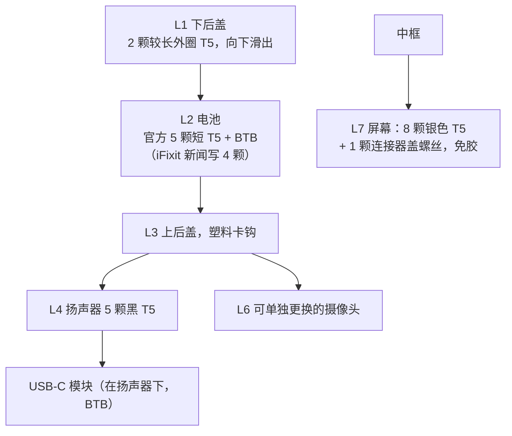

# Fairphone 6 螺丝模块化（屏、电池、摄像头、USB-C）

> [!summary] 一句话概述
> Fairphone 6 仍然走「可拆、可换模块」路线，但和已收录的 Fairphone 5 不一样：后盖改成「两颗更长的 T5 螺丝 + 向下滑开的下后盖」，电池改成更薄的软包，用螺丝压住（不再只靠指甲和拉片）。屏幕八颗银螺丝、免胶；USB-C 藏在扬声器模块下面，摄像头也可单独更换。代价是防护停留在 IP55，换电池不再是完全免工具。

## 配图

![[附件/fairphone6-teardown-layout.jpg]]
*图源：[iFixit *Fairphone 6 Teardown: Proof Phones Don’t Have to Be Disposable*](https://www.ifixit.com/News/111613/fairphone-6-teardown-proof-phones-dont-have-to-be-disposable)（Elizabeth Chamberlain，2025-07-03）拆解摆件图。可见分开的下后盖和上后盖、带薄金属托片的电池、八颗螺丝固定的屏幕、独立摄像头/听筒盖板、主板和扬声器/USB-C 区域。*

![[附件/fairphone6-device-front-back.jpg]]
*图源：[iFixit Fairphone 6 设备页](https://www.ifixit.com/Device/Fairphone_6)；背面中缝附近两颗外露 Torx 螺丝（设备页原文：two exposed Torx screws near the middle seam），以及「第三颗摄像头」位置——iFixit 拆解写那一颗其实是 ToF 传感器开窗，不是相机。*

> 图片版权归原作者所有，仅作个人学习收藏；出处见文末「来源与核实记录」。

## 结构原理

> 本节所有数字只写来源里给出的。两家对电池螺丝数量的表述不一致，表中并列，不擅自取舍。

### 堆叠方案

方向：**从背面到屏幕（官方维修顺序）**

| 层级 | 零件 | 材料 | 厚度/尺寸 | 固定方式 | 依据 |
| --- | --- | --- | --- | --- | --- |
| L1（最外，下后盖） | 下后盖 | 来源未给出 | 整机 156.5 × 73.3 × 9.6 mm，193 g（iFixit 设备页） | 顶部左右各 1 颗较长的外圈 T5；拧下后向下滑出 | 官方电池/屏幕指南；设备页 |
| L2 | 电池 | 软包锂电，贴在薄金属片上（iFixit）；官方未写金属片 | iFixit 拆解：17.26 Wh；设备页另写 4415 mAh（两处单位不同，不换算） | 官方：电池周围 5 颗较短的内圈 T5，掀开连接器盖，断开 BTB，再取出。iFixit 新闻写「四颗螺丝 + 一根软排」。本篇同时保留两种表述 | 官方电池指南；iFixit 新闻 |
| L3 | 上后盖 | 来源未给出；有塑料卡钩 | 来源未给出 | 卸电池后，用塑料卡片从下左、下右开始向上解卡钩 | 官方屏幕指南 |
| L4 | 扬声器模块（含振动马达）+ 其下的 USB-C 口 | 来源未给出 | 来源未给出 | 扬声器：5 颗黑色 T5，左侧小缺口用塑料片撬出；USB-C：必须先拆扬声器，再断开上方 BTB，轻轻取出 | 官方扬声器/USB-C 指南。iFixit：USB-C 在扬声器组件之下，高度模块化 |
| L5 | 主板 | 来源未给出 | 来源未给出 | 官方不把主板当用户可维修件，有警告标签。iFixit：用了比一般手机更多的弹簧顶针（pogo pins）来减少连接器和螺丝；触点焊盘有胶，电源键维修可能比较烦 | iFixit 新闻 |
| L6 | 摄像头与听筒 | 来源未给出 | 主摄 50 MP Sony，超广角 13 MP（设备页 / 拆解） | 打开保护盖后即可碰到；后置摄像头可单独更换，不必整板换掉 | iFixit 新闻 |
| L7（最外，屏幕侧） | 6.31 英寸 LTPO OLED 屏幕 | 设备页：1116×2484，10–120 Hz，峰值 1400 nits，Gorilla Glass 7i | 6.31 英寸；iFixit 写比 Fairphone 5 略小，但几乎亮一倍 | 中框上一圈 8 颗银色 T5（与扬声器/天线螺丝要分开）；翻过来还有 1 颗螺丝压着 BTB 盖。官方强调不要拧过劲，否则屏幕会弯、膜下起泡。没有把屏幕粘死的结构胶 | 官方屏幕指南；iFixit 新闻 |

剖面示意：

### 零件清单

| 零件 | 数量 | 功能 | 材料 | 依据 |
| --- | --- | --- | --- | --- |
| 下后盖 | 1 | 用户面入口 | 来源未给出 | 官方指南 |
| 外圈长 T5 | 2 | 固定下后盖；官方强调外圈比内圈长，要分开存放 | 来源未给出 | 官方指南 |
| 电池 + 内圈短 T5 | 电池 1；螺丝官方写 5 颗，iFixit 新闻写 4 颗 | 可换电池，不用胶把电芯粘在中框上 | 软包；贴薄金属片（iFixit） | 官方；iFixit |
| 上后盖 | 1 | 盖住上半腔，换屏时才需要拆 | 来源未给出，塑料卡钩 | 官方屏幕指南 |
| 屏幕 | 1 | 显示；8 颗银螺丝 + BTB | OLED + Gorilla Glass 7i | 官方；设备页 |
| 扬声器模块 | 1（备件同时包含振动马达） | 扬声器；也挡住 USB-C | 来源未给出 | 官方 USB-C 指南 |
| USB-C 口 | 1 | 独立备件，BTB 连接 | 来源未给出 | 官方 |
| 主摄 / 超广角 / ToF / 前摄 / 听筒 | 各 1 | ToF 不是相机，但需要独立开窗 | 来源未给出 | iFixit 新闻 |

### 装配顺序

> 按官方指南的拆解顺序反推。换任何模块前先关机。工具：T5 螺丝刀、塑料片、分装螺丝的小盒。

**换电池（官方，约 5–10 分钟；iFixit 引用官方实时视频：从关机到重启几乎正好 2 分钟）：**

1. 屏幕朝下。拧掉下后盖左上、右上 2 颗长螺丝，把下后盖向下滑出。
2. 拧掉电池周围的短螺丝（官方：5 颗）。
3. 轻轻掀起上方连接器盖，断开 BTB，取出电池。
4. 放入新电池，接上 BTB，盖好盖，打回短螺丝，滑回下后盖，打回 2 颗长螺丝。

**换屏幕（官方，须先按上面的方式取下电池，再拆上后盖）：**

1. 取下电池后，用塑料片解开上后盖卡钩（从下左、下右向上做）。
2. 拧掉中框上 8 颗银色屏幕螺丝，翻面。屏幕此时已松，但仍有排线，不能硬拽。
3. 移开屏幕，拧掉压着 BTB 盖的那 1 颗螺丝，揭盖，断开 BTB。
4. 新屏幕先接 BTB（会有卡到位的手感），装回盖和那 1 颗螺丝，翻面打 8 颗银螺丝。**不要拧过劲。**
5. 先扣回上后盖，再放电池。官方写：必须先装上后盖再装电池，以免弯到顶部的金属簧片。

**换 USB-C（官方）：**

1. 先拆下后盖和电池，不必拆上后盖和屏幕。
2. 拧掉扬声器上 5 颗黑螺丝，从左侧小缺口用塑料片把扬声器翘出。
3. 断开 USB-C 上方的 BTB，轻轻取出 USB-C。
4. 新 USB-C 就位后把 BTB 按到轻响，确认接口和连接器都平；再装扬声器、打 5 颗黑螺丝，然后装回电池和下后盖。

### 受力与运动分析

- **受力路径**：跌落和弯折主要由中框承担；后盖不再是整圈卡扣受力（相对 FP5），下后盖的两颗长螺丝是用户面的主紧固。电池靠短螺丝和薄金属托片定位，而不是大面积结构胶。屏幕的工作载荷走 8 颗螺丝和中框，BTB 只负责电信号。
- **运动关系**：各模块在维修时是可拆的独立件，日常使用无相对运动。下后盖是滑动开合，上后盖是卡钩。
- **失效风险**：螺丝分类搞混（外长内短，银色屏幕螺丝 vs 黑色扬声器螺丝）；屏幕螺丝过紧导致面板弯曲起泡；先装电池再装上后盖会弯金属簧片；IP55 低于旗舰常见的 IP68，iFixit 把原因部分归于「少用胶」。pogo pin 的焊盘带胶，电源键一类小机构可能不好修（iFixit 唯一的主要批评）。

## 设计要点与参数

| 要点 | 内容 | 依据 |
| --- | --- | --- |
| 整机尺寸 / 重量 | 156.5 × 73.3 × 9.6 mm，193 g | iFixit 设备页 |
| 防护 | IP55；设备页另列 MIL-810H | iFixit 新闻与设备页 |
| 电池能量 | 17.26 Wh（拆解新闻）；设备页写 4415 mAh。两处未同时给出电压，不换算对照 | iFixit |
| 电池固定 | 官方：5 颗短 T5 + BTB；iFixit 新闻：4 颗螺丝 + 一根软排。官方指南更新于 2026-08-19 | 官方；iFixit。可能是版次/计数方式不同，不裁定 |
| 为何改成螺丝电池 | iFixit 转述发布会：为了做薄，从硬壳电芯改成软包，所以改用螺丝压住 | iFixit 新闻 |
| 屏幕 | 6.31 英寸 LTPO OLED，10–120 Hz；8 颗银螺丝 + 1 颗盖板螺丝，免胶 | 官方；iFixit |
| 换电池时间 | 官方 5–10 分钟；iFixit 称官方视频几乎 2 分钟（关机到重启） | 官方；iFixit |
| 可维修评分 | iFixit 10/10 | iFixit 新闻 |
| 软件与零件支持 | 承诺到 2033 年，五年保修 | iFixit 新闻 |
| 备件碳排放「回本」天数（Fraunhofer，iFixit 转述，数据来自 Fairphone 4 主板等） | 摄像头和扬声器 18 天，屏幕 33 天，电池 55 天，Fairphone 4 主板 719 天 | iFixit 新闻 |
| USB | iFixit / 评论指出是 USB 2（以 USB-C 外形出现） | iFixit 新闻及评论 |
| 与 Fairphone 5 的关键差异 | FP5：整块后盖纯卡扣，电池免工具拉片；FP6：下后盖两颗螺丝滑开，软包电池改螺丝固定，换电池不再完全免工具，但官方仍把时间控制在数分钟，并换来更薄机身 | 已收录 FP5 案例；本篇 iFixit 原文 |

## 优缺点

**优点**
- 屏幕、电池、USB-C、后置摄像头都可以按模块更换，不用热风枪和大面积拆胶
- 螺丝分颜色和长短，官方指南把「外长内短、银屏黑扬声器」写成防呆
- 仍然拿到 iFixit 10/10，并且有到 2033 年的零件和系统支持承诺

**缺点 / 代价**
- 相对 Fairphone 5，电池不再是纯免工具；要准备 T5
- 为了少用胶，防护停在 IP55，低于许多旗舰的 IP68（iFixit 也认为免胶和高防护可以并存，这里还有改进空间）
- 电池螺丝数量在 iFixit 新闻和官方指南里不一致，维修时应以眼前的官方步骤和实际孔位为准
- 主板不是面向用户的模块；pogo 焊盘带胶，小按键维修一般

## 可借鉴点

- **「可维修」和「变薄」冲突时，用螺丝软包替代免工具硬壳，但把步骤压到几分钟，并在包装里放对的螺丝刀。** 这是 FP6 相对 FP5 的真实取舍，不要写成「一样免工具」。
- **后盖分成「日常入口（下滑下盖）」和「深修入口（卡钩上盖）」**：换电池不必解一圈卡扣；换屏幕才打开上盖。官方还规定「先装上盖再装电池」，保护顶部簧片。
- **把最容易坏的口（USB-C）做成独立 BTB 模块，藏在先拆的扬声器下面**，避免为了一个充电口拆主板。
- **螺丝要能靠外形区分**：长短、颜色、位置分组，比只在说明书里写编号更不容易装错。
- **屏幕螺丝不要当结构上的「越紧越好」**：官方明确过拧会让面板弯曲起泡。这是薄 OLED 的通用教训。

## 与库中相似案例对比

| 对比项 | 本案例（Fairphone 6） | [[Fairphone 5 卡扣后盖与免胶可换电池]] | [[Framework Laptop 16 Expansion Bay 滑出式显卡模块]] | [[苹果 iPhone 16 电解脱粘电池胶]] |
| --- | --- | --- | --- | --- |
| 后盖 | 2 颗长 T5 + 下滑下盖；上盖卡钩 | 整圈卡扣，指甲从缺口撬开 | 不适用 | 胶粘 |
| 电池 | 软包 + 螺丝（官方 5 / 新闻 4）+ BTB，数分钟 | 免胶拉片，免工具 | — | 电解脱粘胶 |
| 屏幕 | 8 颗银螺丝 + BTB，免胶，IP55 | 8 颗 3.9 mm 螺丝 + 压接，IP55 | — | 胶粘体系 |
| 设计变化 | 为做薄放弃完全免工具电池 | 本库已收录的上一代基准 | 笔记本里的滑出模块 | 另一条「可修电池」技术路线 |

## 相关案例

- [[Fairphone 5 卡扣后盖与免胶可换电池]]
- [[Framework 笔记本模块化扩展卡与磁吸边框]]
- [[Framework Laptop 16 Expansion Bay 滑出式显卡模块]]
- [[苹果 iPhone 16 电解脱粘电池胶]]
- [[PS5 免工具侧板与 DualSense 隐藏螺丝]]
- 分类索引：[[06-拆解与可维修 索引]]

## 来源与核实记录

- 主来源：[Fairphone 6 Teardown: Proof Phones Don’t Have to Be Disposable](https://www.ifixit.com/News/111613/fairphone-6-teardown-proof-phones-dont-have-to-be-disposable)（iFixit，Elizabeth Chamberlain，2025-07-03）——拆解观察、17.26 Wh、软包+金属片、IP55、10/10、摄像头独立可换、pogo pin、支持年限
- 补充来源 1–3：Fairphone 官方北美支持，电池 / 屏幕 / 扬声器与 USB-C 指南（页面标注更新 2026-08-19）
  - [How to replace the battery](https://us.support.fairphone.com/hc/en-us/articles/37412810761106-How-to-replace-the-battery-in-The-Fairphone-Gen-6)
  - [How to replace the display](https://us.support.fairphone.com/hc/en-us/articles/37413308498962-How-to-replace-the-display-in-The-Fairphone-Gen-6-Gen-6)
  - [How to replace the loudspeaker and USB-C port](https://us.support.fairphone.com/hc/en-us/articles/37414789831570-How-to-replace-the-loudspeaker-and-USB-C-port-in-The-Fairphone-Gen-6-Gen-6)
- 补充来源 4：[iFixit Device: Fairphone 6](https://www.ifixit.com/Device/Fairphone_6)——尺寸、4415 mAh、IP55、MIL-810H、两颗外露螺丝的识别特征
- 核实：2026-11-15 打开 iFixit 新闻、设备 API/wiki 与三篇官方指南。电池螺丝 4 颗与 5 颗的差异如实保留。相对 Fairphone 5 只写差异，不重写卡扣后盖。
