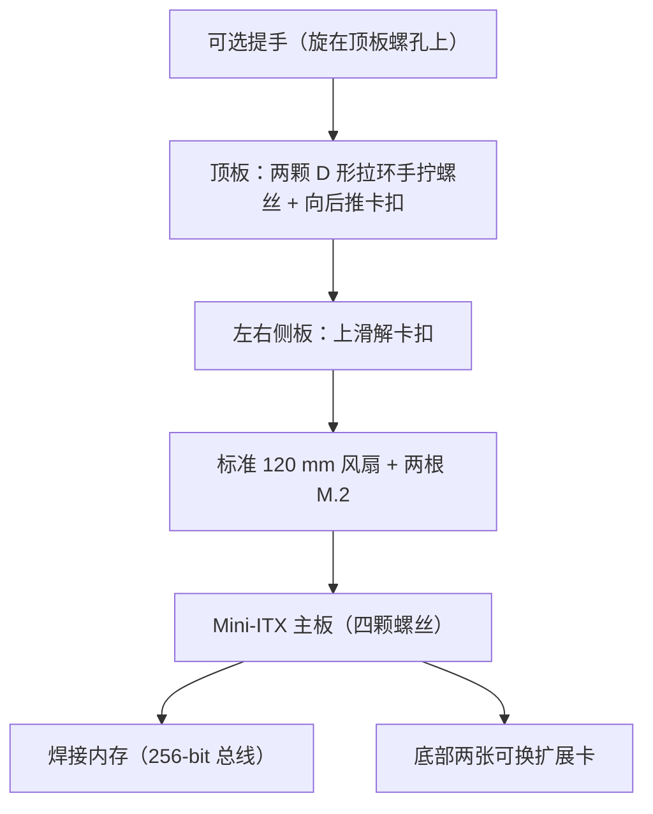

# Framework Desktop 免工具面板与标准件模块化

> [!summary] 一句话概述
> Framework 把笔记本那套「可修、可升级」搬到桌上：侧板靠卡扣上滑就能取下，顶板用带 D 形拉环的手拧螺丝，风扇是标准 120 mm，存储是标准 M.2，主板按 Mini-ITX 出售、可以装进别的机箱。和 Framework 笔记本不同的是，这台为了 256-bit 内存总线的信号完整性，把内存焊死在了主板上——官方把原因说得很清楚，而不是假装「全部都能插拔」。

## 配图

![[附件/framework-desktop-teardown-overview.jpg]]
*图源：[iFixit *Framework Let Us in for an Early Teardown of the Refreshingly Open Framework Desktop*](https://www.ifixit.com/News/108396/framework-let-us-in-for-an-early-teardown-of-the-refreshingly-open-framework-desktop)（Elizabeth Chamberlain，2025-02-26）文章配图；工程样品拆开后的整机概览。*

![[附件/framework-desktop-thumbscrew-dring.jpg]]
*图源：[Framework 官方指南 *Side Panels*](https://guides.frame.work/Guide/Side+Panels/465)；顶板两颗螺丝带 D 形拉环，用手指把环竖起来再拧，不用螺丝刀。*

![[附件/framework-desktop-side-panel.jpg]]
*图源：同上官方指南「Remove the Left Panel」；手指捏住侧板上沿向上推，解开卡扣即可取下。右板只有黑色，左板有黑色或透明可选。*

> 图片版权归原作者所有，仅作个人学习收藏；出处见文末「来源与核实记录」。

## 结构原理

> 本节所有数字只写来源里给出的。机箱长宽高、主板 Exact 尺寸来源若未在已打开页面写出，则写「来源未给出」。

### 堆叠方案

方向：**从外面板到主板（Framework Desktop 原装机箱）**

| 层级 | 零件 | 材料 | 厚度/尺寸 | 固定方式 | 依据 |
| --- | --- | --- | --- | --- | --- |
| L1 | 可选提手 | 来源未给出 | 来源未给出 | 两侧螺纹旋到顶板螺丝孔上，逆时针旋下即可取走 | 官方指南 465 |
| L2 | 顶板 | 来源未给出 | 来源未给出 | 两颗带 D 形拉环的手拧螺丝；松掉后把顶板向机箱后方推，解开卡扣再抬走。装回时箭头朝后，略向下倾由后向前滑，先吃上卡扣，再向前推到位 | 官方指南 465 |
| L3 | 左、右侧板 | 右板仅黑色；左板黑色或透明 | 来源未给出 | 手上推解开卡扣。装回时先从上向下挂上，底部和银色底座之间留一道小缝，再向底座推，让卡扣咬合 | 官方指南 465 |
| L4 | 120 mm 风扇、两根 M.2 SSD | 风扇为 Noctua 或 Cooler Master，也可换成任意 120 mm 风扇（iFixit） | 120 mm | 少量螺丝，面板打开即可碰到 | iFixit 新闻 |
| L5 | 底部两张 Framework 扩展卡 | 来源未给出 | 来源未给出 | USB-C 附件式扩展卡，和笔记本那套扩展卡同一思路，可换接口 | iFixit 新闻 |
| L6 | 主板（Mini-ITX） | 来源未给出 | Mini-ITX 规格；可单独购买并装进第三方机箱或上架 | 原装机箱里 iFixit 写由四颗螺丝固定；拆前面板 I/O 后即可取出。官方另有「把主板装进 Mini-ITX 机箱」指南 | iFixit；官方指南 491 |
| L7 | 焊在主板上的内存 + APU | 来源未给出具体颗粒 | 来源未给出容量选项的完整表（iFixit 转述最高可把至多 96 GB 分给 GPU） | 焊接。不是疏忽：官方曾和 AMD 一起评估 LPCAMM，结论是 256-bit 总线的信号完整性做不成可拆内存，可拆会严重掉带宽（可能腰斩，CEO 在 LTT 采访中的表述，经 iFixit 引用） | iFixit 新闻 |

剖面示意：

### 零件清单

| 零件 | 数量 | 功能 | 材料 | 依据 |
| --- | --- | --- | --- | --- |
| 顶板 | 1 | 向上的免工具入口 | 来源未给出 | 官方 465 |
| D 形拉环手拧螺丝 | 2 | 不用螺丝刀打开顶板 | 来源未给出 | 官方 465 |
| 左侧板 / 右侧板 | 各 1 | 侧面免工具入口；左板可选透明 | 来源未给出 | 官方 465 |
| 120 mm 风扇 | 1 | 标准件散热，可换品牌 | Noctua 或 Cooler Master（样品） | iFixit |
| M.2 SSD | 2 | 标准存储 | 来源未给出 | iFixit |
| Mini-ITX 主板 | 1 | 也可单卖，装进别的机箱 | 来源未给出 | iFixit；官方 491 |
| Framework 扩展卡 | 2（在底部） | 可换 I/O | 来源未给出 | iFixit |
| 焊接内存 | 来源未给出条数 | 给 APU / GPU 共享的宽带内存 | 来源未给出 | iFixit 转述 CEO |

### 装配顺序

> 侧板按官方指南 465。装回顺序与拆卸相反。

1. 若安装了提手，先把两侧螺纹逆时针拧出，取下提手。
2. 把顶板两颗螺丝的 D 形环竖起来，手指逆时针拧下（两颗都要取走）。
3. 顶板向机箱后方推，解开卡扣，抬走。不好抓时可以用螺丝孔当着力点。
4. 左手或右手捏侧板上沿，向上推解脱卡扣，取下左、右侧板。此时风扇和两根 M.2 已经暴露（iFixit）。
5. 若要拆主板：iFixit 写先遇到前置 I/O 面板的一点阻碍，取下前面板后，四颗螺丝即可释放主板。
6. 装回侧板：从上向下挂上，确认底部和银色底座之间有一道小缝，再向底座推，让卡扣咬合。
7. 顶板箭头朝后，略向下倾，由后向前滑到卡扣吃上，放平后再向前推消掉与前面的缝。
8. 手拧顶板螺丝到感觉紧即可；若要装提手，把它放在顶板螺孔上，两侧螺纹顺时针拧紧。

把主板装进第三方 Mini-ITX 机箱的逐步孔位、I/O 挡片和电源线序，见官方指南 491。本批打开了该指南的 API，但正文以「可以按 Mini-ITX 标准装进别的机箱」为结构点，不把未在摘录中核对过的每一个孔位数字写进本篇。

### 受力与运动分析

- **受力路径**：机箱面板是罩壳，不靠胶。侧板和顶板的载荷走卡扣和两颗手拧螺丝；提手的载荷走同一对顶板螺孔。主板的重量和散热压紧力走四颗螺丝和 Mini-ITX 标准安装点。
- **运动关系**：侧板上滑、顶板后滑，都是「先解脱卡扣再分离」的一维运动；没有旋转锁。扩展卡在底部插拔，与笔记本扩展卡同类。
- **失效风险**：焊接内存一旦损坏或不够用，只能换整块主板（这是公开的取舍）。评论还指出这颗 APU 的 PCIe 通道有限，没有 ×16 插槽，独显升级路径和常规桌面不同。iFixit 拆的是工程样品，正式零售机的评分当时还没给出。

## 设计要点与参数

| 要点 | 内容 | 依据 |
| --- | --- | --- |
| 面板开启 | 侧板上滑卡扣；顶板两颗 D 形拉环手拧螺丝 + 后滑卡扣 | 官方 465 |
| 风扇 | 标准 120 mm，可换任意同规格风扇 | iFixit |
| 存储 | 两根可轻易碰到的 M.2 | iFixit |
| 主板 | Mini-ITX，可单卖并装进第三方机箱或用于上架；原装机箱内四颗螺丝 | iFixit；官方 491 |
| 扩展卡 | 底部两张，USB-C 附件式，与笔记本扩展卡同一思路 | iFixit |
| 内存为何焊接 | 与 AMD 评估过 LPCAMM；256-bit 总线扇出的信号完整性不允许可拆内存，可拆可能让带宽减半（CEO 原话经 LTT / iFixit 引用） | iFixit 新闻 |
| 计算规格（背景，非本篇结构重点） | AMD Ryzen AI Max，Radeon 8060S；iFixit 转述最多 96 GB 可分给 GPU | iFixit 新闻 |
| 可维修评分 | 当时为工程样品，iFixit 未打分 | iFixit 新闻 |
| 机箱外形毫米尺寸 | 来源未给出（已打开的页面未写） | — |

## 优缺点

**优点**
- 面板真正免工具：卡扣 + 手拧螺丝，打开就能看到风扇和 SSD
- 主动使用桌面已有的标准件（Mini-ITX、120 mm、M.2），主板还能离开原装机箱单独使用
- 底部保留 Framework 式可换 I/O
- 对不能模块化的内存没有含糊其辞，把总线和信号完整性的限制说清楚

**缺点 / 代价**
- 内存（以及 APU）焊死，升级内存等于换主板
- 受 SoC 通道限制，不是传统「插一张 ×16 独显」的升级路径（评论与 iFixit 上下文）
- 早期拆解对象是工程样品，细节与量产机可能仍有差异

## 可借鉴点

- **桌面机不要重复发明安装孔。** 能用 Mini-ITX、120 mm、M.2 的地方就用标准件，再把「原装机箱」做成这些标准件的一种外壳，而不是唯一外壳。
- **免工具面板用「手拧螺丝 + 滑开卡扣」就够**：D 形拉环让手指能产生足够力矩；侧板纯卡扣适合频繁打开的面。
- **模块化要诚实面对物理限制。** 256-bit 内存走线做不成可靠的连接器时，与其做一个掉半带宽的「假可升级」，不如焊死并公开原因。这和笔记本上坚持可换扩展卡、可换电池并不矛盾——限制是局部的。
- 和笔记本产品线保持同一套扩展卡，降低配件库存，也让用户的 USB-C / HDMI 小卡可以跨形态复用。

## 与库中相似案例对比

| 对比项 | 本案例（Framework Desktop） | [[Framework 笔记本模块化扩展卡与磁吸边框]] | [[Framework Laptop 16 Expansion Bay 滑出式显卡模块]] | [[Mac Pro 2019 旋转把手外壳锁与免工具模块锁]] |
| --- | --- | --- | --- | --- |
| 形态 | 小型桌面，Mini-ITX 主板 | 13 寸笔记本 | 16 寸笔记本的尾部显卡仓 | 全尺寸工作站 |
| 外壳怎么开 | 侧板上滑 + 顶板手拧螺丝 | 5 颗防丢螺丝开底壳，磁吸边框 | 磁吸键盘后开 Interposer 门 | 旋转把手锁 |
| 标准件 | Mini-ITX、120 mm、M.2 | 自制模块为主 | 自制显卡滑块 | 自行定义的滑轨模块 |
| 内存 | 焊接（有公开的信号完整性原因） | 来源见原案例（笔记本可换内存策略与本机不同，不在本篇展开） | — | 可扩展 |
| 扩展卡 | 底部两张，和笔记本同族 | 侧边四张 | 另加尾部 Bay | PCIe / 模块架 |

## 相关案例

- [[Framework 笔记本模块化扩展卡与磁吸边框]]
- [[Framework Laptop 16 Expansion Bay 滑出式显卡模块]]
- [[Mac Pro 2019 旋转把手外壳锁与免工具模块锁]]
- [[Fairphone 6 螺丝模块化（屏、电池、摄像头、USB-C）]]
- 分类索引：[[06-拆解与可维修 索引]]

## 来源与核实记录

- 主来源：[Framework Let Us in for an Early Teardown of the Refreshingly Open Framework Desktop](https://www.ifixit.com/News/108396/framework-let-us-in-for-an-early-teardown-of-the-refreshingly-open-framework-desktop)（iFixit，Elizabeth Chamberlain，2025-02-26）——免工具面板、120 mm 风扇、双 M.2、底部扩展卡、四颗螺丝的主板、焊接内存及 CEO 对 LPCAMM 的说明
- 补充来源 1：[Side Panels](https://guides.frame.work/Guide/Side+Panels/465)（Framework 官方指南 465）——D 形拉环、侧板上滑、顶板后滑与装回对位
- 补充来源 2：[How to Install a Framework Desktop Mainboard Into a Mini-ITX Case](https://guides.frame.work/Guide/How+to+Install+a+Framework+Desktop+Mainboard+Into+a+Mini%E2%80%91ITX+Case/491)（官方指南 491）——主板可按 Mini-ITX 装进第三方机箱
- 补充来源 3：[Framework Desktop DIY Edition Quick Start Guide](https://guides.frame.work/Guide/Framework+Desktop+DIY+Edition+Quick+Start+Guide/464)（官方指南 464）
- 核实：2026-11-15 用 WebFetch 打开 iFixit 新闻，用 Framework Dozuki API 打开指南 465、491、464。机箱外形毫米尺寸未在已打开文本中出现，不编造。当时对象为工程样品，未把未公布的可维修分数写进去。
