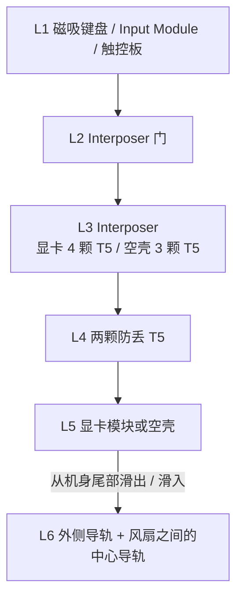

# Framework Laptop 16 Expansion Bay 滑出式显卡模块

> [!summary] 一句话概述
> Framework Laptop 16 在机身后方做了一条贯穿式的 Expansion Bay：松开中板上的 Interposer 和两颗防丢 T5 螺丝后，整块显卡模块（或空壳）可以从机身尾部平推出来。这和已经收录的 Framework 13 侧边 Expansion Card（把 USB-C 转成 HDMI / USB-A 的小卡）不是同一件事——16 寸两边仍然可以插扩展卡，Bay 则是用来换独显或空仓的大滑块。

## 配图

![[附件/framework16-expansion-bay-slide.jpg]]
*图源：[iFixit *How to Replace an Expansion Bay Module in your Framework Laptop 16*](https://www.ifixit.com/Guide/How+to+Replace+an+Expansion+Bay+Module+in+your+Framework+Laptop+16/195629)（与原厂合作的 OEM 指南，步骤「Remove the Expansion Bay Module」）；合上电脑、翻转后，模块从机身尾部滑出。指南写：应能轻松滑出，若有阻力先检查螺丝是否已完全松开。*

![[附件/framework16-interposer-screws.jpg]]
*图源：同上，「Loosen the interposer screws」；掀开 Interposer 门之后，显卡配置用 4 颗防丢 T5 固定 Interposer，空壳（Expansion Bay Shell）则是 3 颗。*

![[附件/framework16-expansion-bay-rails.jpg]]
*图源：同上（以及官方指南 271 的对位说明）；装回去时模块要与外侧导轨平齐，两条中心导轨要从风扇之间穿过去。*

> 图片版权归原作者所有，仅作个人学习收藏；出处见文末「来源与核实记录」。

## 结构原理

> 本节所有数字只写来源里给出的。模块的外形尺寸、接口针数、功耗来源未给出，不估算。

### 堆叠方案

方向：**从键盘面往下看中板，再转到机身尾部的滑出方向（Framework Laptop 16）**

| 层级 | 零件 | 材料 | 厚度/尺寸 | 固定方式 | 依据 |
| --- | --- | --- | --- | --- | --- |
| L1（最外，用户面） | 触控板两侧 Spacer、触控板模块、磁吸键盘、左右 Input Module | 来源未给出；键盘和 Input Module 靠强磁铁 | 来源未给出 | 解锁 Input Module 卡扣后，手指向外/向下滑出或提拉把；键盘提拉时要逐渐加力，避免突然弹出 | iFixit 指南 195629 |
| L2 | Interposer 门（黑色拉手） | 来源未给出 | 来源未给出 | 翻开后保持直立；合上盖子前必须把门关上，以免压坏屏幕（官方指南） | 195629；官方 271 |
| L3 | Interposer（主板与 Expansion Bay 之间的转接板） | 来源未给出 | 来源未给出 | 显卡模块：4 颗防丢 T5；空壳：3 颗防丢 T5。安装方向：橡胶圈或金属片要盖住 Bay 螺丝 | 195629；官方 271 |
| L4 | Expansion Bay 模块固定螺丝 | 来源未给出 | 来源未给出 | 2 颗防丢 T5，把模块锁在机身里 | 195629；官方 271 |
| L5 | Expansion Bay 模块（显卡模块或 Shell） | 来源未给出；官方零件名包括 Expansion Bay Shell、AMD Radeon RX 7700S、NVIDIA GeForce RTX 5070 Graphics Module | 来源未给出长宽厚 | 沿尾部槽道滑入，官方写完全插入时应听到 click；外侧与导轨平齐，中心两条导轨从风扇之间穿过 | 195629；官方 271 |
| L6（最内） | 导轨 + 两侧风扇形成的通道 | 来源未给出 | 来源未给出 | 与中板/机身一体的导向 | 195629 安装步骤 |

剖面示意：

### 零件清单

| 零件 | 数量 | 功能 | 材料 | 依据 |
| --- | --- | --- | --- | --- |
| Expansion Bay 模块（Graphics Module 或 Shell） | 1 | 滑出式功能仓：独显或空壳（空壳还可配风扇，见官方其它指南，本篇不展开） | 来源未给出 | 195629 零件表；官方 271 |
| Interposer | 1 | 连接 Mainboard 与 Bay，并可按模块类型换用不同螺孔/盖法 | 来源未给出 | 195629；官方 271 |
| Interposer 防丢 T5 | 4（显卡）或 3（空壳） | 固定 Interposer | 来源未给出 | 同上 |
| 模块防丢 T5 | 2 | 防止模块滑出 | 来源未给出 | 同上 |
| Input Module 磁铁与对位柱 | 按配置 | 让键盘/侧边模块靠磁吸就位，对位柱保证边沿平齐 | 来源未给出 | 195629 安装步骤 |
| Framework Screwdriver | 1 | 拧上述 T5 | 来源未给出 | 两份指南的工具 |

### 装配顺序

> 官方指南 271 以「先滑入模块，再打螺丝和 Interposer」为主；iFixit 195629 同时写了拆和装。下面按安装顺序写。换新显卡前，官方和 iFixit 都要求先把 BIOS 升级到最新。

1. 关机并拔掉所有线（包括 USB-C 电源）。官方特别提醒：打开 Interposer 门之前必须断电。
2. 合上电脑，把 Expansion Bay 模块对准尾部槽道轻轻推入。应几乎没有阻力；若推不动，不要强行，退出后重新对轨。完全插入时应听到 click（官方 271）。检查外侧与导轨平齐，两条中心导轨走在风扇之间。
3. 打开 Interposer 门，用 Framework 螺丝刀拧紧 2 颗模块防丢 T5。
4. 放入 Interposer：方向要让橡胶圈或金属片盖住 Bay 螺丝（随显卡或空壳而变）。显卡拧 4 颗防丢 T5，空壳拧 3 颗。官方写这里不必用力过猛。
5. 关上 Interposer 门。官方警告：关屏幕前必须先关门，否则可能压坏显示屏。
6. 装回键盘和 Input Module：键盘上沿对准中板上的虚线，呈约 20° 滑入通风板下的定位槽，再放下让磁铁吸住，并对准左右定位柱（官方 271）。触控板先放平再推到位，Spacer 向外沿滑入，最后把 Input Module 卡扣推回去（195629）。
7. 若是新显卡，按官方页面安装驱动包。

拆卸为相反顺序：先取 Spacer / 触控板 / 键盘 / Input Module（有的配置只需取触控板和键盘就能到 Bay），开门，松 Interposer 螺丝并取下 Interposer，松 2 颗模块螺丝，关门，翻面，把模块从尾部抽出。全程 5–10 分钟，难度 Easy（195629）。

### 受力与运动分析

- **受力路径**：模块自重和可能的冲击 → 两侧导轨和两颗 T5 防丢螺丝 → 中板/机身。电气路径则走 Interposer，不靠摩擦接触来承力。
- **运动关系**：模块只有一个沿槽道的滑动自由度；插入终点有 click 定位。键盘和 Input Module 是磁吸，另有滑动卡扣锁住触控板区域。
- **失效风险**：螺丝没松就抽模块（指南明确：有阻力先查螺丝）；Interposer 门开着就合上屏幕，可能压坏显示屏；强行对位不准的模块，可能伤导轨或连接器。来源未给出插拔寿命次数。

## 设计要点与参数

| 要点 | 内容 | 依据 |
| --- | --- | --- |
| 操作时间 / 难度 | 5–10 分钟，Easy | iFixit 195629 |
| Interposer 螺丝 | 显卡 4 颗防丢 T5；空壳 3 颗防丢 T5 | 195629；官方 271 |
| 模块螺丝 | 2 颗防丢 T5 | 同上 |
| 插入手感 | 几乎无阻力；到位有 click；官方：If it is not sliding into place, do not force it | 官方 271 |
| 导轨 | 外侧与导轨平齐；两条中心导轨从风扇之间穿过 | 195629；官方 271 |
| 键盘就位角 | 约 20° 滑入通风板下的定位槽，再靠磁铁落下 | 官方 271 |
| 与 13 寸扩展卡的关系 | 本结构是机身尾部的大滑块；13 寸那种侧边小扩展卡是另一套接口（见已收录案例） | 已收录案例；本指南零件与步骤均针对 Expansion Bay |
| 模块外形尺寸、功耗、接口针数 | 来源未给出 | — |

## 优缺点

**优点**
- 独显变成用户可更换的滑出模块，不必拆底板、也不必焊接
- 全部是防丢螺丝，工具就是随机那把螺丝刀
- 空壳和显卡用同一条槽道，只是 Interposer 螺丝数量和盖法不同
- 导轨、click、磁吸对位柱一起把「插错、插歪」的机会压下去

**缺点 / 代价**
- 要先拿走键盘和部分 Input Module 才能动 Interposer（虽然不必拆整机底板）
- Interposer 门如果忘了关，合盖会伤屏
- 机身必须为滑道和风扇让出一条贯通的结构空间，这是 16 寸相对 13 寸加厚、加长的代价之一（具体毫米来源未给出）

## 可借鉴点

- **把高功耗、高迭代的部件做成「整块滑出」，用转接板（Interposer）隔离主板。** 主板侧只保留固定的 Interposer 座，显卡迭代不必改主板连接器。
- **同一槽道兼容「有功能的模块」和「空壳」**：用螺丝数量（4 对 3）和盖片形式（橡胶圈 vs 金属片）做防呆，而不是做两条互不兼容的仓。
- **防丢螺丝 + 明确的「不要用力」规则**：滑动件一旦需要用力，多半是没松螺丝或没对轨，应该停下来而不是继续推。
- **活动门要和合盖运动互锁或至少在说明书里写成硬警告**：Interposer 门的运动空间正好在屏幕关闭轨迹上。
- 不要把「侧边扩展卡」和「尾部显卡仓」写成同一个模块——对用户、对结构开档都不是一回事。

## 与库中相似案例对比

| 对比项 | 本案例（16 寸 Expansion Bay） | [[Framework 笔记本模块化扩展卡与磁吸边框]]（13 寸） | [[Fairphone 6 螺丝模块化（屏、电池、摄像头、USB-C）]] |
| --- | --- | --- | --- |
| 模块是什么 | 尾部滑出的独显或空壳 | 侧边弹出的 USB-C 扩展小卡、磁吸键盘和边框 | 螺丝固定的屏、电池、摄像头、USB-C |
| 固定 | 2 颗 T5 + Interposer 3 或 4 颗 T5 | 扩展卡按键弹出；底壳 5 颗防丢螺丝 | T5 螺丝，按模块分组 |
| 要不要先拿键盘 | 要（磁吸提起） | 13 寸也是磁吸键盘，但换扩展卡不必走 Bay 那套 | 不必，从后盖进 |
| 结构要点 | 贯通滑道、风扇之间的中心导轨、转接板 | 侧边卡槽与磁吸 | 分上下后盖、免胶 |

## 相关案例

- [[Framework 笔记本模块化扩展卡与磁吸边框]]
- [[Framework Desktop 免工具面板与标准件模块化]]
- [[Fairphone 6 螺丝模块化（屏、电池、摄像头、USB-C）]]
- [[Fairphone 5 卡扣后盖与免胶可换电池]]
- 分类索引：[[06-拆解与可维修 索引]]

## 来源与核实记录

- 主来源：[How to Replace an Expansion Bay Module in your Framework Laptop 16](https://www.ifixit.com/Guide/How+to+Replace+an+Expansion+Bay+Module+in+your+Framework+Laptop+16/195629)（iFixit 指南 195629，与原厂合作 OEM Guide，Alex Diaz-Kokaisl）——完整拆装顺序、3/4 颗 Interposer 螺丝、两颗模块螺丝、导轨说明
- 补充来源：[Install Graphics Module (dGPU)](https://guides.frame.work/Guide/Install+Graphics+Module+(dGPU)/271)（Framework 官方指南 271）——滑入 click、不要强行、Interposer 方向、键盘 20° 就位、关盖前先关门。Framework 与 iFixit 为不同机构
- 核实：2026-11-15 用 iFixit API 与 Framework Dozuki API 打开两份指南全文。未把 13 寸侧边扩展卡的结构写进本篇步骤。模块的毫米尺寸和电气规格来源未给出，不编造。
