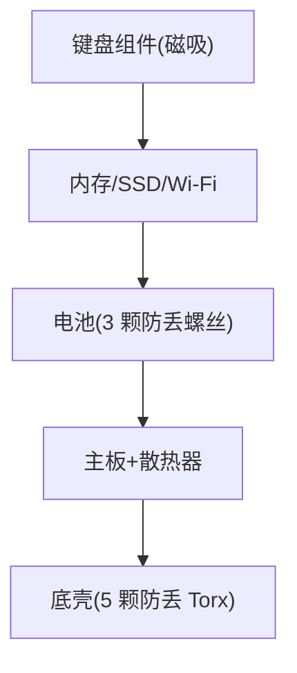

# Framework 笔记本模块化扩展卡与磁吸边框

> [!summary] 一句话概述
> Framework 13 用 5 颗防丢 Torx 螺丝开底壳、磁吸键盘组件、磁吸屏幕边框、按键弹出的扩展卡（把 USB-C 转成 HDMI/USB-A 等）和 3 颗防丢螺丝的电池，拿到 iFixit 罕见的 10/10 可维修分。

## 配图

![[附件/framework-laptop-ifixit.jpg]]
*iFixit：Framework Laptop 拆解文章题图*

> 图片版权归原作者所有，仅作个人学习收藏；出处见文末「来源与核实记录」。

## 结构原理

> 本节数字只写来源里给出的；来源没有就写「来源未给出」。

### 堆叠方案

方向：**从 C 面（键盘面）向下**

| 层级 | 零件 | 材料 | 厚度/尺寸 | 固定方式 | 依据 |
| --- | --- | --- | --- | --- | --- |
| L1 | 键盘组件（含触控板） | — | 来源未给出 | 磁铁固定；键盘本身约 50+ 颗螺丝 | 原文 |
| L2 | 内存/SSD/Wi-Fi 卡 | — | 2×8 GB 内存、250 GB SSD（评测机配置） | 插槽 | 原文 |
| L3 | 电池 | — | 来源未给出 | 3 颗防丢螺丝 + 连接器 | 原文 |
| L4 | 主板 + 散热器 | — | 来源未给出 | 主板 5 颗螺丝、散热器 3 颗 | 原文 |
| L5 | 底壳 | — | 来源未给出 | 5 颗防丢 Torx 螺丝 | 原文 |
| 侧面 | 扩展卡 ×4 | — | 来源未给出 | 插入 USB-C 插座，按钮释放 | 原文 |
| 屏幕 | 磁吸边框 | — | 来源未给出 | 磁吸，可直接剥下 | 原文 |

剖面示意：

### 零件清单

| 零件 | 数量 | 功能 | 材料 | 依据 |
| --- | --- | --- | --- | --- |
| 防丢螺丝 | 底壳 5 + 电池 3 | 拧松不掉落 | — | 原文 |
| 扩展卡 | 4 | USB-C 转 HDMI/DP/USB-A/microSD/存储 | — | 原文 |
| 磁吸屏幕边框 | 1 | 可更换颜色/维修屏幕 | — | 原文 |
| 二合一螺丝刀（带撬棒） | 1（随机附带） | 唯一需要的工具 | — | 原文 |

### 装配顺序

1. 拧松底壳 5 颗防丢 Torx 螺丝，翻面掀起磁吸键盘组件
2. 插入内存、SSD、Wi-Fi 卡（接天线）
3. 装扩展卡到 4 个 USB-C 位
4. （维修）电池：断开连接器 + 3 颗防丢螺丝；主板：5 颗螺丝 + 散热器 3 颗

> 来自 DIY 版组装与拆解描述。

### 受力与运动分析

- **受力路径**：来源未讨论受力。
- **运动关系**：扩展卡直线插拔，按钮解锁；键盘、边框依靠磁力定位。
- **失效风险**：唯一被挑剔的点：主板上的 4 个 USB-C 插座是焊接的（原文）。

## 设计要点与参数

| 要点 | 内容 | 依据 |
| --- | --- | --- |
| 可维修评分 | 10/10 | 原文 |
| 底壳螺丝 | 5 颗防丢 Torx | 原文 |
| 电池螺丝 | 3 颗防丢 | 原文 |
| 整机厚度 | 「略厚于 HP Envy 14」，具体数值来源未给出 | 原文 |

## 优缺点

**优点**
- 全部主要部件易拆易换，部件贴标签、带二维码直达备件页
- 一把随附螺丝刀可完成全部维修

**缺点 / 代价**
- USB-C 插座焊接在主板
- 电池偏小（原文）

## 可借鉴点

- 防丢螺丝 + 磁吸定位，降低用户拆装风险
- 高磨损接口用「转接卡」隔离，坏了换卡不换主板
- 零件标签 + 二维码，把维修信息做进结构

## 相关案例

- [[苹果 AirPods Pro 全胶粘封装（反面案例）]]
- [[微软 Surface Laptop 超声波点焊与 Alcantara 覆面（反面案例）]]
- [[PS5 免工具侧板与 DualSense 隐藏螺丝]]
- 分类索引：[[06-拆解与可维修 索引]]

## 来源与核实记录

- 主来源：[Framework Laptop Teardown: 10/10, But is it Perfect?](https://www.ifixit.com/News/51614/framework-laptop-teardown-10-10-but-is-it-perfect)（2021-07-28，Taylor Dixon / iFixit）
- 补充来源：<https://www.ifixit.com/Teardown/Framework+Laptop+Teardown/145124>
- 核实：2026-11-13 打开原文，核对螺丝数量、磁吸件、扩展卡、10/10 评分与 USB-C 焊接问题。
