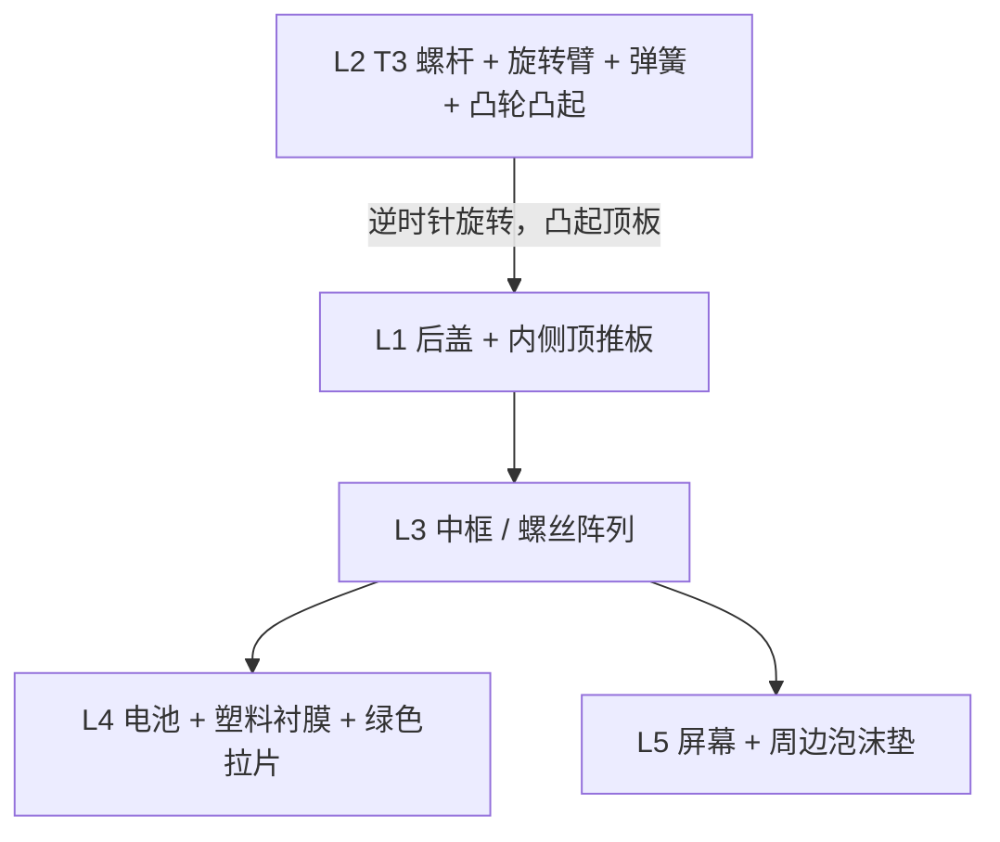

# HMD Skyline 螺杆凸轮顶开后盖与塑料衬膜取电池

> [!summary] 一句话概述
> HMD Skyline 在底边用一颗 T3 螺丝驱动内部旋转臂，凸轮凸起顶在后盖板上把一角顶开，再沿周边解开卡扣和轻度背胶；电池则靠内置塑料衬膜向上拉开，而不用沿长度拉伸的拉片胶。

## 配图

![[附件/hmd-skyline-cam-pop.jpg]]
*图源：[iFixit《HMD Skyline Battery Replacement》](https://www.ifixit.com/Guide/HMD+Skyline+Battery+Replacement/173725) 打开后盖步骤；逆时针拧底边左侧 T3 螺丝后，后盖一角被顶起，露出可供撬片插入的缝*

![[附件/hmd-skyline-battery-liner.jpg]]
*图源：同上，分离电池胶步骤；右侧三条塑料片翻开并按住框架，左手抓住绿色中央拉片向上拉，使电池与胶层分离*

> 图片版权归原作者所有，仅作个人学习收藏；出处见文末「来源与核实记录」。

## 结构原理

> 本节所有数字只写来源里给出的；来源没有就写「来源未给出」，不估算、不换算成看似精确的值。

### 堆叠方案

方向：**从后盖向外到屏幕**（电池朝上放置、后盖朝上拆解）

| 层级 | 零件 | 材料 | 厚度/尺寸 | 固定方式 | 依据 |
| --- | --- | --- | --- | --- | --- |
| L1（最外，背面） | 后盖（含无线充电线圈） | 来源未给出后盖基材 | 来源未给出 | 周边卡扣 + 用于密封的背胶；左下角内侧有被凸轮顶推的板 | iFixit 新闻；官方维修手册 / iFixit 指南「Separate the back cover」 |
| L2 | 螺杆凸轮机构 | 来源未给出 | 来源未给出 | 底边一颗 T3 螺丝驱动旋转臂，弹簧在释放后把臂拉回，凸轮凸起顶在后盖板上 | iFixit 新闻；HMD 官方新闻稿 |
| L3 | 中框与内部组件 | 来源未给出 | 屏幕固定螺丝在官方屏幕更换章节写为 13 颗、长 4.9 mm 的 T3，颜色或色调与其他螺丝不同 | 电池连接器盖等另有 T3 螺丝 | 官方维修手册「Remove the screen screws」；电池指南 |
| L4 | 电池 + 内置塑料衬膜 | 锂离子电池；衬膜为塑料 | 来源未给出 | 电池仍胶粘在槽内，但有可手拉的塑料衬膜；绿色中央拉片向上拉以分离胶层 | iFixit 新闻；电池指南 Step「Separate the battery adhesive」 |
| L5（正面） | 屏幕 | 来源未给出面板类型（官方/新闻另述显示规格，与本结构无关） | 来源未给出 | 背面拆掉指定螺丝并断开排线后，屏幕从正面落下；周边用泡沫垫协助保持 IP54 | iFixit 新闻；官方手册屏幕更换章节 |

剖面示意：

### 零件清单

| 零件 | 数量 | 功能 | 材料 | 依据 |
| --- | --- | --- | --- | --- |
| 底边凸轮驱动螺丝 | 1（左下 / 底边左侧） | 旋转驱动凸轮臂，顶开后盖一角 | 来源未给出材质；工具为 T3 Torx | iFixit 新闻；官方手册 / 指南 |
| 螺杆驱动旋转臂、凸轮凸起、复位弹簧 | 来源未给出件号，作为一套机构描述 | 把旋转变成对后盖板的顶升，松手后弹簧拉回 | 来源未给出 | iFixit 新闻与 HMD 官方新闻稿（双方表述一致） |
| 后盖内侧被顶推的板 | 1 | 承受凸轮凸起的顶力，把后盖一角顶出缝 | 来源未给出 | 同上 |
| 后盖卡扣与背胶 | 沿周边 | 卡扣保持；背胶用于密封。iFixit 实测该胶较温和，无需加热即可撬开，装回时可重新卡合 | 来源未给出胶型 | iFixit 新闻 |
| 电池连接器盖螺丝 | 2 | 固定电池连接器盖 | 来源未给出；工具 T3 | 官方手册 / iFixit 电池指南 |
| 电池塑料衬膜与绿色中央拉片 | 电池自带 | 手拉分离电池与胶层，再从框架上揭下衬膜 | 塑料 | iFixit 新闻与电池指南 |
| 屏幕固定螺丝 | 13 | 从背面把屏幕锁在中框上 | 来源未给出材质；长度 4.9 mm，T3 | 官方维修手册屏幕更换章节 |
| 屏幕周边泡沫垫 | 1 圈 | 协助安装并帮助维持 IP54 | 泡沫 | iFixit 新闻 |

### 装配顺序

按拆解顺序反推（后盖与电池；屏幕路径另见官方手册）：

1. 电池电量放到 25% 以下，断电并拔掉线缆（官方手册 / iFixit 指南安全步骤）。
2. 后盖朝上，用 T3 螺丝刀把底边螺丝**逆时针**拧到后盖一角弹起；不要把工具插入后盖面板下方的假缝，而要插到中框与后盖内侧之间。
3. 从左下角插入撬片，沿周边滑开卡扣并分离背胶，取下后盖。装新后盖前揭净内侧离型膜，把无线充电线圈上方的小排线按到定位柱上，再把底边螺丝顺时针旋回，合盖并沿周边压回卡扣。
4. 卸下电池连接器盖的两颗 T3 螺丝，小心翻开电池上的石墨片，撬开盖的卡扣，断开电池压接连接器。
5. 从电池右侧揭起三条塑料片，向外翻并按住框架；抓住绿色中央拉片竖直向上拉，使胶层分离，把电池翻到机身左侧，再从框架上揭下塑料膜，取走电池和衬膜。
6. 铲除并清理旧胶（必要时用浓度高于 90% 的异丙醇），按白色标记贴新胶，揭离型膜后接上连接器再把电池压入槽内。

> 官方维修手册与 iFixit 指南步骤一致。HMD 与 iFixit 有合作，零件和指南通过 iFixit、Gsmnet 提供。

### 受力与运动分析

- **受力路径**：日常使用时后盖由周边卡扣和背胶保持；凸轮机构在锁紧位置不承担后盖的主保持（推断：新闻写装回后「可靠地重新卡合」，打开动作才靠凸轮顶升）。电池日常由胶层承担。
- **运动关系**：拧螺丝使旋转臂转动，凸轮凸起顶在后盖板上，把后盖一角顶起一条可供撬片进入的缝；弹簧在释放后把臂拉回。电池衬膜是向上揭离，不是沿电池长度方向把胶带拉出（与拉伸释放胶条不同）。
- **失效风险**：撬片插错到面板下方的假缝会损伤后盖；插入电池连接器盖过深可能意外断开后摄压接件。衬膜或拉片老化、胶过强时需要持续稳定拉力。iFixit 仍认为「完全免胶、硬壳卡入」的电池得分更高，本方案更换后仍要清胶、贴新胶。

## 设计要点与参数

| 要点 | 内容 | 依据 |
| --- | --- | --- |
| 打开后盖的第一动作 | 逆时针拧底边一颗 T3 螺丝，直到后盖一角弹起 | 官方手册 / iFixit 指南；新闻 |
| 凸轮机构 | 螺杆驱动旋转臂，带把臂拉回的弹簧；凸轮凸起顶在后盖板上 | iFixit 新闻；HMD 官方新闻稿 |
| 后盖胶 | 用于水密；iFixit 称足够温和，无需加热即可撬开并再卡回去 | iFixit 新闻 |
| 防护等级 | 屏幕周边泡沫垫帮助维持 IP54；新闻指出若要在维修后尽量保持防护，后盖背胶可能仍需重贴 | iFixit 新闻 |
| 屏幕螺丝 | 13 颗、长 4.9 mm 的 T3，颜色或色调与其余螺丝不同，便于辨认 | 官方维修手册；新闻补充「颜色与中框相配」 |
| 取电池 | 绿色中央拉片向上拉，不是沿长度拉伸颈缩 | 官方手册 / iFixit 指南 |
| 安全与准备 | 电池电量低于 25% 再拆 | 官方手册 / iFixit 指南 |
| 官方零件 | 在选定市场可通过 iFixit 或 Gsmnet 购买备件、工具和指南；HMD 称使用原厂零件、工具和指南的自行维修视为授权维修，不影响有限保修 | HMD Self-repair 页 |
| 可维修评分 | iFixit 智能手机量表 9/10 | iFixit 新闻 |
| 凸轮升程、弹簧力、背胶剥离力 | 来源未给出 | — |

## 优缺点

**优点**
- 外观仍是一块齐平后盖，打开起点却被一颗整合进底边的螺丝明确标出
- 凸轮只负责「先开一条缝」，后续仍用卡扣+轻度胶，避免整圈强胶硬撬
- 屏幕从背面卸彩色螺丝后可由正面落下，周边用泡沫垫而不是再上一圈结构胶
- 电池衬膜把「有胶固定」和「可手拉分离」结合起来，官方和 iFixit 都提供步骤与零件

**缺点 / 代价**
- 后盖仍有背胶，完全恢复原有防护可能要重贴
- 电池仍要清残胶、贴新胶，不是硬壳卡入或螺丝压板
- 自拍与按键等路径新闻认为并不特别优化，仍要拆到较深
- 凸轮和顶推板增加了内部零件；其升程与耐久次数来源未给出

## 可借鉴点

- 需要齐平外观又要可修时，可以用「一颗螺杆凸轮先顶开一角」代替在缝里盲目找切入点
- 凸轮顶的是后盖上的专用板，而不是直接顶易碎的外表面（按新闻描述）
- 把维修用螺丝做成与其他螺丝不同的颜色或色调，降低拆错钉的概率
- 若电池必须用胶，优先做「衬膜+手拉分离」并控制胶的强度，使其不必加热；同时不要把它写成拉伸释放拉片胶
- 官方零件和公开指南要一起提供，结构才真正可修

## 与库中相似案例对比

| 对比项 | 本案例（HMD Skyline） | [[Fairphone 5 卡扣后盖与免胶可换电池]] | [[Fairphone 6 螺丝模块化（屏、电池、摄像头、USB-C）]] | [[苹果 iPhone 14 双面可开：中框承力与前后两道密封]] |
| --- | --- | --- | --- | --- |
| 打开后盖的第一动作 | 一颗 T3 螺丝驱动凸轮顶起一角，再滑开卡扣和轻度背胶 | 卡扣后盖，不是螺杆凸轮 | 螺丝模块化，重点在可换模组而不是凸轮顶盖 | 从屏侧和后盖侧都可以打开，中框承力 |
| 电池固定 | 有胶，但用内置塑料衬膜向上拉开 | 免胶可换 | 螺丝模块化电池（见该篇，不把参数抄到本篇） | 该篇重点不是电池胶 |
| 是否做成摄像头模块化 | 后摄在主板暴露侧，便于接触，但本篇不把它写成 Fairphone 式摄像头模组 | 模块化思路不同 | 明确的螺丝模块化摄像头 | 不是模块化手机 |
| 分类取舍 | 06：整机进入路径（凸轮顶盖 + 衬膜电池） | 06：免胶可换电池与卡扣后盖 | 06：更多模组的螺丝模块化 | 06：双面可开与密封 |

## 相关案例

- [[Fairphone 5 卡扣后盖与免胶可换电池]]
- [[Fairphone 6 螺丝模块化（屏、电池、摄像头、USB-C）]]
- [[苹果 iPhone 14 双面可开：中框承力与前后两道密封]]
- [[拉伸释放电池胶：沿长度方向拉出颈缩失粘，避免弯折电芯]]
- 分类索引：[[06-拆解与可维修 索引]]

## 来源与核实记录

- 主来源：[HMD Skyline: A New Twist on Repairable Smartphone Design](https://www.ifixit.com/News/97701/hmd-skyline-a-new-twist-on-repairable-smartphone-design)（2024-07-18，Carsten Frauenheim，with Jeff Suovanen / iFixit）
- 补充来源 1：[HMD Skyline: More than a pretty face](https://www.hmd.com/en_int/press/hmd-skyline-more-than-a-pretty-face)（2024-07-18，HMD / Human Mobile Devices 新闻稿；凸轮、弹簧、顶推板与「拧一颗螺丝打开后盖」的表述与 iFixit 新闻一致）
- 补充来源 2：[HMD Skyline Repair Guide PDF](https://www.hmd.com/assets/wcfotm6rrl7u/6q56dUxK9mYVex3VFsI2sj/f531c34dac1ffa0a68f51267e39ff6f4/HMD_Skyline_-_Repair_Guide.pdf)（托管于 HMD 官网的官方维修手册，2024-10-03 生成；含后盖、电池、屏幕、充电板。屏幕章节写明 13 颗 4.9 mm T3 螺丝）
- 补充来源 3：[HMD Skyline Battery Replacement](https://www.ifixit.com/Guide/HMD+Skyline+Battery+Replacement/173725)（iFixit 指南，Spencer Day；通过 API 核对步骤与配图）
- 补充来源 4：[HMD making self-repair simpler](https://www.hmd.com/en_gb/self-repair)（官方自修说明：零件与指南来自 iFixit 或 Gsmnet，以及授权维修与保修的说明）
- 核实：2026-11-22 打开 iFixit 新闻与 HMD 新闻稿核对凸轮机构（螺杆、旋转臂、弹簧、凸轮凸起、后盖板）；下载并阅读官方 66 页维修手册中的后盖、电池与屏幕章节；用 iFixit API 核对照片中的 T3 顶盖和绿色拉片。本篇电池路径写的是衬膜上拉，没有把拉伸释放胶的角度或 iPhone 16 电解脱粘参数写进来。
