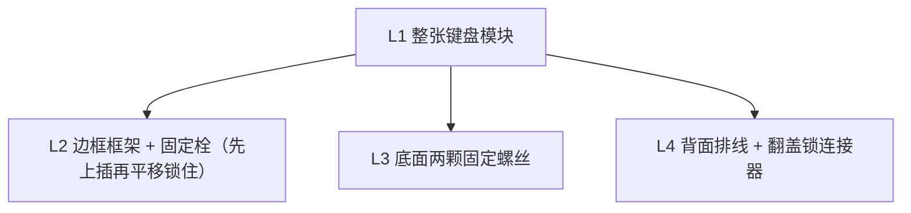

# ThinkPad T480 整张键盘作为可选服务 CRU：两颗螺丝滑出后拔排线

> [!summary] 一句话概述
> ThinkPad T480 把整张键盘当作客户可更换部件：从底面拧松两颗固定螺丝，在键面把键盘推向屏幕方向以松开边框里的固定栓，翻起后再拔掉背面的排线，无需拆每一颗键帽机构。

## 配图

![[附件/thinkpad-t480-ug-keyboard-steps.jpg]]
*图源：联想《T480 用户指南》中文版「更换键盘」章节（印刷页约 112–113）；上图为底面两颗键盘固定螺丝及拧松示意，下图为向屏幕方向推动以松开固定栓*

![[附件/thinkpad-t480-keyboard-slide.jpg]]
*图源：[iFixit《Lenovo ThinkPad T480 Keyboard Replacement》](https://www.ifixit.com/Guide/Lenovo+ThinkPad+T480+Keyboard+Replacement/140096)；双手把整张键盘推向屏幕并滑出，键盘仍通过排线连在机内*

![[附件/thinkpad-t480-keyboard-zif.jpg]]
*图源：同上；键盘翻到掌托上，背面可见两条排线，其中一条已插入带翻盖锁的连接器*

> 图片版权归原作者所有，仅作个人学习收藏；出处见文末「来源与核实记录」。

## 结构原理

> 本节所有数字只写来源里给出的；来源没有就写「来源未给出」，不估算、不换算成看似精确的值。

### 堆叠方案

方向：**从键帽向下到掌托内部的连接器**（拆前先卸可拆卸电池，并按手册禁用内置电池）

| 层级 | 零件 | 材料 | 厚度/尺寸 | 固定方式 | 依据 |
| --- | --- | --- | --- | --- | --- |
| L1 | 整张键盘模块（键帽与内部键机构已组装在键盘框架上） | 来源未给出 | 来源未给出 | 作为一件 CRU 整体拆装，不在本工序拆键帽 | 用户指南「更换键盘」；iFixit 指南 |
| L2 | 键盘边框 / 掌托上的固定栓与框架 | 来源未给出 | 来源未给出 | 键盘顶部边缘插入边框框架之下，固定栓在滑动到位后钩住键盘框架 | 用户指南安装步骤 2–3 |
| L3 | 两颗键盘固定螺丝 | 来源未给出规格 | 来源未给出长度；位于底面、与电池仓平行（iFixit 用语） | 从计算机底部拧入，把键盘锁在机身上；拆卸时「拧松」 | 用户指南步骤 5；iFixit Step「loosen the two screws」 |
| L4 | 键盘背面排线与连接器 | 来源未给出线材 | 用户指南称「接口」，未写数量；iFixit 写明两条 ribbon 连接器，用拨片翻开锁后再抽线 | 翻盖式排线锁（ZIF 一类），不是焊接 | iFixit 步骤 4–5；用户指南步骤 8「拔下接口」 |

剖面示意：

### 零件清单

| 零件 | 数量 | 功能 | 材料 | 依据 |
| --- | --- | --- | --- | --- |
| 键盘组件 | 1（整张） | 输入模块，含键帽机构和排线 | 来源未给出 | 用户指南将其列为「可选服务 CRU」 |
| 固定螺丝 | 2 | 从底部把键盘锁在机身 | 来源未给出 | 用户指南；iFixit |
| 固定栓 / 键盘边框框架 | 来源未给出数量 | 限制键盘在平面内的位置，滑动后锁住或松开 | 来源未给出 | 用户指南步骤 6、安装步骤 2–3 |
| 排线连接器 | 用户指南未写数量；iFixit 写 2 条 | 把键盘电信号接到主板一侧，可打开锁后抽线 | 来源未给出 | 用户指南「拔下接口」；iFixit |
| 可拆卸电池 | 1 | 拆键盘前先卸下，使底面螺丝可操作并切断外置电源 | 来源未给出 | 用户指南步骤 4；iFixit 前置步骤 |

### 装配顺序

用户指南「要安装新键盘」：

1. 先接上接口，再把键盘翻转回正面。
2. 把键盘插入键盘边框，确保靠近显示屏的顶部边缘位于边框框架之下。
3. 按图示方向推动键盘，使固定栓扣在键盘框架下方。
4. 合上显示屏，翻转机器，拧紧那两颗螺丝。
5. 装回可拆卸电池，再接通电源线。

拆卸（用户指南，iFixit 与之对应）：禁用内置电池并关机、断电 → 合盖翻转 → 卸可拆卸电池 → 拧松两颗键盘螺丝 → 翻回来打开屏幕，沿图示方向用力推，从边框松开固定栓 → 略微向上旋转再把键盘翻到掌托上 → 拔下接口后取走键盘。iFixit 补充：不要撕扯仍连着的排线；用拨片先翻开连接器锁再抽线。

> 开始前用户指南要求先禁用快速启动，再在 ThinkPad Setup 的 Config → Power 中选择 Disable Built-in Battery。

### 受力与运动分析

- **受力路径**：两颗底面螺丝把键盘压向机身；固定栓和边框框架限制键盘在平面内滑出。日常敲击载荷由键盘模块自身的键机构承担，再经框架和螺丝传到掌托，不必为修一块键而拆整机主板。
- **运动关系**：松开螺丝后，键盘仍被固定栓挡住，必须先向屏幕方向平移才能脱离边框，再向上翻起。排线在翻起后才暴露，打开翻盖锁才能抽出。安装是相反的平移：先让顶边进入框架下方，再推回去让固定栓重新扣住，最后拧螺丝。
- **失效风险**：未拔线就强行掀起键盘会拉伤排线（iFixit 明确提醒）。固定栓未完全入位就拧螺丝，顶边可能没有压到框架下（推断，依据安装步骤强调「确保顶边在框架之下」）。用户指南把键盘定为「可选服务 CRU」，即面向较高技能的客户，不是最简单的自助服务 CRU。

## 设计要点与参数

| 要点 | 内容 | 依据 |
| --- | --- | --- |
| 维修单元 | 整张键盘作为一件可选服务 CRU，由联想把 CRU 发给客户并可要求退回旧件 | 用户指南第 9 章「客户可更换部件」 |
| 螺丝数量与位置 | 两颗，从计算机底部拧松 / 拧紧；iFixit 写其与电池仓平行 | 用户指南；iFixit |
| 解锁动作 | 向屏幕方向推，松开边框上的固定栓 | 用户指南步骤 6 与插图 |
| 电连接 | 翻到掌托上再拔接口；iFixit 观察为两条排线、翻盖锁 | 用户指南步骤 8；iFixit 步骤 4–5 |
| 安装对位 | 顶边先进入边框框架之下，再推移使固定栓扣住 | 用户指南安装步骤 2–3 |
| 前置安全 | 禁用内置电池，卸可拆卸电池，断开交流电源 | 用户指南 |
| 螺丝规格、行程、排线间距 | 来源未给出 | — |
| iFixit 列出的配件号 | 指南配件栏写有 Lenovo ThinkPad T480 Keyboard - 01HX419 等；官方用户指南未给出 FRU 料号，本篇不以照片标签补写官方料号 | iFixit 指南 parts 栏 |

## 优缺点

**优点**
- 换键盘不必拆键帽、剪刀脚或整件掌托上盖，维修单元与损坏件一致
- 只需两颗螺丝加一次滑动，从键面即可取出，工具要求低
- 排线可开合，避免把输入组件焊在主板上
- 官方中文步骤带插图，并纳入 CRU 政策

**缺点 / 代价**
- 仍要先处理电池（禁用内置电池、卸可拆卸电池），不是热插拔输入件
- 列为可选服务 CRU，步骤和防静电要求高于电源线、小红帽等自助服务 CRU
- 两条排线在翻起过程中容易被拉伤，必须先开锁再抽线
- 用户指南未给出螺丝规格和官方料号，现场仍需对照机器与备件渠道

## 可借鉴点

- 把「整张键盘」而不是「每一颗键」定义为更换单元，并在外壳上用少量螺丝 + 滑移卡栓实现可逆拆装
- 先让顶边藏进框架，再平移锁栓，比只有垂直卡扣更不容易在敲击中自行脱出（推断，依据安装顺序）
- 电连接放在翻起后才能碰到的背面，并用翻盖锁而不是焊接，才能真正做到整张更换
- 在说明书里把该类部件标成 CRU，并写清拆前断电、禁用内置电池，避免只在内部维修手册里出现

## 与库中相似案例对比

| 对比项 | 本案例（T480 整张键盘 CRU） | [[16 英寸 MacBook Pro 剪刀脚键盘：1 mm 键程与交叉支架（对照蝶式）]] | [[Framework 笔记本模块化扩展卡与磁吸边框]] | [[Cherry MX 机械键盘轴：轴心、螺旋弹簧与金交叉触点]] |
| --- | --- | --- | --- | --- |
| 维修单元 | 整张键盘模块 | 键帽下方的剪刀脚机构本身，不是把整张键盘当一块 FRU 来写 | 扩展卡与磁吸边框，不是本篇这种整张键盘滑出 | 单颗轴的内部结构 |
| 固定 | 两颗底面螺丝 + 边框固定栓，平移解锁 | 该篇讨论键程与支架，不描述整张键盘拆法 | 磁吸 / 模块插接（见该篇） | 轴与板的固定不在本篇范围 |
| 电连接 | 背面排线 + 可打开的翻盖锁 | 该篇不以此为结构点 | 扩展卡电连接，结构不同 | 轴内触点 |
| 分类取舍 | 06：把输入件做成可更换模块 | 04：键机构运动 | 06 / 该篇已有定位：模块化扩展与边框 | 04：轴内部 |

## 相关案例

- [[16 英寸 MacBook Pro 剪刀脚键盘：1 mm 键程与交叉支架（对照蝶式）]]
- [[Framework 笔记本模块化扩展卡与磁吸边框]]
- [[FPC 翻盖锁扣连接器：IRISO 三类锁与 Hirose FH12 前翻盖 ZIF]]
- [[Cherry MX 机械键盘轴：轴心、螺旋弹簧与金交叉触点]]
- 分类索引：[[06-拆解与可维修 索引]]

## 来源与核实记录

- 主来源：[ThinkPad T480 用户指南（中文）](https://download.lenovo.com/pccbbs/mobiles_pdf/t480_ug_zh-cn.pdf)（© 2018 Lenovo；PDF 生成信息为 2018-02-26 / 2018-03-19。第 9 章：键盘列为可选服务 CRU，印刷页 112–116 为拆装步骤与插图）
- 补充来源：[Lenovo ThinkPad T480 Keyboard Replacement](https://www.ifixit.com/Guide/Lenovo+ThinkPad+T480+Keyboard+Replacement/140096)（iFixit 指南，Sarah Westberg；发布记录为 2021-04-12。核对两颗螺丝位置、向屏幕推移、两条排线及翻盖锁）
- 核实：2026-11-22 完整下载并阅读中文用户指南「更换键盘」全文与插图，交叉打开 iFixit 指南 API 与配图。联想 Hardware Maintenance Manual 英文版因传输中断未能得到完整 PDF，未引用 HMM 中的 FRU 表。未把 MacBook 键机构或 Framework 磁吸输入件写成同一结构。
