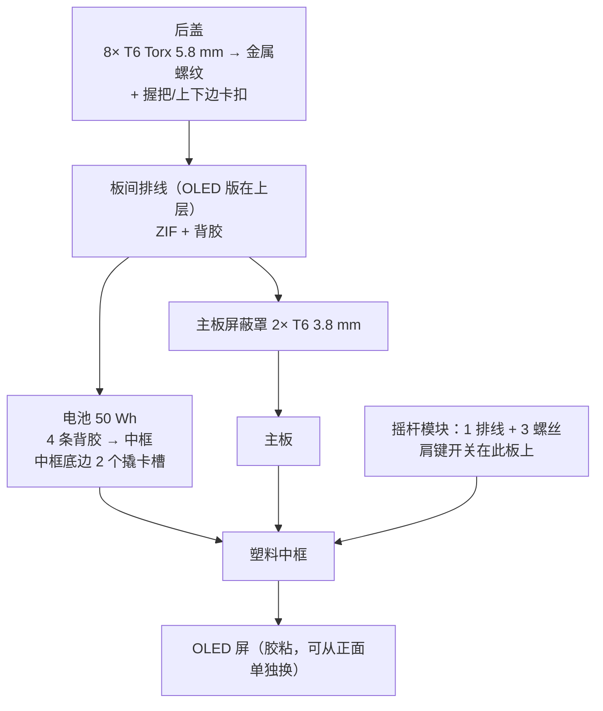

# Valve Steam Deck OLED 可维修改版：金属螺纹柱、T6 Torx 与电池撬卡槽

> [!summary] 一句话概述
> Steam Deck OLED 是一个难得的「代际可维修改版」样本。Valve 官方改动清单写明：后壳螺丝全部改 Torx，并**拧进金属螺纹**（LCD 版是塑料螺纹，反复拆装会滑牙）；减少螺丝种类和常见维修步数；肩键开关从按键小板移到摇杆板；换屏不再需要拆后盖。iFixit 实拆补充：后盖 8 颗 T6 Torx、长 5.8 mm；板间排线从主板底下挪到电池和主板上方，不再在装散热罩时被压伤；电池仍用 4 条强力背胶，但中框底边开了两个撬卡槽。iFixit 可维修评分从 LCD 版的 7/10 升到 9/10。

## 配图

![[附件/sdoled-interconnect-cable-3gen.jpg]]
*图源：[iFixit News 86954](https://www.ifixit.com/News/86954/handheld-head-to-head-steam-deck-oled-v-legion-go)。前排 OLED 版的黑色板间排线在电池和主板上方；后排原版和中排改版 LCD 的白色排线塞在主板下面*

![[附件/sdoled-back-screws-t6.jpg]]
*图源：[iFixit 指南 168676 第 2 步](https://www.ifixit.com/Guide/Steam+Deck+OLED+Battery+Replacement/168676)：后盖 8 颗 T6 Torx（5.8 mm）*

![[附件/sdoled-battery-adhesive-strips.jpg]]
*图源：同上 第 18 步：电池底面 4 条长背胶的位置*

> 图片版权归原作者所有，仅作个人学习收藏；出处见文末「来源与核实记录」。

## 结构原理

> 本节数字只写来源里给出的；来源没有就写「来源未给出」。

### 堆叠方案

方向：**从背面（后盖）到正面（屏幕）**

| 层 | 零件 | 固定方式 | OLED 版变化 | 依据 |
| --- | --- | --- | --- | --- |
| 1 | 后盖 | 8 颗 T6 Torx（5.8 mm）+ 握把与上下边卡扣 | 螺丝头改 Torx，螺丝拧进金属螺纹 | iFixit 指南；Valve |
| 2 | 板间排线（左右按键板之间） | ZIF 连接器 + 背胶贴在电池和屏蔽罩上 | 从主板下面挪到上面 | iFixit 文章；指南 |
| 3 | 主板屏蔽罩 | 2 颗 T6 Torx（3.8 mm） | 来源未给出 | iFixit 指南 |
| 4 | 电池（50 Wh，LCD 版 40 Wh） | 4 条强力背胶粘在中框 | 胶量明显少于 LCD 版；中框底边开 2 个撬卡槽 | iFixit 文章；指南；Valve |
| 5 | 摇杆模块 | 1 根排线 + 3 颗螺丝 | 沿用 LCD 版易换设计；肩键开关移到摇杆板 | iFixit 文章；Valve |
| 6 | 中框（塑料） | — | 来源未给出 | iFixit 指南 |
| 7 | OLED 屏幕 | 胶粘，加热 + 撬片 + 吸盘拆下 | 换屏不再需要拆后盖；屏幕中间支撑较多，拆时不易碎 | Valve；iFixit 文章 |

剖面示意：

### 零件清单

| 零件 | 数量 | 规格 | 依据 |
| --- | --- | --- | --- |
| 后盖螺丝 | 8 | T6 Torx，长 5.8 mm | iFixit 指南 |
| 屏蔽罩螺丝 | 2 | T6 Torx，长 3.8 mm | iFixit 指南 |
| 后壳螺纹 | 8 处 | 金属螺纹（嵌件形式来源未给出） | Valve；iFixit 文章 |
| 电池 | 1 | 50 Wh（Valve），20%→80% 最快约 45 min | Valve |
| 电池背胶 | 4 条 | 长条强力胶 | iFixit 指南 |
| 撬卡槽 | 2 | 中框底边，一宽一窄 | iFixit 指南 |
| 摇杆模块固定螺丝 | 3 | 来源未给出 | iFixit 文章 |
| 整机重量 | — | 约 640 g（比 LCD 版轻约 5%） | Valve |

### 装配顺序

> 按 iFixit 换电池指南的拆解顺序（装配为逆序）：

1. 放电到 5% 以下，BIOS 进电池存储模式，**先拔 microSD 卡**（否则开后盖时可能把卡折断）。
2. 拆后盖 8 颗 T6 螺丝 → 撬片斜向上插入扳机附近，沿握把边滑动脱开卡扣 → 再划上下边 → 握住握把拉下后盖。
3. 拉电池排线拉片（直着往电池方向拉；排线较硬，可以左右晃着拉）。
4. 翻开右按键板 ZIF 锁扣拔板间排线（标 C-R）→ 把排线从屏蔽罩上分离，挪到电池上并用胶带固定。
5. 拆屏蔽罩 2 颗 T6（3.8 mm）→ 取下屏蔽罩 → 拔左侧 ZIF（C-L）→ 低角度把排线从电池上撕下。
6. 把挡住撬卡槽的两根天线拨开 → 用锡箔包住塑料中框 → 低温热风加热电池 1–3 min。
7. 两张切成长条、修圆角的塑料卡从两个卡槽插到电池下面切胶；卡住时滴一滴 90% 以上异丙醇（一次只滴一滴，多了会损坏屏幕）。
8. 用整张卡从底边撬起，每次保持 30 s；大块和小块电池不要撬得高低差太大，否则铝塑膜会从接缝撕裂。
9. 装配：清掉旧胶，按旧电池的位置贴 4 条新胶，压紧新电池。

### 受力与运动分析

- **螺纹磨损**：后盖是用户最常拆的件。塑料螺纹每次重拧都会削掉一点牙，金属螺纹承担反复装拆；Valve 官方说法是「拆装不影响结构完整性」。Torx 头部更不易滑丝。
- **排线挤压**：LCD 版板间排线在主板下面，装回散热罩时容易被夹伤或切断（iFixit 文章）；OLED 版改到上层，问题从布线上消除。
- **跌落**：肩键开关在跌落时受冲击，Valve 写「改进了肩键开关机构的跌落可靠性」，并把它移到可以单独买的摇杆板上（按键小板买不到新件）。
- **电池剥离**：背胶是面受力，从卡槽插卡切胶，是把剥离力集中在胶条端部；L 形电池两块高度差过大，接缝会受撕裂力（iFixit 指南）。

## 设计要点与参数

| 要点 | 参数 | 依据 |
| --- | --- | --- |
| 后盖螺丝 | 8 × T6 Torx，5.8 mm，金属螺纹 | iFixit 指南；Valve |
| 螺丝头 | 改 Torx，头部材料和几何也调整过，以降低滑丝风险 | Valve |
| 螺丝种类 | 全机减少（具体数量来源未给出） | Valve |
| 电池 | 40 → 50 Wh；续航多 30%–50% | Valve |
| 电池拆卸 | 4 条胶，2 个撬卡槽；仍需加热和撬，未用易拉胶 | iFixit 指南；文章 |
| 可维修评分 | LCD 7/10 → OLED 9/10（Legion Go 8/10） | iFixit 文章 |
| 不足 | USB-C 口和 microSD 卡槽焊在主板上 | iFixit 文章 |

## 优缺点

**优点**
- 最常拆的后盖做到「金属螺纹 + 统一 T6」
- 排线改走上层，拆装风险降低
- 易损件（摇杆、肩键）集中在可单独购买的模块上

**缺点**
- 电池仍是背胶，没有像 Legion Go 那样用易拉胶（iFixit 判这一轮 Legion Go 胜）
- 接口焊在主板上，磨损后要换主板
- iFixit 为 Valve 提供可维修性方案（文章已披露），评分有利益关联

## 可借鉴点

- **用户会反复拆的盖板，螺丝柱用金属螺纹**；只装一次的可以用塑料自攻
- **全机统一一种螺丝头**（这里是 T6），减少维修工具
- **易损件和不卖件分开**：把易坏的开关移到可单独购买的模块
- **排线不走在会被二次压合的零件下方**
- **胶粘电池至少留撬卡槽**；更好的做法是易拉胶
- **拆机防呆**：后盖开启路径会撞到 microSD 卡，应在结构上避开或在说明中提示

## 与库中相似案例对比

| 对比项 | Steam Deck OLED | [[Fairphone 5 卡扣后盖与免胶可换电池]] | [[苹果 iPhone 16 电解脱粘电池胶]] | [[苹果 iPhone 14 双面可开：中框承力与前后两道密封]] |
| --- | --- | --- | --- | --- |
| 电池固定 | 4 条背胶 + 撬卡槽 | 免胶 | 电解脱粘胶（通电剥离） | 该笔记未记录 |
| 后盖 | 8 颗 T6 + 卡扣，金属螺纹 | 卡扣 | 见该案例 | 2 颗 6.8 mm 五星螺丝（前后共用）+ 较弱背胶 + 卡扣 |
| 防水 | 来源未提 | 见该案例 | 见该案例 | 前后两道密封 |
| 差异 | 代际改版逐项改进，官方公开改动清单 | 从一开始就为维修设计 | 用胶的前提下降低拆卸难度 | 双面可开 |

## 相关案例

- [[Fairphone 5 卡扣后盖与免胶可换电池]]
- [[Framework 笔记本模块化扩展卡与磁吸边框]]
- [[苹果 iPhone 16 电解脱粘电池胶]]
- [[3D 打印件热熔铜螺母：孔径与拉拔力实测]]（金属螺纹嵌件的另一种做法）
- 分类索引：[[06-拆解与可维修 索引]]

## 来源与核实记录

- 主来源：[Handheld head-to-head: Steam Deck OLED v. Legion Go](https://www.ifixit.com/News/86954/handheld-head-to-head-steam-deck-oled-v-legion-go)（iFixit，Kevin O'Reilly，2023-11-22）
- 补充来源 1：[Steam Deck OLED Battery Replacement](https://www.ifixit.com/Guide/Steam+Deck+OLED+Battery+Replacement/168676)（iFixit 指南，Clay Eickemeyer，2024-02-27）
- 补充来源 2：[Steam Deck OLED 官方页面](https://www.steamdeck.com/en/oled)（Valve，「Easier to repair」与完整改动清单；独立来源）
- 补充来源 3：[Steam Deck Teardown](https://www.ifixit.com/Teardown/Steam+Deck+Teardown/148714)（iFixit，2022-03-25，LCD 版结论：只需一把十字螺丝刀，电池难拆）
- 核实：2026-11-13 打开全部来源核对。The Verge 同题报道转述 iFixit，不计作独立来源。
