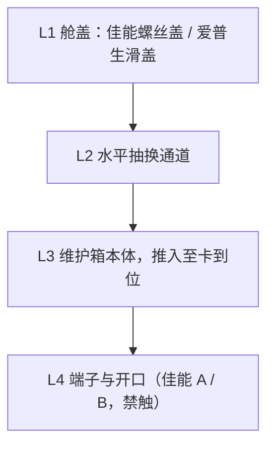

# 喷墨用户可更换维护箱：抽换定位、端子禁触与盖板锁紧

> [!summary] 一句话概述
> 喷墨机把废墨收集做成用户可抽出更换的维护箱（佳能称保养墨盒）：盒上有电气端子和开口，插入时靠平直推入直到卡入到位，外面再用盖板挡住。佳能 G3020 的 MC-G02 用螺丝固定带圆孔的盖，取出时先拉到止位再略提起；爱普生 L436X 的 T04D1 则免螺丝，盖子向右推出，靠盒上的三角标志定向插入。满了不换，打印机就会停机。

## 配图

![[附件/canon-mc-g02-terminals.jpg]]
*图源：[佳能 Inkjet 手册：G3020 series《更换保养墨盒》](https://ij.manual.canon/ij/webmanual/Manual/All/G3020%20series/SC/UG/ug-235.html) 官方插图；禁止触摸保养墨盒的端子（A）和开口（B）。*

![[附件/canon-g3020-maintenance-cover.jpg]]
*图源：同一页官方步骤插图；拧开保养墨盒盖（C）上的螺丝后，把手指放进盖上的圆孔，按箭头方向取下盖。盖住的是维护箱抽换通道。*

![[附件/canon-mc-g02-used-bag.jpg]]
*图源：同一页官方插图；用过的保养墨盒要立即放入新盒随附的塑料袋并系紧袋口，防止墨水泄漏。手册还提醒不要让取下的盒子掉落或平放在桌上，以免底部脏污或墨水溅出。*

> 图片版权归原作者所有，仅作个人学习收藏；出处见文末「来源与核实记录」。

## 结构原理

> 本节所有数字只写来源里给出的；来源没有就写「来源未给出」。佳能与爱普生是同一类「用户可抽换的废墨维护箱」，锁盖方式不同，参数不混用。

### 堆叠方案

方向：**从机外盖板到箱体插入通道（佳能 G3020 以机身侧/后部保养墨盒舱为例，手册图为侧向抽盖）。**

| 层级 | 零件 | 材料 | 厚度/尺寸 | 固定方式 | 依据 |
| --- | --- | --- | --- | --- | --- |
| L1（最外） | 保养墨盒盖 C（佳能）；维护箱盖（爱普生） | 未注明 | 来源未给出盖厚。佳能盖上有圆孔和背面凸出部 | 佳能：螺丝固定，顺时针拧紧；装盖时背面凸出部与打印机上的孔对齐。爱普生：用手向右轻推盖子，无需拧螺丝 | 佳能步骤 3、4、8、9；爱普生 FAQ 步骤 1 |
| L2 | 抽换通道 / 舱口 | 未注明 | 来源未给出通道尺寸。爱普生写明位于机身右侧下方 | 盖板打开后露出，供维护箱水平推入 | 佳能步骤 5–7；爱普生 FAQ |
| L3 | 维护箱 / 保养墨盒本体 | 未注明。佳能型号 MC-G02；爱普生编号 T04D1 | 来源未给出外形尺寸 | 佳能：平直插入直至卡入到位；取出时先拉出到位，再稍微提起后拉出。爱普生：参照盒上三角标志正确插入 | 佳能步骤 5–7；爱普生 FAQ 步骤 2 |
| L4（接口） | 端子 A 与开口 B（佳能明确标注） | 未注明 | 来源未给出端子节距 | 插入到位后与机内对应端接触；手册禁止用手触摸 | 佳能「重要事项」与官方插图。爱普生该 FAQ 未写端子名称 |

剖面示意：

### 零件清单

| 零件 | 数量 | 功能 | 材料 | 依据 |
| --- | --- | --- | --- | --- |
| 保养墨盒 / 维护箱 | 1 | 收集维护过程中的废墨；满了必须更换，否则机器停止 | 未注明。佳能 MC-G02；爱普生 T04D1 | 佳能开篇与订购型号；爱普生问题描述 |
| 端子 A | 佳能插图标注 | 电气接点，禁止触摸 | 未注明 | 佳能重要事项 |
| 开口 B | 佳能插图标注 | 开口，禁止触摸；手册未进一步命名其功能 | 未注明 | 同上 |
| 保养墨盒盖 C 与螺丝 | 盖 1，螺丝 1（佳能步骤 3、9） | 挡住舱口；螺丝锁紧 | 未注明 | 佳能步骤 3、4、8、9 |
| 盖上的圆孔 | 1 | 手指伸入以取下盖 | 未注明 | 步骤 4 |
| 盖背面凸出部 + 机上的孔 | 来源未给出只数 | 关盖时对位 | 未注明 | 步骤 8 |
| 随附塑料袋 | 1 | 把用过的盒子装入并系紧，防止泄漏 | 未注明 | 步骤 1、6 |
| 三角标志（爱普生） | 在新维护箱上 | 指示正确插入方向 | 未注明 | 爱普生 FAQ |
| 无边距打印废墨收集垫（对照，不可用户更换） | 爱普生写明存在此件 | 寿命到了用户无法自行更换，须联系认证服务机构 | 未注明 | 爱普生 FAQ 注意 |

### 装配顺序

佳能 G3020《更换保养墨盒》（官方步骤）：

1. 准备新的保养墨盒，从包装中取出盒子和随附塑料袋。
2. 关闭打印机。
3. 拧开保养墨盒盖（C）上的螺丝。
4. 将手指放在盖的圆孔上，取下盖。
5. 将保养墨盒拉出到位。
6. 稍微提起保养墨盒，再将其拉出。立即放入塑料袋并系紧；不要用手伸进打印机内；按当地法规弃置。不要让盒子掉落或放到桌面上，以免底部沾污或墨水溅出。
7. 平直插入新的保养墨盒，直至其卡入到位。
8. 将盖背面的凸出部分与打印机上的孔对齐，然后关闭盖。
9. 把螺丝插入螺丝孔，顺时针拧紧。
10. 开启打印机。

爱普生 L436X 官方 FAQ（另一种盖板，步骤更短）：

1. 无需拧螺丝，用手往右轻推出维护箱盖子，取下位于机身右侧下方的旧维护箱。
2. 参照新维护箱上的三角标志正确插入，再把盖子装回。

爱普生同一页注意：无边距打印废墨收集垫寿命到期时，用户不能自行更换。这与可抽换的 T04D1 维护箱不是同一件事。

### 受力与运动分析

- **受力路径**：抽出时沿水平通道拉盒子；佳能在「拉出到位」之后还要稍微提起，说明通道里有止位或挂钩，需要先解除再完全取出（手册没有给这个止位的名称和力值）。插入时沿同一通道平直推入，直到「卡入到位」。盖板的螺丝或滑盖只挡住舱口，并不代替盒子自身的卡入。来源未给出插拔力。
- **运动关系**：维护箱相对通道主要是水平抽插；佳能取出的后半段有一个轻微上抬。盖：佳能是先拧螺丝再沿圆孔取下，关上时用凸出部对孔；爱普生是盖子向右滑开。端子在插入到位后与机内接点相遇，但手册没有给出对位销的尺寸。
- **失效风险**：触摸端子或开口可能造成接触不良或弄脏（佳能禁止）。插入未卡到位就盖盖、开机，盒子可能不到位。用过的盒子若不装袋会漏墨。把「可换维护箱」和「不可换的废墨垫」搞混，会在爱普生提示无边距垫寿命时误拆机器。满盒不换，佳能写明将显示错误并且打印机停止工作。

## 设计要点与参数

| 要点 | 内容 | 依据 |
| --- | --- | --- |
| 结构本质 | 用户可抽出的废墨维护箱，插入卡到位，盖板封舱 | 两家官方步骤 |
| 佳能型号 | 保养墨盒 MC-G02 | 佳能订购说明 |
| 佳能禁触 | 端子 A、开口 B | 重要事项与插图 |
| 佳能取出 | 先拉出到位，再稍微提起后拉出 | 步骤 5–6 |
| 佳能插入 | 平直插入直至卡入到位 | 步骤 7 |
| 佳能盖板 | 螺丝 + 圆孔取盖；背面凸出部对孔后顺时针拧紧 | 步骤 3、4、8、9 |
| 佳能联锁 | 更换前关闭打印机，装好后再开启 | 步骤 2、10 |
| 爱普生型号 | 维护箱 T04D1 | 爱普生 FAQ |
| 爱普生盖板 | 免螺丝，向右轻推盖子；箱在机身右侧下方 | 同上 |
| 爱普生定向 | 按新箱上的三角标志插入 | 同上 |
| 对照：不可用户更换 | 爱普生无边距打印废墨收集垫，须由认证服务机构处理 | 爱普生 FAQ 注意 |
| 力值、尺寸、材料牌号 | 来源未给出 | 两家均未列 |

## 优缺点

**优点**
- 把会饱和的废墨从机器里做成可丢弃的盒子，用户不必打开机芯。
- 插入「卡入到位」和盖板对位（凸出部对孔，或三角标志）都是可检查的动作。
- 端子和开口被明确划为禁触区，减少手上油污和短路。
- 同一功能可以用螺丝盖或滑盖两种锁法：要工具防误开就用螺丝，要免工具就用滑盖。

**缺点 / 代价**
- 盒子满了不换就会停机，必须提前备件（佳能写：将满时立即获取新盒）。
- 废墨有泄漏风险，取出后必须立即装袋，也不能把脏盒子放在桌上。
- 并不是所有废墨相关零件都能用户更换，爱普生把无边距废墨垫排除在外。
- 来源没有给出插拔力和端子节距，设计仿制时不能靠猜测补数。

## 可借鉴点

- **先规定「什么能让用户换、什么必须送修」**：可抽的维护箱和不可换的废墨垫写在同一份说明里，避免用户拆错件。
- **抽插分两下比「一拉到底」更安全**：佳能的「先到止位，再略提起」适合箱内有残墨、需要先脱离挂钩的场合。
- **把手和盖做成不同的对位特征**：盒体用卡入到位，盖用凸出部对孔或三角标志，不要让一个斜插同时承担电接触和密封。
- **把禁触区画在盒子上并写进步骤**：端子和开口比一句「小心静电」更可执行。

## 与库中相似案例对比

| 对比项 | 本案例（可换维护箱） | [[Nano-SIM 针顶出托盘（Pin-eject）：外部顶针把客户自制托盘顶出]] | [[SD 与 microSD 推推式卡座：心形槽滑块与卡片当撞销]] | [[鼓粉分离：感光鼓与碳粉仓分件更换（对照传统鼓粉一体）]] |
| --- | --- | --- | --- | --- |
| 模块里装的是什么 | 废墨 | 用户的 SIM 卡 | 存储卡 | 碳粉 / 感光鼓 |
| 插入与锁紧 | 水平推入至卡入到位，外加螺丝盖或滑盖 | 托盘推进卡座，针顶出 | 推入后由心形槽保持 | 舱内导向或插槽，另有绿色锁定杆等 |
| 电气接口 | 佳能明确禁止触摸端子 A | 托盘上的卡触点，见该篇 | 卡触点 | 本篇硒鼓案例未把电触点作为主体 |
| 满/到位之后 | 满盒停机，必须换新，旧盒装袋 | 卡不到位则无法识别 | 推到底再推可弹出 | 粉尽或鼓尽分别提示 |
| 分类取舍 | 06：整机上的用户可维护耗材模块 | 卡座机构 | 04 / 推推机构 | 06，同类「分件耗材」，但介质和锁法不同 |

## 相关案例

- [[鼓粉分离：感光鼓与碳粉仓分件更换（对照传统鼓粉一体）]]
- [[Nano-SIM 针顶出托盘（Pin-eject）：外部顶针把客户自制托盘顶出]]
- [[SD 与 microSD 推推式卡座：心形槽滑块与卡片当撞销]]
- 分类索引：[[06-拆解与可维修 索引]]

## 来源与核实记录

- 主来源：[Canon : Inkjet 手册 : G3020 series : 更换保养墨盒](https://ij.manual.canon/ij/webmanual/Manual/All/G3020%20series/SC/UG/ug-235.html)（佳能官方中文手册，2026-11-22 打开。核对 MC-G02、端子 A 与开口 B、盖 C 螺丝与圆孔、拉出到位后再提起、平直插入至卡入到位、凸出部对孔、顺时针拧紧，并下载官方插图。）
- 补充来源：[L436X 系列如何更换维护箱 - 爱普生中国官方 FAQ](https://www.epson.com.cn/faq/533cc50f583140f5b5fc56ac942e38cb.html?productId=339d076156ee428796f8b5e96dbc70ae)（独立机构。核对 T04D1、免螺丝向右推盖、机身右侧下方、三角标志定向插入，以及无边距废墨收集垫不可用户更换。）
- 核实：2026-11-22 打开上述页面并保存手册插图。未编造插拔力或端子尺寸，也未把废墨垫写成可抽换维护箱。
