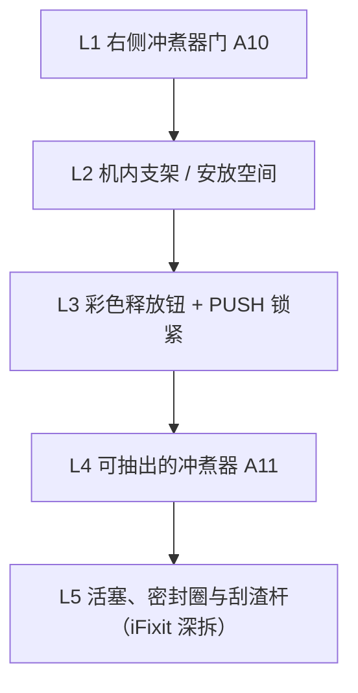

# 德龙全自动咖啡机可拆冲煮器：侧门抽出、彩色释放钮与 PUSH 锁紧

> [!summary] 一句话概述
> 德龙把冲煮器做成用户可整组抽出清洗的模块：关机并取下水箱后，打开右侧冲煮器门，同时向内按两只彩色释放钮，把冲煮器向外拉出；装回时沿机内支架推入，按下 PUSH 直到咔哒锁定，并确认两只彩色钮已经弹出。iFixit 在 Magnifica 上证明同一类组件还可以继续拆到活塞、密封圈和刮渣杆。它不是「记得清洗」的提示，而是一套带门锁、释放钮和推入锁紧的可拆结构。

## 配图

![[附件/delonghi-ecam22-parts-infuser.jpg]]
*图源：[德龙 ECAM22.110 使用说明书](https://dls.delonghigroup.com/files/docs/5/A1-57132C7759.pdf) 第 3 页官方部件图；A9 为水箱，A10 为右侧冲煮器门，A11 为正在从侧舱抽出的冲煮器。正文 4.1 节用同一编号命名。*

![[附件/delonghi-ecam22-infuser-removal.jpg]]
*图源：同一份说明书第 5 页图 29、图 30；图 29 打开右侧冲煮器门，图 30 在冲煮器两侧按释放位置向外拉出。图 30 上可见 PUSH 标识与两侧箭头。对应正文 15.9 节步骤 3–4。*

![[附件/ifixit-delonghi-infuser-push.jpg]]
*图源：[iFixit：DeLonghi Magnifica - Lubricate the brewing unit](https://www.ifixit.com/Guide/DeLonghi+Magnifica+-+Lubricate+the+brewing+unit/193629) 指南题图；插入端可见两侧红色释放拨杆、中央 PUSH，以及端部的圆形接口。官方说明书称彩色释放钮与 PUSH，但没有用文字给这些圆形接口命名，本篇不把它们写成已核实的阀型号。*

> 图片版权归原作者所有，仅作个人学习收藏；出处见文末「来源与核实记录」。

## 结构原理

> 本节所有数字只写来源里给出的；来源没有就写「来源未给出」。

### 堆叠方案

方向：**从机器右侧舱门到冲煮器插入端**。

| 层级 | 零件 | 材料 | 厚度/尺寸 | 固定方式 | 依据 |
| --- | --- | --- | --- | --- | --- |
| L1（最外） | 冲煮器门 A10 | 未注明 | 来源未给出 | 位于设备右侧，打开后才能接触冲煮器 | 说明书 4.1、15.9 步骤 3，图 29 |
| L2 | 机内支架 / 冲煮器安放空间 | 未注明 | 来源未给出导程和宽度。英文写 sliding it onto the internal support；中文写推入设备内部空间 | 冲煮器沿该支架推入 | 15.9 步骤 7，英文对应段，图 31 |
| L3 | 彩色释放钮（iFixit：两只红色拨杆）与 PUSH | 未注明 | 来源未给出钮的行程。装入后两只彩色钮须弹出（图 33） | 取出：两钮向内按，同时向外拉。锁紧：按 PUSH 直到咔哒到位 | 15.9 步骤 4、7、8；iFixit Step 1 |
| L4（可抽出的模块） | 冲煮器 A11 | 未注明壳体材料。iFixit：活塞带滤网（文中标为橙色）与橡胶密封圈 | 来源未给出外形尺寸。难装时按两个把手（图 32）使其恢复正确大小 | 整组抽出清洗，装回后由 PUSH 与弹出的释放钮保持 | 15.9；iFixit Steps 1–4 |
| L5（冲煮器内部，深拆才接触） | 活塞、夹箍、滤网、橡胶密封圈、刮渣杆与弹簧 | 密封圈为橡胶；润滑用食品级硅脂（iFixit 零件表） | 来源未给出直径 | 夹箍固定活塞；刮渣杆用轴上螺丝固定，弹簧一端入孔、一端入刮渣杆，并越过止动销 | iFixit Steps 2–6。官方 15.9 不要求用户拆到这一层 |

剖面示意：

### 零件清单

| 零件 | 数量 | 功能 | 材料 | 依据 |
| --- | --- | --- | --- | --- |
| 冲煮器门 A10 | 1 | 打开后露出冲煮器 | 未注明 | 说明书 4.1 |
| 冲煮器 A11 | 1 | 酿造组件，用户整组抽出清洗 | 未注明 | 4.1、15.9：至少每月清洁一次 |
| 水箱 A9 | 1 | 取出冲煮器前须先卸下 | 未注明 | 15.9 步骤 2、10 |
| 彩色释放钮 | 2 | 向内按才能向外拉出；装回后须弹出 | 未注明。iFixit 称为 two red levers / red latches | 15.9 步骤 4、8；iFixit Step 1、5 |
| PUSH | 1 | 推入后按到底，直到冲煮器确实固定 / clicks into place | 未注明 | 15.9 步骤 7；iFixit 题图可见标识 |
| 把手（难装时按压） | 2 | 插入前轻压两只把手，使冲煮器恢复正确大小 | 未注明 | 15.9 注意段，图 32 |
| 活塞、夹箍、滤网、橡胶密封圈 | 数量：iFixit 展示一套活塞组件 | 活塞运动与密封；夹箍（绿色标注）挡住活塞 | 橡胶密封圈；其余未注明 | iFixit Steps 2–4 |
| 刮渣杆、弹簧、止动销 | 刮渣杆 1，弹簧 1 | 刮除残渣；拆装时弹簧一端入孔，一端入刮渣杆，并越过止动销 | 未注明 | iFixit Step 6 |
| 圆形接口（照片可见） | 题图端部可见圆形管口 | 官方未命名；不作为已核实的水管/阀型号 | 未注明 | iFixit 题图；说明书未给该接口名称 |

### 装配顺序

按官方 15.9「清洁冲煮器」的拆装步骤（中文与英文对照）。机器启动时不可拿出冲煮器。

取出：

1. 确认设备已按第 7 节正确关闭。英文：须完成 shutdown procedure。不能在开机时抽出。
2. 卸下水箱 A9。
3. 打开位于设备右侧的冲煮器门 A10（图 29）。
4. 向内按压两个带颜色的按钮，同时将冲煮器向外拉出（图 30）。

清洗（官方范围）：

5. 不要用洗碗精，以免损坏冲煮器。将冲煮器浸泡在水中约 5 分钟，再在水龙头下冲洗干净。
6. 清洁设备内放置冲煮器的空间，清除咖啡残渣。

装回：

7. 将冲煮器重新推入内部空间，沿 internal support 滑入（英文；图 31），然后按下 PUSH 标志，直到冲煮器确实固定 / fully in until it clicks into place。
8. 若很难插入，先按图 32 的两个把手，使其恢复正确的大小，再插入。
9. 确认两只彩色按钮已经弹出（图 33）。
10. 关闭冲煮器门，将水箱放回。

iFixit 的深拆不是每月必做项：在已经按上述方法取出之后，才用刮刀松开夹箍、推出活塞并给橡胶圈上食品级脂；继续拆螺丝可取下刮渣杆。装回按相反顺序。官方 15.9 没有这些内部步骤，不能把深拆写成德龙要求用户必须做的保养。

### 受力与运动分析

- **受力路径**：抽出时手指把两只释放钮推向内侧，解除保持，再沿抽出方向拉冲煮器。装回时推力沿支架把组件送入，最后按 PUSH 直到咔哒；保持力来自该锁紧，而不是把门关紧。难装时先按两只把手改变组件外形，再推入，避免硬挤。来源未给出按压力或锁紧力的数值。
- **运动关系**：冲煮器相对机内支架是抽出/推入的直线移动。释放钮有按入与弹出两个位置，弹出表示已锁定（官方步骤 8）。冲煮器内部（iFixit）还有活塞相对框架的滑动，以及刮渣杆绕轴转动；那一层只在深拆时出现。水路如何在插入到位后接通，官方说明书没有用文字说明。
- **失效风险**：开机时强行抽出会违反官方「不可拿出」的限制。释放钮没有弹出却关门，等于没有锁紧。用洗碗精或洗碗机可能损坏冲煮器。iFixit 遇到的故障是活塞发紧，导致残渣不能正确落到渣盒、并出现异响，需要润滑活塞和密封圈。隐藏在咖啡出口下方的螺丝如果漏拆，就拆不下带红色锁的那一块（iFixit Step 5）。

## 设计要点与参数

| 要点 | 内容 | 依据 |
| --- | --- | --- |
| 结构本质 | 用户可整组抽出的冲煮模块，侧门 + 释放钮 + PUSH 锁紧 | 说明书 15.9 |
| 取出联锁 | 必须先正确关机；开机时不可取出 | 15.9「重要」 |
| 取出前还要卸下 | 水箱 A9 | 步骤 2 |
| 释放 | 两只彩色钮向内按，同时向外拉 | 步骤 4，图 30 |
| 装入 | 沿内部支架滑入，按 PUSH 直到咔哒 | 步骤 7，英文 sliding it onto the internal support |
| 到位确认 | 两只彩色钮必须弹出 | 步骤 8，图 33 |
| 外形复位 | 难装时按两只把手，恢复正确大小 | 注意段，图 32 |
| 清洗限制 | 至少每月一次；清水浸泡约 5 分钟；不用洗碗精 | 15.9 |
| 内部可拆件 | 活塞、夹箍、橡胶密封圈、刮渣杆与弹簧；食品级润滑脂 | iFixit。非官方每月必做项 |
| 水管/阀接口名称 | 来源未给出文字名称 | 不以照片推断代替官方命名 |

## 优缺点

**优点**
- 冲煮器作为一个完整模块，用户不必拆整机就能取出清洗，门、释放钮和 PUSH 形成明确的取出/锁紧动作。
- 到位有正反馈：咔哒，再加上两只彩色钮弹出，而不是只靠「感觉推到底」。
- 难装时用把手把组件收回到正确外形，比硬塞更能保护支架。
- 同一类组件在独立拆解里还可以继续分解到活塞和密封圈，方便处理官方「只冲洗外壳」解决不了的发紧问题。

**缺点 / 代价**
- 取出有联锁：关机流程没走完或水箱未卸下，操作会对不上官方步骤。
- 官方手册没有写清水路对接的具体密封结构，维修时不能只靠猜圆管口。
- 内部活塞和密封圈不在每月清洁步骤里，长期只冲洗外部，仍可能出现 iFixit 所写的活塞发紧。
- 释放钮、PUSH、把手都是塑料外观件，来源未给出力值和寿命。

## 可借鉴点

- **把「用户可拆模块」做成：门 → 解锁 → 抽出 → 推入 → 锁紧确认**：释放和 PUSH 分工，一侧负责解除保持，一侧负责推入锁死，并用「钮是否弹出」做目视检查。
- **用关机联锁避免在带压或运动中抽模块**：官方把「开机不可取出」写在第一步之前。
- **给难装情况准备一个「恢复外形」的动作**（两只把手），而不是让用户加大推力。
- **手册层与深拆层要分开写**：用户手册停在整组冲洗；活塞、密封圈和刮渣杆是另一层，需要独立来源才能写进去。

## 与库中相似案例对比

| 对比项 | 本案例（可拆冲煮器） | [[电动工具电池包：滑轨插入与按压锁舌（得伟拆解）]] | [[Framework Laptop 16 Expansion Bay 滑出式显卡模块]] | [[气动快插接头（SMC KQ2 一类）：卡爪咬管、密封圈密封，按解锁套后拔出]] |
| --- | --- | --- | --- | --- |
| 模块做什么 | 酿造咖啡的整组机械组件，取出是为了清洗 | 供电电池包 | 功能扩展模块 | 气管的可拆连接 |
| 解锁 | 两只彩色/红色释放钮向内按 | 按压锁舌 | 见该篇滑出锁，不套用本机释放钮 | 按解锁套 |
| 锁紧确认 | PUSH 至咔哒，且两钮弹出 | 锁舌落入 | 见该篇 | 卡爪咬管 |
| 流体接口 | 官方未命名；照片可见圆形接口 | 电触点，不是水管 | 电/结构接口 | 密封圈负责密封 |
| 分类取舍 | 06：整机上的用户可维护模块 | 02 / 滑轨锁 | 06，电脑模块 | 02，接头本身 |

## 相关案例

- [[电动工具电池包：滑轨插入与按压锁舌（得伟拆解）]]
- [[Framework Laptop 16 Expansion Bay 滑出式显卡模块]]
- [[气动快插接头（SMC KQ2 一类）：卡爪咬管、密封圈密封，按解锁套后拔出]]
- 分类索引：[[06-拆解与可维修 索引]]

## 来源与核实记录

- 主来源：[De’Longhi ECAM22.110 全自动义式咖啡机使用说明书（中英双语）](https://dls.delonghigroup.com/files/docs/5/A1-57132C7759.pdf)（德龙官方 PDF，文档编号 5413218631/04.15 见于手册页。2026-11-22 下载。核对第 3 页 A10/A11、第 9 页部件名称、第 15 页 15.9 节中文步骤与第 31 页英文对应段：internal support、coloured release buttons、PUSH、click、两只把手、浸泡约 5 分钟、不用洗碗精。）
- 补充来源：[DeLonghi Magnifica - Lubricate the brewing unit \| iFixit](https://www.ifixit.com/Guide/DeLonghi+Magnifica+-+Lubricate+the+brewing+unit/193629)（独立机构，Peter Scholl 等，页面显示 Last updated on May 5, 2026。核对：按两只红色拨杆取出；夹箍、活塞、橡胶密封圈、刮渣杆与弹簧。题图用于展示 PUSH 与红色拨杆的实物位置。）
- 核实：2026-11-22 打开并下载手册、抓取 iFixit 页面与题图。未把圆管口写成官方已命名的阀，也未把 iFixit 深拆写成德龙要求所有用户每月执行的步骤。
