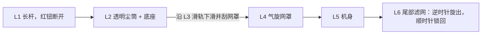

# 戴森 V11 集尘筒红色释放钮与可拆滤网：按下后尘筒沿滑轨下滑并打开底座，滤网逆时针旋出

> [!summary] 一句话概述
> 戴森 V11 的集尘筒套在机身的尘筒滑轨（bin runner）上：先按红色按钮脱开长杆，再握住机器让尘筒朝下，用力按到底红色释放钮，尘筒沿滑轨下滑、一边刮过气旋网罩，随后底座打开倒灰；要把整只尘筒取下来清洁时，再按滑轨上的红钮，把尘筒从滑轨上滑出。机身尾部的滤网单元则逆时针旋转解锁后取下，冷水清洗并至少阴干 24 小时，再顺时针转到锁定。

## 配图

![[附件/dyson-v11-emptying-clear-bin.jpg]]
*图源：[Dyson V11（SV14）英版用户手册 C97385，2018-11-22](https://www.dyson.se/content/dam/dyson/maintenance/user-guides/en_GB/vacuumcleaners/sticks/dysonv11stick/269232-01.pdf) 第 6 页 Emptying the clear bin；灰尘不得超过 MAX 标记，按下释放钮后尘筒打开倒灰，再把尘筒底座向上推到发出咔哒*

![[附件/dyson-v11-cleaning-filter.jpg]]
*图源：同上手册第 8 页 Cleaning the filter；步骤示意滤网从机身尾部取出、冷水冲洗、开口朝上晾至少 24 小时，完全干燥后再装回。湿滤网不得装机（图中打叉）*

![[附件/ifixit-dyson-v11-filter-twist.jpg]]
*图源：[iFixit: Dyson V11 Filter Replacement](https://www.ifixit.com/Guide/Dyson+V11+Filter+Replacement/165804)（Harry Cutts，2023-10-05 发布，2023-11-15 更新）；实物照片：扭转滤网后再把它滑下取下*

> 图片版权归原作者所有，仅作个人学习收藏；出处见文末「来源与核实记录」。

## 结构原理

> 本节所有数字只写来源里给出的；来源没有就写「来源未给出」，不估算、不换算成看似精确的值。

本篇写的是用户日常维护路径：尘筒如何从机身解锁、滤网如何取下和复位，以及密封/锁止发生在哪里。不是再写一个通用按压卡扣。

### 堆叠方案

方向：**从长杆/吸头端到机身尾部的滤网**

| 层级 | 零件 | 材料 | 厚度/尺寸 | 固定方式 | 依据 |
| --- | --- | --- | --- | --- | --- |
| L1（吸头端） | 长杆（wand） | 来源未给出 | 来源未给出 | 红色释放按钮断开长杆与集尘筒 | 戴森中国「清洁集尘筒和气旋」「清空集尘筒」；英版手册：press the red wand release button |
| L2 | 透明集尘筒（clear bin）与尘筒底座 | 来源未给出具体塑料牌号 | 筒上有 MAX 标记，尘垢达到该线即须清空，切勿填满 | 套在尘筒滑轨上；底座向上推入直到与筒体咔哒锁住 | 戴森中国页；英版手册 Closing / emptying |
| L3 | 红色尘筒释放按钮，位于尘筒滑轨（bin runner）上 | 来源未给出 | 来源未给出行程；须按到底，否则底座打不开 | 按下后尘筒沿滑轨下滑并打开底座；再按一次同一区域的红钮，可将尘筒从滑轨上滑下 | 戴森中国：用力按下红色释放按钮，集尘筒将向下滑动，并打开底座。英版手册：The bin will slide down, cleaning the shroud as it goes；Press the red button located on the bin runner to release the bin and slide the bin off the runner |
| L4 | 气旋与网罩（shroud / cyclone） | 来源未给出 | 来源未给出 | 固定在机身一侧；尘筒下滑时刮过网罩；取下尘筒后可轻拍气旋、用吸头清理网罩 | 戴森中国清洁气旋步骤；英版手册 cleaning the shroud |
| L5 | 机身（含电池与电机） | 来源未给出 | 来源未给出 | 尘筒与滤网都从机身可拆 | 支持页与手册整体结构 |
| L6（尾部） | 滤网单元（褶皱纸滤芯 + 泡沫滤芯） | 英版手册写 pleated paper element 与 foam element | 来源未给出外形尺寸 | 逆时针旋转解锁后取下；顺时针旋转直到锁定/咔哒 | 戴森中国清洗滤网页；英版手册 Washing the filter unit；iFixit：Twist the filter and then slide it off |

剖面示意：

密封面：打开过的来源没有给出密封圈截面或压缩率。能确定的锁止位置是：尘筒底座必须向上推到与筒体咔哒，底座才会关闭；滤网必须顺时针转到锁定。中国支持页写：「只有集尘筒组件被完全推入机器并卡入正确位置，集尘筒底座才会关闭。」英版手册写清洁尘筒只用湿布，尘筒不耐洗碗机，不建议用清洁剂、上光剂或空气清新剂，以免损坏器具。密封件的材料与是否可单独更换，来源未给出。

### 零件清单

| 零件 | 数量 | 功能 | 材料 | 依据 |
| --- | --- | --- | --- | --- |
| 长杆 | 1 | 延伸吸头，用红色释放钮与尘筒断开 | 来源未给出 | 戴森中国；英版手册 |
| 长杆红色释放按钮 | 1 | 把长杆从尘筒上解开 | 来源未给出 | 同上 |
| 透明集尘筒 | 1 | 容纳灰尘，可沿滑轨滑动并打开底座倒灰 | 来源未给出 | 同上 |
| 尘筒底座 | 1 | 关闭时形成筒底；向上推入至咔哒 | 来源未给出 | 英版手册 Close the clear bin… click into place |
| 尘筒滑轨与红色释放钮 | 1 套 | 导向尘筒，按到底后打开底座，并可把整只尘筒滑出 | 来源未给出 | 英版手册 bin runner |
| 气旋与网罩 | 1 | 分离灰尘；尘筒下滑时被刮扫 | 来源未给出 | 戴森中国；英版手册 shroud |
| 滤网单元 | 1 | 过滤排气；可拆下清洗 | 褶皱纸 + 泡沫（英版手册） | 戴森中国；英版手册 |
| MAX 标记 | 印在尘筒上 | 清空限值 | — | 戴森中国；英版手册 |

### 装配顺序

按官方维护步骤（清空与取下尘筒、拆洗滤网）。装回是原文给出的逆向/复位步骤。

**清空与取下尘筒**

1. 断开充电器。清空时不要扣动开机扳机。
2. 按下红色释放按钮，将长杆与集尘筒断开，取下长杆。
3. 握住机器，让集尘筒朝下，用力把红色释放按钮按到底。集尘筒沿滑轨向下滑动，并打开底座。中国页与英版手册都写：如果没有完全按下，底座不会打开。英版手册并写：下滑过程中会刮过网罩（cleaning the shroud as it goes）。
4. 为减少扬尘，可将透明尘筒连同开口套进防尘袋再清空（中国页与英版手册均有此提醒）。
5. 若要取下整只尘筒做清洁：按英版手册，先完成上述清空动作，再按尘筒滑轨上的红钮，把尘筒从滑轨上滑出。中国「清洁集尘筒和气旋」页写：按下集尘筒上的红色释放按钮，将集尘筒滑出取下。
6. 轻拍气旋，清理网罩与开口处的堵塞。清洁透明尘筒只用湿布。
7. 装回：把集尘筒重新卡入滑轨/插槽。只有组件被完全推入并卡到位，底座才会关闭。关闭底座的动作是把底座向上推，直到尘筒与底座咔哒锁住。

**拆洗滤网**

1. 逆时针旋转滤网装置以解锁，从主机上轻轻取下。iFixit 的独立表述是：扭转滤网，再把它滑下取下。
2. 先轻拍去除余尘。
3. 只用冷水，不用洗涤剂，不进洗碗机或洗衣机。英版手册要求先洗褶皱纸滤芯（泡沫朝下冲纸面），再洗泡沫（避免脏水流到纸面上），直到水流清澈；中国页同样要求先外后内、开口朝下冲洗至水清。
4. 轻轻拍掉多余水分，开口朝上，在通风处阴干至少 24 小时，完全干燥前不得装回。
5. 将滤网装回主机，顺时针旋转直到锁定到位（英版手册写 until it clicks into place）。

英版手册还建议至少每月清洗一次滤网，或在滤网维护指示灯亮起时清洗；吸细尘或主要使用加强模式时可能需要更勤洗。中国页有相同的使用强度提醒。

### 受力与运动分析

- **受力路径**：倒灰时用户按下红色释放钮，按钮解除尘筒在滑轨上的保持，尘筒在重力与滑轨导向下向下滑动，底座打开；复位时用手把底座和/或尘筒推回，咔哒锁克服开盖趋势。滤网靠旋转锁止保持在机尾，气流从尘筒、气旋到滤网。密封力的数值来源未给出。
- **运动关系**：尘筒相对滑轨作直线运动（下滑打开 / 上推关闭 / 整只滑出）。长杆与尘筒之间是另一只红色释放钮的分离。滤网相对机尾作旋转解锁/锁定，解锁后再轴向拉出。空载扳机在尘筒打开时不得扣动（官方安全句）。
- **失效风险**：红钮未按到底，底座打不开（官方原文）。尘筒未完全推回，底座不会关闭，可能漏尘（官方原文）。超 MAX 线继续吸，灰尘会碰到滤网，导致更频繁的滤网维护（英版手册）。滤网未干就装回，手册图示禁止。尘筒不耐洗碗机和清洁剂（英版手册）。

## 设计要点与参数

| 要点 | 内容 | 依据 |
| --- | --- | --- |
| 尘筒打开 | 尘筒朝下，红钮按到底，尘筒沿滑轨下滑并打开底座；未按到底则打不开 | 戴森中国清空/清洁页；英版手册 |
| 下滑兼清理 | 尘筒下滑时刮过气旋网罩 | 英版手册：cleaning the shroud as it goes |
| 整只尘筒可拆 | 再按滑轨上的红钮，把尘筒从滑轨上滑出 | 英版手册 bin runner 句；中国清洁页「滑出取下」 |
| 底座关闭 | 向上推到底座与筒体咔哒；且整只尘筒须完全推入机身卡到位，底座才会关闭 | 英版手册；戴森中国页 |
| 清空限值 | MAX 标记，切勿填满 | 戴森中国；英版手册 |
| 滤网拆装 | 逆时针旋转解锁后取下；顺时针旋转锁定（至咔哒） | 戴森中国；英版手册；iFixit 互证扭转后滑下 |
| 滤网结构 | 褶皱纸滤芯 + 泡沫滤芯，须按顺序冲洗以免脏水回流 | 英版手册 |
| 干燥 | 阴干至少 24 小时，完全干燥后再装 | 戴森中国；英版手册与第 8 页图示 |
| 清洗介质 | 只用冷水，不用洗涤剂，不进洗碗机/洗衣机 | 戴森中国；英版手册 |
| 清洗周期 | 至少每月一次，或在维护指示灯亮起时；细尘/加强模式可能更勤 | 英版手册；中国页有强度提醒 |
| 按钮行程、滑轨截面、密封压缩率 | 来源未给出 | — |

## 优缺点

**优点**
- 倒灰、拆筒、拆滤网都是用户徒手操作，维护路径短，不必开壳。
- 尘筒下滑同时刮过网罩，把「打开倒灰」和「清扫气旋」合成一个动作。
- 同一只红钮既用于打开底座，也可把整只尘筒从滑轨上卸下，结构件没有另做一套锁。
- 滤网给出了明确的旋转方向、清洗介质和 24 小时干燥要求。

**缺点 / 代价**
- 红钮必须按到底，行程和力值却没有对用户标出，只靠「按到底否则打不开」来约束。
- 密封结构在公开手册里几乎不画，维修时难以判断胶圈是否需要单独更换。
- 滤网干燥时间长（至少 24 小时），若只备一只滤网，当天不能连续使用。

## 可借鉴点

- 把可拆容器做在滑轨上：按压解锁后先让容器沿导轨移动并打开，而不是整件掉下来；需要深度清洁时，再沿同一滑轨把容器完全滑出。
- 让打开动作顺便刮扫需要经常清理的网罩，减少单独拆气旋的次数。
- 关闭条件写成两个同时满足：容器已推入到位，底座也已咔哒。只关底座但容器没插到位，不允许看起来像已锁好。
- 滤网用旋转锁而不是仅靠摩擦拔插，并在图上禁止「未干装回」。
- 用 MAX 线给出清空判据，并写明超线会连累滤网。

## 与库中相似案例对比

| 对比项 | 本案例（V11 尘筒滑轨 + 可拆滤网） | [[Fairphone 5 卡扣后盖与免胶可换电池]] | [[GoPro 快拆卡扣与指旋螺母：两爪弹性卡入和螺钉夹紧是两套锁]] | [[Nifco 经典心形槽 Push-Push：U 形销与片簧（对照 ITW 防变形版）]] |
| --- | --- | --- | --- | --- |
| 要解决的问题 | 日常倒灰、洗滤网、偶尔拆筒清洁 | 打开后盖换电池 | 相机快拆 | 按压弹跳锁 |
| 主运动 | 尘筒沿滑轨直线滑动并开底座；滤网旋转锁 | 卡扣后盖 | 两爪卡入或螺钉夹紧 | 心形槽滑块 |
| 是否只是又一个按压卡扣 | 不是：要写清滑轨、刮网罩、底座咔哒和滤网旋锁这条维护路径 | 后盖卡扣，无尘筒滑轨 | 主题 6 已有快拆，结构不同 | 主题 6 已有，不承担倒灰路径 |
| 密封 | 官方要求推到位才关闭底座，截面参数未给出 | 该案例范围内的密封另述 | 与本篇无关 | 与本篇无关 |

## 相关案例

- [[Fairphone 5 卡扣后盖与免胶可换电池]]
- [[GoPro 快拆卡扣与指旋螺母：两爪弹性卡入和螺钉夹紧是两套锁]]
- [[Nifco 经典心形槽 Push-Push：U 形销与片簧（对照 ITW 防变形版）]]
- [[Framework Desktop 免工具面板与标准件模块化]]
- 分类索引：[[06-拆解与可维修 索引]]

## 来源与核实记录

- 主来源：[戴森中国：V11 Fluffy 清洁集尘筒和气旋](https://support.dyson.cn/support/sv14/dyson-v11-fluffy/maintaining-your-dyson/cleaning-the-bin-and-cyclone)（2026-11-22 打开。断开充电器、红钮取下长杆、尘筒朝下按到底红钮下滑并打开底座、再按红钮把尘筒滑出、清洁气旋、装回须完全推入卡到位底座才会关闭、MAX 标记）
- 补充来源 1：[戴森中国：清洗滤网](https://support.dyson.cn/support/sv14/dyson-v11-fluffy/maintaining-your-dyson/washing-the-filter-sbs)、[清空集尘筒 - 步骤](https://support.dyson.cn/support/sv14/dyson-v11-fluffy/troubleshooting/visible-issue/filter-blocking-frequently/emptying-the-bin-step-by-step-1)（同属戴森。逆时针取滤网、冷水冲洗、阴干至少 24 小时、顺时针锁回；清空步骤与未按到底则底座不开）
- 补充来源 2：[Dyson V11 SV14 英版用户手册 C97385（2018-11-22）](https://www.dyson.se/content/dam/dyson/maintenance/user-guides/en_GB/vacuumcleaners/sticks/dysonv11stick/269232-01.pdf)（同属戴森。尘筒下滑刮过网罩、bin runner 红钮把尘筒滑出、底座上推至咔哒、褶皱纸+泡沫滤芯的冲洗顺序、24 小时干燥、每月或按指示灯清洗、尘筒不可进洗碗机）
- 补充来源 3：[iFixit: Dyson V11 Filter Replacement](https://www.ifixit.com/Guide/Dyson+V11+Filter+Replacement/165804)（Harry Cutts；2023-10-05 发布，2023-11-15 更新。独立第二机构。步骤：Twist the filter and then slide it off to remove it。只用于互证滤网扭转取出，不把该指南没有写到的尘筒滑轨细节算在 iFixit 头上）
- 核实：2026-11-22 打开戴森中国三个支持页，下载英版 SV14 手册并抽出第 6、8 页插图，打开 iFixit 指南并下载指南照片。戴森美国/香港手册 CDN 本次传输不完整，未引用。新西兰支持页核对了与中国页一致的清空步骤，同属戴森，不另计机构。
