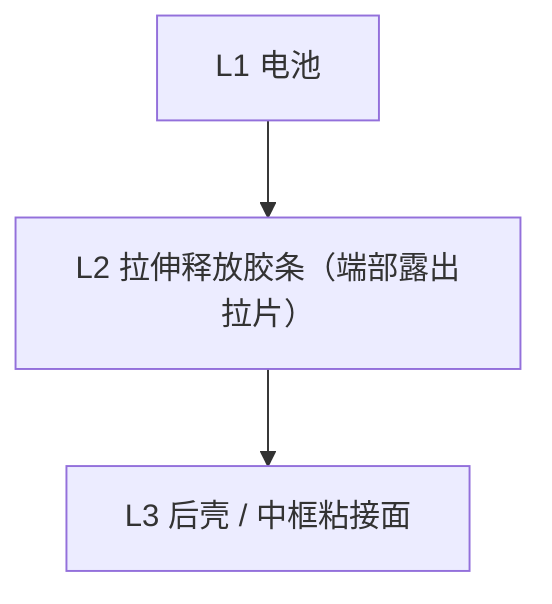

# 拉伸释放电池胶：沿长度方向拉出颈缩失粘，避免弯折电芯

> [!summary] 一句话概述
> 把高伸长、高内聚强度的压敏胶带夹在电池和壳体之间，维修时沿长度方向以低速、小角度拉开，胶带被拉长变薄后从界面脱开，从而在尽量不撬、不弯折电芯的前提下取出电池。

## 配图

![[附件/iphone13-stretch-release-tabs.jpg]]
*图源：[iFixit《iPhone 13 Battery Replacement》](https://www.ifixit.com/Guide/iPhone+13+Battery+Replacement/145896) Step「Locate the adhesive pull-tabs」；电池上下两端共四条拉伸释放胶，黑色拉片贴在电池边缘（图中红框）*

![[附件/iphone13-stretch-release-pull.jpg]]
*图源：同上，拉胶条步骤；用手抓住底部拉片，朝手机底边方向低角度缓慢拉伸，胶条保持平整*

> 图片版权归原作者所有，仅作个人学习收藏；出处见文末「来源与核实记录」。

## 结构原理

> 本节所有数字只写来源里给出的；来源没有就写「来源未给出」，不估算、不换算成看似精确的值。

### 堆叠方案

方向：**从电池上表面向下到后壳**（以 iPhone 13 为例；须先按该机指南打开屏幕并断开电池连接器）

| 层级 | 零件 | 材料 | 厚度/尺寸 | 固定方式 | 依据 |
| --- | --- | --- | --- | --- | --- |
| L1 | 电池 | 锂离子电池 | 来源未给出 | 由下方四条拉伸释放胶固定 | iFixit iPhone 13 指南「Locate the adhesive pull-tabs」 |
| L2 | 拉伸释放胶条（两条在电池底边，两条在顶边） | 可拉伸压敏胶（具体牌号该指南未给出） | 来源未给出 | 双面粘接电池与后壳；端部有黑色拉片，轻粘在电池边缘 | 同上；3M 中国文将「手机、平板电脑中的电池固定」列为可拉伸移除典型应用 |
| L3 | 后壳内侧（部分机型在电池下方还有无线充电线圈，胶条需绕开） | 来源未给出 | 来源未给出 | 作为胶条的另一粘接面 | iFixit 电池胶条安装指南简介（iPhone 8 至 14 等矩形电池） |

剖面示意：

### 零件清单

| 零件 | 数量 | 功能 | 材料 | 依据 |
| --- | --- | --- | --- | --- |
| 拉伸释放胶条 | iPhone 13 为 4 条 | 日常固定电池；沿长度拉伸后失粘，便于取出 | 可拉伸压敏胶 | iFixit iPhone 13 指南；3M 中国文 |
| 黑色拉片（胶条端部） | 每条 1 个 | 供手指或钝镊子抓住并引导拉伸方向 | 来源未给出 | iFixit iPhone 13 指南 |
| 离型膜 / 保护膜（更换用新胶条） | 安装指南描述有蓝色、粉色、橙色等保护膜 | 保护胶面，对位后再揭除 | 来源未给出具体材质 | iFixit《iPhone 电池胶条的更换》 |
| 3M 可拉伸移除胶带（厂商代表产品） | 按设计裁切 | 电池等部件的可拆粘接 | 3M 写明代表产品为 VHB 挤出式胶带、6657/SR76 系列等 | 3M 中国文「可拉伸移除方案」 |

### 装配顺序

按拆解顺序反推（iPhone 13 更换电池；安装新胶条见 iFixit 胶条指南）：

1. 在电芯背面按定位贴好胶条：两组黑色突耳均匀伸出电池两边，两条较短胶条靠近电池排线；贴上后不可再揭下重定位。
2. 揭除端部保护膜，把突耳折到电池两端并压实。
3. 将电池放入机内对位，接上电池排线以帮助定位，再揭掉最后一层大片保护膜，按压电池上下两端使胶条粘到后壳。

拆卸（iFixit iPhone 13 指南）：先断开电池连接器；必要时按该指南卸扬声器以降低胶条拉断风险。揭起黑色拉片，沿长度朝手机底部方向缓慢拉伸，保持胶条平整、低角度，不要向下按压电池。若胶条在电池下方断裂且无法取出，在断胶处滴入浓度 90% 或以上的异丙醇，约 1 分钟后再用撬片平端轻抬，不得刺破或弯折电池。

> 若来源只给了拆解顺序，装配步骤已按上述安装指南与拆解步骤对照写出。

### 受力与运动分析

- **受力路径**：日常使用时，电池的保持力来自胶条两面与电芯、壳体之间的压敏粘接。
- **运动关系**：维修时把胶带沿自身长度方向拉伸。3M 中国文写明：胶带须有极高的伸长率和足够的内聚强度；从一个角以低速、低角度（通常建议小于 30 度）缓慢拉伸，胶带被拉长、变薄，最终从粘接界面分离，而不会断裂或残留。iFixit 将该类胶条称为 “command-strip style”，并写明「拉伸后失去粘性」，要求拉条时保持扁平、不要起皱，并低角度牵引以免挂住电池边缘。
- **失效风险**：胶条在电池下方被拉断后，剩余段难以取出，往往需要溶剂辅助，并增加撬动电芯的风险。iFixit 提醒不要用尖工具戳电池。3M 强调内聚强度必须足够，否则胶带会在拉伸中断裂而不是整条脱出（推断：这是「高内聚 + 高伸长」同时出现的原因）。

## 设计要点与参数

| 要点 | 内容 | 依据 |
| --- | --- | --- |
| 拉伸角度与速度 | 低速、低角度；3M 通常建议小于 30 度 | 3M 中国文「可拉伸移除方案 / 工作原理」 |
| 材料要求 | 极高伸长率，且内聚强度足够，拉伸时不拉断、不残胶 | 同上 |
| 工具与化学 | 无需加热或溶剂即可拆；对敏感元件友好 | 同上「方案优点」 |
| iPhone 13 胶条布置 | 四条：电池底边两条、顶边两条；端部黑色拉片轻粘在电池边缘 | iFixit iPhone 13 指南 |
| 拉伸方向 | 朝手机底部方向拉，保持张力但不要强拽，给胶条时间伸长脱粘 | 同上拉胶步骤 |
| 胶条断裂后的补救 | 浓度 90% 或以上异丙醇，等待约 1 分钟，再用平端轻抬 | 同上「How to remove a stuck battery」 |
| 胶带厚度、剥离强度、伸长率数值 | 来源未给出（本次未打开 3M 产品数据表） | — |
| 与电拆解、热拆解的区分 | 3M 同期还介绍了热拆解（例如加热到 70–100°C 使一侧粘性下降）和电拆解胶带；本篇只写拉伸移除，不把那些参数挪到拉片胶上 | 3M 中国文其余方案；对照库中 iPhone 16 电解脱粘 |

## 优缺点

**优点**
- 电池可以胶粘固定以抵抗跌落和满充膨胀，又不必在维修时大力撬电芯
- 拆解不依赖加热或化学品（胶条顺利拉出时）
- 拉片预留在电池边缘，维修路径明确

**缺点 / 代价**
- 胶条容易在狭缝中被拉断，尤其是绕过无线充电线圈或被扬声器挡住时；断裂后仍可能要用酒精和撬动
- 拉伸方向、角度和胶条平整度都有操作要求，角度过大容易挂边
- 胶条一般一次性，更换电池必须贴新胶；对位错误不能重贴（iFixit 胶条指南）
- 拉伸所需的空间取决于胶条长度，结构上要为拉出路径留出方向

## 可借鉴点

- 需要「平时粘得住、维修时不伤电芯」时，优先考虑沿长度拉伸失粘，而不是在电芯侧面下撬
- 把拉片折到电池边缘并轻度预粘，保证第一下就能抓住整条胶宽
- 在设计说明书里写清：低角度、低速、保持胶条扁平；并规定胶条断裂后的补救，避免维修者改用螺丝刀撬电池
- 胶条路径要避开线圈、扬声器等凸起，或为绕行预留宽度；不要指望一条又宽又短的胶带能顺利拉出
- 不要把电解脱粘或热脱粘的电压、温度参数套用到拉伸胶上，三者解除粘接的机制不同

## 与库中相似案例对比

| 对比项 | 本案例（拉伸释放 / 拉片胶） | [[苹果 iPhone 16 电解脱粘电池胶]] | [[苹果 AirPods Pro 全胶粘封装（反面案例）]] | [[Fairphone 5 卡扣后盖与免胶可换电池]] |
| --- | --- | --- | --- | --- |
| 解除方式 | 沿胶带长度拉伸，胶层颈缩失粘 | 在导电片与接地螺丝间通电，界面电化学脱开 | 几乎不可逆的胶包，没有按需脱粘路径 | 不用胶固定电池，靠螺丝 / 卡扣 |
| 是否需要电源或加热 | 顺利拉出时不需要 | 需要直流电源（该篇所写电压与时间仅适用于该胶，不得套用到本篇） | 通常要破坏性拆解 | 螺丝刀等常规工具 |
| 对电芯的主要风险 | 胶条拉断后改撬，可能弯折或刺破电池 | 接线短路、极性接反导致残胶位置变化 | 拆解本身容易损伤电池与外壳 | 相对低，但仍需按手册断开连接器 |
| 分类取舍 | 06：把胶粘做成可维修拆卸工艺 | 06：同属可按需解除的胶，但机理是电解不是拉伸 | 06 反面案例：胶粘导致不可修 | 06：免胶可换，结构完全不同 |

## 相关案例

- [[苹果 iPhone 16 电解脱粘电池胶]]
- [[苹果 AirPods Pro 全胶粘封装（反面案例）]]
- [[Fairphone 5 卡扣后盖与免胶可换电池]]
- [[微软 Surface Laptop 超声波点焊与 Alcantara 覆面（反面案例）]]
- 分类索引：[[06-拆解与可维修 索引]]

## 来源与核实记录

- 主来源：[3M胶粘专家讲堂 \| 重塑粘接生态链：深度解析压敏胶4大拆解方案](https://www.3m.com.cn/3M/zh_CN/bonding-and-assembly-cn/bonding_news/pressure-sensitive-adhesive/)（2025-12-04，3M 中国 / 3M 粘接技术应用专家王工）
- 核实：2026-11-22 打开 3M 中国原页，核对可拉伸移除的原理（高伸长、足够内聚、低速、通常小于 30 度）、代表产品名称与「手机、平板电脑中的电池固定」应用；未把同页热拆解、电拆解的温度或电压写入本篇。交叉打开 iFixit《iPhone 13 Battery Replacement》全文胶条步骤与配图（四条胶、黑色拉片、低角度拉伸、90% 异丙醇约 1 分钟），以及中文《iPhone 电池胶条的更换》核对新胶条贴法和离型膜顺序。3M 英文产品目录 PDF 本次请求返回 403，未引用其中的厚度或伸长率数字。
