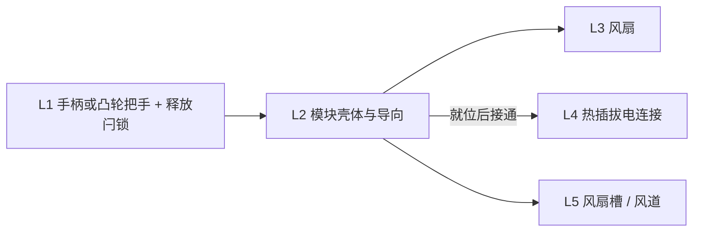

# 热插拔风扇模块：快拆手柄或凸轮把手与运行中更换

> [!summary] 一句话概述
> 热插拔风扇把风扇做成带导向的独立模块，用免工具手柄或凸轮把手保持在机箱里，电连接随模块插拔一起完成。设备可以在运行时更换故障风扇，但来源各自规定了必须装回的时间，超时会过热甚至关机。它和热插拔电源一样是「按锁、抽模块」，可是运载的是冷却气流，锁的形式和允许空槽的时限都不能从电源篇照抄。

## 配图

![[附件/lenovo-sr950-hotswap-fan-remove.jpg]]
*图源：联想 ThinkSystem SR950《卸下风扇》图 1，https://pubs.lenovo.com/sr950/zh-CN/remove_the_fan；步骤 1 朝服务器中心向内按风扇手柄以松开滑锁，再把风扇向前拉出一半；步骤 2 将风扇完全拉出。正文写明风扇通过铰链连到手柄，卸下时风扇会向下翻倒。*

![[附件/netapp-fas8300-fan-cam-handle.jpg]]
*图源：NetApp《热插拔 FAS8300 或 FAS8700 系统中的风扇模块》插图，https://docs.netapp.com/zh-cn/ontap-systems/fas8300/fan-swap-out.html；图注 1 风扇手柄，2 锁定卡舌，3 风扇，4 状态 LED。步骤是向下按凸轮把手上的释放闩锁，再向下旋转凸轮把手，然后把模块竖直拉出。*

## 结构原理

> 本节所有数字只写来源里给出的；来源没有就写「来源未给出」，不估算、不换算成看似精确的值。

### 堆叠方案

按「从操作者一侧到机内风道」写。两家的模块朝向不同：联想 SR950 的风扇从机器前部方向拉出；NetApp 页要求把模块从机箱中竖直拉出。不要把两种抽出方向画成同一条路径。

| 层级 | 零件 | 材料 | 厚度/尺寸 | 固定方式 | 依据 |
| --- | --- | --- | --- | --- | --- |
| L1（最外） | 风扇手柄（NetApp 同时称为凸轮把手 / 风扇手柄）及释放件 | 未注明 | 来源未给出手柄长度或转角 | 联想：朝服务器中心向内按手柄以松开滑锁。NetApp：向下按凸轮把手上的释放闩锁，再向下旋转凸轮把手 | 联想卸下步骤 1；NetApp 步骤 4–5、9 |
| L2 | 风扇模块壳体与导向 | 未注明 | NetApp 提醒「风扇模块较短」，须用空闲的手托住底部。其余外形尺寸来源未给出 | 沿机箱开口滑入、滑出 | NetApp 步骤 5 注意、步骤 7 |
| L3 | 风扇（NetApp 图注单独标出「风扇」） | 未注明 | 转速、风量、功率来源未给出 | 装在模块内，随模块一起更换；联想：风扇与手柄铰接，卸下时向下翻倒 | 联想正文；NetApp 图注 3 |
| L4 | 电连接（随模块插拔） | 未注明 | 来源未给出连接器型号或针数 | 模块完全就位后接通；两家都没有要求另外插线 | 由「热插拔、就位后 LED 变化」的步骤推出其存在；连接器细节来源未给出，故不编造 |
| L5（最内） | 机箱风扇槽及风道 | 未注明 | 来源未给出槽深 | 模块推入至完全固定。NetApp：完全就位后凸轮把手会略微升高，再向上旋转到闭合位置，释放闩锁卡入锁定 | 联想「所有风扇必须均已安装」；NetApp 步骤 7–9 |

剖面示意：

### 零件清单

| 零件 | 数量 | 功能 | 材料 | 依据 |
| --- | --- | --- | --- | --- |
| 风扇模块 | 联想页按所卸的那一只操作，未给出整机风扇总数。NetApp 用 Fan#_# 编号（第一个数字是插槽，第二个数字是行，1=顶部，2=底部），例如插槽 1 第二行 = Fan1_2 | 提供该风道的冷却，可整只更换 | 未注明 | 联想卸下页；NetApp 步骤 3 |
| 风扇手柄 / 凸轮把手 | 每模块 1 个（按插图） | 解锁、抽插；NetApp 的凸轮把手还把模块推入并锁在机箱里 | 未注明 | 两家步骤与插图 |
| 滑锁或锁定卡舌 / 释放闩锁 | 来源未给出尺寸 | 保持手柄闭合；按下后才能抽出或旋转凸轮 | 未注明 | 联想「松开滑锁」；NetApp 图注 2「锁定卡舌」、步骤 4「释放闩锁」 |
| 铰链（联想 SR950） | 来源未给出 | 把风扇连到手柄上，卸下时风扇向下翻倒 | 未注明 | 联想卸下页正文 |
| 状态 / 注意 LED | NetApp 图注 4「状态 LED」 | 定位故障风扇；就位并加速后熄灭 | 未注明 | NetApp 步骤 3、9 |
| 挡板（NetApp） | 1 | 盖住前部；从机箱框架球形螺柱上拉脱，装回时再推到螺柱上 | 未注明 | NetApp 步骤 2、10 |

### 装配顺序

卸下（联想 ThinkSystem SR950；风扇是热插拔设备，可在服务器开机的情况下卸下）：

1. 先卸下正面外盖。
2. 朝服务器中心向内按风扇手柄以松开滑锁，把风扇向前拉出一半，等待 10 秒。
3. 再向前拉，把风扇从服务器中完全拉出。风扇与手柄铰接，卸下时会向下翻倒。
4. 为保持系统散热，操作过程中所有风扇必须均已安装到服务器中。

热插拔（NetApp FAS8300 或 FAS8700；可在不中断服务的情况下进行）。该页用警告框写明：必须在将风扇模块从机箱中卸下后两分钟内更换；系统气流中断，控制器模块或模块在两分钟后关闭，以避免过热。

1. 若尚未接地，先正确接地。
2. 如有必要，用两只手抓住挡板两侧开口，拉向自己，直到挡板从机箱框架上的球形螺柱上松开。
3. 根据控制台错误消息和各风扇模块上的警示 LED，确定要更换的模块；也可用 BMC 消息，编号规则见上表。
4. 向下按风扇模块凸轮把手上的释放闩锁，再向下旋转凸轮把手。此时风扇模块会稍微远离机箱。
5. 把风扇模块从机箱中竖直拉出，并用空闲的手托住底部，防止它突然摆出。该页强调模块较短，须始终托住底部以免受伤。
6. 将替代模块与开口对齐后滑入机箱，用力推凸轮把手使其完全固定；完全就位后凸轮把手会略微升高。
7. 把凸轮把手向上旋转到闭合位置，确认释放闩锁卡入锁定位置。注意 LED 在风扇就位并加速到运行速度后关闭。
8. 将挡板与球形螺柱对齐后轻轻推入。

> 两家给出的时间窗口不同，只各自有效：联想是拉出一半后等待 10 秒再完全取出；NetApp 是完全取出后必须在两分钟内装回。不要把其中一个数字写到另一台机器上。也打开过联想 DM600S 磁盘架风扇页（同属联想，不另计机构），该页写「务请确保在 30 分钟内卸下并更换风扇模块」，同样不能套用到 SR950 或 FAS8300。

### 受力与运动分析

- **受力路径**：抽出力作用在手柄或凸轮把手上。联想先向内按手柄松开滑锁，再沿抽出方向拉模块。NetApp 先按释放闩锁并向下旋转凸轮把手，模块会稍微离开机箱，这一段是凸轮把手在把模块向外推离；然后再竖直抽出。装回时，NetApp 明确用凸轮把手把模块推到完全固定，再把把手转到闭合位置锁住。来源未给出锁紧力或风压载荷数值。
- **运动关系**：模块相对风扇槽主要是沿导向滑动（联想向前，NetApp 竖直，按各自插图）。手柄相对模块：联想有铰接，卸下后风扇可向下翻；NetApp 凸轮把手有旋转开合。电连接随就位接通、随抽出断开，行程细节来源未给出。
- **失效风险**：来源共同强调的是冷却中断。NetApp 把后果写死：两分钟后控制器关闭以防过热。联想要求操作过程中所有风扇都装在服务器里，并警告附近有危险的活动扇叶，不要用手指或身体其他部位接触。NetApp 另提醒模块短、会摆出，托不住会伤人。推断（来源未测）：手柄未锁到位时，振动中模块可能松脱，风量和电连接都会受影响。

## 设计要点与参数

| 要点 | 内容 | 依据 |
| --- | --- | --- |
| 可否在运行中更换 | 联想：风扇是热插拔设备，可在服务器开机的情况下卸下。NetApp：可热插拔而不中断服务 | 两家开篇与注意 |
| 释放动作 | 联想：向内按手柄松开滑锁。NetApp：按凸轮把手上的释放闩锁并向下旋转把手 | 联想步骤 1；NetApp 步骤 4 |
| 分步抽出 | 联想：先拉出一半，等待 10 秒，再完全拉出 | 联想步骤 1–2 |
| 装回时限 | NetApp：从机箱取出后两分钟内必须更换，否则控制器关闭。联想 SR950 本页未给出同等的「取出后 xx 分钟」数字，只要求所有风扇均已安装 | NetApp 警告框；联想「为保持系统散热…」 |
| 就位反馈 | NetApp：凸轮把手完全就位会略微升高；闩锁卡入；注意 LED 在风扇加速后关闭 | NetApp 步骤 8–9 |
| 铰接 | 联想：风扇通过铰链连到手柄，卸下时向下翻倒 | 联想正文 |
| 挡板固定 | NetApp：球形螺柱 | NetApp 步骤 2、10 |
| 风扇转速、风量、连接器针数、凸轮转角 | 来源未给出 | — |

## 优缺点

**优点**
- 风扇做成模块后，运行中即可更换，不必先拆系统板或停机到完全断电（以各手册允许的条件为准）。
- 手柄或凸轮把手把解锁、抽插和保持做在同一零件上，现场不需要螺丝刀。
- 用 LED 和编号定位故障风扇，减少拔错槽。
- 来源把「允许短时间空槽」和「超时会关机」写进警告，比只写「尽快」更可执行（以 NetApp 两分钟为例）。

**缺点 / 代价**
- 空出风扇位会立刻削弱冷却，时限很短，备件必须事先在手边。
- 活动扇叶有夹伤风险；模块短时还会向外摆动。
- 各机型的手柄运动（向内按、向下旋转凸轮、先抽一半等）不能混用。
- 电连接细节在已打开的手册里写得很少，排障时难以只靠本页判断是插头还是扇叶故障。

## 可借鉴点

- 设计运行中可换的风扇时，必须同时设计导向、免工具保持，以及「取出后多久必须装回」的时限，并写清超时后果（过热告警还是直接关机）。
- 凸轮把手适合把最后一段推入和锁止做在同一个旋转动作里（NetApp：旋转后模块稍稍离开，反向旋转再锁住）；按压式手柄则更适合侧面空间紧、主要靠直线抽出的布置（联想 SR950）。
- 先抽一半再等待，给转速下降留出时间，再完全取出，可降低带转扇叶伤人和气流突变。是否采用，只按该机型手册。
- 短模块一定要在说明书里要求托住底部，不要只画一个拉出箭头。
- 不要把电源篇的「等灯变绿再拔另一只」或硬盘篇的空槽两分钟，直接写成风扇规则。

## 与库中相似案例对比

| 对比项 | 本案例（热插拔风扇模块） | [[热插拔服务器电源：释放闩锁加手柄抽出、盲插连接器对接]] | [[热插拔硬盘托架：前手柄锁止、托盘滑入并把接口盲插到背板]] | [[PS5 免工具侧板与 DualSense 隐藏螺丝]] |
| --- | --- | --- | --- | --- |
| 模块功能 | 冷却风道 | 供电 | 存储 | 游戏机外壳维护，不是机柜风扇模块 |
| 锁与运动 | 按手柄松开滑锁，或旋转凸轮把手；有的先抽一半 | 按电源释放闩锁，直线抽出；不是本篇凸轮把手 | 开合托盘/凸轮手柄，终点是硬盘背板 | 侧板快拆，见该案例 |
| 带载条件 | 可在运行中更换，但有装回时限（NetApp 两分钟；联想先等 10 秒再完全取出） | 冗余电源下一次换一只，先断该模块交流线，等新电源被识别 | 按存储手册，空槽另有散热时限 | 不适用 |
| 主要风险 | 过热、活动扇叶、短模块摆出 | 失去最后一只电源、混用不同规格 PSU | 未插到位导致盘无法工作 | 不适用 |
| 分类取舍 | 06：整机可换冷却模块 | 06：整机可换电源模块，连接器和带载条件都不同 | 06：存储托盘 | 06：消费电子外壳 |

## 相关案例

- [[热插拔服务器电源：释放闩锁加手柄抽出、盲插连接器对接]]
- [[热插拔硬盘托架：前手柄锁止、托盘滑入并把接口盲插到背板]]
- [[服务器免工具机柜滑轨：方孔卡入导轨与解锁拉片后整机抽出]]
- [[Mac Pro 2019 旋转把手外壳锁与免工具模块锁]]
- 分类索引：[[06-拆解与可维修 索引]]

## 来源与核实记录

- 主来源：[联想 ThinkSystem SR950：卸下风扇](https://pubs.lenovo.com/sr950/zh-CN/remove_the_fan)（联想 Docs 中文。向内按手柄松滑锁、拉出一半等待 10 秒、铰接向下翻、开机可卸、全部风扇须安装、活动扇叶警告）
- 补充来源 1：[NetApp：热插拔 FAS8300 或 FAS8700 系统中的风扇模块](https://docs.netapp.com/zh-cn/ontap-systems/fas8300/fan-swap-out.html)（NetApp 独立机构。页面标注 08/21/2026。凸轮把手、释放闩锁、两分钟时限与控制器关闭、托住底部、就位后把手略微升高、LED 在加速后关闭、球形螺柱挡板）
- 核实：2026-11-22 打开联想 SR950 页并下载官方插图；打开 NetApp 中文页并下载插图。另打开过联想 DM600S 风扇页（30 分钟时限，同属联想，仅作「不可跨型号套用时限」的对照，不计入第二机构）。华为企业风扇文档在本环境返回 403，未引用。
