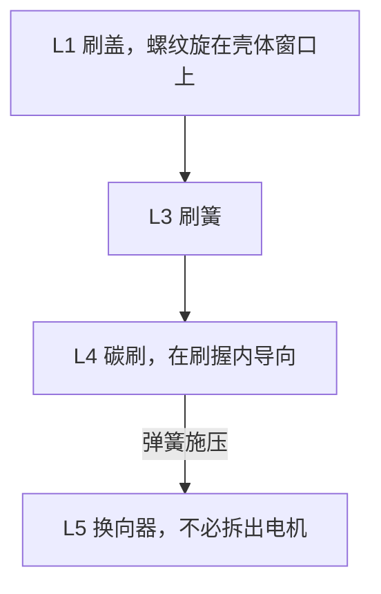

# 琢美 Dremel 4000 碳刷窗：两侧旋下刷盖，弹簧把碳刷压向换向器，不必拆电机

> [!summary] 一句话概述
> 琢美 Dremel 4000 在机身两侧各开一个碳刷窗：用随机扳手当螺丝刀，逆时针旋下刷盖，即可沿刷握抽出带弹簧的碳刷，不必拆开整只电机或电枢；装回时弹簧把碳刷弧面压向换向器，刷盖拧到与壳体齐平。碳刷短于 1/8 英寸或与换向器接触的端面粗糙、有凹坑时就要更换，而且通常要成对更换。

## 配图

![[附件/dremel-catalog-4000-brush-cap.jpg]]
*图源：[琢美 2025–2026 产品目录](https://ptoeuxdevfilestore.blob.core.windows.net/dremel/2025%E7%90%A2%E7%BE%8E%E7%9B%AE%E5%BD%950121.pdf) 中「图示为 Dremel 4000」的整机标注；g. 碳刷盖，说明为「旋拧后可以对碳刷进行更换」*

![[附件/dremel-4000-brush-cap-figs.jpg]]
*图源：[Dremel 4000 英文说明书 Maintenance Information（DM 2610005595，2009-05）](https://www.dremel.com/storage/en-us/4000-1-26-54254-original%24pdf-19315-en-us.pdf) 第 12 页图 C、图 D；图 C 用随机扳手逆时针拧刷盖，图 D 分解出刷盖、刷簧和碳刷，并注明碳刷弧面须与壳体曲率（说明书正文则写与换向器曲率）匹配*

> 图片版权归原作者所有，仅作个人学习收藏；出处见文末「来源与核实记录」。

## 结构原理

> 本节所有数字只写来源里给出的；来源没有就写「来源未给出」，不估算、不换算成看似精确的值。

### 堆叠方案

方向：**从机身外侧的刷盖到电机换向器**

| 层级 | 零件 | 材料 | 厚度/尺寸 | 固定方式 | 依据 |
| --- | --- | --- | --- | --- | --- |
| L1（最外） | 刷盖（brush cap），机身每侧各一 | 来源未给出 | 拧紧后应与工具壳体齐平；不要过紧（第二来源） | 螺纹旋入壳体上的碳刷窗 | 英文说明书图 C；eReplacementParts：Do not over-tighten the brush cap |
| L2 | 碳刷窗 / 刷握（brush holder） | 来源未给出 | 来源未给出孔径与深度 | 碳刷组件从窗口滑入滑出 | eReplacementParts：slide out of / into the holder |
| L3 | 刷簧（brush spring） | eReplacementParts 写为铜质弹簧圈（copper spring-coil），与碳刷连成一组 | 来源未给出线径与弹力 | 一端连在碳刷上，装入后被刷盖压住，把碳刷推向换向器 | 英文说明书：pulling on the spring that is attached to the carbon brush；eReplacementParts |
| L4 | 碳刷（carbon brush） | 碳；具体牌号来源未给出 | 与换向器接触的工作段若短于 1/8"，或端面粗糙、有凹坑，即应更换 | 在刷握内导向，弧面朝向换向器 | 英文说明书图 D 与更换判据 |
| L5 | 换向器 / 电枢（commutator / armature） | 来源未给出 | 来源未给出直径 | 碳刷在其表面滑动导电；本维修路径不必把电枢拆出 | 英文说明书；eReplacementParts：firmly holding the carbon brush against the armature's commutator |

剖面示意：

说明书图 D 的标注写「CURVED END OF BRUSH MUST MATCH CURVATURE OF HOUSING」，同页正文则写「The curved surface of the brush must match the curvature of the commutator」。本文把图注和正文一并记下，不以其中一句覆盖另一句。两边碳刷通常不会同时磨完，但若一侧已到限，两边都要换。

### 零件清单

| 零件 | 数量 | 功能 | 材料 | 依据 |
| --- | --- | --- | --- | --- |
| 刷盖 | 2（机身两侧各 1） | 封闭碳刷窗并把刷簧留在位 | 来源未给出 | 英文说明书；目录标注碳刷盖 |
| 刷簧 | 2 | 把碳刷压向换向器，并作为取出碳刷的拉手 | eReplacementParts：铜质弹簧圈 | 说明书图 D；eReplacementParts |
| 碳刷 | 2 | 向旋转的换向器馈电，属磨损件 | 碳 | 说明书；目录「更换碳刷，快速方便」 |
| 刷握 / 碳刷通道 | 2 | 给碳刷导向 | 来源未给出 | eReplacementParts：brush holder |
| 随机扳手 | 1 | 当螺丝刀用，逆时针拧刷盖 | 来源未给出 | 说明书：Use the tool wrench as a screwdriver |

### 装配顺序

按原厂说明书「Maintenance of replaceable brushes on model 4000」（拆前先断电）。若只看到拆解描述，下面第 5–6 步按原文装回说明，不是猜测。

1. 拔掉电源插头，把工具放在干净表面上。
2. 用随机扳手当螺丝刀，逆时针旋下刷盖（图 C）。eReplacementParts 同样写用螺丝刀拧下刷盖。
3. 拉住连在碳刷上的弹簧，把碳刷从工具里取出。eReplacementParts 补充：整组碳刷和弹簧应从刷握中滑出。
4. 检查两边：若碳刷短于 1/8"，或与换向器接触的端面粗糙、有凹坑，则更换。若一侧已磨完，两边都换，并只用原厂替换刷。
5. 按图装回：碳刷弧面须与换向器曲率匹配（正文）；确认刷盖与壳体齐平。eReplacementParts 提醒刷盖不要过紧。
6. 换好后把工具放在干净表面上，空载全速运行约 5 分钟，让碳刷磨合（seat），再带负载使用。新工具首次使用前，说明书也要求同样做一次 5 分钟空载磨合。

目录只说明「旋拧后可以对碳刷进行更换」，没有另给螺纹规格或扭矩。

### 受力与运动分析

- **受力路径**：刷簧把碳刷压在换向器上，构成电接触；电机旋转时碳刷在换向器表面滑动并逐渐磨损。刷盖把弹簧留在刷握里，并封闭窗口。
- **运动关系**：碳刷在刷握内沿径向（相对电枢轴线）滑动，以补偿磨损；刷盖相对壳体只有旋入/旋出。电枢本身在这条维修路径里不拆。
- **失效风险**：继续在碳刷过短或端面已坑化的状态下使用，说明书警告会永久损坏工具。刷盖拧得过紧可能损坏盖或窗口（eReplacementParts 提出，原厂只要求齐平）。碳刷方向装反、弧面不贴合，接触不良（说明书要求按图安装）。只换一侧会导致两边长度不一致。

## 设计要点与参数

| 要点 | 内容 | 依据 |
| --- | --- | --- |
| 入口形式 | 机身两侧可旋开的碳刷盖，旋拧后即可换刷 | 琢美中文目录 g. 碳刷盖；英文说明书图 C |
| 取出方式 | 拉住连在碳刷上的弹簧，整组从刷握滑出 | 英文说明书步骤 2；eReplacementParts |
| 更换判据 | 短于 1/8"，或接触端面粗糙、有凹坑 | 英文说明书 |
| 成对更换 | 两边通常不是同时磨完；一侧到限则两边都换 | 英文说明书 |
| 刷盖安装 | 与壳体齐平；不要过紧 | 说明书；eReplacementParts |
| 磨合 | 空载全速约 5 分钟 | 英文说明书（新机准备与更换后各一次） |
| 检查周期 | 建议每 40–50 小时检查一次；连续使用时应更频繁检查 | 英文说明书 |
| 弹簧作用 | 向换向器施压，并把电传到碳刷 | eReplacementParts |
| 刷盖螺纹规格、弹簧弹力、刷握孔径 | 来源未给出 | — |

## 优缺点

**优点**
- 用户打开两侧窗口就能换最主要的磨损件，不必拆壳体、不必抽出电枢。
- 弹簧与碳刷连成一组，取出时有明确抓手，装回路径短。
- 原厂给出了可执行的长度判据（1/8"）和磨合时间，而不是只写「记得定期换碳刷」。

**缺点 / 代价**
- 有刷电机本身就要为碳刷留窗口、刷握和密封，壳体侧壁被开孔。
- 刷盖若松会掉、若过紧可能损坏；公开资料没有扭矩值。
- 图注写「与壳体曲率匹配」、正文写「与换向器曲率匹配」，说明这一弧面既要过窗口也要贴换向器，装配时仍可能装反。
- 无刷电机没有这条路径；本结构只适用于仍用碳刷换向的机型。

## 可借鉴点

- 把易损的电接触件做成「窗口 + 可旋盖 + 带簧的滑出组件」，维修时不要强迫用户拆整只电机。
- 给磨损件一个可测量的报废尺寸（本例 1/8"），并写明成对更换，避免只换一侧。
- 刷盖的终止条件用「与壳体齐平」这种视觉判据，比只写「拧紧」更安全；同时提醒不要过紧。
- 换刷后安排一次空载磨合，让弧面重新贴合换向器，再带载。
- 图和正文对「弧面贴什么」要一致，避免装配工按错参照面。

## 与库中相似案例对比

| 对比项 | 本案例（Dremel 4000 碳刷窗） | [[Fairphone 6 螺丝模块化（屏、电池、摄像头、USB-C）]] | [[Framework Desktop 免工具面板与标准件模块化]] | [[Valve Steam Deck OLED 可维修改版：金属螺纹柱、T6 Torx 与电池撬卡槽]] |
| --- | --- | --- | --- | --- |
| 维修对象 | 电机碳刷这一易损件 | 整机的屏、电池、摄像头等模块 | 台式机面板与标准件模块 | 整机内部电池与螺丝路径 |
| 是否拆整机 | 不必拆电机或电枢，只开两侧刷盖 | 要打开相应模块 | 要打开面板 | 要开壳 |
| 保持方式 | 螺纹刷盖 + 弹簧施压 | 螺丝固定模块 | 免工具面板 + 标准件 | T6 螺丝、金属螺纹柱 |
| 磨损判据 | 碳刷长度 1/8" 与端面状态 | 不以碳刷长度为据 | 同左 | 同左 |
| 分类取舍 | 放在 06：它是为可维修而开的结构窗口 | 06，整机模块化 | 06 | 06 |

## 相关案例

- [[Fairphone 6 螺丝模块化（屏、电池、摄像头、USB-C）]]
- [[Framework Desktop 免工具面板与标准件模块化]]
- [[Valve Steam Deck OLED 可维修改版：金属螺纹柱、T6 Torx 与电池撬卡槽]]
- [[电动工具电池包：滑轨插入与按压锁舌（得伟拆解）]]
- 分类索引：[[06-拆解与可维修 索引]]

## 来源与核实记录

- 主来源：[琢美 2025–2026 产品目录](https://ptoeuxdevfilestore.blob.core.windows.net/dremel/2025%E7%90%A2%E7%BE%8E%E7%9B%AE%E5%BD%950121.pdf)（博世电动工具（中国）有限公司 / 琢美。Dremel 4000 整机标注「g. 碳刷盖：旋拧后可以对碳刷进行更换」，并写「更换碳刷，快速方便」。产品编号 F0134000RA）
- 补充来源 1：[Dremel 4000 Operating/Safety Instructions，文件 DM 2610005595 05-09](https://www.dremel.com/storage/en-us/4000-1-26-54254-original%24pdf-19315-en-us.pdf)（2009-05；第 12 页 Carbon Brushes 与图 C、图 D：扳手逆时针拧盖、拉弹簧取刷、1/8" 判据、成对更换、齐平、空载 5 分钟、每 40–50 小时检查。与目录同属 Dremel/Bosch，不另计机构）
- 补充来源 2：[eReplacementParts: How to Replace the Brush and Spring on a Dremel Rotary Tool (Model 4000)](https://www.ereplacementparts.com/repair/how-to-replace-the-brush-and-spring-on-a-dremel-rotary-tool-(model-4000)/)（独立第二机构。碳刷与铜质弹簧圈组成一组、弹簧把碳刷压在换向器上、从刷握滑出/滑入、刷盖不要过紧）
- 核实：2026-11-22 下载目录与英文说明书并打开 eReplacementParts 页面。亚太区多语说明书里的中文「维护」节未展开碳刷步骤，故步骤以英文原厂说明书为准。未把「记得定期换碳刷」的保养文当成结构来源。
