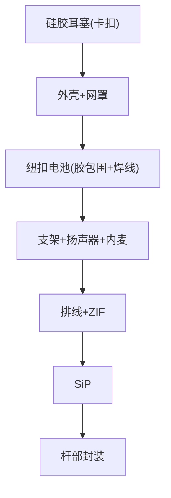

# 苹果 AirPods Pro 全胶粘封装（反面案例）

> [!summary] 一句话概述
> AirPods Pro 耳机体内用一圈耐酒精的白色橡胶状胶把纽扣电池「包」起来，电池再用焊接线连接；杆部只能用超声波切割才能打开——0/10 的可维修分，是微型化与可维修冲突的典型。

## 配图

![[附件/airpods-pro-glue.jpg]]
*iFixit：耳机内部的胶与纽扣电池*

![[附件/airpods-pro-case.jpg]]
*iFixit：用台钳撬开充电盒*

> 图片版权归原作者所有，仅作个人学习收藏；出处见文末「来源与核实记录」。

## 结构原理

> 本节数字只写来源里给出的；来源没有就写「来源未给出」。

### 堆叠方案

方向：**耳机：从耳侧到杆部**

| 层级 | 零件 | 材料 | 厚度/尺寸 | 固定方式 | 依据 |
| --- | --- | --- | --- | --- | --- |
| L1 | 可拆硅胶耳塞 | 硅胶 | 来源未给出 | 卡扣式，咔哒一声装上 | Step 6 |
| L2 | 外壳（含网罩） | 塑料 | 来源未给出 | 胶粘 | Step 4、7 |
| L3 | 纽扣电池 | — | 来源未给出 | 被白色橡胶状胶包围，焊线连接 | Step 7-8 |
| L4 | 透明塑料支架 + 扬声器单元 + 内向麦克风 | — | 来源未给出 | 支架固定单元 | Step 9 |
| L5 | 排线（留余量）+ ZIF 小连接器 | — | 来源未给出 | 可拆连接 | Step 7 |
| L6 | SiP（H1 等）+ 同轴连接器 | — | 来源未给出 | — | Step 10 |
| L7 | 杆部：麦克风、天线、疑似力传感器 | — | 来源未给出 | 整体封装，需超声切割 | Step 11-12 |

剖面示意：

### 零件清单

| 零件 | 数量 | 功能 | 材料 | 依据 |
| --- | --- | --- | --- | --- |
| 耳塞 | 2 | 密封耳道，可换 | 硅胶 | Step 6 |
| 纽扣电池 | 每耳 1 | 供电 | — | Step 7 |
| 充电盒电池 | 2 芯，合计 1.98 Wh | 供电 | — | Step 15 |
| 胶粘剂 | — | 固定/封装 | 白色、橡胶状、耐酒精 | Step 8 |

### 装配顺序

1. (按拆解顺序反推) 杆部组件整体封装
2. SiP、排线（带余量）与 ZIF 连接
3. 扬声器单元由透明支架固定
4. 纽扣电池焊线连接后灌/涂胶
5. 合壳胶粘，装耳塞

> 来源只给出（破坏性）拆解顺序，以上为反推。

### 受力与运动分析

- **受力路径**：来源未讨论受力。
- **运动关系**：无相对运动；耳塞为可拆卡扣件。
- **失效风险**：电池会老化但无法更换；苹果表示 AirPods Pro 不可维修、只能更换（Step 16）。

## 设计要点与参数

| 要点 | 内容 | 依据 |
| --- | --- | --- |
| 单耳重量 | 5.4 g | Step 1 |
| 充电盒重量 | 45.6 g | Step 1 |
| 充电盒电池 | 1.98 Wh（2 芯） | Step 15 |
| 防水 | IPX4 | Step 1 |
| 可维修评分 | 0/10 | Step 17 |
| 胶层厚度 | 来源未给出 | — |

## 优缺点

**优点**
- 极致紧凑，IPX4
- 耳塞卡扣可换；排线留余量 + ZIF 连接，内部局部有可拆考虑

**缺点 / 代价**
- 电池胶包+焊接，不可换
- 杆部无非破坏性入口

## 可借鉴点

- 对照学习：微型化产品至少给电池留可拆连接（如压接/连接器）
- 耳塞这类易耗件用卡扣可换，值得保留

## 相关案例

- [[GoPro Hero4 Session 免外壳防水机身]]
- [[微软 Surface Laptop 超声波点焊与 Alcantara 覆面（反面案例）]]
- [[Framework 笔记本模块化扩展卡与磁吸边框]]
- 分类索引：[[06-拆解与可维修 索引]]

## 来源与核实记录

- 主来源：[AirPods Pro Teardown](https://www.ifixit.com/Teardown/AirPods+Pro+Teardown/127551)（2019-10-31，Jeff Suovanen / iFixit）
- 核实：2026-11-13 通过 iFixit API 读取 17 步原文，核对胶粘、电池、重量与评分。
