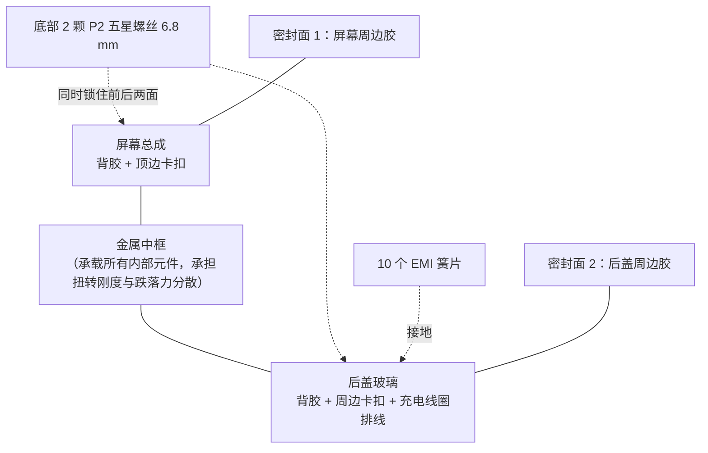

# 苹果 iPhone 14 双面可开：中框承力与前后两道密封

> [!summary] 一句话概述
> iPhone X 到 13 的后盖玻璃胶得极牢，还焊着镜头装饰圈，换后盖几乎要拆光整机、用激光烧胶再刮碎玻璃。iPhone 14（标准版）改了内部架构：**屏幕后面加了一块金属中框，所有内部元件装在中框上**，于是屏幕可以从正面打开，后盖可以从背面打开；**拧下充电口两侧同样两颗 6.8 mm 五星螺丝，前后都能开**，后盖只靠这两颗螺丝、一个排线连接器和较弱的背胶固定。代价是密封周长约翻倍，还需要 10 个 EMI 簧片接触后盖来替代原来的焊接接地。iFixit 把它的可维修评分提到 7/10，是 iPhone 7 之后给 iPhone 的最高分。

## 配图

![[附件/iphone14-midframe-front-open.jpg]]
*图源：[iFixit《Inside Apple's Secret iPhone 14 Redesign》](https://www.ifixit.com/News/64865/iphone-14-teardown)；屏幕从正面打开，下面就是新加的金属中框*

![[附件/iphone14-rear-glass-clips.jpg]]
*图源：同上；后盖玻璃打开时的缝隙，可见后盖边缘的白色卡扣*

![[附件/iphone14-rear-open-internals.jpg]]
*图源：[iFixit iPhone 14 Rear Glass Replacement](https://www.ifixit.com/Guide/iPhone+14+Rear+Glass+Replacement/153210) 第 8 步；后盖打开后的内部，红框处是音量键旁的脆弱排线，撬片不能插入此处*

> 图片版权归原作者所有，仅作个人学习收藏；出处见文末「来源与核实记录」。

## 结构原理

> 本节数字只写来源里给出的；来源没有就写「来源未给出」。

### 堆叠方案

方向：**从正面（屏幕）到背面（后盖）**

| 层级 | 零件/区域 | 材料 | 厚度/尺寸 | 固定方式 | 依据 |
| --- | --- | --- | --- | --- | --- |
| L1 | 屏幕总成 | 玻璃 + OLED | 来源未给出 | 背胶 + 顶边两个卡扣 + 底部两颗五星螺丝 | iFixit 屏幕指南 |
| L2 | 新增金属中框 | 金属 | 来源未给出 | 与外框一体或固定（来源未细说） | iFixit 文章 |
| L3 | 主板、电池、摄像头等内部元件 | — | — | 装在中框上 | iFixit 文章 |
| L4 | 后盖玻璃（含无线充电线圈、后麦克风） | 玻璃 | 来源未给出 | 背胶（较前代弱）+ 周边卡扣 + 同两颗五星螺丝 + 1 个排线连接器 | iFixit 文章、后盖指南 |
| L5 | 接地 | EMI 簧片 | 10 个 | 簧片压在后盖接触点上 | iFixit 文章 |

剖面示意：

### 零件清单

| 零件 | 数量 | 功能 | 材料 | 依据 |
| --- | --- | --- | --- | --- |
| P2 五星螺丝 | 2 | 充电口两侧，长 6.8 mm；前后两面共用 | 钢 | 两份指南 |
| 电池连接器盖板螺丝 | 2 | Y000，长 1.3 mm | 钢 | 后盖指南 |
| 充电线圈连接器盖板螺丝 | 1 | Y000，长 1.0 mm | 钢 | 后盖指南 |
| 屏幕连接器支架螺丝 | 1 | Y000，长 0.9 mm | 钢 | 屏幕指南 |
| 前置传感器连接器支架螺丝 | 1 | Y000，长 0.9 mm | 钢 | 屏幕指南 |
| 传感器总成支架螺丝 | 2 | Y000，长 1.4 mm | 钢 | 屏幕指南 |
| 后盖卡扣 | 周边多个 | 定位与卡紧；装回时先对齐顶边 | — | 后盖指南 |
| 连接器硅胶密封圈 | 每个板对板连接器一圈 | 额外防水防尘 | 黑色硅胶 | 后盖指南第 17 步 |
| EMI 簧片 | 10 | 后盖接地，替代焊接 | 金属 | iFixit 文章 |

### 装配顺序

> 以下按 iFixit 拆解步骤倒序整理为装配视角：

1. 装回后盖时，先把后盖放到位，**对齐顶边卡扣先压顶边，再按下其余部分**；按不进去就检查卡扣是否弯了（后盖指南第 14 步）。
2. 接上充电线圈排线，装充电线圈连接器盖板（1 颗 1.0 mm Y000）。
3. 接上电池，装电池连接器盖板（2 颗 1.3 mm Y000；盖板先挂上方卡钩）。此时可开机测试后再密封。
4. 拆卸时撬片插入深度不超过 3 mm，否则会伤到内部元件；右侧音量键旁有脆弱排线，摄像头附近要避开（后盖指南）。
5. 最后锁充电口两侧两颗 6.8 mm 五星螺丝（前后共用）。

### 受力与运动分析

- **刚度路径改变**：iPhone 13 跌落时，外框吸收冲击，再把力分散到胶粘的电池和牢固粘接的后盖上；iPhone 14 用新的中框承担力的分散和扭转刚度，后盖不再是主要结构件（iFixit 文章）。
- **防水**：多出一个可开启面，等于密封周长翻倍（iFixit 文章：「twice as much perimeter to seal」）。板对板连接器外再加黑色硅胶圈作为额外防护（后盖指南）。
- **射频与接地**：原来靠焊接接地，现在用 10 个 EMI 簧片接触后盖上分布的接触点（iFixit 文章）。
- **可开启的代价**：苹果为后盖做了配对（激活）要求，iFixit 对此持批评态度；iOS 18 起可用 Repair Assistant 自行配对原装后盖（后盖指南）。

## 设计要点与参数

| 要点 | 内容 | 依据 |
| --- | --- | --- |
| 可维修评分 | 7/10，iPhone 7 之后最高 | iFixit 文章 |
| 共用螺丝 | 前后都只需先拆 2 颗 P2 五星 6.8 mm 螺丝 | 两份指南 |
| 撬片深度 | ≤ 3 mm | 两份指南 |
| 加热要求 | 每条边加热到「略烫手」再划胶 | 后盖指南 |
| 后盖组成 | 后盖玻璃 + 无线充电线圈 + 后麦克风，作为一个总成更换 | 后盖指南 |
| 架构范围 | 仅 iPhone 14 / 14 Plus；14 Pro / Pro Max 仍为旧架构 | iFixit 文章 |
| 前序铺垫 | iPhone 13 Pro 已把听筒与前摄从屏幕总成移到主框架 | iFixit 文章 |
| 历史对比 | iPhone 3G 从正面开，iPhone 4 从背面开，iPhone 5 起回到正面开；三星自 Galaxy S6 起背面胶粘、从背面开 | iFixit 文章 |

## 优缺点

**优点**
- 屏幕和后盖两个最常坏的外观件都能单独更换
- 后盖维修不再需要激光去胶和刮碎玻璃
- 内部元件集中到中框，前后两面互不依赖

**缺点 / 代价**
- 密封周长翻倍，防水设计难度上升
- 需要额外的 EMI 接地簧片和射频重新设计
- 软件配对仍限制第三方零件（iFixit 观点）

## 可借鉴点

- **加一块中框，把「结构 + 安装基准」从外观件里剥离出来**，外观件就可以做成可更换的盖板
- **前后共用同一组锁紧螺丝**，减少维修步骤
- **卡扣 + 弱胶组合**：卡扣负责定位和保持，胶负责密封，胶不必做到极强
- **连接器外圈加硅胶密封**，作为整机密封之外的第二道防线
- 维修指南里的「撬片 ≤ 3 mm」本质是结构内部离边缘的安全距离，设计时可以把脆弱排线避开边缘 3 mm 以上（推断）

## 与库中相似案例对比

| 对比项 | 本案例 | [[苹果 iPhone 16 电解脱粘电池胶]] | [[Fairphone 5 卡扣后盖与免胶可换电池]] | [[苹果 iPhone 7 首代 IP67：逐个开口封堵与气压平衡阀]] |
| --- | --- | --- | --- | --- |
| 可维修改进点 | 整机架构：双面可开 | 电池胶：通电脱粘 | 后盖卡扣 + 免胶电池 | — |
| 防水等级 | 来源未给出 | 见该案例 | IP55（见该案例） | IP67 |
| 打开后盖的方式 | 加热 + 撬片 + 卡扣 | 见该案例 | 徒手撬开卡扣 | 从正面开 |
| 共同点 | 都在「防水」和「可拆」之间找平衡 | — | — | 开口逐个密封 |

## 相关案例

- [[苹果 iPhone 16 电解脱粘电池胶]]
- [[苹果 iPhone 7 首代 IP67：逐个开口封堵与气压平衡阀]]
- [[Fairphone 5 卡扣后盖与免胶可换电池]]
- [[苹果 AirPods Pro 全胶粘封装（反面案例）]]
- 分类索引：[[06-拆解与可维修 索引]]

## 来源与核实记录

- 主来源：[Inside Apple's Secret iPhone 14 Redesign](https://www.ifixit.com/News/64865/iphone-14-teardown)（iFixit，Kyle Wiens，2022-09-16）
- 补充来源 1：[iPhone 14 Rear Glass Replacement](https://www.ifixit.com/Guide/iPhone+14+Rear+Glass+Replacement/153210)（iFixit 指南，Tobias Isakeit，A2882）
- 补充来源 2：[iPhone 14 Screen Replacement](https://www.ifixit.com/Guide/iPhone+14+Screen+Replacement/152975)（iFixit 指南，Tobias Isakeit）
- 核实：2026-11-13 打开文章全文，并通过 iFixit API 读取两份指南全部步骤核对螺丝长度与数量。The Verge 同题报道（2022-09-19）检索到但正文未成功抓取，未引用。
