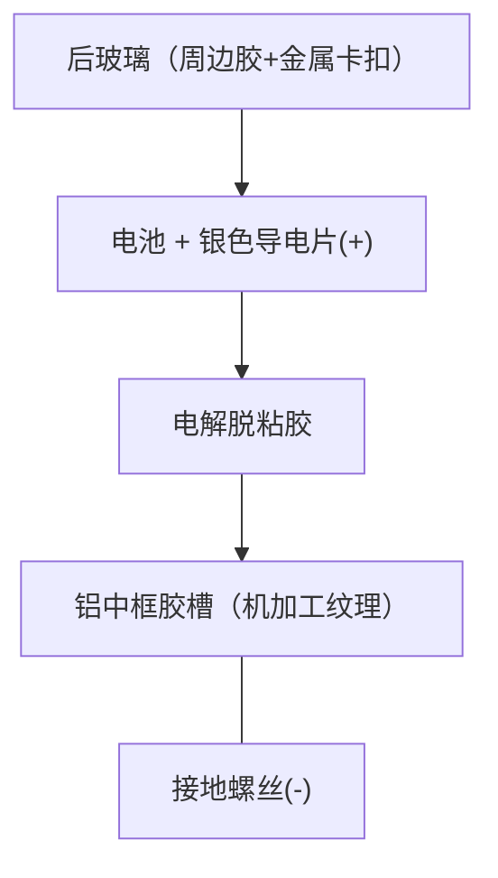

# 苹果 iPhone 16 电解脱粘电池胶

> [!summary] 一句话概述
> iPhone 16/16 Plus 不再用易脆的拉胶条固定电池，而是用一种通电即脱粘的胶：把电池底边的银色导电片接正极、机内接地螺丝接负极，加 9 V 约 90 秒，胶与铝中框的界面被电化学「氧化脱开」，电池即可无力取出——把「胶粘」从不可维修变成可重复、可预期的拆卸工艺。

> [!note] 与已收录案例的区别
> [[苹果 AirPods Pro 全胶粘封装（反面案例）]] 是胶粘导致不可拆；本篇是**可按需解除的胶粘**，属于胶粘的正面改进。

## 配图

![[附件/iphone16-battery-9v-debond.jpg]]
*图源：iFixit 新闻 We Hot-Wired the iPhone 16 转引的苹果官方 iPhone 16 电池维修手册配图：9 V 电池 + 鳄鱼夹，计时 1:30*

![[附件/iphone16-frame-adhesive-well.jpg]]
*图源：同上；Evident 显微镜下的中框电池胶槽，机加工出的纹路与粗糙面供胶附着*

> 图片版权归原作者所有，仅作个人学习收藏；出处见文末「来源与核实记录」。

## 结构原理

> 本节数字只写来源里给出的；来源没有就写「来源未给出」。

### 堆叠方案

方向：**从后玻璃向屏幕方向**（电池区域）

| 层级 | 零件 | 材料 | 厚度/尺寸 | 固定方式 | 依据 |
| --- | --- | --- | --- | --- | --- |
| L1 | 后玻璃 | 玻璃 | 来源未给出 | 周边胶 + 金属卡扣；指南提示撬片不要插入超过 3 mm | 指南 Step 8–13 |
| L2 | 电池（无拉胶条），底边带银色导电片 | 锂电池 | 来源未给出 | — | 新闻；指南 Step 20 |
| L3 | 电解脱粘胶层 | 导电电解胶（具体成分来源未给出） | 来源未给出 | 夹在电池与中框之间，电池侧带粉色离型纸 | 新闻 |
| L4 | 中框胶槽 | 铝 | 来源未给出 | 机加工出纹路与粗糙面供胶附着 | 新闻（显微照片） |

剖面示意：

### 零件清单

| 零件 | 数量 | 功能 | 材料 | 依据 |
| --- | --- | --- | --- | --- |
| 电池银色导电片 | 1 | 正极接入点（接红色鳄鱼夹） | 金属 | 指南 Step 20、22 |
| 接地螺丝 | 1 | 负极接入点（位置：来源图示，文字未写明） | 金属 | 指南 Step 23 |
| 电解脱粘胶 | 1 层 | 固定电池，通电后脱粘 | iFixit 高度确信为 Tesa「Debonding on Demand — Electrical Release」 | 新闻 |
| 中框胶槽 | 1 | 容纳胶层，提供附着纹理 | 铝 | 新闻 |

### 装配顺序

按拆解顺序反推（维修更换时）：
1. 清理中框残胶：大块用镊子撕掉，余下用浓度 > 90% 的异丙醇擦净。
2. 新电池若未预贴胶，按旧电池对照贴胶并撕离型纸（苹果手册描述撕粉色离型纸）。
3. 放入新电池并压紧（具体对位步骤见指南后半部分，本次未逐步核对）。
4. 装回后玻璃。

> 拆卸：断开电池 → 揭起银色导电片 → 红夹接导电片、黑夹接地螺丝 → 通电约 90 秒 → 断电后抓导电片取出电池。

### 受力与运动分析

- **受力路径**：日常使用时电池由胶层与中框胶槽的粘接承载。
- **脱粘机理**（iFixit 引用的论文解释）：阳极脱层——铝基材表面被氧化，Al³⁺ 迁移进胶层，胶与被氧化的那一面失去支撑而快速脱开；胶会留在接正极的一侧。
- **极性**：正确极性时残胶留在电池上、中框干净；接反也能脱粘，但残胶留在中框上；反接不能让胶重新粘合，胶不是可重复使用的。
- **失效风险**：苹果手册提示胶随时间老化可能需要更长时间脱粘；红夹不能碰到其他金属面以免短路。

## 设计要点与参数

| 要点 | 内容 | 依据 |
| --- | --- | --- |
| 苹果推荐 | 9 V 电池通电 90 秒 | 指南简介；新闻 |
| 可用电压 | 5–20 V 电源/充电宝均可（时间不同）；苹果称最高可用 30 V | 指南简介；新闻 |
| iFixit 实测 | 12 V 约 60 秒取出；20 V 约 5 秒；5 V 略超 6 分钟 | 新闻 |
| 极性 | 正极接电池导电片，残胶留在电池侧 | 新闻；指南 Step 22–23 |
| 中框表面 | 胶槽机加工出纹路和粗糙面 | 新闻 |
| 适用机型 | 16 / 16 Plus 用新胶；16 Pro / Pro Max 仍用拉胶条（Pro 电池为钢壳） | 新闻 |
| 胶层厚度、剥离强度 | 来源未给出 | — |

## 优缺点

**优点**
- 拆电池不再依赖易断的拉胶条或溶剂，过程一致、可重复
- 工具门槛低：9 V 电池 + 导线即可，非专有工具
- 胶槽纹理 + 极性控制让残胶留在旧电池上，中框易清理

**缺点 / 代价**
- 需要电源和接线，维修者要注意极性与短路
- 胶不可复用，更换需新胶（iFixit 推测新电池会预贴胶）；胶老化后的脱粘时间未知
- iFixit 仍更希望用螺丝等更易逆的紧固方式

## 可借鉴点

- 「必须粘」又「必须可维修」的零件，可以设计成**按需脱粘**：预留电极接入点（导电片 + 接地螺丝）
- 让胶层与金属基材的哪一侧脱开可通过极性/表面处理设计，从而控制残胶位置
- 粘接面机加工纹理，提高粘接强度的同时保证脱粘界面可控（推断）

## 相关案例

- [[苹果 AirPods Pro 全胶粘封装（反面案例）]]
- [[Fairphone 5 卡扣后盖与免胶可换电池]]
- [[微软 Surface Laptop 超声波点焊与 Alcantara 覆面（反面案例）]]
- 分类索引：[[06-拆解与可维修 索引]]

## 来源与核实记录

- 主来源：[We Hot-Wired the iPhone 16](https://www.ifixit.com/News/100352/we-hot-wired-the-iphone-16)（iFixit 新闻，2024-09-22，Kyle Wiens）
- 补充来源：[iPhone 16 Battery Replacement](https://www.ifixit.com/Guide/iPhone+16+Battery+Replacement/177286)（iFixit 指南，Alex Diaz-Kokaisl）
- 核实：2026-11-13 打开新闻全文核对电压/时间、极性、机理、胶槽显微照片；通过 iFixit API 读取指南简介与 Step 8–29 核对导电片、接地螺丝、清胶步骤。
